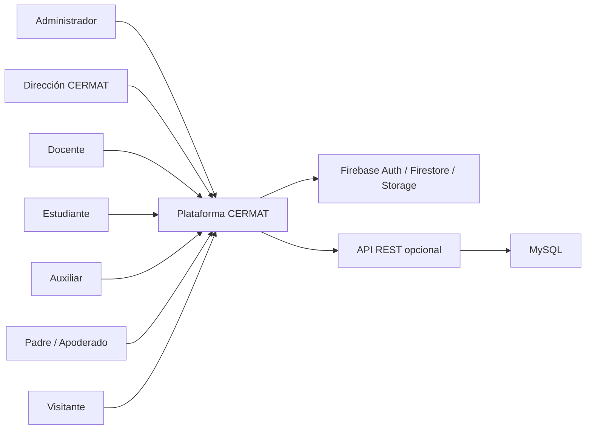
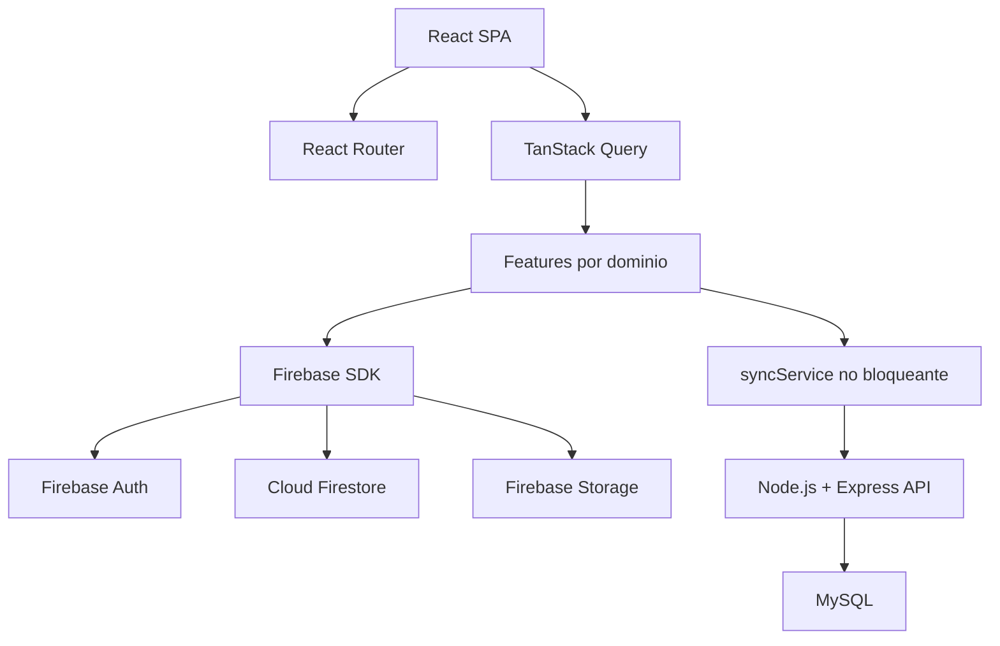

# Brief EPE — Plataforma Web Integral CERMAT

!!! abstract "Tipo de proyecto"
    Este documento corresponde a un proyecto de tipo **EPE (Evaluación de Perfil de Egreso)**, el nivel de mayor exigencia académica. El problema es real, los actores son verificables y el sistema está implementado y funcional.

## 1. Información general

| Campo | Detalle |
|---|---|
| Nombre del proyecto | Plataforma Web Integral de Gestión Académica CERMAT |
| Tipo | [ ] PS &nbsp;&nbsp; [ ] PI &nbsp;&nbsp; [x] EPE |
| Curso / Ciclo | Perfil de Egreso - Integración de evidencias profesionales (9° ciclo) |
| Equipo | David Robert Yucra Mamani (líder), Gladys Rosaura Yana Pari, Denilson Leeke Mamani Flores, Cárdenas Vilca Rennzo |
| Fecha | 2026-06-22 (actualizado el 2026-10-24) |

## 2. Problema

!!! danger "Problema real — evidencia EPE"
    El problema es real, verificable en el contexto de una institución educativa activa en Azángaro, Perú. El sistema desarrollado responde a necesidades operativas concretas identificadas con los actores involucrados.

La Academia La Prepa Cermat requiere una plataforma digital integral para administrar de forma centralizada su oferta académica, matrículas, alumnos, docentes, auxiliares, asistencia, pagos, recursos, talleres, sedes, contenidos públicos y comunicación con padres.

Antes del sistema, los procesos académicos y administrativos tienden a depender de canales dispersos: formularios no integrados, gestión manual de alumnos, control de asistencia poco trazable, seguimiento de pagos separado de la matrícula, información pública difícil de mantener y ausencia de portales diferenciados por rol. Esto genera duplicidad de datos, baja visibilidad operativa, riesgo de errores en cupos y matrículas, demora en la atención a padres y poca trazabilidad para decisiones administrativas.

Como proyecto **EPE**, el problema es real, verificable en el contexto de una institución educativa y sustentado por los actores, módulos y reglas implementadas en el repositorio:

- Administración de ciclos, sedes, grupos, recursos, docentes, alumnos, pagos, talleres y asistencia.
- Matrícula pública conectada con el flujo interno de aprobación y activación.
- Portales por rol para administradores, docentes, estudiantes, auxiliares y padres.
- Reglas de seguridad en Firestore para proteger operaciones según rol.
- Sincronización opcional hacia MySQL para analítica, reportes y continuidad operativa.

## 3. Contexto y Stakeholders

### Organización / entorno

La plataforma opera en el entorno de la **Academia La Prepa Cermat**, una institución educativa que ofrece ciclos académicos, talleres, recursos formativos y servicios de seguimiento a estudiantes y padres.

El sistema funciona como una aplicación web SPA, con datos operativos en Firebase y un backend Node.js + MySQL complementario para integración y reportes.

### Usuarios / actores

| Stakeholder | Rol | Necesidad principal | Impacto esperado |
|---|---|---|---|
| Dirección / administración CERMAT | Responsable institucional | Controlar ciclos, grupos, matrículas, pagos, sedes, docentes, auxiliares y contenidos. | Mayor trazabilidad, reducción de trabajo manual y mejor visibilidad operativa. |
| Administrador del sistema | Usuario operativo interno | Gestionar información académica, usuarios, pagos, asistencia y publicaciones. | Operación centralizada con permisos de alto nivel. |
| Docente | Usuario académico | Consultar cursos, alumnos, recursos y registrar asistencia mediante QR. | Mejor control de clases y seguimiento académico. |
| Estudiante | Usuario final | Ver cursos, recursos, estado de matrícula, talleres y asistencia. | Experiencia académica personalizada. |
| Auxiliar | Soporte operativo | Supervisar asistencia y validar QR de estudiantes y docentes. | Control presencial más rápido y trazable. |
| Padre / apoderado | Consulta externa | Ver asistencia de su hijo mediante código CERMAT. | Transparencia y seguimiento familiar. |
| Visitante / postulante | Usuario público | Revisar ciclos, sedes, blog, talleres, recursos y registrar matrícula. | Conversión de interesados en matrículas. |
| Equipo técnico | Desarrollo y mantenimiento | Mantener una arquitectura modular, segura y escalable. | Evolución controlada del sistema. |

### Mapa de stakeholders

## 4. Objetivo del sistema

Implementar una plataforma web integral que centralice la gestión académica, administrativa y comunicacional de CERMAT, permitiendo administrar ciclos, grupos, matrículas, pagos, usuarios, asistencia, recursos, talleres, sedes y contenidos públicos con portales diferenciados por rol y reglas de seguridad basadas en permisos.

### Objetivo medible EPE

Reducir la fragmentación operativa mediante un sistema único que:

- Centralice los principales procesos académicos y administrativos.
- Permita la matrícula pública y la gestión interna de estados.
- Controle la asistencia de estudiantes y docentes mediante QR.
- Exponga información pública actualizable desde la administración.
- Mantenga la trazabilidad de pagos, usuarios, grupos y recursos.
- Proteja los datos por rol mediante Firebase Authentication y Firestore Rules.

## 5. Alcance

### Incluye

- Sitio público institucional: inicio, ciclos, sedes, blog, recursos, talleres, contacto y matrícula.
- Gestión académica: ciclos, categorías, sedes, grupos, cupos, modalidad, turnos y horarios.
- Matrícula en línea: registro público, validación de ciclo y grupo, seguimiento y estados.
- Gestión de pagos: registro, método de pago, cuotas, comprobantes, cancelación lógica y resumen administrativo.
- Gestión de usuarios: administradores, docentes, estudiantes y auxiliares.
- Activación de cuentas por invitación para estudiantes, docentes y auxiliares.
- Portal administrativo completo.
- Portal docente con cursos, recursos y asistencia.
- Portal estudiante con cursos, recursos, matrícula, talleres y asistencia.
- Portal auxiliar para supervisión de asistencia.
- Consulta de asistencia para padres mediante código CERMAT.
- Gestión de recursos, blog, talleres y contenido del sitio.
- Reglas de seguridad de Firestore por rol y colección.
- Sincronización opcional hacia API REST + MySQL para asistencia, pagos y matrículas.

### No incluye

- Aplicación móvil nativa.
- Pasarela de pagos automatizada con bancos o proveedores externos.
- Facturación electrónica integrada.
- Envío masivo de notificaciones push.
- Inteligencia artificial predictiva avanzada.
- Integración directa con sistemas gubernamentales o ERP externos.
- Gestión contable completa fuera del alcance académico.

### Supuestos

- Los usuarios administradores poseen credenciales y permisos configurados en Firebase.
- Firestore es la fuente principal para la operación web.
- MySQL funciona como almacenamiento complementario cuando la API REST está habilitada.
- Los procesos de validación institucional, pagos y estados finales dependen de administradores autorizados.

## 6. Datos

### Entidades principales

| Entidad | Propósito |
|---|---|
| `users` | Perfiles, roles, docentes, estudiantes, auxiliares y códigos de padres. |
| `cycles` | Ciclos académicos publicados o internos. |
| `cycleCategories` | Niveles y categorías académicas. |
| `campuses` | Sedes. |
| `groups` | Grupos por ciclo, sede, turno, horario, docente y cupo. |
| `enrollments` | Matrículas, estados, pagos esperados y datos del estudiante. |
| `payments` | Pagos registrados por matrícula. |
| `attendanceTokens` | Tokens diarios para asistencia QR. |
| `attendanceLogs` | Registros de entrada y salida de estudiantes y docentes. |
| `studentQrSignatures`, `attendanceDayState` | Firma del QR permanente y estado diario de asistencia (evitan QR falsificados y dobles marcas). |
| `parentAttendance` | Vista pública resumida para padres mediante código. |
| `resources` | Recursos académicos públicos o restringidos. |
| `posts` | Blog institucional. |
| `workshops` | Talleres públicos y privados. |
| `messages` | Mensajes de contacto. |
| `config` | Configuración dinámica del sitio y servicios. |
| `invites`, `teacherInvites`, `auxiliarInvites` | Activación e invitaciones por rol. |

### Origen de datos

- Formularios públicos: matrícula, contacto y consulta.
- Panel administrativo: ciclos, sedes, recursos, blog, talleres, docentes, alumnos, pagos y configuración.
- Portales autenticados: asistencia, recursos, cursos y estado de matrícula.
- Firebase Authentication: identidad y sesión.
- Firestore: datos operativos principales.
- Firebase Storage: imágenes y archivos.
- API REST opcional: sincronización con MySQL.

### Restricciones

- Las lecturas y escrituras están restringidas por Firestore Rules.
- La matrícula pública solo permite ciclos publicados y grupos válidos.
- La asistencia requiere usuario autenticado y tokens válidos.
- Los pagos solo pueden ser administrados por usuarios admin.
- La eliminación de pagos y matrículas no es libre; se prioriza la trazabilidad.

## 7. Enfoque de solución

!!! tip "Arquitectura híbrida — visión de conjunto"
    El sistema implementa una arquitectura técnica híbrida que combina una capa cloud (Firebase) para la operación web en tiempo real con una capa local (Node.js + MySQL) para analítica, reportes y continuidad operativa.

    

    *Imagen: Arquitectura técnica híbrida de la solución CERMAT — capas de presentación, autenticación, negocio, analítica, datos e infraestructura local administrada.*

### Tipo de sistema

Sistema **transaccional web** con componentes de gestión académica, administración, portal por roles, control de asistencia QR y sincronización complementaria hacia una base de datos relacional.

### Consideraciones técnicas

| Dimensión | Decisión |
|---|---|
| Frontend | React 18 + TypeScript + Vite |
| UI | Tailwind CSS + Radix UI + shadcn/ui + Lucide |
| Navegación | React Router DOM |
| Estado remoto | TanStack React Query |
| Autenticación | Firebase Authentication |
| Base principal | Cloud Firestore |
| Archivos | Firebase Storage |
| Seguridad | Firestore Rules + guards por rol |
| Backend complementario | Node.js + Express |
| Base complementaria | MySQL |
| Despliegue SPA | Vercel: [academia-school-platform.vercel.app](https://academia-school-platform.vercel.app) (separado del sistema del colegio en cermatschool.edu.pe) |

### Arquitectura básica

### Decisiones justificadas EPE

- **Arquitectura modular por dominio:** los módulos viven en `src/features/*`, lo que facilita el mantenimiento y la trazabilidad.
- **Firestore como base operacional:** permite sincronización en tiempo real, reglas de seguridad declarativas y desarrollo ágil.
- **Roles diferenciados:** admin, docente, estudiante y auxiliar tienen rutas y permisos separados.
- **Asistencia QR:** reduce el registro manual y mejora la trazabilidad.
- **MySQL complementario:** habilita reportes, analítica y consultas relacionales sin bloquear la operación principal.

### Arquitectura por capas

| Capa | Tecnología | Responsabilidad |
|---|---|---|
| **Presentación** | React 18 + TypeScript + Vite | SPA con portales diferenciados por rol |
| **Autenticación cloud** | Firebase Authentication | Identidad, sesión y claims por rol |
| **Datos cloud** | Cloud Firestore + Firebase Storage | Base de datos operativa en tiempo real |
| **Negocio local** | Node.js + Express | API REST, validación, lógica, auditoría |
| **Analítica** | Python + FastAPI | Procesamiento de históricos, alertas y tendencias |
| **Datos local** | MySQL | Base relacional para reportes y sincronización |
| **Infraestructura** | PM2 + respaldo verificado (`backup.js` y `restore.js`) | Gestión de servicios locales y respaldo |

## 8. Viabilidad

| Dimensión | Evaluación |
|---|---|
| Técnica | Alta. El sistema ya cuenta con módulos implementados, rutas activas, reglas de Firestore, servicios por dominio y esquema MySQL complementario. |
| Tiempo | Viable como EPE porque integra evidencias desarrolladas previamente y documenta un sistema funcional con módulos existentes. |
| Recursos | Viable con un equipo pequeño de desarrollo web, Firebase, Node.js y administradores institucionales para la validación. |
| Riesgos | Dependencia de la configuración correcta de roles, reglas de Firestore, índices y calidad de los datos migrados. |
| Mitigación | Validaciones Zod, reglas de seguridad probadas en emulador, separación por rol, 90 pruebas automáticas y pipeline de CI. |

## 9. Alineación con competencias

| Competencia | Marcado | Justificación |
|---|---:|---|
| CE021 - Ingeniería de Requerimientos | X | El sistema cuenta con problema, actores, objetivos, alcance, requerimientos, prototipos, arquitectura y trazabilidad. |
| CE022 - Ingeniería de la Información | X | Gestiona entidades, colecciones, reglas de seguridad, sincronización SQL, consultas e índices. |
| CE023 - Programación | X | Implementa módulos React/TypeScript, Firebase SDK, hooks, validaciones, rutas, componentes y servicios. |
| CE024 - QA | X | Incluye 90 pruebas automáticas en 4 niveles, pipeline de CI, control de estados, reglas de seguridad probadas y restricciones de duplicidad. |

!!! success "Resultado de viabilidad"
    La viabilidad está **demostrada**: la plataforma está desplegada en [academia-school-platform.vercel.app](https://academia-school-platform.vercel.app) con Firebase, y opera en piloto (8 matrículas, 2 pagos y 7 marcas de asistencia al 2026-10-24). La capa relacional (Node.js, MySQL y analítica) se ejecuta con PM2 en el servidor local cuando está encendido.

## Relación con la guía oficial

Este brief es el punto de partida que comparten las tres líneas. La evaluación la hace el jurado con las rúbricas oficiales de cada entregable ([Gestión TI](gestion-ti/index.md), [Ingeniería de Software](e1-definicion-sistema-ce021.md) e [Infraestructura](infraestructura/index.md)); el equipo no se autoevalúa.

## Frase clave

> El brief del proyecto es el punto de partida de la evaluación por competencias, asegurando que la Plataforma CERMAT responde a un problema pertinente, viable y alineado con el perfil de egreso.
