# E1 - Requerimientos y Diseño del Sistema (CE021)

!!! abstract "Evidencia CE021 — Ingeniería de Requerimientos"
    Define, valida y diseña la solución de software: especificación de requerimientos, prototipo navegable, arquitectura C4 con registro de decisiones y diseño detallado en UML, con trazabilidad desde cada requerimiento hasta el código y las pruebas automáticas.

## Portada

| Campo | Detalle |
|---|---|
| Título del sistema | Plataforma Web Integral de Gestión Académica CERMAT |
| Estudiantes | David Robert Yucra Mamani (líder), Gladys Rosaura Yana Pari, Denilson Leeke Mamani Flores, Cárdenas Vilca Rennzo |
| Semestre | 2026-2 (9° ciclo) |
| Fecha | 2026-11-16 (primera versión: 2026-10-24) |
| Despliegue | [https://academia-school-platform.vercel.app](https://academia-school-platform.vercel.app) |

## Resumen Ejecutivo

**Problema.** La Academia La Prepa Cermat (Azángaro, Puno) gestionaba la oferta de ciclos, las matrículas, los pagos y la asistencia con registros dispersos. Eso producía duplicados, riesgo de sobrepasar los cupos, pagos desvinculados de la matrícula y ningún canal de consulta para los padres.

**Usuarios.** Visitantes y postulantes, administradores, docentes, estudiantes, auxiliares y padres o apoderados. Tienen 6 portales con permisos diferenciados.

**Alcance.** 30 requerimientos funcionales y 11 no funcionales: sitio público, matrícula en línea con ficha del alumno, gestión académica, pagos con comprobante y estado de cuenta, acceso de alumnos con usuario y contraseña, asistencia por QR, consulta para padres, talleres con cupo, contenidos y una réplica relacional que se compara y repara cada noche. Quedan fuera la app móvil nativa, la pasarela de pagos y la facturación electrónica.

**Solución.** Una aplicación web (SPA en React y TypeScript) publicada en Vercel, con Firebase como identidad y base operativa protegida por reglas por rol. Una capa relacional complementaria (API Node.js, MySQL y analítica en Python) cubre reportes, continuidad y la administración de cuentas; desde el 2026-10-24 corre en el VPS del colegio. El diseño se documenta con vistas C4, 12 decisiones arquitectónicas y diagramas UML. Cada requerimiento se traza hasta su código y, cuando existe, hasta su prueba automática (372 pruebas en el proyecto).

!!! info "Cambios desde la versión del 2026-10-24"
    Se agregaron los requerimientos RF23 a RF30 y el RNF11, las reglas de negocio RN12 a RN20, las historias HU11 a HU17 y las decisiones ADR-09 a ADR-12. RF05 a RF09, RF13, RF20 y RF21 se ampliaron para reflejar lo construido entre el 25 de octubre y el 16 de noviembre de 2026.

## Sección 1: Especificación de Requerimientos

### 1.1 Requerimientos funcionales

| ID | Descripción |
|---|---|
| RF01 | El sistema debe mostrar una página pública de inicio con información institucional y acceso a la oferta académica. |
| RF02 | El sistema debe listar los ciclos académicos publicados y permitir ver su detalle. |
| RF03 | El sistema debe permitir la pre-matrícula pública seleccionando ciclo, grupo, sede, turno y modalidad de pago. |
| RF04 | El sistema debe impedir pre-matrículas en ciclos no publicados o cerrados, en grupos que no pertenecen al ciclo, en grupos sin cupo y con un precio distinto del plan del ciclo. |
| RF05 | El administrador debe gestionar ciclos académicos, categorías, sedes y grupos con capacidad, turno y horario. Cada grupo tiene un docente responsable y puede tener cursos por materia con otros docentes. El horario de cada grupo se muestra en el detalle público del ciclo. |
| RF06 | El administrador debe gestionar matrículas y sus estados (pendiente, confirmada, cancelada) con trazabilidad del autor, y corregir sus datos, incluido el cambio de grupo dentro del mismo ciclo. |
| RF07 | El administrador debe registrar pagos asociados a matrículas (método, monto y cuota) y anularlos sin borrarlos. El descuento solo se aplica al contado, y una matrícula en cuotas lleva su cronograma de vencimientos. |
| RF08 | El administrador debe gestionar alumnos, docentes y auxiliares, de forma individual o masiva por Excel. La matrícula masiva lleva una fila por alumno, con su ciclo, grupo, forma de pago y ficha. |
| RF09 | El sistema debe activar las cuentas de docentes y auxiliares mediante invitaciones de un solo uso. Las de estudiantes, también por invitación cuando la academia elige ese modo (RF24). |
| RF10 | El docente debe acceder a sus cursos y consultar los alumnos asociados. |
| RF11 | El docente debe acceder a los recursos académicos asignados o creados por él. |
| RF12 | El sistema debe registrar la asistencia de estudiantes con su QR permanente firmado. |
| RF13 | El sistema debe registrar la asistencia de docentes con un QR que cambia cada 2 minutos, validado con la hora del servidor. |
| RF14 | El auxiliar debe operar los paneles de asistencia según sus permisos. |
| RF15 | El estudiante debe ver su panel, cursos, recursos, matrícula, talleres y asistencia. |
| RF16 | El padre debe consultar la asistencia de su hijo con un código CERMAT, sin acceso administrativo. |
| RF17 | El administrador debe publicar y administrar recursos académicos. |
| RF18 | El administrador debe publicar y administrar entradas del blog. |
| RF19 | El administrador debe administrar talleres y su visibilidad pública. |
| RF20 | El sistema debe registrar los mensajes de contacto y las solicitudes de cupo por WhatsApp del sitio público, y el administrador debe atenderlos en una bandeja de Solicitudes. |
| RF21 | El sistema debe sincronizar matrículas, pagos y asistencia a la base relacional cuando el servicio esté habilitado, incluido el borrado de una marca de asistencia. |
| RF22 | El sistema debe proteger las rutas por rol: admin, docente, estudiante, auxiliar y padre. |
| RF23 | La matrícula debe registrar la ficha completa del alumno: nombres, apellidos, documento y fecha de nacimiento. Si es menor de edad, también los datos del apoderado. Además, guarda la autorización de tratamiento de datos (Ley N.° 29733), tanto en la pre-matrícula pública como en el panel. |
| RF24 | El administrador debe crear el acceso directo del alumno, con un usuario interno y una contraseña inicial. También debe poder entregarle una tarjeta de acceso, restablecer la contraseña, corregir el documento y desactivar la cuenta. El alumno puede cambiar su contraseña. La invitación por enlace queda como opción configurable. |
| RF25 | Cada pago debe tener un comprobante numerado con un QR que lo verifica en una página pública, imprimible en A4 o en ticket de 80 mm. Al anularse el pago, el comprobante queda «ANULADO». |
| RF26 | El administrador debe consultar el estado de cuenta: deuda vencida, cuotas que vencen en 7 días, saldo y cronograma por alumno, con recordatorio por WhatsApp y exportación a CSV. |
| RF27 | El estudiante debe inscribirse en talleres con cupo y cancelar su inscripción. El administrador ve, exporta y retira a los inscritos. |
| RF28 | El administrador debe gestionar en un módulo Usuarios todas las cuentas (administradores, docentes, auxiliares y alumnos), crear cuentas de personal, cambiar contraseñas y desactivar o reactivar cuentas. |
| RF29 | El administrador debe configurar los datos institucionales de inscripción y pago: monto de inscripción, descuento mínimo al contado, cuentas bancarias y teléfonos de WhatsApp. |
| RF30 | El sistema debe comparar cada noche la réplica relacional con Firestore y repararla, sin duplicar filas ni borrar marcas que sigan existiendo. |

### 1.2 Requerimientos no funcionales

| ID | Tipo (ISO/IEC 25010) | Descripción | Verificación |
|---|---|---|---|
| RNF01 | Seguridad | Toda lectura y escritura se autoriza con Firebase Auth, claims, documento de rol y reglas de Firestore. | 101 pruebas de reglas en emulador |
| RNF02 | Usabilidad | La interfaz es adaptable a móvil y separa los flujos público, administrativo y privado. | Capturas de escritorio y móvil (Sección 2) |
| RNF03 | Eficiencia | Las consultas usan filtros compatibles con los índices de Firestore. | Revisión de consultas |
| RNF04 | Mantenibilidad | El código se organiza por dominio en `src/features/*` (`api.ts`, `hooks.ts`, `schemas.ts`, `types.ts`). | Estructura del repositorio |
| RNF05 | Disponibilidad | La operación depende de Firebase; si la capa relacional falla, el flujo principal continúa. | Sincronización no bloqueante |
| RNF06 | Integridad | Matrículas, pagos y asistencia conservan estados, fechas y responsables, y no se borran físicamente. | Reglas y triggers con pruebas |
| RNF07 | Escalabilidad | Se agregan módulos sin reestructurar la aplicación. | 17 módulos de dominio independientes (4 agregados entre octubre y noviembre sin cambiar los existentes) |
| RNF08 | Compatibilidad | SPA con build Vite y rutas de React Router en navegadores modernos. | Build en el pipeline de CI |
| RNF09 | Validación | Los formularios se validan con esquemas Zod antes de escribir. | Pruebas unitarias de esquemas |
| RNF10 | Auditoría | Las acciones críticas registran responsable, fecha y estado. | Tabla `auditoria` y campos `*By` |
| RNF11 | Seguridad (confidencialidad) | El número de documento del alumno solo lo lee el administrador y nunca se guarda en `users`, `enrollments` ni MySQL, porque docentes y auxiliares leen los dos primeros. La autorización de datos queda registrada con quién la dio (titular o apoderado). | Pruebas de reglas de la ficha de matrícula (7) |

### 1.3 Reglas de negocio

Cada regla está aplicada en el código o en las reglas de seguridad, no solo descrita.

| ID | Regla | Dónde se aplica |
|---|---|---|
| RN01 | Solo se admite pre-matrícula en ciclos publicados con estado "activo" o "nuevo". | `firestore.rules` (`isEnrollmentCycleOpen`) |
| RN02 | El grupo debe pertenecer al ciclo, y la sede, su identificador y el turno deben coincidir con los del grupo. | `firestore.rules` (`isEnrollmentGroupInCycle`, `isEnrollmentGroupCampusValid`) |
| RN03 | Un mismo teléfono solo puede tener una pre-matrícula por grupo. | Id determinístico `grupo__teléfono` en `createEnrollment` |
| RN04 | Cada pre-matrícula descuenta un cupo y el cupo nunca supera la capacidad del grupo. | Transacción en `createEnrollment` y regla `isPublicEnrollmentSeatIncrement` |
| RN05 | Los estados de la matrícula solo cambian por las transiciones permitidas (Sección 4.4). La activación la hace el propio alumno con una invitación válida. | `isAdminEnrollmentUpdateAllowed` y regla de activación |
| RN06 | Solo un administrador registra pagos; el monto es mayor que 0; un pago no se elimina, solo se anula indicando quién lo hizo. | Reglas de `payments` y trigger `trg_pagos_bd` |
| RN07 | El número de cuota no puede superar las cuotas pactadas en la matrícula. | Trigger `trg_pagos_bi` (réplica relacional) |
| RN08 | Las cuentas de auxiliar y docente solo se crean con una invitación vigente de un solo uso. | `firestore.rules` (`hasUsableInvite`) |
| RN09 | La marca de un alumno exige su QR firmado y la registra un auxiliar o administrador. Entrada y salida alternan en el día. El docente marca con su QR vigente (RN19) y no puede marcar salida sin entrada. | `isStudentAttendanceCreate`, `isTeacherAttendanceCreate`, `attendanceDayState` |
| RN10 | El código de los padres tiene formato `CERMAT-XXXX-XXXX`, sin caracteres ambiguos (0, O, 1, I), y se genera con `crypto.getRandomValues`. Al regenerarlo, el anterior queda revocado y su historial pasa al nuevo. | `src/lib/parentAccess.ts`, registro `parentAttendance/{código}` |
| RN11 | Matrículas y pagos no se borran físicamente: se cancelan o anulan. | `allow delete: if false` en las reglas |
| RN12 | El precio de la pre-matrícula debe coincidir con el plan del ciclo: cuotas × precio por cuota, o el precio del ciclo al contado. | `firestore.rules` (`isEnrollmentPriceValid`) |
| RN13 | El descuento solo se aplica al pago al contado y va de 0 al precio. En cuotas, el cronograma tiene una fecha válida por cuota. | `features/enrollments/schemas.ts`, `server/src/sync/esquemas.ts` y `sp_sync_matricula` (pruebas BD 22–24) |
| RN14 | El número de documento del alumno solo lo lee el administrador y solo lo escribe la API. | Reglas de `fichasMatricula` y `documentosAlumnos` |
| RN15 | La contraseña inicial del alumno es `cermat` + su número de documento. Es un **riesgo aceptado** por el equipo y pendiente de validar con la Dirección. Durante 7 días se le recuerda cambiarla y después ve un aviso fijo. Solo la API cambia el indicador `passwordInicial`. | `server/src/cuentas/reglas.ts`, `AvisoContrasena.tsx`, reglas de `users` |
| RN16 | Una cuenta de docente o auxiliar con `isActive == false` pierde su rol aunque tenga claims y no puede reactivarse sola. | `isStaffAccountActive` en las reglas; `resolveRole` en la API |
| RN17 | La inscripción a un taller solo mueve el contador en 1, junto con la propia inscripción, y nunca por encima de la capacidad. | Reglas de `workshops` y `workshopRegistrations` |
| RN18 | La marca del alumno guarda un resumen sha256 de la firma ligado al alumno, al día y al sentido, nunca la firma. | `studentScanProof` (`scanProof.ts`) e `isStudentScanProofValid` |
| RN19 | El QR del docente cambia cada 2 minutos. Las reglas lo recalculan con la hora del servidor y aceptan el tramo anterior y el siguiente. | `rotatingCode.ts` e `isTeacherDailyCode` |
| RN20 | Cada pago crea su comprobante en la misma transacción, con un número correlativo. El comprobante solo se anula, nunca se borra. | `features/payments/api.ts`; reglas de `receipts` y `counters` |

### 1.4 Restricciones del sistema

| Tipo | Restricción |
|---|---|
| Tecnológica | La operación principal depende de Firebase (cuotas del plan del proveedor) y las consultas están sujetas a los índices de Firestore. |
| Tecnológica | Requiere un navegador moderno con JavaScript y conexión a Internet; no hay modo sin conexión. |
| Operativa | Las fechas de asistencia usan la zona horaria de Perú (America/Lima). |
| Operativa | La capa relacional (API, MySQL y analítica) es complementaria: su caída no detiene matrícula, pagos ni asistencia. |
| Legal | El sistema trata datos personales de menores de edad: aplica la Ley N.° 29733 de Protección de Datos Personales. La pre-matrícula pública pide la autorización (del apoderado si el alumno es menor) y muestra «Cómo usamos tus datos». El texto del aviso, el plazo de conservación y la inscripción del banco de datos están por validar con la academia. |
| Operativa | Los usuarios de los alumnos usan el dominio `cermatacademia.edu.pe`. Si otra persona lo registrara, recibiría los correos de restablecimiento: la academia debe confirmar que es su titular. |
| Alcance | Sin app móvil nativa, pasarela de pagos, facturación electrónica ni integración con ERP. |
| Despliegue | La academia usa su propio dominio en Vercel, separado del sistema de gestión del colegio (cermatschool.edu.pe). |

### 1.5 Historias de usuario y criterios de aceptación

| ID | Historia | Criterios de aceptación | RF |
|---|---|---|---|
| HU01 | Como **postulante** quiero pre-matricularme sin crear cuenta para reservar mi cupo. | **Dado** un ciclo abierto con cupo, **cuando** envío el formulario, **entonces** queda en "pendiente" y se descuenta 1 cupo. Mismo teléfono en el grupo: mensaje de duplicado. Ciclo cerrado o grupo lleno: rechazo. | RF03, RF04 |
| HU02 | Como **administrador** quiero confirmar, cancelar o reabrir matrículas y corregir sus datos para controlar el proceso. | Solo se aceptan las transiciones de la Sección 4.4. Cada cambio registra quién lo hizo. Al cambiar de grupo, el cupo pasa del grupo anterior al nuevo en la misma transacción. El monto no puede quedar por debajo de lo pagado. | RF06 |
| HU03 | Como **administrador** quiero registrar y anular pagos para llevar la caja. | Solo admin. Monto mayor que 0. No se borra. La anulación registra el autor. | RF07 |
| HU04 | Como **estudiante** quiero activar mi cuenta con el enlace recibido al pagar (modo por invitación). | El enlace es de un solo uso y vence. La página revisa el enlace antes de crear la cuenta. Al activarse, la matrícula pasa a "activo". | RF09 |
| HU05 | Como **auxiliar o docente invitado** quiero activar mi cuenta. | Sin invitación, o con una vencida o de otra persona, no se crea el perfil. Reintentar con la propia sí funciona. | RF09, RF22 |
| HU06 | Como **auxiliar** quiero registrar la asistencia escaneando el QR del alumno. | El QR firmado se acepta. El formato antiguo se detecta. Entrada y salida alternan. Un reenvío no duplica. La marca guarda un resumen, no la firma. | RF12, RF14 |
| HU07 | Como **docente** quiero marcar mi asistencia con el QR que muestra el auxiliar. | El código cambia cada 2 minutos y uno de hace varios minutos se rechaza. No hay salida sin entrada previa. La primera marca del día funciona. | RF13 |
| HU08 | Como **padre** quiero consultar la asistencia con un código fácil de dictar. | Acepta minúsculas, espacios y el código sin prefijo. Un código revocado no muestra datos. | RF16 |
| HU09 | Como **administrador** quiero dar de alta alumnos o docentes desde un Excel. | Una fila con error no detiene el lote. El error indica la fila real del archivo. | RF08 |
| HU10 | Como **Dirección** quiero ver los alumnos en riesgo de abandono. | Calcula sobre días lectivos, incluye a quien nunca asistió y excluye a los docentes. | RF21 |
| HU11 | Como **administrador** quiero crear el acceso del alumno con usuario y contraseña para que no dependa de un enlace que vence. | Usuario `nombre.apellido`; si está ocupado, se sugiere el siguiente. Unir a una cuenta existente solo con confirmación. La tarjeta dice «cermat + tu número de DNI», nunca el número. Un reintento tras un corte no crea otra cuenta. | RF24 |
| HU12 | Como **estudiante** quiero cambiar mi contraseña inicial. | Pide la contraseña actual. La nueva tiene al menos 6 caracteres, es distinta y no empieza con «cermat». El recordatorio dura 7 días y luego queda un aviso fijo hasta cambiarla. | RF24 |
| HU13 | Como **administrador** quiero entregar un comprobante de cada pago. | Se crea con el pago, sin números repetidos. El QR abre la página pública sin sesión. Un pago anulado muestra el comprobante «ANULADO». | RF25 |
| HU14 | Como **administrador** quiero ver quién debe y qué vence esta semana. | Deuda vencida, cuotas que vencen en 7 días y saldo. La regla de vencimiento es explícita (la cuota 1 vence al inicio del ciclo y cada una de las siguientes, un mes después). Lo pagado se aplica en orden. | RF26 |
| HU15 | Como **estudiante** quiero inscribirme en un taller con cupo. | No supera la capacidad. Puede cancelar. El administrador ve, exporta y retira inscritos. | RF27 |
| HU16 | Como **administrador** quiero matricular a muchos alumnos desde un Excel, cada uno en su ciclo y grupo. | Una fila por alumno con ciclo, grupo, forma de pago, cuotas, descuento y ficha. Una fila con error no detiene el lote. Los accesos se crean después, uno por uno. | RF08, RF23, RF24 |
| HU17 | Como **administrador** quiero desactivar a un docente o auxiliar que deja la academia. | Pierde su rol aunque tenga claims. No puede reactivarse solo. Ve «Tu cuenta está desactivada». | RF28 |

## Sección 2: Prototipo Navegable

### 2.1 Fidelidad y flujo de navegación

El prototipo es de **alta fidelidad**: es el propio sistema desplegado y navegable en [academia-school-platform.vercel.app](https://academia-school-platform.vercel.app), con 59 rutas protegidas por 6 guardas de rol.

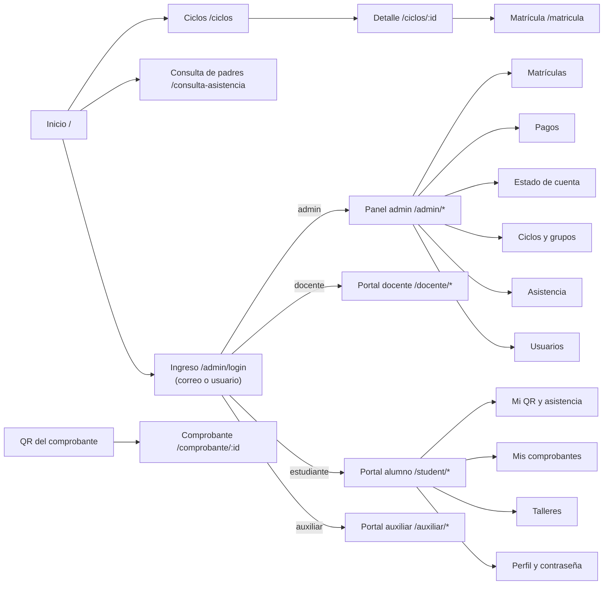

### 2.2 Pantallas principales

Capturas del sitio desplegado tomadas el 2026-10-24:

| Inicio | Ciclos |
|---|---|
| 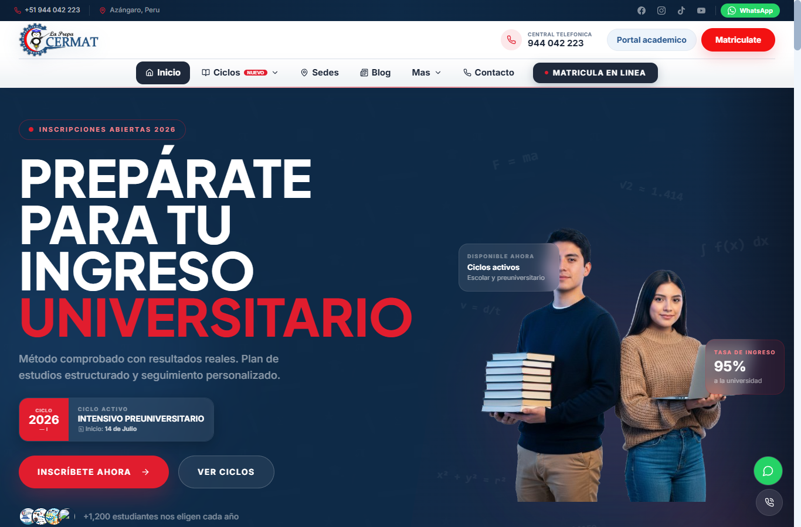 | 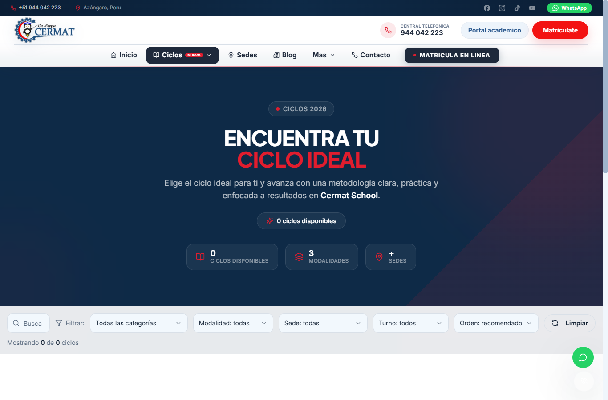 |

| Matrícula en línea | Consulta de asistencia para padres |
|---|---|
| 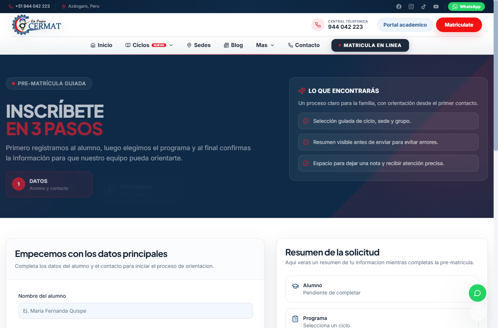 | 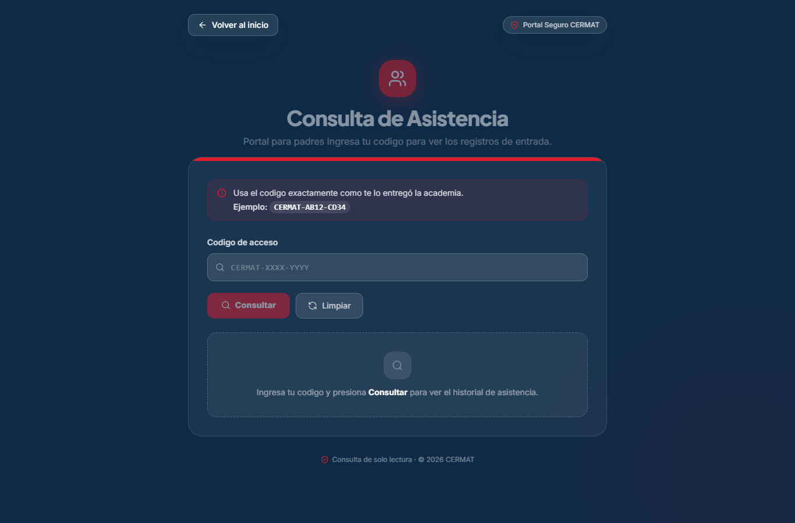 |

| Ingreso a los portales | Matrícula en móvil (RNF02) |
|---|---|
| 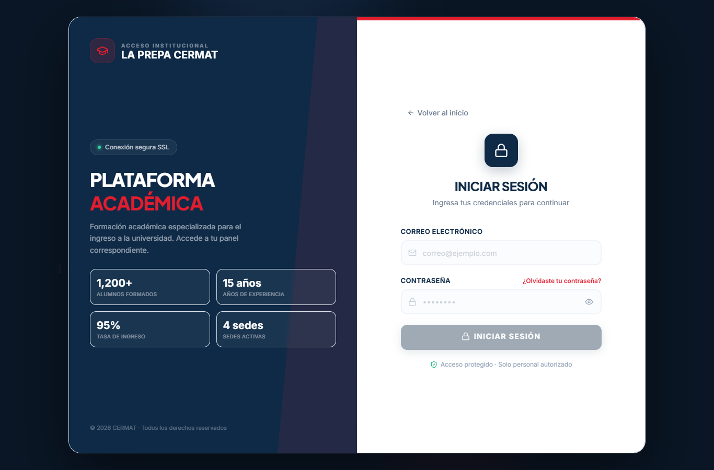 | 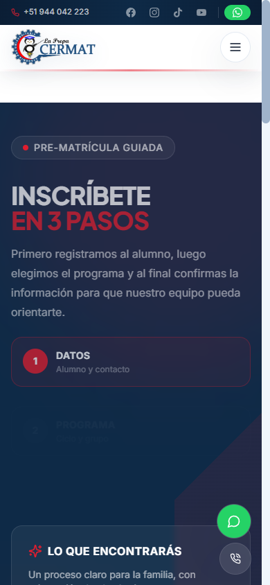 |

### 2.3 Evidencia de validación con usuarios

| Aspecto | Estado |
|---|---|
| Validación funcional con el equipo | Recorridos de los flujos críticos en los emuladores para cada entrega de octubre y noviembre (escritorio y celular, sin errores de consola) y 372 pruebas automáticas (ver [E4](e4-calidad-operacion-ce024.md)) |
| Uso real en piloto | Conteos de Firestore al 2026-10-24: 8 matrículas, 2 pagos, 7 marcas de asistencia, 8 usuarios con perfil. Al 2026-11-14, según la conciliación: 10 matrículas, 3 pagos y 7 marcas |
| Decisiones de producto tomadas por el equipo | Mostrar el horario de cada grupo en el sitio público (12-nov). Contraseña inicial `cermat` + DNI como riesgo aceptado. Ficha completa en la pre-matrícula pública. Retiro inmediato del código fijo del docente. Quedan registradas en `docs/FASE_LOGICA_ROLES_REGLAS.md` y `docs/PLAN_ACCESO_DIRECTO_ALUMNOS.md` |
| Validación con la Dirección y usuarios finales | **Pendiente de acta firmada.** Protocolo propuesto: recorrido guiado de HU01–HU17 con la Dirección, un docente y un auxiliar; registro de observaciones y conformidad en el acta del Anexo A. |

## Sección 3: Diseño Arquitectónico

### 3.1 C1 — Contexto del sistema

Notación C4 en todas las vistas: persona (borde azul oscuro), sistema o contenedor propio (borde azul), sistema externo (gris) y base de datos (cilindro).

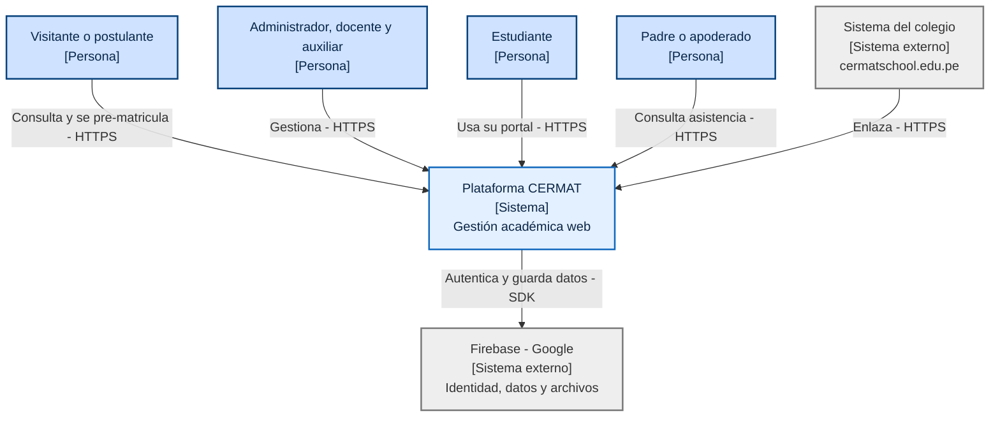

### 3.2 C2 — Contenedores (cumple el rol de vista de despliegue)

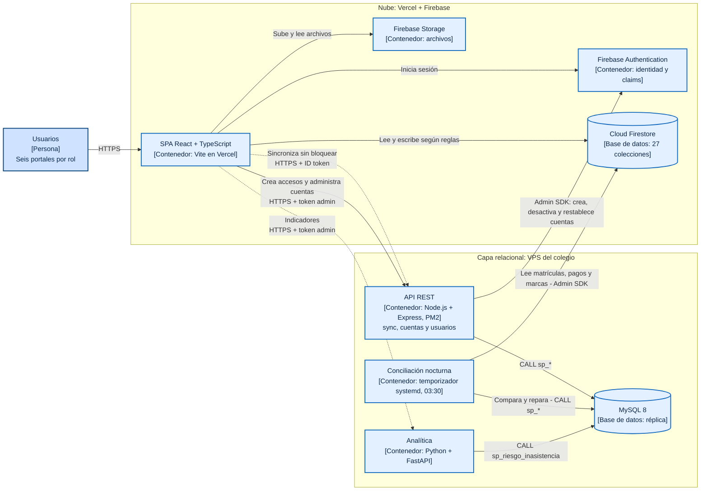

### 3.3 C3 — Componentes de la SPA y de la API

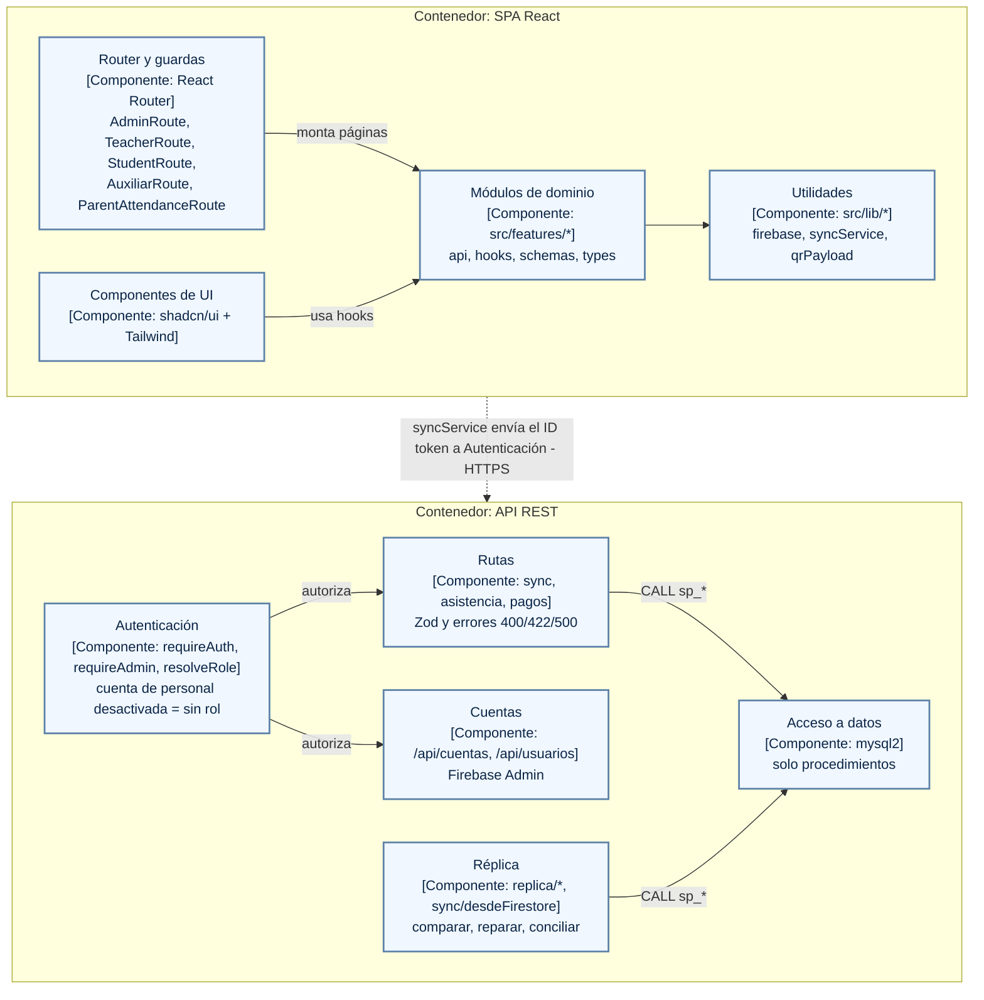

### 3.4 Registro de decisiones arquitectónicas (ADR)

| ADR | Contexto | Decisión | Consecuencias | Estado |
|---|---|---|---|---|
| ADR-01 | Equipo pequeño, sin servidor propio permanente, con necesidad de tiempo real y control de acceso por rol | Firebase como backend principal (Auth, Firestore, Storage) con reglas declarativas | Sin servidor que mantener para la operación diaria. La seguridad depende de reglas que deben probarse y publicarse (ver ADR-07). | Aceptada |
| ADR-02 | Firestore no resuelve bien reportes agregados ni conciliaciones | Réplica relacional en MySQL, escrita solo mediante procedimientos almacenados | Reportes SQL, integridad por FK y CHECK, y auditoría. La cuenta de la API no puede escribir tablas directamente. | Aceptada |
| ADR-03 | La réplica no debe detener la operación si falla | Sincronización no bloqueante, idempotente y con vista de conciliación | Un fallo de la API no afecta al usuario. Los eventos perdidos se detectan en `v_conciliacion_pagos`. Un envío fallido no se reintenta en el momento; desde el 2026-11-14 lo repara la conciliación nocturna (ADR-12). | Aceptada; complementada por ADR-12 |
| ADR-04 | Muchos dominios que crecen en paralelo | Arquitectura modular por dominio en `src/features/*` | Módulos predecibles y probables por separado. Algunas páginas siguen siendo grandes (deuda registrada en E4). | Aceptada |
| ADR-05 | Riesgo de sobrecupo y duplicados en la matrícula pública sin sesión | Transacción con id determinístico `grupo__teléfono` y regla que solo permite sumar un cupo junto con la nueva pre-matrícula | Sin sobrecupo aun con solicitudes simultáneas. Para el visitante, un duplicado se ve como permiso denegado (mensaje explicado). | Aceptada |
| ADR-06 | Un QR con solo el id del alumno puede falsificarse | QR permanente firmado (firma en `studentQrSignatures`) más estado diario transaccional (`attendanceDayState`) | No se aceptan QR reconstruidos ni dobles marcas simultáneas. Requiere regenerar los QR del formato antiguo. | Aceptada |
| ADR-07 | Las reglas publicadas quedaron 4 meses desactualizadas | Las reglas se prueban en un emulador y se publican solo desde el pipeline de CI | Ninguna regla sin probar llega a producción. Requiere configurar el secreto de despliegue; mientras falte, la versión corregida se publicó desde la consola el 2026-10-24, después de pasar las 19 pruebas. | Aceptada (2026-10-24) |
| ADR-08 | La capa relacional corría en una PC y solo sincronizaba con ella encendida; la sede de diseño (VM-APP01) espera el hardware | Alojar la API, MySQL y la analítica en el VPS del colegio, con un usuario propio, puertos solo en 127.0.0.1 y Nginx con HTTPS en dos subdominios | Servicio 24/7 sin depender de una PC. Comparte con el colegio los 2 GB de RAM del VPS (medido: 1,3 GiB disponibles con todo en marcha) y depende del proveedor del VPS (R-08 y R-29). VM-APP01 sigue como destino de diseño. | Aceptada (2026-10-24) |
| ADR-09 | El auxiliar lee las marcas, y cada marca guardaba la firma del QR: con ella podía fabricar otras marcas | La marca guarda un resumen sha256 de la firma con el alumno, el día y el sentido, y la regla lo recalcula (`hashing.sha256`) | Un resumen no sirve para otro día ni para el otro sentido. Las marcas anteriores se limpiaron con la migración de accesos del VPS. | Aceptada (2026-11-12) |
| ADR-10 | El QR del docente valía todo el día y se podía marcar desde fuera con una foto o el texto reenviado | Código rotativo cada 2 minutos: sha256 del secreto del día y del tramo, recalculado por las reglas con la hora del servidor; el docente no lee el secreto | Sin depender de la ubicación ni del dispositivo, que se pueden falsear desde el navegador. Una pantalla abierta con la versión anterior deja de servir hasta recargarla. | Aceptada (2026-11-12) |
| ADR-11 | El alumno solo entraba con un enlace de invitación que vence a los 7 días; hasta usarlo no tenía acceso y, si vencía, había que generar otro | Acceso directo creado por la API: usuario interno `nombre.apellido@cermatacademia.edu.pe` y contraseña inicial `cermat` + documento; la invitación queda como opción (`config/accesos`) | El alumno entra desde el primer día. Quien conozca el DNI puede entrar hasta que el alumno cambie la contraseña. Es un **riesgo aceptado** por el equipo, pendiente de validar con la Dirección, y mitigado con un recordatorio y un aviso fijo. El documento solo lo lee el administrador (RNF11). Depende de que la academia sea titular del dominio. | Aceptada (2026-11-15) |
| ADR-12 | Un envío fallido a MySQL no se repetía y la réplica quedaba incompleta (R-28) | Comparación campo por campo desde Firestore y reenvío reparador con los mismos procedimientos, cada noche a las 03:30, después del respaldo; borrado auditado de marcas que ya no existen | La réplica converge sola en ≤ 24 h. El servicio queda en `failed` si encuentra diferencias que no pudo reparar. Cada lectura nocturna consume lecturas de Firestore, limitadas con `--dias 14`. | Aceptada (2026-11-14) |

## Sección 4: Diseño Detallado

### 4.1 Diagrama de casos de uso

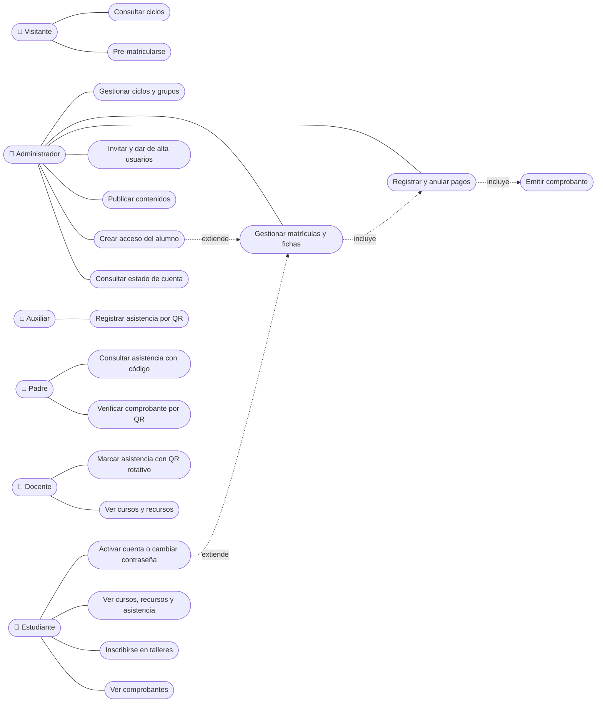

### 4.2 Diagrama de clases del dominio

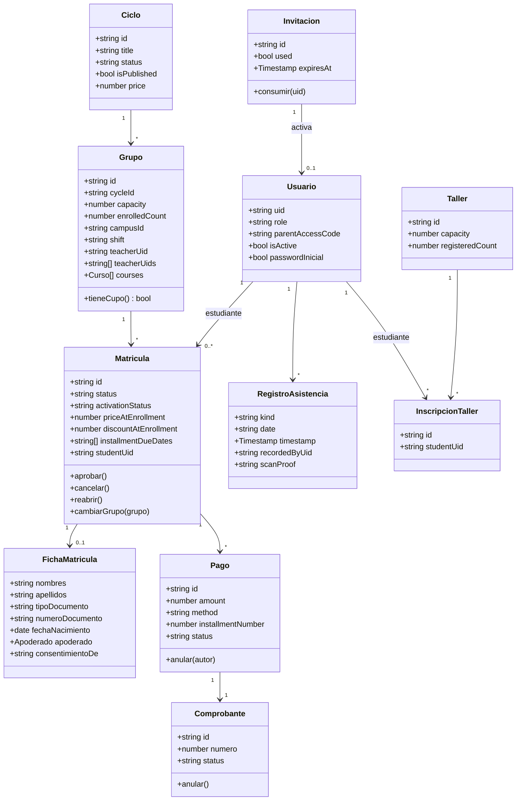

El id de `Matricula` es determinístico (`grupo__teléfono`, RN03) y el de `Invitacion` es el SHA-256 del token enviado por enlace: el token nunca se guarda. El de `Comprobante` es el del pago, que Firestore genera al azar, así que no se puede adivinar el de otro. `FichaMatricula` vive en `fichasMatricula`, que solo lee el administrador (RNF11).

### 4.3 Diagramas de secuencia

**Pre-matrícula pública con control de cupo (HU01, ADR-05):**

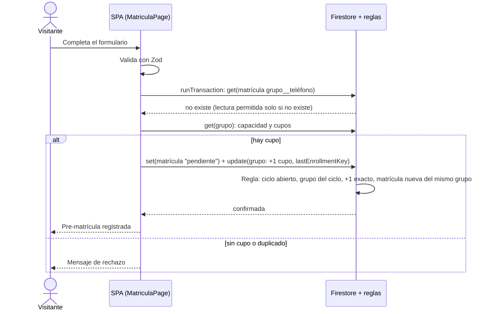

**Activación por invitación (HU05, RN08):**

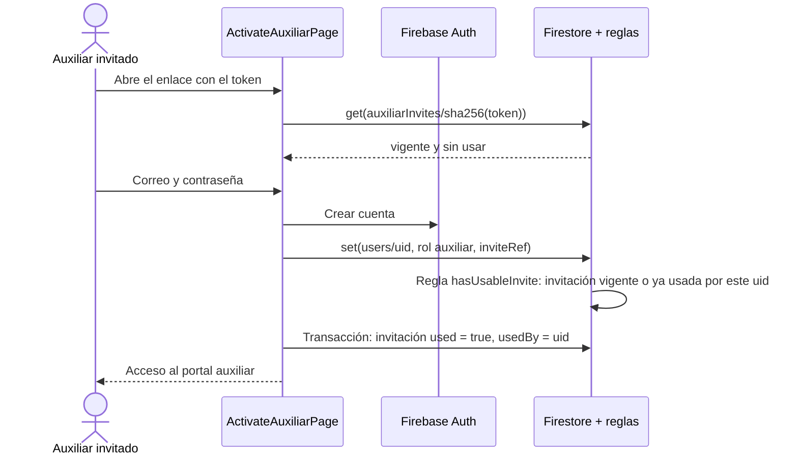

**Registro de asistencia con QR firmado (HU06, ADR-06):**

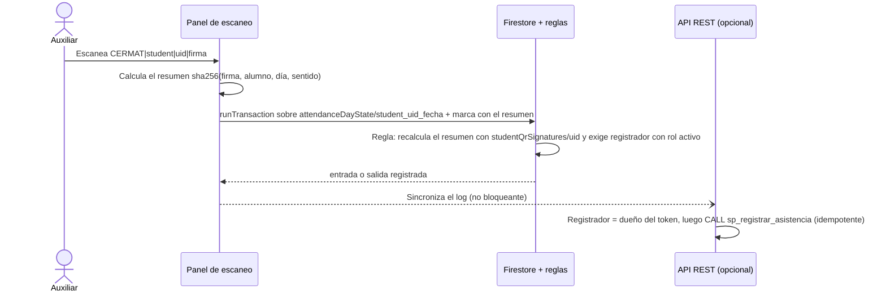

**Creación del acceso directo del alumno (HU11, ADR-11):**

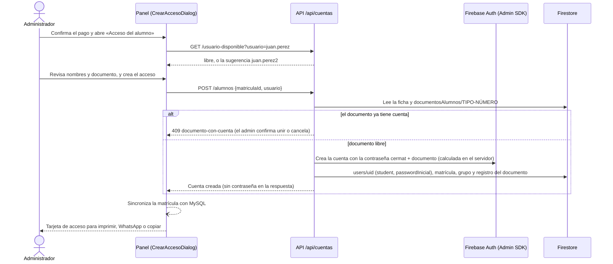

### 4.4 Diagrama de estados de la matrícula

Corresponde a `isAdminEnrollmentUpdateAllowed` y a la regla de activación de `firestore.rules`. El valor guardado sigue siendo `pagado`, pero desde el 2026-11-12 el panel lo muestra como **Confirmada**, porque significa «aprobada» y no «pagada por completo». Lo pagado y el saldo están en el estado de cuenta.

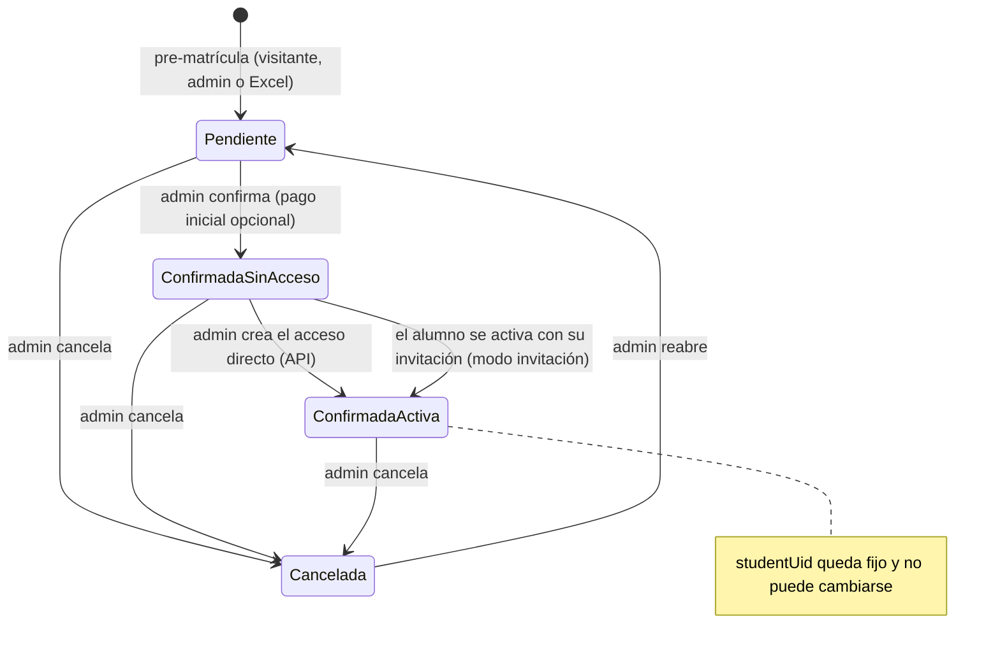

**Estado diario de la asistencia del alumno** (`attendanceDayState`):

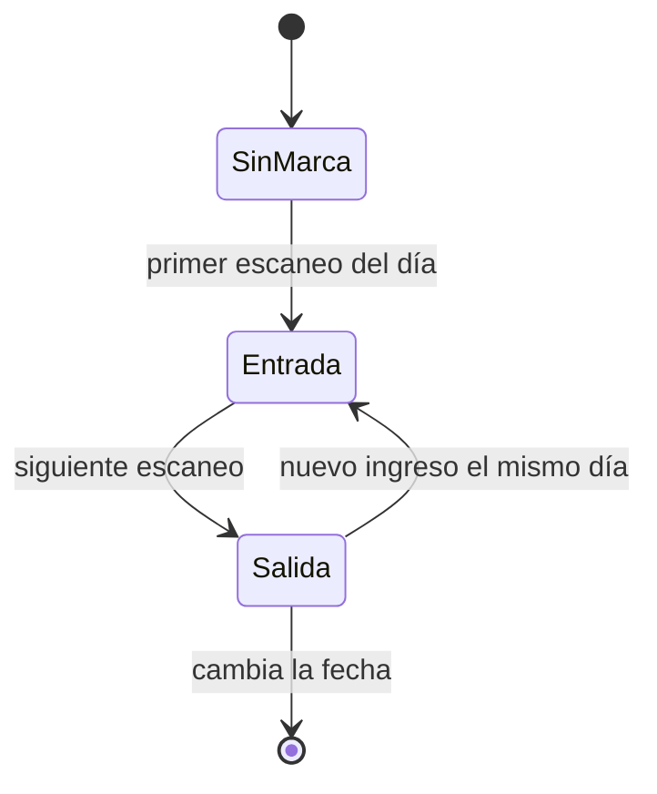

### 4.5 Modelo de diseño detallado

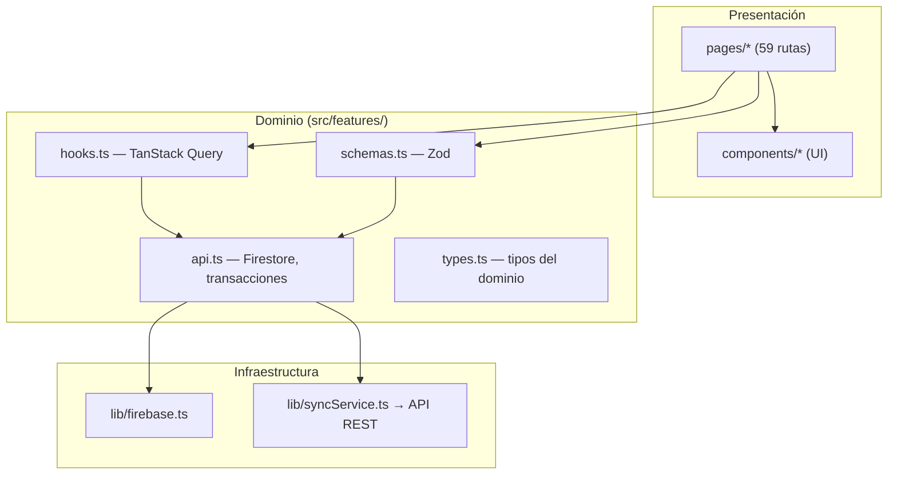

| Capa | Responsabilidad | Regla de dependencia |
|---|---|---|
| Presentación | Pantallas y formularios | Solo usa hooks y esquemas del dominio |
| Dominio | Casos de uso, validación y acceso a datos | No depende de la UI |
| Infraestructura | SDK de Firebase y sincronización | Encapsulada en `src/lib` |

## Anexos

### Anexo A — Acta de validación con stakeholders (plantilla)

| Campo | Contenido |
|---|---|
| Fecha y lugar | (completar) |
| Participantes | Dirección de la academia, un docente, un auxiliar y el equipo de desarrollo |
| Historias validadas | HU01–HU17 (marcar conformidad u observación por historia) |
| Observaciones | (completar) |
| Conformidad | Firma de la Dirección y del líder del equipo |
| Estado | **Pendiente de realizar y firmar** |

### Anexo B — Matriz de trazabilidad de requerimientos

| RF | Historia | Componente | Prueba automática |
|---|---|---|---|
| RF01 | — | `pages/Index.tsx`, `components/home/*` | — (captura 01) |
| RF02 | — | `pages/CiclosPage.tsx`, `features/cycles/*` | — (captura 02) |
| RF03 | HU01 | `pages/MatriculaPage.tsx`, `features/enrollments/api.ts` | Reglas › matrícula pública (10); esquemas de matrícula (5) |
| RF04 | HU01 | `firestore.rules`, `features/enrollments/schemas.ts` | Reglas › ciclo cerrado, sobrecupo, cupo sin matrícula y precio del plan |
| RF05 | — | `pages/admin/AdminCycleGroupsPage.tsx`, `features/groups/*` | Reglas › manipulación del contador y varios docentes por grupo (3); unitarias › cursos (3) y horario (3) |
| RF06 | HU02 | `pages/admin/AdminEnrollmentsPage.tsx`, `EditEnrollmentDialog.tsx`, `features/enrollments/*` | Reglas › editar una matrícula (2); transiciones de estado pendientes |
| RF07 | HU03 | `pages/admin/AdminPaymentsPage.tsx`, `features/payments/*` | Reglas › pagos (3); unitarias › pagos (9); API › payment (5); BD 2–4, 10–11, 16–18, 22–24 |
| RF08 | HU09, HU16 | `features/users/*`, `features/enrollments/bulkEnrollmentImport.ts`, `lib/excelImport.ts` | Unitarias › excelImport (3) y matrícula masiva (4) |
| RF09 | HU04, HU05 | `pages/Activate*Page.tsx`, `features/teacherInvites/*` | Reglas › roles (8), personal sin claims (7) y activación del alumno (6); unitarias › invite (3) |
| RF10 | — | `pages/teacher/TeacherCursosPage.tsx` | Reglas › varios docentes por grupo |
| RF11 | — | `pages/teacher/TeacherRecursosPage.tsx`, `features/resources/*` | Reglas › recursos solo para un grupo (4) |
| RF12 | HU06 | `features/attendance/api.ts`, `scanProof.ts`, `lib/qrPayload.ts` | Unitarias › QR (5) y resumen (2); Reglas › resumen de la firma (3) y QR fuera del perfil (3); API › attendance; BD 14–15 |
| RF13 | HU07 | `pages/teacher/TeacherAttendanceScanPage.tsx`, `features/attendance/rotatingCode.ts` | Unitarias › código rotativo (2); Reglas › QR cada 2 minutos (3) y primera marca (2); API › asistencia del docente |
| RF14 | HU06 | `pages/auxiliar/*`, `pages/admin/AuxiliarDashboard.tsx` | API › auxiliar sin claim |
| RF15 | — | `pages/student/*` | Reglas › lectura del alumno con sesión |
| RF16 | HU08 | `pages/ConsultaAsistenciaPadrePage.tsx`, `lib/parentAccess.ts` | Unitarias › parentAccess (4); Reglas › registro y revocación del código (4) |
| RF17 | — | `features/resources/*`, `pages/admin/AdminRecursosPage.tsx` | Reglas › recursos solo para un grupo |
| RF18 | — | `features/posts/*`, `pages/admin/AdminPostsPage.tsx` | Unitarias › conversión de fechas |
| RF19 | — | `features/workshops/*` | — |
| RF20 | — | `pages/ContactoPage.tsx`, `pages/admin/AdminMessagesPage.tsx`, `features/messages/*` | Unitarias › mensajes (5); Reglas › solicitudes de WhatsApp (12) y Contacto (4) |
| RF21 | HU10 | `lib/syncService.ts`, `server/src/routes/sync.ts`, `server/src/db/*` | API › sync (22); BD (25) |
| RF22 | HU05 | `routes/*Route.tsx`, `firestore.rules`, `server/src/middleware/auth.ts` | Reglas › roles; API › autenticación |
| RF23 | HU16 | `features/enrollments/ficha.ts`, `CamposFichaAlumno.tsx`, `AutorizacionDatosMatricula.tsx` | Unitarias › ficha (14); Reglas › ficha de matrícula (7) |
| RF24 | HU11, HU12 | `features/accesos/*`, `server/src/routes/cuentas.ts`, `StudentProfilePage.tsx` | API › cuentas (21); unitarias › usuario (6) y contraseña (5); Reglas › acceso directo (4) |
| RF25 | HU13 | `features/receipts/*`, `pages/ReceiptPage.tsx` | Unitarias › comprobante (3); Reglas › comprobantes (3) |
| RF26 | HU14 | `pages/admin/AdminAccountStatementPage.tsx`, `features/payments/summary.ts` | Unitarias › resumen y cronograma (11) |
| RF27 | HU15 | `features/workshops/registrations.ts`, `StudentWorkshopsPage.tsx` | Reglas › talleres con cupo (4) |
| RF28 | HU17 | `pages/admin/AdminUsuariosPage.tsx`, `server/src/routes/usuarios.ts`, `useStaffAccess.ts` | API › usuarios (10); unitarias › usuarios (5); Reglas › personal desactivado (5) |
| RF29 | — | `pages/admin/AdminInstitutionalConfigPage.tsx`, `features/institucion/*` | — |
| RF30 | — | `server/src/scripts/compararReplica.ts`, `server/src/replica/*`, `deploy/systemd/academia-replica.*` | API › comparación (10), conversión desde Firestore (11) y conciliación de marcas (9); BD 11, 14–15 |

Cobertura de trazabilidad: 30 de 30 RF con componente identificado; 28 de 30 con al menos una prueba automática. Las 2 restantes (RF19 y RF29) se cubren con revisión en los emuladores. Al 2026-11-16 no pasan 6 pruebas de RF12, RF21, RF24, RF25, RF28 y RF30, que fallan desde la entrega de matrícula masiva ([E4 §1.3](e4-calidad-operacion-ce024.md#13-reporte-de-ejecucion-2026-11-16)).

### Anexo C — Diagramas complementarios

Arquitectura técnica híbrida: 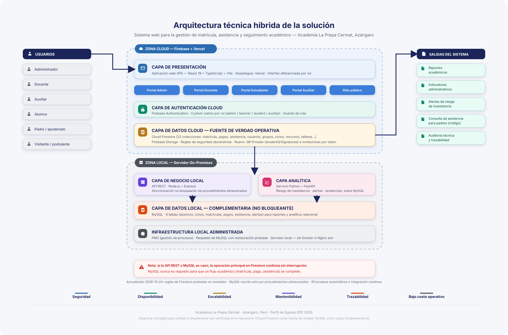

### Anexo D — Evidencia de sustentación

Exposición breve ante el docente: pendiente (ver [Guía de sustentación](e5-presentacion-sustentacion-ce0217.md)).

## Rúbrica de Evaluación

| Criterio | Excelente (18-20) | Bueno (15-17) | Regular (13-14) | Deficiente (<13) |
|---|---|---|---|---|
| Completitud y claridad de requerimientos | SRS completo, claro y estructurado (RF, RNF, reglas, restricciones) | SRS mayormente completo | Requerimientos incompletos o ambiguos | Requerimientos deficientes |
| Coherencia entre requerimientos, prototipos y diseño del sistema | Prototipos y diseño reflejan fielmente los requerimientos | Coherencia general | Varias inconsistencias | No hay coherencia |
| Definición de arquitectura del sistema | Arquitectura clara, documentada y alineada al problema | Arquitectura funcional | Arquitectura parcial | No hay arquitectura |
| Modelado del sistema (UML) | Diagramas completos y coherentes | Modelado adecuado | Modelado incompleto | No hay modelado |
| Trazabilidad de requerimientos | Componentes rastreables a requerimientos | Trazabilidad parcial | Trazabilidad limitada | No hay trazabilidad |
| Validación con stakeholders | Evidencia clara de validación | Validación parcial | Validación limitada | No hay validación |
| Sustentación y defensa técnica | Explica y defiende con dominio las decisiones tomadas | Explica con solvencia | Explica con dificultad | No sustenta |
