# E1 - Requerimientos y Diseño del Sistema (CE021)

!!! abstract "Evidencia CE021 — Ingeniería de Requerimientos"
    Define, valida y diseña la solución de software: especificación de requerimientos, prototipo navegable, arquitectura C4 con registro de decisiones y diseño detallado en UML, con trazabilidad desde cada requerimiento hasta el código y las pruebas automáticas.

## Portada

| Campo | Detalle |
|---|---|
| Título del sistema | Plataforma Web Integral de Gestión Académica CERMAT |
| Estudiantes | David Robert Yucra Mamani (líder), Gladys Rosaura Yana Pari, Denilson Leeke Mamani Flores, Cárdenas Vilca Rennzo |
| Semestre | 2026-2 (9° ciclo) |
| Fecha | 2026-10-24 |
| Despliegue | [https://academia-school-platform.vercel.app](https://academia-school-platform.vercel.app) |

## Resumen Ejecutivo

**Problema.** La Academia La Prepa Cermat (Azángaro, Puno) gestionaba la oferta de ciclos, las matrículas, los pagos y la asistencia con registros dispersos. Eso producía duplicados, riesgo de sobrepasar los cupos, pagos desvinculados de la matrícula y ningún canal de consulta para los padres.

**Usuarios.** Visitantes y postulantes, administradores, docentes, estudiantes, auxiliares y padres o apoderados. Tienen 6 portales con permisos diferenciados.

**Alcance.** 22 requerimientos funcionales y 10 no funcionales: sitio público, matrícula en línea, gestión académica, pagos, asistencia por QR, consulta para padres, contenidos y sincronización a una base relacional. Quedan fuera la app móvil nativa, la pasarela de pagos y la facturación electrónica.

**Solución.** Una aplicación web (SPA en React y TypeScript) publicada en Vercel, con Firebase como identidad y base operativa protegida por reglas por rol. Una capa relacional complementaria (API Node.js, MySQL y analítica en Python) cubre reportes y continuidad. El diseño se documenta con vistas C4, 7 decisiones arquitectónicas y diagramas UML. Cada requerimiento se traza hasta su código y, cuando existe, hasta su prueba automática (90 pruebas en el proyecto).

## Sección 1: Especificación de Requerimientos

### 1.1 Requerimientos funcionales

| ID | Descripción |
|---|---|
| RF01 | El sistema debe mostrar una página pública de inicio con información institucional y acceso a la oferta académica. |
| RF02 | El sistema debe listar los ciclos académicos publicados y permitir ver su detalle. |
| RF03 | El sistema debe permitir la pre-matrícula pública seleccionando ciclo, grupo, sede, turno y modalidad de pago. |
| RF04 | El sistema debe impedir pre-matrículas en ciclos no publicados o cerrados, en grupos que no pertenecen al ciclo y en grupos sin cupo. |
| RF05 | El administrador debe gestionar ciclos académicos, categorías, sedes y grupos con capacidad, turno y horario. |
| RF06 | El administrador debe gestionar matrículas y sus estados (pendiente, pagado, cancelado) con trazabilidad del autor. |
| RF07 | El administrador debe registrar pagos asociados a matrículas (método, monto, cuota y comprobante) y anularlos sin borrarlos. |
| RF08 | El administrador debe gestionar alumnos, docentes y auxiliares, de forma individual o masiva por Excel. |
| RF09 | El sistema debe activar cuentas de estudiantes, docentes y auxiliares mediante invitaciones de un solo uso. |
| RF10 | El docente debe acceder a sus cursos y consultar los alumnos asociados. |
| RF11 | El docente debe acceder a los recursos académicos asignados o creados por él. |
| RF12 | El sistema debe registrar la asistencia de estudiantes con su QR permanente firmado. |
| RF13 | El sistema debe registrar la asistencia de docentes con un QR diario validado por token y ventana horaria. |
| RF14 | El auxiliar debe operar los paneles de asistencia según sus permisos. |
| RF15 | El estudiante debe ver su panel, cursos, recursos, matrícula, talleres y asistencia. |
| RF16 | El padre debe consultar la asistencia de su hijo con un código CERMAT, sin acceso administrativo. |
| RF17 | El administrador debe publicar y administrar recursos académicos. |
| RF18 | El administrador debe publicar y administrar entradas del blog. |
| RF19 | El administrador debe administrar talleres y su visibilidad pública. |
| RF20 | El sistema debe registrar los mensajes de contacto del sitio público. |
| RF21 | El sistema debe sincronizar matrículas, pagos y asistencia a la base relacional cuando el servicio esté habilitado. |
| RF22 | El sistema debe proteger las rutas por rol: admin, docente, estudiante, auxiliar y padre. |

### 1.2 Requerimientos no funcionales

| ID | Tipo (ISO/IEC 25010) | Descripción | Verificación |
|---|---|---|---|
| RNF01 | Seguridad | Toda lectura y escritura se autoriza con Firebase Auth, claims, documento de rol y reglas de Firestore. | 19 pruebas de reglas en emulador |
| RNF02 | Usabilidad | La interfaz es adaptable a móvil y separa los flujos público, administrativo y privado. | Capturas de escritorio y móvil (Sección 2) |
| RNF03 | Eficiencia | Las consultas usan filtros compatibles con los índices de Firestore. | Revisión de consultas |
| RNF04 | Mantenibilidad | El código se organiza por dominio en `src/features/*` (`api.ts`, `hooks.ts`, `schemas.ts`, `types.ts`). | Estructura del repositorio |
| RNF05 | Disponibilidad | La operación depende de Firebase; si la capa relacional falla, el flujo principal continúa. | Sincronización no bloqueante |
| RNF06 | Integridad | Matrículas, pagos y asistencia conservan estados, fechas y responsables, y no se borran físicamente. | Reglas y triggers con pruebas |
| RNF07 | Escalabilidad | Se agregan módulos sin reestructurar la aplicación. | 13 módulos de dominio independientes |
| RNF08 | Compatibilidad | SPA con build Vite y rutas de React Router en navegadores modernos. | Build en el pipeline de CI |
| RNF09 | Validación | Los formularios se validan con esquemas Zod antes de escribir. | Pruebas unitarias de esquemas |
| RNF10 | Auditoría | Las acciones críticas registran responsable, fecha y estado. | Tabla `auditoria` y campos `*By` |

### 1.3 Reglas de negocio

Cada regla está aplicada en el código o en las reglas de seguridad, no solo descrita.

| ID | Regla | Dónde se aplica |
|---|---|---|
| RN01 | Solo se admite pre-matrícula en ciclos publicados con estado "activo" o "nuevo". | `firestore.rules` (`isEnrollmentCycleOpen`) |
| RN02 | El grupo debe pertenecer al ciclo, y la sede, su identificador y el turno deben coincidir con los del grupo. | `firestore.rules` (`isEnrollmentGroupInCycle`, `isEnrollmentGroupCampusValid`) |
| RN03 | Un mismo teléfono solo puede tener una pre-matrícula por grupo. | Id determinístico `grupo__teléfono` en `createEnrollment` |
| RN04 | Cada pre-matrícula descuenta un cupo y el cupo nunca supera la capacidad del grupo. | Transacción en `createEnrollment` y regla `isPublicEnrollmentSeatIncrement` |
| RN05 | Los estados de la matrícula solo cambian por las transiciones permitidas (Sección 4.4). La activación la hace el propio alumno con una invitación válida. | `isAdminEnrollmentUpdateAllowed` y regla de activación |
| RN06 | Solo un administrador registra pagos; el monto es mayor que 0; un pago no se elimina, solo se anula indicando quién lo hizo. | Reglas de `payments` y trigger `trg_pagos_bd` |
| RN07 | El número de cuota no puede superar las cuotas pactadas en la matrícula. | Trigger `trg_pagos_bi` (réplica relacional) |
| RN08 | Las cuentas de auxiliar y docente solo se crean con una invitación vigente de un solo uso. | `firestore.rules` (`hasUsableInvite`) |
| RN09 | La marca de un alumno exige su QR firmado y la registra un auxiliar o administrador. Entrada y salida alternan en el día. El docente marca con el QR diario dentro de su ventana y no puede marcar salida sin entrada. | `isStudentAttendanceCreate`, `isTeacherAttendanceCreate`, `attendanceDayState` |
| RN10 | El código de los padres tiene formato `CERMAT-XXXX-XXXX`, sin caracteres ambiguos (0, O, 1, I), y puede revocarse. | `src/lib/parentAccess.ts` |
| RN11 | Matrículas y pagos no se borran físicamente: se cancelan o anulan. | `allow delete: if false` en las reglas |

### 1.4 Restricciones del sistema

| Tipo | Restricción |
|---|---|
| Tecnológica | La operación principal depende de Firebase (cuotas del plan del proveedor) y las consultas están sujetas a los índices de Firestore. |
| Tecnológica | Requiere un navegador moderno con JavaScript y conexión a Internet; no hay modo sin conexión. |
| Operativa | Las fechas de asistencia usan la zona horaria de Perú (America/Lima). |
| Operativa | La capa relacional (API, MySQL y analítica) es complementaria: su caída no detiene matrícula, pagos ni asistencia. |
| Legal | El sistema trata datos personales de menores de edad: aplica la Ley N.° 29733 de Protección de Datos Personales. |
| Alcance | Sin app móvil nativa, pasarela de pagos, facturación electrónica ni integración con ERP. |
| Despliegue | La academia usa su propio dominio en Vercel, separado del sistema de gestión del colegio (cermatschool.edu.pe). |

### 1.5 Historias de usuario y criterios de aceptación

| ID | Historia | Criterios de aceptación | RF |
|---|---|---|---|
| HU01 | Como **postulante** quiero pre-matricularme sin crear cuenta para reservar mi cupo. | **Dado** un ciclo abierto con cupo, **cuando** envío el formulario, **entonces** queda en "pendiente" y se descuenta 1 cupo. Mismo teléfono en el grupo: mensaje de duplicado. Ciclo cerrado o grupo lleno: rechazo. | RF03, RF04 |
| HU02 | Como **administrador** quiero aprobar, cancelar o reabrir matrículas para controlar el proceso. | Solo se aceptan las transiciones de la Sección 4.4. Cada cambio registra quién lo hizo. | RF06 |
| HU03 | Como **administrador** quiero registrar y anular pagos para llevar la caja. | Solo admin. Monto mayor que 0. No se borra. La anulación registra el autor. | RF07 |
| HU04 | Como **estudiante** quiero activar mi cuenta con el enlace recibido al pagar. | El enlace es de un solo uso y vence. Al activarse, la matrícula pasa a "activo". | RF09 |
| HU05 | Como **auxiliar o docente invitado** quiero activar mi cuenta. | Sin invitación, o con una vencida o de otra persona, no se crea el perfil. Reintentar con la propia sí funciona. | RF09, RF22 |
| HU06 | Como **auxiliar** quiero registrar la asistencia escaneando el QR del alumno. | El QR firmado se acepta. El formato antiguo se detecta. Entrada y salida alternan. Un reenvío no duplica. | RF12, RF14 |
| HU07 | Como **docente** quiero marcar mi asistencia con el QR del día. | Solo dentro de la ventana del token. No hay salida sin entrada previa. | RF13 |
| HU08 | Como **padre** quiero consultar la asistencia con un código fácil de dictar. | Acepta minúsculas, espacios y el código sin prefijo. Un código revocado no muestra datos. | RF16 |
| HU09 | Como **administrador** quiero dar de alta alumnos o docentes desde un Excel. | Una fila con error no detiene el lote. El error indica la fila real del archivo. | RF08 |
| HU10 | Como **Dirección** quiero ver los alumnos en riesgo de abandono. | Calcula sobre días lectivos, incluye a quien nunca asistió y excluye a los docentes. | RF21 |

## Sección 2: Prototipo Navegable

### 2.1 Fidelidad y flujo de navegación

El prototipo es de **alta fidelidad**: es el propio sistema desplegado y navegable en [academia-school-platform.vercel.app](https://academia-school-platform.vercel.app), con 55 rutas protegidas por 6 guardas de rol.

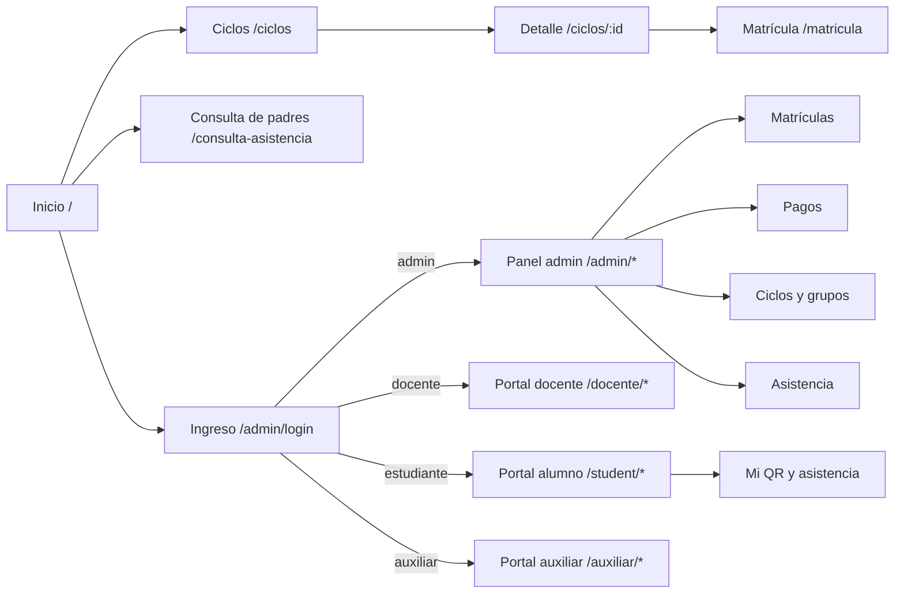

### 2.2 Pantallas principales

Capturas del sitio desplegado tomadas el 2026-10-24:

| Inicio | Ciclos |
|---|---|
| 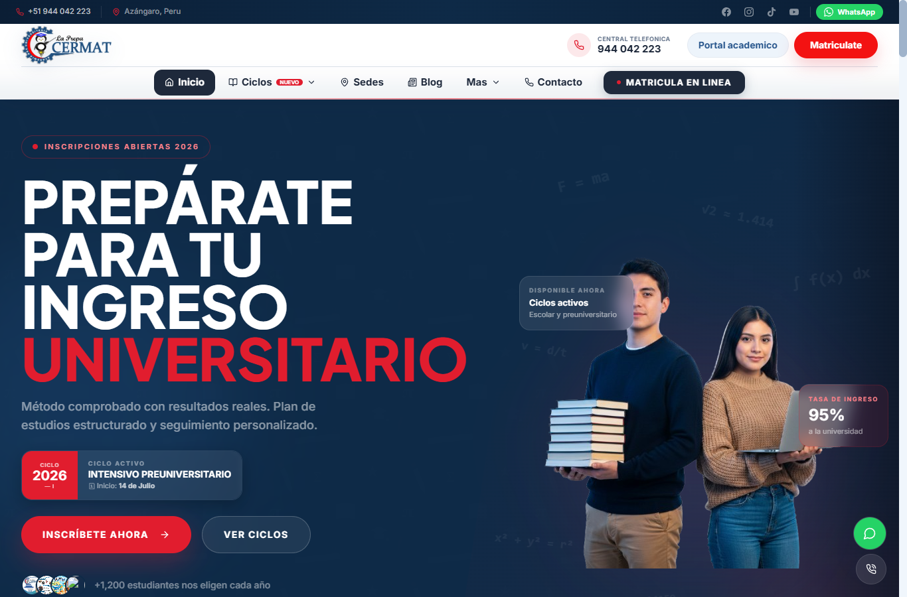 | 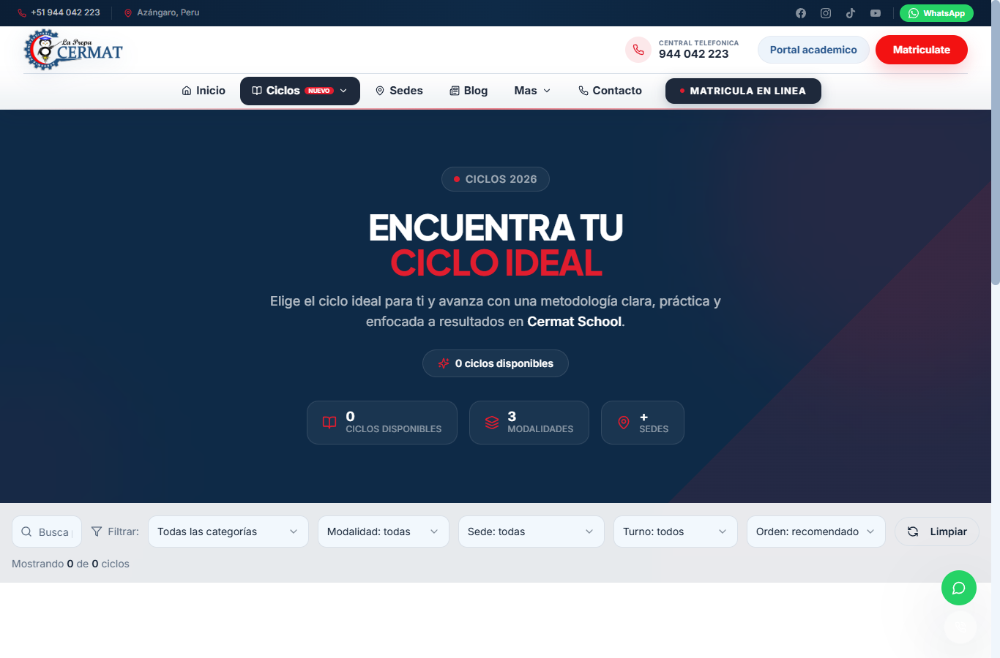 |

| Matrícula en línea | Consulta de asistencia para padres |
|---|---|
| 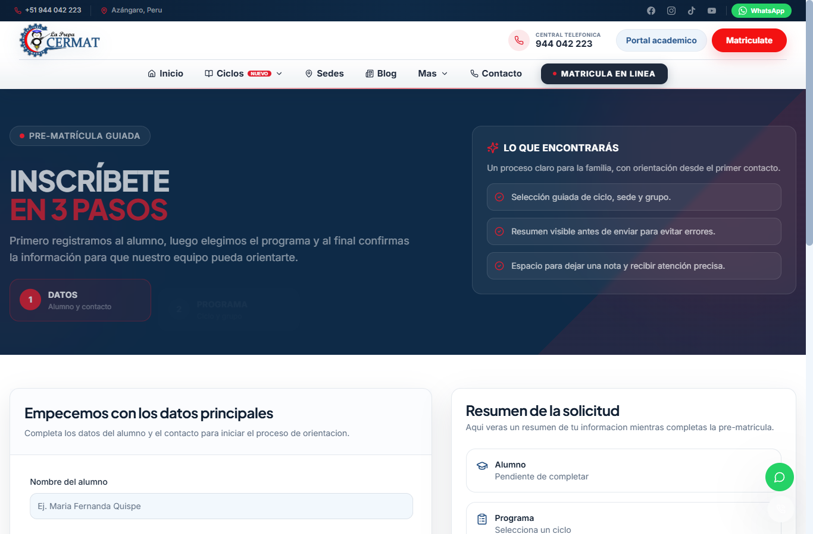 | 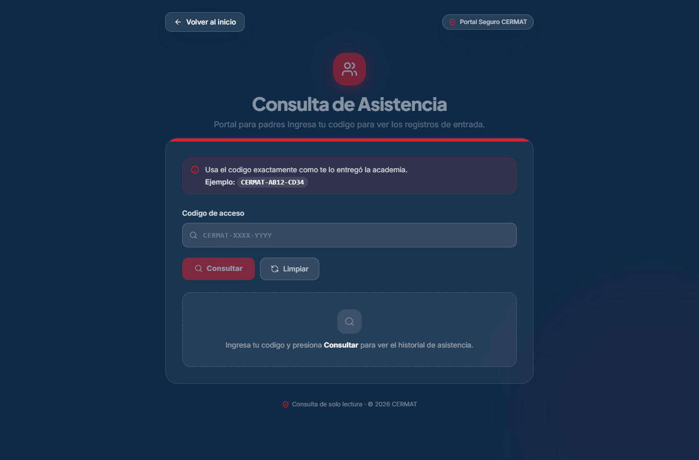 |

| Ingreso a los portales | Matrícula en móvil (RNF02) |
|---|---|
| 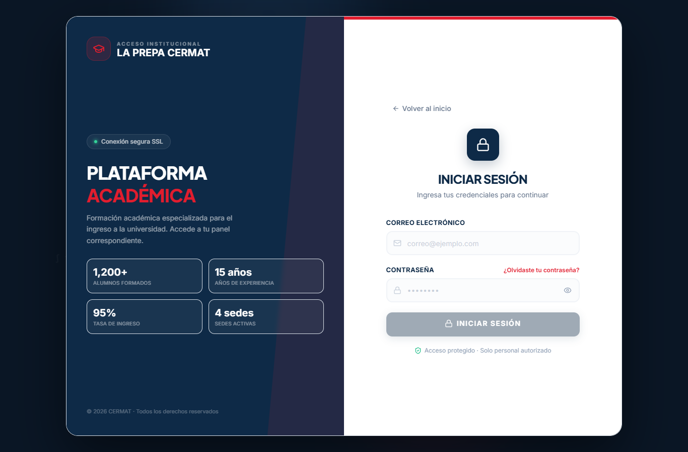 | 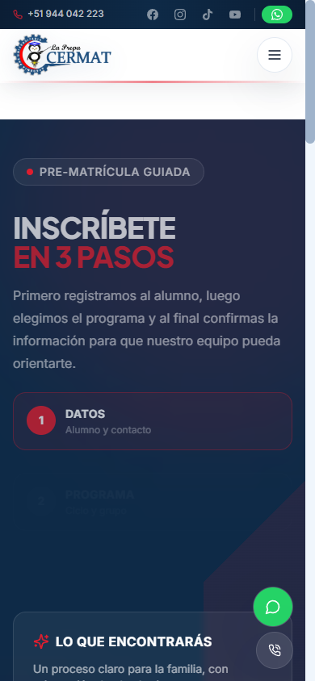 |

### 2.3 Evidencia de validación con usuarios

| Aspecto | Estado |
|---|---|
| Validación funcional con el equipo | Recorridos de los flujos críticos y 90 pruebas automáticas (ver [E4](e4-calidad-operacion-ce024.md)) |
| Uso real en piloto | Conteos de Firestore al 2026-10-24: 8 matrículas, 2 pagos, 7 marcas de asistencia, 8 usuarios con perfil |
| Validación con la Dirección y usuarios finales | **Pendiente de acta firmada.** Protocolo propuesto: recorrido guiado de HU01–HU08 con la Dirección, un docente y un auxiliar; registro de observaciones y conformidad en el acta del Anexo A. |

## Sección 3: Diseño Arquitectónico

### 3.1 C1 — Contexto del sistema

Notación C4 en todas las vistas: persona (borde azul oscuro), sistema o contenedor propio (borde azul), sistema externo (gris) y base de datos (cilindro).

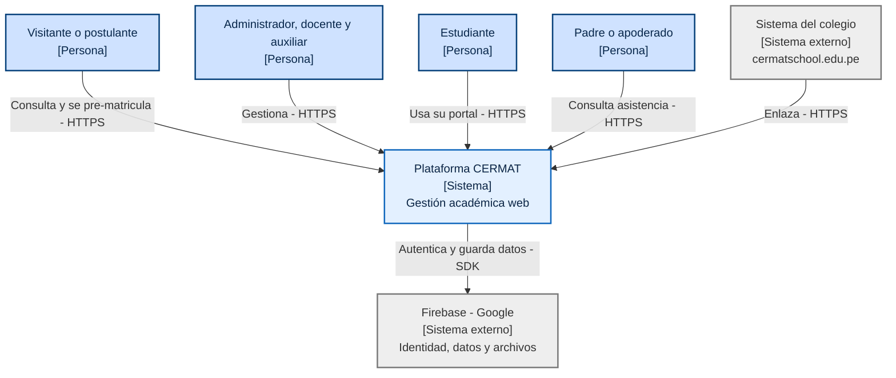

### 3.2 C2 — Contenedores (cumple el rol de vista de despliegue)

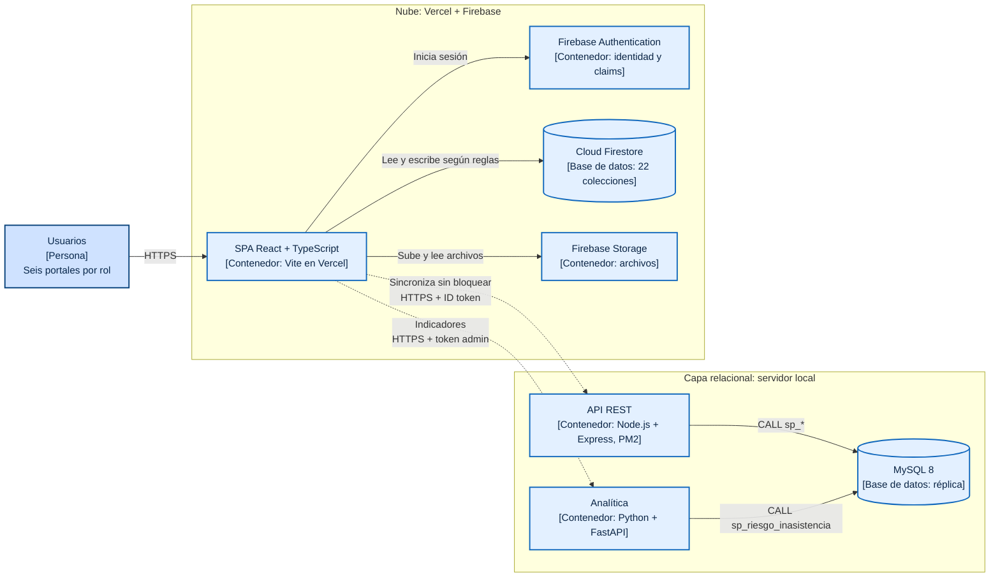

### 3.3 C3 — Componentes de la SPA y de la API

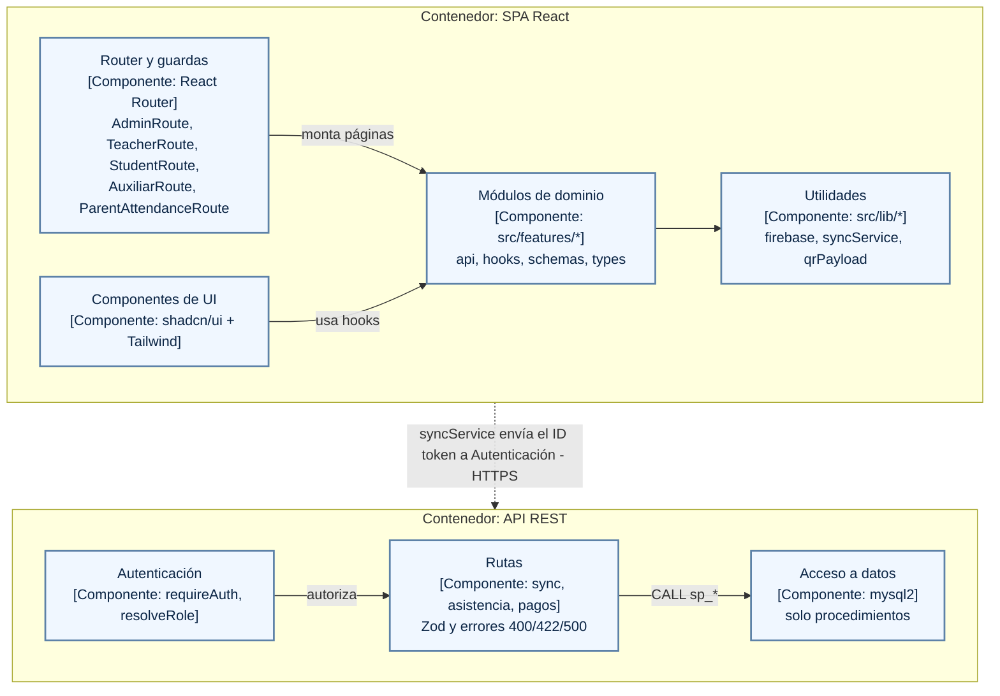

### 3.4 Registro de decisiones arquitectónicas (ADR)

| ADR | Contexto | Decisión | Consecuencias | Estado |
|---|---|---|---|---|
| ADR-01 | Equipo pequeño, sin servidor propio permanente, con necesidad de tiempo real y control de acceso por rol | Firebase como backend principal (Auth, Firestore, Storage) con reglas declarativas | Sin servidor que mantener para la operación diaria. La seguridad depende de reglas que deben probarse y publicarse (ver ADR-07). | Aceptada |
| ADR-02 | Firestore no resuelve bien reportes agregados ni conciliaciones | Réplica relacional en MySQL, escrita solo mediante procedimientos almacenados | Reportes SQL, integridad por FK y CHECK, y auditoría. La cuenta de la API no puede escribir tablas directamente. | Aceptada |
| ADR-03 | La réplica no debe detener la operación si falla | Sincronización no bloqueante, idempotente y con vista de conciliación | Un fallo de la API no afecta al usuario. Los eventos perdidos se detectan en `v_conciliacion_pagos`. | Aceptada |
| ADR-04 | Muchos dominios que crecen en paralelo | Arquitectura modular por dominio en `src/features/*` | Módulos predecibles y probables por separado. Algunas páginas siguen siendo grandes (deuda registrada en E4). | Aceptada |
| ADR-05 | Riesgo de sobrecupo y duplicados en la matrícula pública sin sesión | Transacción con id determinístico `grupo__teléfono` y regla que solo permite sumar un cupo junto con la nueva pre-matrícula | Sin sobrecupo aun con solicitudes simultáneas. Para el visitante, un duplicado se ve como permiso denegado (mensaje explicado). | Aceptada |
| ADR-06 | Un QR con solo el id del alumno puede falsificarse | QR permanente firmado (firma en `studentQrSignatures`) más estado diario transaccional (`attendanceDayState`) | No se aceptan QR reconstruidos ni dobles marcas simultáneas. Requiere regenerar los QR del formato antiguo. | Aceptada |
| ADR-07 | Las reglas publicadas quedaron 4 meses desactualizadas | Las reglas se prueban en un emulador y se publican solo desde el pipeline de CI | Ninguna regla sin probar llega a producción. Requiere configurar el secreto de despliegue. | Aceptada (2026-10-24) |

## Sección 4: Diseño Detallado

### 4.1 Diagrama de casos de uso

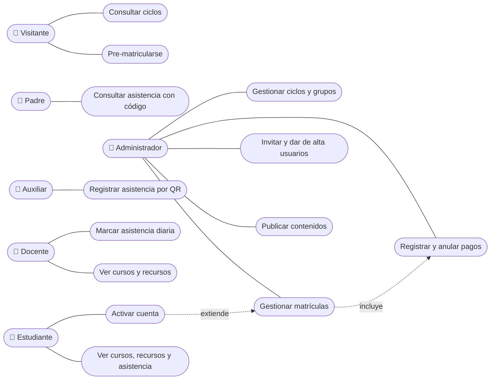

### 4.2 Diagrama de clases del dominio

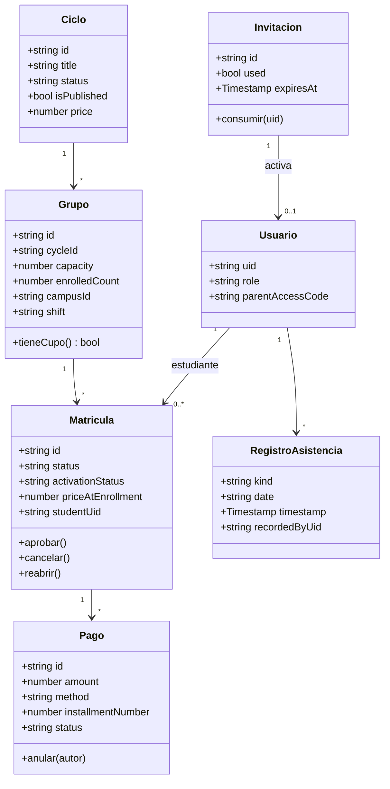

El id de `Matricula` es determinístico (`grupo__teléfono`, RN03) y el de `Invitacion` es el SHA-256 del token enviado por enlace: el token nunca se guarda.

### 4.3 Diagramas de secuencia

**Pre-matrícula pública con control de cupo (HU01, ADR-05):**

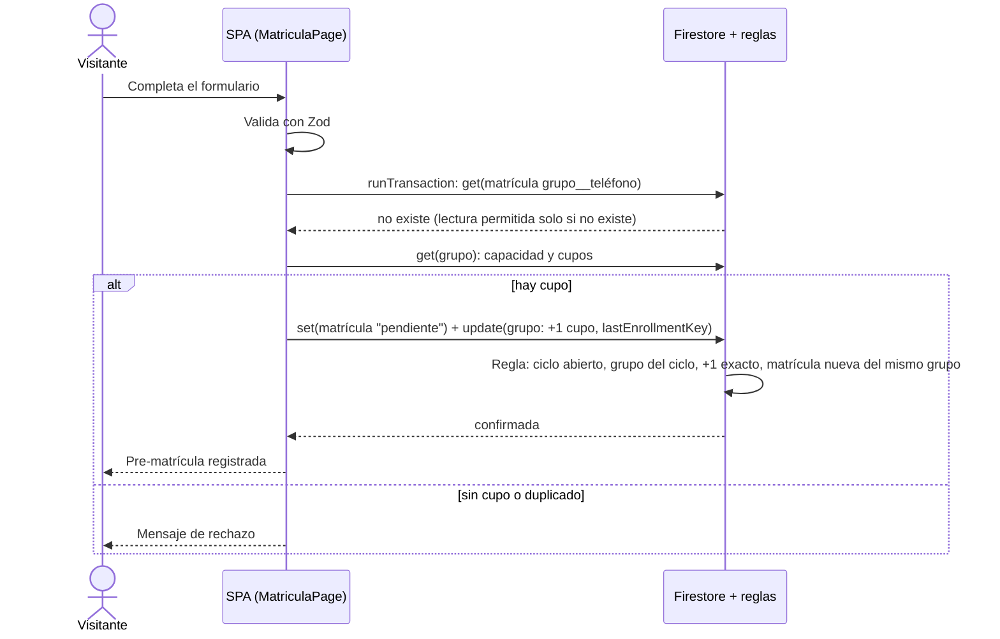

**Activación por invitación (HU05, RN08):**

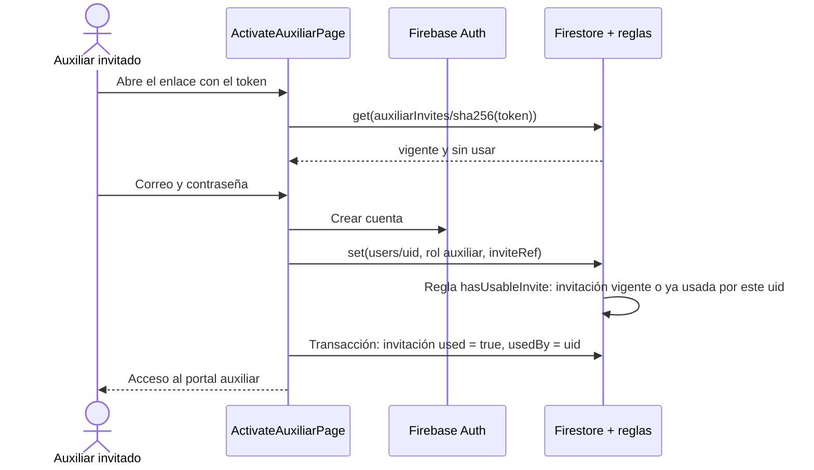

**Registro de asistencia con QR firmado (HU06, ADR-06):**

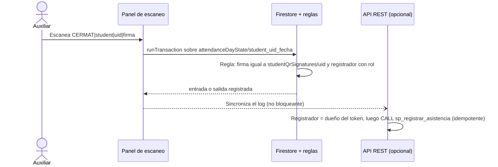

### 4.4 Diagrama de estados de la matrícula

Corresponde a `isAdminEnrollmentUpdateAllowed` y a la regla de activación de `firestore.rules`.

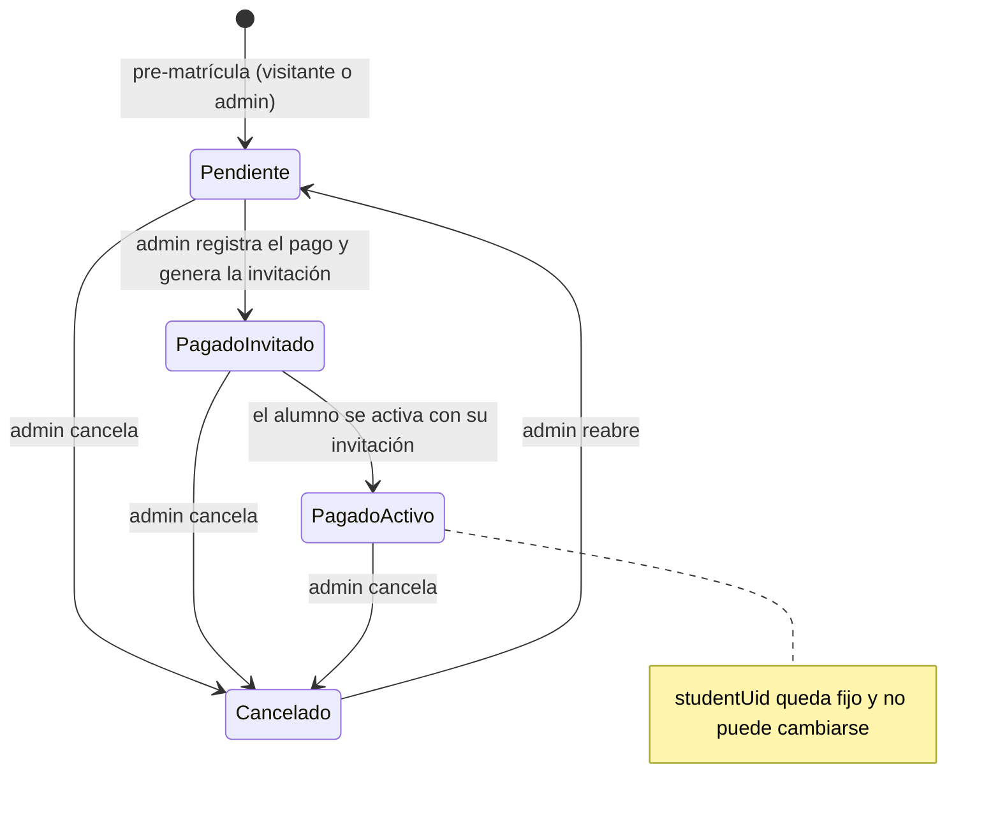

**Estado diario de la asistencia del alumno** (`attendanceDayState`):

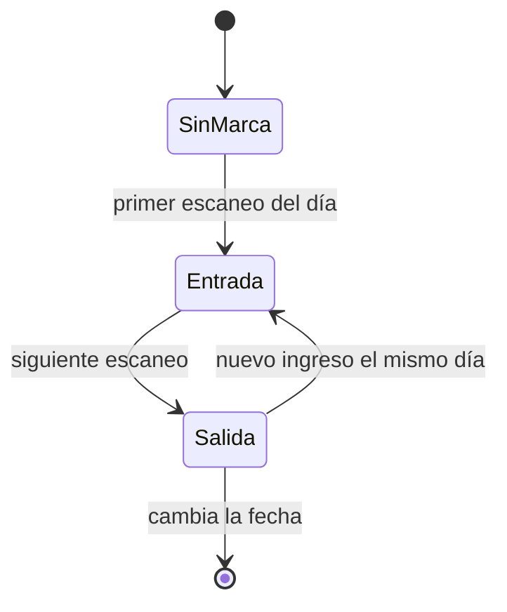

### 4.5 Modelo de diseño detallado

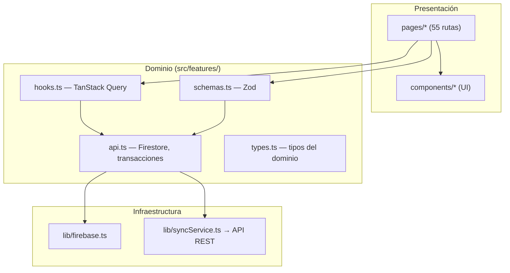

| Capa | Responsabilidad | Regla de dependencia |
|---|---|---|
| Presentación | Pantallas y formularios | Solo usa hooks y esquemas del dominio |
| Dominio | Casos de uso, validación y acceso a datos | No depende de la UI |
| Infraestructura | SDK de Firebase y sincronización | Encapsulada en `src/lib` |

## Anexos

### Anexo A — Acta de validación con stakeholders (plantilla)

| Campo | Contenido |
|---|---|
| Fecha y lugar | (completar) |
| Participantes | Dirección de la academia, un docente, un auxiliar y el equipo de desarrollo |
| Historias validadas | HU01–HU10 (marcar conformidad u observación por historia) |
| Observaciones | (completar) |
| Conformidad | Firma de la Dirección y del líder del equipo |
| Estado | **Pendiente de realizar y firmar** |

### Anexo B — Matriz de trazabilidad de requerimientos

| RF | Historia | Componente | Prueba automática |
|---|---|---|---|
| RF01 | — | `pages/Index.tsx`, `components/home/*` | — (captura 01) |
| RF02 | — | `pages/CiclosPage.tsx`, `features/cycles/*` | — (captura 02) |
| RF03 | HU01 | `pages/MatriculaPage.tsx`, `features/enrollments/api.ts` | Reglas › matrícula pública; esquemas de matrícula |
| RF04 | HU01 | `firestore.rules`, `features/enrollments/schemas.ts` | Reglas › ciclo cerrado, sobrecupo y cupo sin matrícula |
| RF05 | — | `pages/admin/AdminCiclosPage.tsx`, `features/groups/*` | Reglas › manipulación del contador |
| RF06 | HU02 | `pages/admin/AdminEnrollmentsPage.tsx`, `features/enrollments/*` | Pendiente: pruebas de transiciones de estado |
| RF07 | HU03 | `pages/admin/AdminPaymentsPage.tsx`, `features/payments/*` | Reglas › pagos; API › payment (5); BD (10) |
| RF08 | HU09 | `features/users/*`, `lib/excelImport.ts` | Unitarias › excelImport (3) |
| RF09 | HU04, HU05 | `pages/Activate*Page.tsx`, `features/teacherInvites/*` | Reglas › roles (8); unitarias › invite (3) |
| RF10 | — | `pages/teacher/TeacherCursosPage.tsx` | — |
| RF11 | — | `pages/teacher/TeacherRecursosPage.tsx`, `features/resources/*` | — |
| RF12 | HU06 | `features/attendance/api.ts`, `lib/qrPayload.ts` | Unitarias › QR (5); API › attendance (6); BD 12 |
| RF13 | HU07 | `pages/teacher/TeacherAttendanceScanPage.tsx` | API › asistencia diaria del docente |
| RF14 | HU06 | `pages/auxiliar/*`, `pages/admin/AuxiliarDashboard.tsx` | API › auxiliar sin claim |
| RF15 | — | `pages/student/*` | Reglas › lectura del alumno con sesión |
| RF16 | HU08 | `pages/ConsultaAsistenciaPadrePage.tsx`, `lib/parentAccess.ts` | Unitarias › parentAccess (4) |
| RF17 | — | `features/resources/*`, `pages/admin/AdminRecursosPage.tsx` | — |
| RF18 | — | `features/posts/*`, `pages/admin/AdminPostsPage.tsx` | Unitarias › conversión de fechas (3) |
| RF19 | — | `features/workshops/*` | — |
| RF20 | — | `pages/ContactoPage.tsx`, `firestore.rules` | — |
| RF21 | HU10 | `lib/syncService.ts`, `server/src/routes/sync.ts`, `server/src/db/*` | API › sync (15); BD (19) |
| RF22 | HU05 | `routes/*Route.tsx`, `firestore.rules`, `server/src/middleware/auth.ts` | Reglas › roles; API › autenticación |

Cobertura de trazabilidad: 22 de 22 RF con componente identificado; 15 de 22 con al menos una prueba automática. Las 7 restantes se cubren con capturas o están en el plan de mejora del E4.

### Anexo C — Diagramas complementarios

Arquitectura técnica híbrida: 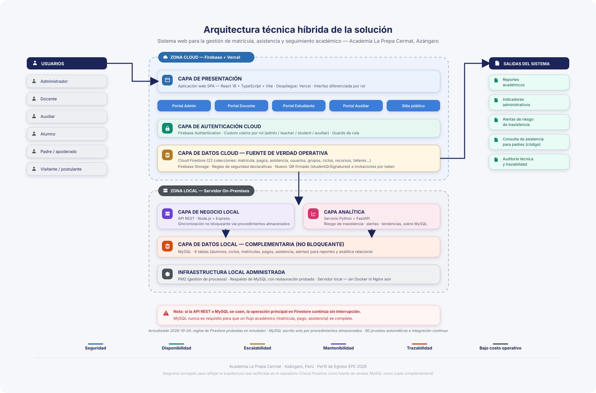

### Anexo D — Evidencia de sustentación

Exposición breve ante el docente: pendiente (ver [Guía de sustentación](e5-presentacion-sustentacion-ce0217.md)).

## Rúbrica de Evaluación

| Criterio | Excelente (18-20) | Bueno (15-17) | Regular (13-14) | Deficiente (<13) |
|---|---|---|---|---|
| Completitud y claridad de requerimientos | SRS completo, claro y estructurado (RF, RNF, reglas, restricciones) | SRS mayormente completo | Requerimientos incompletos o ambiguos | Requerimientos deficientes |
| Coherencia entre requerimientos, prototipos y diseño del sistema | Prototipos y diseño reflejan fielmente los requerimientos | Coherencia general | Varias inconsistencias | No hay coherencia |
| Definición de arquitectura del sistema | Arquitectura clara, documentada y alineada al problema | Arquitectura funcional | Arquitectura parcial | No hay arquitectura |
| Modelado del sistema (UML) | Diagramas completos y coherentes | Modelado adecuado | Modelado incompleto | No hay modelado |
| Trazabilidad de requerimientos | Componentes rastreables a requerimientos | Trazabilidad parcial | Trazabilidad limitada | No hay trazabilidad |
| Validación con stakeholders | Evidencia clara de validación | Validación parcial | Validación limitada | No hay validación |
| Sustentación y defensa técnica | Explica y defiende con dominio las decisiones tomadas | Explica con solvencia | Explica con dificultad | No sustenta |
