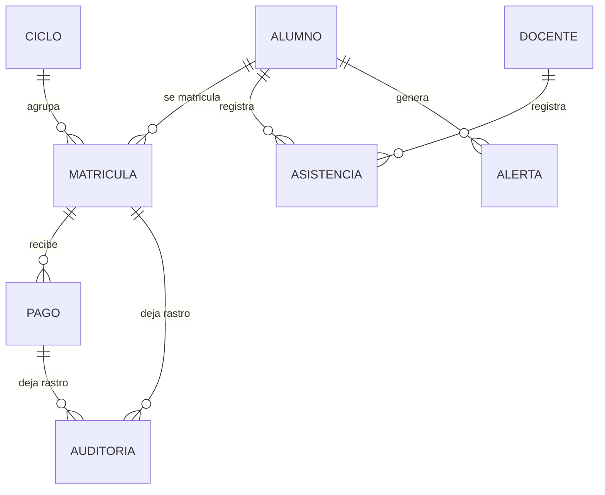
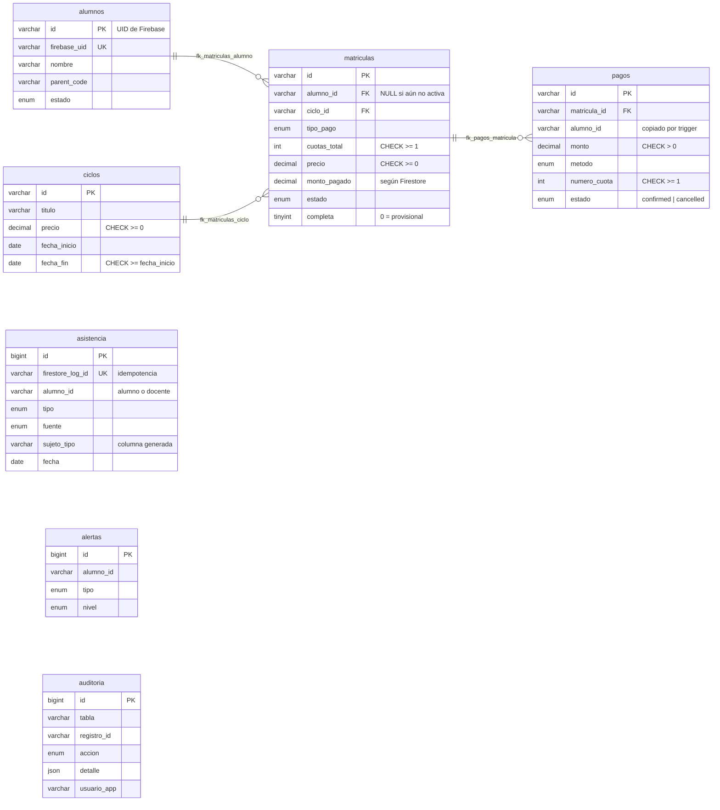

# E2 - Plataforma de Datos del Sistema (CE022)

!!! abstract "Evidencia CE022 — Ingeniería de la Información"
    Modelado, implementación, consulta, programación, seguridad y administración de la base de datos que sostiene la Plataforma CERMAT. El modelo es **híbrido**: Cloud Firestore es la fuente de verdad operativa y MySQL es la capa relacional para reportes, analítica, auditoría y continuidad.

## Portada

| Campo | Detalle |
|---|---|
| Título del sistema | Plataforma Web Integral de Gestión Académica CERMAT |
| Estudiantes | David Robert Yucra Mamani (líder), Gladys Rosaura Yana Pari, Denilson Leeke Mamani Flores, Cárdenas Vilca Rennzo |
| Semestre | 2026-2 (9° ciclo) |
| Fecha | 2026-10-24 |
| Scripts | `server/src/db/` del repositorio `academia-school-platform` |

## Resumen Ejecutivo

Los datos sostienen tres decisiones de la academia: quién está matriculado y cuánto debe, quién asiste y quién está en riesgo de abandonar, y qué se cobró y por qué medio. La operación diaria escribe en **Firestore** (22 colecciones protegidas por reglas por rol). Cada matrícula, pago y marca de asistencia se replica en **MySQL 8.0** mediante una API que **solo escribe a través de procedimientos almacenados**.

En MySQL la integridad se asegura en el motor, no solo en la aplicación: 3 claves foráneas, 7 restricciones CHECK, 6 triggers (validación, auditoría y consistencia), 4 funciones, 5 procedimientos transaccionales y 3 vistas de reporte. La seguridad usa 4 roles de mínimo privilegio. La cuenta de la API no puede ejecutar `INSERT`, `UPDATE`, `DELETE` ni `DROP` directos. Los respaldos incluyen rutinas y triggers, se verifican con SHA-256 y se restauran con medición del RTO. Una batería de **19 pruebas automáticas** sobre la base valida funciones, triggers y restricciones.

## Sección 1: Modelo de Datos

### 1.1 Modelo entidad-relación (conceptual)



### 1.2 Modelo lógico relacional (MySQL)



### 1.3 Modelo normalizado

| Forma normal | Verificación |
|---|---|
| 1FN | Todos los atributos son atómicos. Los horarios y las categorías multivaluados viven solo en Firestore, no en la réplica. |
| 2FN | Todas las tablas tienen clave primaria simple, así que no hay dependencias parciales. |
| 3FN | `matriculas` depende solo de su id. El saldo **no se almacena**: se calcula con `fn_saldo_matricula` o `v_estado_cuenta`. |
| Desnormalización deliberada | `pagos.alumno_nombre` y `pagos.ciclo_titulo` guardan el valor vigente al momento del pago, como un comprobante. `pagos.alumno_id` es una copia que mantiene el trigger `trg_matriculas_au`. |
| Excepción justificada | `asistencia.alumno_id` guarda alumnos **y** docentes (fuente `teacher-daily-qr`), por eso no tiene FK. La columna generada `sujeto_tipo` los separa en todas las consultas. |

### 1.4 Diccionario de datos

**MySQL (`server/src/db/schema.sql` + `02_integridad.sql`)**

| Tabla | Columna | Tipo | Restricción | Descripción |
|---|---|---|---|---|
| alumnos | id | VARCHAR(64) | PK | UID de Firebase Auth |
| alumnos | firebase_uid | VARCHAR(64) | UNIQUE, NOT NULL | Igual a `id`, por compatibilidad |
| alumnos | parent_code | VARCHAR(50) | índice | Código CERMAT para la consulta de padres |
| alumnos | estado | ENUM | activo/inactivo/egresado | Vigencia del alumno |
| ciclos | id | VARCHAR(64) | PK | Id del documento en Firestore |
| ciclos | precio | DECIMAL(10,2) | CHECK ≥ 0 | Precio de lista |
| matriculas | id | VARCHAR(128) | PK | Id de la matrícula en Firestore |
| matriculas | alumno_id | VARCHAR(64) | FK → alumnos, NULL | NULL mientras la cuenta no se activa |
| matriculas | ciclo_id | VARCHAR(64) | FK → ciclos | Ciclo matriculado |
| matriculas | cuotas_total | INT | CHECK ≥ 1 | Cuotas pactadas |
| matriculas | precio | DECIMAL(10,2) | CHECK ≥ 0 | Precio congelado al matricular |
| matriculas | monto_pagado | DECIMAL(10,2) | CHECK ≥ 0 | Valor reportado por Firestore (se concilia) |
| matriculas | completa | TINYINT(1) | — | 0 = creada por un pago adelantado |
| pagos | matricula_id | VARCHAR(128) | FK → matriculas | Matrícula pagada |
| pagos | monto | DECIMAL(10,2) | CHECK > 0 | Importe |
| pagos | numero_cuota | INT | CHECK ≥ 1 o NULL; ≤ cuotas pactadas (trigger) | NULL = pago único |
| pagos | estado | ENUM | confirmed/cancelled | Anulación lógica: no se borra |
| asistencia | firestore_log_id | VARCHAR(64) | UNIQUE | Evita duplicados por reintentos |
| asistencia | sujeto_tipo | VARCHAR(10) | generada (STORED) | `alumno` o `docente` según la fuente |
| auditoria | detalle | JSON | NOT NULL | Valores antes/después |
| auditoria | usuario_app | VARCHAR(64) | — | UID de Firebase que originó el cambio |

**Firestore (fuente de verdad, protegida por `firestore.rules`)**

| Colección | Descripción | Relaciones |
|---|---|---|
| `users` | Perfiles y rol (admin, teacher, student, auxiliar) | asistencia, grupos, invitaciones, código de padres |
| `cycles`, `cycleCategories`, `campuses` | Oferta académica, niveles y sedes | grupos, matrículas, recursos |
| `groups` | Grupo por ciclo, sede, turno, horario, docente y cupo | `enrolledCount` controlado por transacción |
| `enrollments` | Matrículas y su máquina de estados | pagos, `studentGroupLinks` |
| `payments` | Pagos; eliminación bloqueada por reglas | `enrollmentId` |
| `attendanceTokens`, `attendanceLogs`, `attendanceDayState` | QR diario, marcas y estado transaccional del día | usuario, fecha |
| `studentQrSignatures` | Firma opaca del QR permanente | validada por reglas con `get()` |
| `parentAttendance` | Vista resumida por código para padres | estudiante |
| `resources`, `posts`, `workshops`, `messages`, `config` | Contenido y configuración | — |
| `invites`, `teacherInvites`, `auxiliarInvites`, `studentGroupLinks`, `students` | Activación por rol y vínculos | — |

## Sección 2: Implementación de Base de Datos

### 2.1 Scripts DDL

| Archivo | Contenido |
|---|---|
| `schema.sql` | 6 tablas base con PK, 15 índices y ENUM |
| `02_integridad.sql` | 3 FK, 7 CHECK, columnas `completa`, `firestore_log_id` y `sujeto_tipo`, índices compuestos `idx_ciclo_estado`, `idx_estado_fecha`, `idx_sujeto_fecha` y `idx_alumno_tipo_resuelta`. Convierte `''` en `NULL` y crea las filas padre faltantes de datos ya replicados, para que las FK se puedan aplicar sobre una base en uso. |
| `03_programacion.sql` | Tabla `auditoria`, funciones, procedimientos, triggers y vistas |
| `04_seguridad.sql` | Roles y privilegios |

Fragmento de `02_integridad.sql`:

```sql
ALTER TABLE pagos
  ADD CONSTRAINT fk_pagos_matricula FOREIGN KEY (matricula_id) REFERENCES matriculas (id)
    ON UPDATE CASCADE ON DELETE RESTRICT,
  ADD CONSTRAINT chk_pagos_monto CHECK (monto > 0),
  ADD CONSTRAINT chk_pagos_cuota CHECK (numero_cuota IS NULL OR numero_cuota >= 1),
  ADD INDEX idx_estado_fecha (estado, pagado_en);

ALTER TABLE asistencia
  ADD COLUMN firestore_log_id VARCHAR(64) NULL AFTER id,
  ADD COLUMN sujeto_tipo VARCHAR(10)
    GENERATED ALWAYS AS (IF(fuente = 'teacher-daily-qr', 'docente', 'alumno')) STORED,
  ADD UNIQUE KEY uq_asistencia_log (firestore_log_id);
```

### 2.2 Scripts DML

`90_datos_prueba.sql` carga **datos ficticios** (nombres "Prueba", correos `example.com`):

- 2 ciclos y 4 alumnos con `INSERT` directos.
- 4 matrículas y 6 operaciones de pago mediante los procedimientos, incluidas una anulación y un pago que llega antes que su matrícula.
- 30 días de asistencia generados con `INSERT … SELECT` y tabla derivada (solo días hábiles).

El script se niega a ejecutarse si la base contiene matrículas reales: una tabla temporal con CHECK aborta la carga sin dejar residuos.

### 2.3 Evidencias de creación

Migración aplicada sobre una base que ya tenía datos replicados con la versión anterior de la API (pagos sin alumno, ciclos inexistentes y un pago huérfano). Resultado: las 3 migraciones se registran en `schema_migraciones`, los vacíos pasan a `NULL`, se crean las filas padre faltantes y el pago huérfano queda en una matrícula provisional visible en `v_conciliacion_pagos`.

!!! note "Capturas a adjuntar"
    `SHOW CREATE TABLE pagos;` · `SELECT * FROM information_schema.TABLE_CONSTRAINTS WHERE TABLE_SCHEMA='cermat_db';` · `SELECT * FROM schema_migraciones;` (comandos en `server/src/db/README.md`).

## Sección 3: Consultas y Programación en Base de Datos

### 3.1 Consultas SQL relevantes (`91_consultas.sql`)

| ID | Pregunta de negocio | Implementación |
|---|---|---|
| Q1 | ¿Qué matrículas de un ciclo siguen pendientes? | `JOIN` matrículas–alumnos filtrado por `(ciclo_id, estado)` |
| Q2 | ¿Cuánto se cobró por día y medio de pago? | Agregación sobre `(estado, pagado_en)` |
| Q3 | ¿Qué alumnos están en riesgo de abandono? | `CALL sp_riesgo_inasistencia(30, 75)` |
| Q4 | ¿A qué hora entró y salió un alumno cada día? | Vista `v_asistencia_diaria` |
| Q5 | ¿Quién tiene saldo pendiente? | Vista `v_estado_cuenta` (pagos agregados una sola vez) |
| Q6 | ¿Se perdió algún evento de sincronización? | Vista `v_conciliacion_pagos` |

```sql
-- Q5. Estado de cuenta con saldo pendiente
SELECT matricula_id, alumno_nombre, ciclo_titulo, precio, total_pagado, saldo, cuotas_pagadas, cuotas_total
  FROM v_estado_cuenta
 WHERE estado <> 'cancelado' AND saldo > 0
 ORDER BY saldo DESC;
```

### 3.2 Procedimientos almacenados

| Procedimiento | Tipo | Qué garantiza |
|---|---|---|
| `sp_sync_matricula` | Escritura transaccional | Crea o actualiza ciclo, alumno y matrícula en una transacción con `ROLLBACK` + `RESIGNAL`. Completa una matrícula provisional cuando llega la real. |
| `sp_sync_pago` | Escritura transaccional | No pierde pagos que llegan antes que su matrícula. En una anulación conserva al registrador original y deja en auditoría quién anuló. |
| `sp_registrar_asistencia` | Escritura idempotente | Reenviar el mismo log no duplica filas y responde si la marca era nueva. No depende de `ROW_COUNT()`, que con `CLIENT_FOUND_ROWS` de mysql2 cuenta los duplicados. |
| `sp_estado_cuenta` | Consulta | Estado de cuenta por ciclo o general |
| `sp_riesgo_inasistencia` | Consulta | Parte de los alumnos con matrícula vigente, así que **incluye a quienes nunca asistieron**. Excluye docentes y usa días lectivos reales. |

Fragmento de `sp_sync_pago`:

```sql
  DECLARE EXIT HANDLER FOR SQLEXCEPTION
  BEGIN
    SET @app_uid = NULL;
    ROLLBACK;
    RESIGNAL;
  END;
  SET @app_uid = p_registrado_por;          -- lo leen los triggers de auditoría
  START TRANSACTION;
  INSERT IGNORE INTO matriculas (id, completa) VALUES (p_matricula_id, 0);
  INSERT INTO pagos (...) VALUES (...)
  ON DUPLICATE KEY UPDATE estado = p_estado, monto = p_monto;
  COMMIT;
```

### 3.3 Funciones

| Función | Retorna | Uso |
|---|---|---|
| `fn_total_pagado(matricula)` | DECIMAL | Suma de pagos `confirmed` (los anulados no cuentan) |
| `fn_saldo_matricula(matricula)` | DECIMAL | `precio − pagado`, nunca negativo |
| `fn_dias_lectivos(desde, hasta)` | INT | Días con al menos una entrada de alumno, sin fines de semana ni feriados |
| `fn_porcentaje_asistencia(alumno, desde, hasta)` | DECIMAL(5,1) | Asistencia sobre días lectivos |

**Corrección de lógica:** la analítica anterior dividía entre 30 días calendario. Un alumno que asistía todos los días hábiles obtenía ≈ 73 % y quedaba marcado "en riesgo". Además, no veía a los alumnos con cero asistencias y contaba a los docentes como alumnos. Con `fn_dias_lectivos` y `sp_riesgo_inasistencia` los tres problemas quedan resueltos. `analytics/main.py` y `GET /api/asistencia/riesgo` ya usan el procedimiento.

### 3.4 Triggers

| Trigger | Momento | Función |
|---|---|---|
| `trg_pagos_bi` | BEFORE INSERT | Copia `alumno_id` desde la matrícula y rechaza una cuota mayor a las pactadas (`SIGNAL 45000`) |
| `trg_pagos_ai` | AFTER INSERT | Audita el pago |
| `trg_pagos_au` | AFTER UPDATE | Audita cambios de estado o monto (antes/después) |
| `trg_pagos_bd` | BEFORE DELETE | Impide borrar pagos, igual que la regla de Firestore |
| `trg_matriculas_ai` | AFTER INSERT | Audita la matrícula |
| `trg_matriculas_au` | AFTER UPDATE | Audita cambios de estado o de completitud; propaga `alumno_id` a los pagos cuando la cuenta se activa |

### 3.5 Planes de ejecución

Obtenidos con `EXPLAIN FORMAT=TREE` en MySQL 8.0.30:

```text
Q1 -> Nested loop left join  (cost=0.70 rows=1)
    -> Sort: m.created_at DESC
        -> Index lookup on m using idx_ciclo_estado (ciclo_id=(@ciclo), estado='pendiente')
    -> Single-row index lookup on a using PRIMARY (id=m.alumno_id)

Q4 -> Group aggregate: min(...), max(...)
    -> Index lookup on asistencia using idx_alumno_fecha (alumno_id='UID-PRUEBA-A1')
```

Q1 y Q4 resuelven por índice, sin recorrer la tabla completa. En Q2, con pocos datos de prueba, el optimizador eligió `idx_estado`. El índice compuesto `idx_estado_fecha` está pensado para el volumen real, donde el rango de fechas descarta la mayoría de filas. Esto debe confirmarse con `EXPLAIN` sobre la base productiva.

## Sección 4: Seguridad y Administración

### 4.1 Usuarios y roles

| Cuenta | Rol | Puede | No puede |
|---|---|---|---|
| `cermat_api` | `cermat_rol_api` | `SELECT`; `EXECUTE` de los procedimientos y funciones | `INSERT`, `UPDATE`, `DELETE`, `DROP` directos (verificado: error 1142) |
| `cermat_analitica` | `cermat_rol_analitica` | `SELECT`; escribir en `alertas`; `sp_riesgo_inasistencia` | Modificar matrículas, pagos o asistencia |
| `cermat_respaldo` | `cermat_rol_respaldo` | `SELECT`, `SHOW VIEW`, `TRIGGER`, `LOCK TABLES`, `EVENT`, `SHOW_ROUTINE` | Escribir |
| `cermat_reportes` | `cermat_rol_reportes` | Leer las 3 vistas | Leer tablas con datos crudos |

Las cuentas se crean con `server/scripts/db-crear-usuarios.js`, que lee las contraseñas solo de variables de entorno (mínimo 12 caracteres). **Ninguna contraseña queda escrita en el repositorio.**

La capa de aplicación aplica además estas reglas en la API:

| Ruta | Regla |
|---|---|
| `POST /api/sync/payment` | Solo administradores, igual que `firestore.rules` |
| `POST /api/sync/enrollment` | Un no-administrador solo sincroniza su propia matrícula recién creada |
| `POST /api/sync/attendance-log` | El registrador es siempre el dueño del token (nunca el cuerpo de la petición) y el rol se valida por fuente |

### 4.2 Auditoría implementada

La tabla `auditoria` registra cada alta, cambio de estado o monto y anulación de pagos y matrículas. Guarda el detalle en JSON (antes/después), el UID de Firebase que originó el cambio (`@app_uid`, fijado por el procedimiento) y la cuenta MySQL (`CURRENT_USER()`).

### 4.3 Estrategias de respaldo y recuperación

| Elemento | Implementación |
|---|---|
| Respaldo | `server/scripts/backup.js`: `mysqldump --single-transaction --routines --triggers --events` con la cuenta de solo lectura. La contraseña viaja por `MYSQL_PWD`, no por la línea de comandos. Genera `.sha256` y conserva 7. |
| Programación | `pm2 start scripts/backup.js --name cermat-backup --cron "0 2 * * *" --no-autorestart` |
| Recuperación | `server/scripts/restore.js`: verifica el hash, restaura en `cermat_db_verificacion`, mide el RTO y compara filas, rutinas, triggers y vistas. Restaurar sobre producción exige `--confirmar-produccion`. |
| Registro | Cada prueba se anota en `backups/registro-restauraciones.jsonl` |

En el ambiente de prueba (MySQL 8.0.30, 2026-10-24) el respaldo pasó la verificación SHA-256 y se restauró en `cermat_db_verificacion` con un RTO medido de 0,38 s. Las filas, rutinas, triggers y vistas restaurados coincidieron con el origen. También se verificó que la restauración rechaza un archivo alterado ("no coincide con su .sha256") y que se niega a escribir sobre la base productiva sin confirmación.

!!! note "Captura a adjuntar"
    Salida de `node scripts/restore.js` ejecutado sobre la base real del equipo, junto con la línea correspondiente de `backups/registro-restauraciones.jsonl`.

### 4.4 Evidencias de monitoreo

| Indicador | Fuente |
|---|---|
| Disponibilidad de MySQL | `GET /health` de la API y de la analítica (ping a MySQL), mostrado en el panel admin "Infraestructura" |
| Integridad de la réplica | `SELECT * FROM v_conciliacion_pagos;`, que debe devolver 0 filas |
| Trazabilidad | `SELECT … FROM auditoria ORDER BY id DESC` |
| Recuperabilidad | `backups/registro-restauraciones.jsonl` (RTO y objetos completos por prueba) |

## Pruebas de la capa de datos

`92_pruebas_bd.sql` ejecuta 19 pruebas y muestra una tabla OK/FALLÓ.

**Resultado: 19/19 OK** en MySQL 8.0.30, con modo estricto y binlog activo.

| # | Prueba | Resultado |
|---|---|---|
| 1–3 | `fn_total_pagado` y `fn_saldo_matricula`; los pagos anulados no cuentan | OK |
| 4–7 | Asistencia sobre días lectivos; alumno con 0 asistencias visible; docentes excluidos | OK |
| 8–9 | El trigger copia `alumno_id`; la anulación conserva al registrador y audita a quien anuló | OK |
| 10–11 | El pago adelantado crea una matrícula provisional y la conciliación queda limpia al llegar la real | OK |
| 12 | Reenviar un log no duplica filas | OK |
| 13–18 | Rechazos: borrar pago, cuota excedida, monto negativo, FK alumno, borrar matrícula con pagos, 0 cuotas | OK |
| 19 | Las operaciones rechazadas no dejan filas a medias (`ROLLBACK`) | OK |

## Consistencia con el sistema

| Requerimiento (E1) | Soporte de datos |
|---|---|
| RF03–RF06 Matrícula y estados | `enrollments` + reglas; `matriculas` + `sp_sync_matricula` |
| RF07 Pagos | `payments`; `pagos` + `sp_sync_pago` + triggers + `v_estado_cuenta` |
| RF12–RF14 Asistencia QR | `attendanceLogs`, `attendanceDayState`; `asistencia` idempotente |
| RF16 Padres | `parentAttendance`, `alumnos.parent_code` |
| RF21 Sincronización | `syncService` → API → procedimientos; conciliación con `v_conciliacion_pagos` |
| RNF06 Integridad y RNF10 Auditoría | FK, CHECK, triggers, `auditoria` |

## Anexos

| Anexo | Ubicación |
|---|---|
| Scripts completos | `server/src/db/schema.sql`, `02_integridad.sql`, `03_programacion.sql`, `04_seguridad.sql`, `90_datos_prueba.sql`, `91_consultas.sql`, `92_pruebas_bd.sql` |
| Capturas de ejecución | Resultado de `92_pruebas_bd.sql` (19/19), de `91_consultas.sql` (consultas + `EXPLAIN`) y de `restore.js` |
| Resultados de consultas | Salida de `91_consultas.sql` sobre la base de prueba |
| Documentación técnica de administración | `server/src/db/README.md` (orden de migración, cuentas, respaldo y recuperación) |
| Evidencia de sustentación | Exposición breve ante el docente (pendiente) |

## Rúbrica de Evaluación

| Criterio | Excelente | Bueno | Regular | Deficiente |
|---|---|---|---|---|
| Modelado de datos | Modelo consistente, normalizado y alineado | Modelo adecuado | Modelo incompleto | Modelo incorrecto |
| Integridad y consistencia de datos | Integridad referencial completa | Integridad funcional | Problemas de consistencia | Datos inconsistentes |
| Implementación y consultas SQL | Consultas correctas y eficientes | Consultas funcionales | Consultas deficientes | Sin consultas |
| Programación de base de datos | Uso adecuado de lógica en BD | Uso funcional | Uso limitado | No hay programación |
| Seguridad y administración | Control de accesos y seguridad definidos | Seguridad básica | Seguridad parcial | Sin seguridad |
| Rendimiento y optimización | Índices y consultas optimizadas | Rendimiento aceptable | Problemas de rendimiento | Sistema ineficiente |
| Sustentación y defensa técnica | Explica y defiende con dominio las decisiones tomadas | Explica con solvencia | Explica con dificultad | No sustenta |
