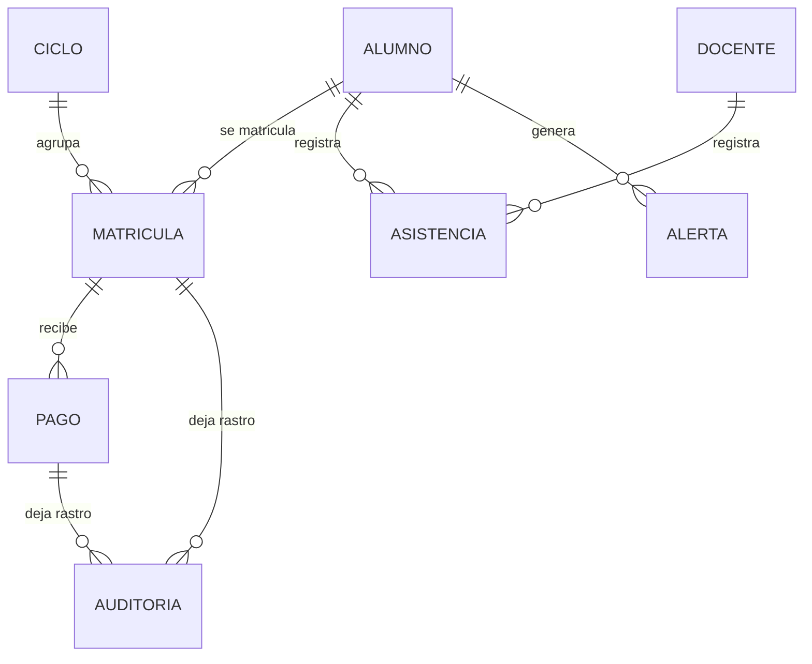
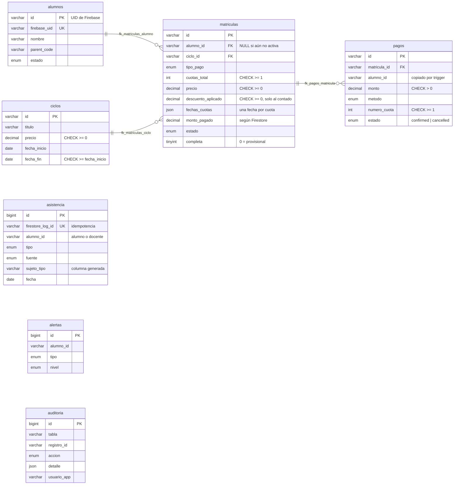

# E2 - Plataforma de Datos del Sistema (CE022)

!!! abstract "Evidencia CE022 — Ingeniería de la Información"
    Modelado, implementación, consulta, programación, seguridad y administración de la base de datos que sostiene la Plataforma CERMAT. El modelo es **híbrido**: Cloud Firestore es la fuente de verdad operativa y MySQL es la capa relacional para reportes, analítica, auditoría y continuidad.

## Portada

| Campo | Detalle |
|---|---|
| Título del sistema | Plataforma Web Integral de Gestión Académica CERMAT |
| Estudiantes | David Robert Yucra Mamani (líder), Gladys Rosaura Yana Pari, Denilson Leeke Mamani Flores, Cárdenas Vilca Rennzo |
| Semestre | 2026-2 (9° ciclo) |
| Fecha | 2026-11-18 (primera versión: 2026-10-24) |
| Scripts | `server/src/db/` del repositorio `academia-school-platform` |
| Documento | [Word](assets/software/informes/CE022_S2_E2_Plataforma_de_Datos_del_Sistema.docx) y [PDF](assets/software/informes/CE022_S2_E2_Plataforma_de_Datos_del_Sistema.pdf), generados desde esta página |

## Resumen Ejecutivo

Los datos sostienen tres decisiones de la academia: quién está matriculado y cuánto debe, quién asiste y quién está en riesgo de abandonar, y qué se cobró y por qué medio. La operación diaria escribe en **Firestore** (27 colecciones protegidas por reglas por rol). Cada matrícula, pago y marca de asistencia se replica en **MySQL 8.0** mediante una API que **solo escribe a través de procedimientos almacenados**.

En MySQL la integridad se asegura en el motor, no solo en la aplicación: 3 claves foráneas, 8 restricciones CHECK, 7 triggers (validación, auditoría y consistencia), 4 funciones, 6 procedimientos transaccionales y 3 vistas de reporte. La seguridad usa 4 roles de mínimo privilegio. La cuenta de la API no puede ejecutar `INSERT`, `UPDATE`, `DELETE` ni `DROP` directos. Los respaldos incluyen rutinas y triggers, se verifican con SHA-256 y se restauran con medición del RTO. Una batería de **25 pruebas automáticas** sobre la base valida funciones, triggers, restricciones y la reparación de la réplica.

Desde el 2026-10-24 la base real `cermat_db` tiene estas migraciones y sus cuentas de servicio, con el mínimo privilegio verificado en ella (secciones 2.3 y 4.1). Ese mismo día la base pasó al VPS del colegio, donde tiene respaldo diario, y su restauración se probó también en otro servidor (sección 4.3). Esa noche recibió, con una carga inicial, los datos que Firestore ya tenía: quedó con 10 matrículas, 2 pagos y 7 asistencias (sección 2.3).

Desde el 2026-11-14 la réplica se compara campo por campo con Firestore y se repara cada noche a las 03:30, después del respaldo. La primera comparación encontró 3 diferencias de milisegundos, que la carga reparó; la comparación final dio «coinciden» (sección 4.5). La migración 06 agrega a las matrículas el descuento al contado y el cronograma de cuotas.

## Sección 1: Modelo de Datos

### 1.1 Modelo entidad-relación (conceptual)



### 1.2 Modelo lógico relacional (MySQL)



### 1.3 Modelo normalizado

| Forma normal | Verificación |
|---|---|
| 1FN | Todos los atributos son atómicos. Los horarios y las categorías multivaluados viven solo en Firestore, no en la réplica. |
| 2FN | Todas las tablas tienen clave primaria simple, así que no hay dependencias parciales. |
| 3FN | `matriculas` depende solo de su id. El saldo **no se almacena**: se calcula con `fn_saldo_matricula` o `v_estado_cuenta`. |
| Desnormalización deliberada | `pagos.alumno_nombre` y `pagos.ciclo_titulo` guardan el valor vigente al momento del pago, como un comprobante. `pagos.alumno_id` es una copia que mantiene el trigger `trg_matriculas_au`. |
| Excepción justificada | `asistencia.alumno_id` guarda alumnos **y** docentes (fuente `teacher-daily-qr`), por eso no tiene FK. La columna generada `sujeto_tipo` los separa en todas las consultas. |

### 1.4 Diccionario de datos

**MySQL (`server/src/db/schema.sql` + `02_integridad.sql`)**

| Tabla | Columna | Tipo | Restricción | Descripción |
|---|---|---|---|---|
| alumnos | id | VARCHAR(64) | PK | UID de Firebase Auth |
| alumnos | firebase_uid | VARCHAR(64) | UNIQUE, NOT NULL | Igual a `id`, por compatibilidad |
| alumnos | parent_code | VARCHAR(50) | índice | Código CERMAT para la consulta de padres |
| alumnos | estado | ENUM | activo/inactivo/egresado | Vigencia del alumno |
| ciclos | id | VARCHAR(64) | PK | Id del documento en Firestore |
| ciclos | precio | DECIMAL(10,2) | CHECK ≥ 0 | Precio de lista |
| matriculas | id | VARCHAR(128) | PK | Id de la matrícula en Firestore |
| matriculas | alumno_id | VARCHAR(64) | FK → alumnos, NULL | NULL mientras la cuenta no se activa |
| matriculas | ciclo_id | VARCHAR(64) | FK → ciclos | Ciclo matriculado |
| matriculas | cuotas_total | INT | CHECK ≥ 1 | Cuotas pactadas |
| matriculas | precio | DECIMAL(10,2) | CHECK ≥ 0 | Precio congelado al matricular |
| matriculas | descuento_aplicado | DECIMAL(10,2) | CHECK ≥ 0; ≤ precio y solo al contado (`sp_sync_matricula`) | Descuento al contado (migración 06) |
| matriculas | fechas_cuotas | JSON | NULL al contado; una fecha válida por cuota (`sp_sync_matricula`) | Cronograma de vencimientos congelado al matricular (migración 06) |
| matriculas | monto_pagado | DECIMAL(10,2) | CHECK ≥ 0 | Valor reportado por Firestore (se concilia) |
| matriculas | completa | TINYINT(1) | — | 0 = creada por un pago adelantado |
| pagos | matricula_id | VARCHAR(128) | FK → matriculas | Matrícula pagada |
| pagos | monto | DECIMAL(10,2) | CHECK > 0 | Importe |
| pagos | numero_cuota | INT | CHECK ≥ 1 o NULL; ≤ cuotas pactadas (trigger) | NULL = pago único |
| pagos | estado | ENUM | confirmed/cancelled | Anulación lógica: no se borra |
| asistencia | firestore_log_id | VARCHAR(64) | UNIQUE | Evita duplicados por reintentos |
| asistencia | sujeto_tipo | VARCHAR(10) | generada (STORED) | `alumno` o `docente` según la fuente |
| auditoria | detalle | JSON | NOT NULL | Valores antes/después |
| auditoria | usuario_app | VARCHAR(64) | — | UID de Firebase que originó el cambio |

**Firestore (fuente de verdad, protegida por `firestore.rules`)**

| Colección | Descripción | Relaciones |
|---|---|---|
| `users` | Perfiles y rol (admin, teacher, student, auxiliar) | asistencia, grupos, invitaciones, código de padres |
| `cycles`, `cycleCategories`, `campuses` | Oferta académica, niveles y sedes | grupos, matrículas, recursos |
| `groups` | Grupo por ciclo, sede, turno, horario, docente responsable, cursos por materia (`courses`) y cupo | `enrolledCount` controlado por transacción; `teacherUids` calculado al guardar |
| `enrollments` | Matrículas, su máquina de estados, descuento y cronograma | pagos, `studentGroupLinks` |
| `fichasMatricula` | Ficha completa del alumno, apoderado y consentimiento | matrícula; solo la lee el administrador |
| `documentosAlumnos` | Registro `TIPO-NÚMERO` del documento y su cuenta | solo la lee el administrador y solo la escribe la API |
| `payments` | Pagos; eliminación bloqueada por reglas | `enrollmentId` |
| `receipts`, `counters` | Comprobante de cada pago (id = id del pago) y su correlativo | pago; el alumno lista solo los suyos |
| `attendanceTokens`, `attendanceLogs`, `attendanceDayState` | Secreto del día del QR rotativo, marcas con resumen de la firma y estado transaccional del día | usuario, fecha |
| `studentQrSignatures` | Firma opaca del QR permanente | validada por reglas con `get()`; solo la leen el alumno y el admin |
| `parentAttendance` | Registro del código de padres (vigente o revocado) y sus marcas | estudiante |
| `workshops`, `workshopRegistrations` | Talleres con `registeredCount` e inscripciones `{taller}__{alumno}` | contador movido solo junto con la inscripción |
| `resources`, `posts`, `messages`, `config` | Contenido, solicitudes y configuración (servicios, modo de acceso de alumnos y datos institucionales de pago) | — |
| `invites`, `teacherInvites`, `auxiliarInvites`, `studentGroupLinks`, `students` | Activación por rol y vínculos | — |

## Sección 2: Implementación de Base de Datos

### 2.1 Scripts DDL

| Archivo | Contenido |
|---|---|
| `schema.sql` | 6 tablas base con PK, 15 índices y ENUM |
| `02_integridad.sql` | 3 FK, 7 CHECK, columnas `completa`, `firestore_log_id` y `sujeto_tipo`, índices compuestos `idx_ciclo_estado`, `idx_estado_fecha`, `idx_sujeto_fecha` y `idx_alumno_tipo_resuelta`. Convierte `''` en `NULL` y crea las filas padre faltantes de datos ya replicados, para que las FK se puedan aplicar sobre una base en uso. |
| `03_programacion.sql` | Tabla `auditoria`, 4 funciones, 6 procedimientos, 7 triggers y 3 vistas; los reenvíos reparan pagos y asistencias. Re-ejecutable; después siempre va `04`, porque MySQL quita los permisos por rutina al recrearlas |
| `04_seguridad.sql` | Roles y privilegios (9 permisos `EXECUTE` para la API) |
| `05_corregir_turno.sql` | Corrige la etiqueta `mañana` del ENUM `matriculas.turno`, dañada al crear la tabla desde una sesión en cp850. Sus sentencias van solo en ASCII (la «ñ» en hexadecimal) y es re-ejecutable |
| `06_matriculas_descuento_cronograma.sql` | Agrega `descuento_aplicado` (con `chk_matriculas_descuento`) y `fechas_cuotas` (JSON) a `matriculas` en bases existentes. Va antes de `03`, porque las rutinas nuevas usan esas columnas. Se aplica una sola vez |

Todos los scripts empiezan con `SET NAMES utf8mb4`. Sin eso, una consola de Windows en cp850 guarda mal la «ñ» y las tildes: así se dañó la etiqueta `mañana` en junio.

Fragmento de `02_integridad.sql`:

```sql
ALTER TABLE pagos
  ADD CONSTRAINT fk_pagos_matricula FOREIGN KEY (matricula_id) REFERENCES matriculas (id)
    ON UPDATE CASCADE ON DELETE RESTRICT,
  ADD CONSTRAINT chk_pagos_monto CHECK (monto > 0),
  ADD CONSTRAINT chk_pagos_cuota CHECK (numero_cuota IS NULL OR numero_cuota >= 1),
  ADD INDEX idx_estado_fecha (estado, pagado_en);

ALTER TABLE asistencia
  ADD COLUMN firestore_log_id VARCHAR(64) NULL AFTER id,
  ADD COLUMN sujeto_tipo VARCHAR(10)
    GENERATED ALWAYS AS (IF(fuente = 'teacher-daily-qr', 'docente', 'alumno')) STORED,
  ADD UNIQUE KEY uq_asistencia_log (firestore_log_id);
```

### 2.2 Scripts DML

`90_datos_prueba.sql` carga **datos ficticios** (nombres "Prueba", correos `example.com`):

- 2 ciclos y 4 alumnos con `INSERT` directos.
- 4 matrículas y 6 operaciones de pago mediante los procedimientos, incluidas una anulación y un pago que llega antes que su matrícula.
- 30 días de asistencia generados con `INSERT … SELECT` y tabla derivada (solo días hábiles).

El script se niega a ejecutarse si la base contiene matrículas reales: una tabla temporal con CHECK aborta la carga sin dejar residuos.

### 2.3 Evidencias de creación

Migración aplicada sobre una base que ya tenía datos replicados con la versión anterior de la API (pagos sin alumno, ciclos inexistentes y un pago huérfano). Resultado: las 3 migraciones se registran en `schema_migraciones`, los vacíos pasan a `NULL`, se crean las filas padre faltantes y el pago huérfano queda en una matrícula provisional visible en `v_conciliacion_pagos`.

**Base real (`cermat_db`, 2026-10-24, de 16:29 a 16:40 UTC−5):**

1. Respaldo previo `cermat_db_2026-10-24T16-29-23_antes-migracion.sql`, con su SHA-256.
2. Revisión previa sin conflictos: estaban todas las columnas que usan las migraciones y el único pago cumple los CHECK.
3. Migraciones 02, 03 y 04 aplicadas: 3 FK, 7 CHECK, 4 funciones, 5 procedimientos, 6 triggers, 3 vistas y 4 roles; `schema_migraciones` con 3 filas.
4. La matrícula del único pago no existía, así que la migración creó una provisional (`completa = 0`). `v_conciliacion_pagos` la muestra hasta que llegue la real, como está diseñado.

**Migración 05 (2026-10-24, noche).** Primero se aplicó en la PC, después del respaldo `cermat_db_2026-10-25T01-51-20.sql` (el nombre va en hora UTC; eran las 20:51 en Perú), y después en el VPS, a las 22:06. La etiqueta `mañana` quedó correcta en la tabla y en la vista `v_estado_cuenta`, y `schema_migraciones` registra 002 a 005. Antes de aplicarla, la llamada exacta de la API reprodujo el error de producción (`1265 Data truncated`); después pasó.

**Carga inicial desde Firestore (2026-10-24, 22:56).** La sincronización solo envía las altas y los cambios nuevos, así que MySQL no tenía lo que Firestore ya guardaba. `server/src/scripts/cargaInicial.ts` lo copió una sola vez:

- Usa las mismas validaciones que `/api/sync` (`server/src/sync/esquemas.ts`) y los mismos procedimientos, con la cuenta de la API. En la auditoría queda como `carga-inicial`.
- Va en orden (matrículas, pagos y asistencias) para que ningún pago cree una matrícula provisional.
- Calcula la hora de cada marcación en hora de Perú, aunque el VPS esté en UTC.
- Es idempotente. En la PC se escribió dos veces sobre una copia del último respaldo del VPS, y la segunda no agregó asistencias.

En el VPS, después de un respaldo previo, el modo de prueba encontró válidas las 10 matrículas, los 2 pagos y las 7 asistencias de Firestore, sin rechazos. La carga con `--escribir` llevó la base de 2 matrículas (1 provisional), 1 pago y 0 asistencias a **10 matrículas (0 provisionales), 2 pagos y 7 asistencias**, sin errores. La matrícula provisional del punto 4 recibió así sus datos reales.

**Actualizaciones de noviembre en el VPS.** Todas siguieron el mismo protocolo: huellas SHA-256 del paquete, respaldo previo, servicios detenidos durante el SQL y una espera máxima de 60 s por bloqueo.

| Fecha | Qué se aplicó | Resultado |
|---|---|---|
| 2026-11-12, 20:52 | `03` y `04` con `sp_eliminar_asistencia`, y la API que borra en MySQL las marcas eliminadas en el panel | 5 huellas correctas; respaldo `cermat_db_2026-11-13T01-52-08.sql`; `/health` en `ok`; 9 de 9 permisos `EXECUTE`; `sp_eliminar_asistencia: 1` |
| 2026-11-12, 21:07 | Conciliación de las marcas borradas antes de esa entrega (`conciliarAsistencias.ts`) | 2 huellas; respaldo `cermat_db_2026-11-13T02-07-33.sql`; 7 marcas en MySQL y 7 en Firestore: nada que borrar |
| 2026-11-14, 21:47 | Réplica reparable: `03` y `04` nuevos, la API completa y el temporizador `academia-replica` (sección 4.5) | 22 huellas; respaldo `cermat_db_2026-11-15T02-47-37.sql`; 9 de 9 permisos; comparación final «coinciden» |

La migración `06_matriculas_descuento_cronograma.sql` (16-nov) está en el repositorio y el CI la prueba sobre una base existente, pero el manual de despliegue todavía no registra su aplicación en el VPS.

**Estructura verificada (2026-11-18).** Las salidas siguientes vienen de una base `cermat_db` creada desde cero con los scripts del repositorio (`schema`, `02` a `05`), en un MySQL 8.0.30 temporal y aislado, sin datos reales. En una base nueva, las columnas y la restricción de `06` ya vienen en `schema.sql` y `02_integridad.sql`: `06` solo se aplica a bases existentes, y por eso `schema_migraciones` llega hasta `005`. En esa misma instancia, las 25 pruebas de `92_pruebas_bd.sql` pasaron (25 OK, 0 fallidas).

???+ example "SHOW CREATE TABLE pagos: claves, índices, clave foránea y CHECK"
    ```text
    mysql> SHOW CREATE TABLE pagos\G
    *************************** 1. row ***************************
           Table: pagos
    Create Table: CREATE TABLE `pagos` (
      `id` varchar(64) COLLATE utf8mb4_unicode_ci NOT NULL,
      `matricula_id` varchar(128) COLLATE utf8mb4_unicode_ci NOT NULL,
      `alumno_id` varchar(64) COLLATE utf8mb4_unicode_ci DEFAULT NULL,
      `alumno_nombre` varchar(200) COLLATE utf8mb4_unicode_ci DEFAULT '',
      `ciclo_titulo` varchar(200) COLLATE utf8mb4_unicode_ci DEFAULT '',
      `monto` decimal(10,2) NOT NULL,
      `metodo` enum('efectivo','yape','plin','transferencia','deposito') COLLATE utf8mb4_unicode_ci NOT NULL,
      `numero_cuota` int DEFAULT NULL,
      `comprobante` varchar(100) COLLATE utf8mb4_unicode_ci DEFAULT '',
      `notas` text COLLATE utf8mb4_unicode_ci,
      `estado` enum('confirmed','cancelled') COLLATE utf8mb4_unicode_ci DEFAULT 'confirmed',
      `registrado_por` varchar(64) COLLATE utf8mb4_unicode_ci DEFAULT '',
      `pagado_en` timestamp NULL DEFAULT CURRENT_TIMESTAMP,
      `created_at` timestamp NULL DEFAULT CURRENT_TIMESTAMP,
      `updated_at` timestamp NULL DEFAULT CURRENT_TIMESTAMP ON UPDATE CURRENT_TIMESTAMP,
      PRIMARY KEY (`id`),
      KEY `idx_matricula` (`matricula_id`),
      KEY `idx_alumno` (`alumno_id`),
      KEY `idx_estado` (`estado`),
      KEY `idx_pagado_en` (`pagado_en`),
      KEY `idx_estado_fecha` (`estado`,`pagado_en`),
      CONSTRAINT `fk_pagos_matricula` FOREIGN KEY (`matricula_id`) REFERENCES `matriculas` (`id`) ON DELETE RESTRICT ON UPDATE CASCADE,
      CONSTRAINT `chk_pagos_cuota` CHECK (((`numero_cuota` is null) or (`numero_cuota` >= 1))),
      CONSTRAINT `chk_pagos_monto` CHECK ((`monto` > 0))
    ) ENGINE=InnoDB DEFAULT CHARSET=utf8mb4 COLLATE=utf8mb4_unicode_ci
    ```

???+ example "Restricciones de la base: 3 claves foráneas y 8 CHECK"
    ```text
    mysql> SELECT TABLE_NAME, CONSTRAINT_NAME, CONSTRAINT_TYPE
        ->   FROM information_schema.TABLE_CONSTRAINTS
        ->  WHERE TABLE_SCHEMA = 'cermat_db'
        ->  ORDER BY TABLE_NAME, CONSTRAINT_TYPE, CONSTRAINT_NAME;
    +--------------------+--------------------------+-----------------+
    | TABLE_NAME         | CONSTRAINT_NAME          | CONSTRAINT_TYPE |
    +--------------------+--------------------------+-----------------+
    | alertas            | PRIMARY                  | PRIMARY KEY     |
    | alumnos            | PRIMARY                  | PRIMARY KEY     |
    | alumnos            | firebase_uid             | UNIQUE          |
    | asistencia         | PRIMARY                  | PRIMARY KEY     |
    | asistencia         | uq_asistencia_log        | UNIQUE          |
    | auditoria          | PRIMARY                  | PRIMARY KEY     |
    | ciclos             | chk_ciclos_fechas        | CHECK           |
    | ciclos             | chk_ciclos_precio        | CHECK           |
    | ciclos             | PRIMARY                  | PRIMARY KEY     |
    | matriculas         | chk_matriculas_cuotas    | CHECK           |
    | matriculas         | chk_matriculas_descuento | CHECK           |
    | matriculas         | chk_matriculas_monto     | CHECK           |
    | matriculas         | chk_matriculas_precio    | CHECK           |
    | matriculas         | fk_matriculas_alumno     | FOREIGN KEY     |
    | matriculas         | fk_matriculas_ciclo      | FOREIGN KEY     |
    | matriculas         | PRIMARY                  | PRIMARY KEY     |
    | pagos              | chk_pagos_cuota          | CHECK           |
    | pagos              | chk_pagos_monto          | CHECK           |
    | pagos              | fk_pagos_matricula       | FOREIGN KEY     |
    | pagos              | PRIMARY                  | PRIMARY KEY     |
    | schema_migraciones | PRIMARY                  | PRIMARY KEY     |
    +--------------------+--------------------------+-----------------+
    ```

???+ example "Migraciones registradas"
    ```text
    mysql> SELECT * FROM schema_migraciones;
    +---------+-------------------------------------------------------------------+---------------------+
    | version | descripcion                                                       | aplicada_en         |
    +---------+-------------------------------------------------------------------+---------------------+
    | 002     | Integridad referencial, CHECK, idempotencia de asistencia         | 2026-11-18 00:05:52 |
    | 003     | Auditoría, funciones, procedimientos, triggers y vistas           | 2026-11-18 00:05:53 |
    | 004     | Roles de mínimo privilegio                                        | 2026-11-18 00:05:53 |
    | 005     | Corrige la codificacion de la etiqueta manana en matriculas.turno | 2026-11-18 00:05:53 |
    +---------+-------------------------------------------------------------------+---------------------+
    ```

## Sección 3: Consultas y Programación en Base de Datos

### 3.1 Consultas SQL relevantes (`91_consultas.sql`)

| ID | Pregunta de negocio | Implementación |
|---|---|---|
| Q1 | ¿Qué matrículas de un ciclo siguen pendientes? | `JOIN` matrículas–alumnos filtrado por `(ciclo_id, estado)` |
| Q2 | ¿Cuánto se cobró por día y medio de pago? | Agregación sobre `(estado, pagado_en)` |
| Q3 | ¿Qué alumnos están en riesgo de abandono? | `CALL sp_riesgo_inasistencia(30, 75)` |
| Q4 | ¿A qué hora entró y salió un alumno cada día? | Vista `v_asistencia_diaria` |
| Q5 | ¿Quién tiene saldo pendiente? | Vista `v_estado_cuenta` (pagos agregados una sola vez) |
| Q6 | ¿Se perdió algún evento de sincronización? | Vista `v_conciliacion_pagos` |

```sql
-- Q5. Estado de cuenta con saldo pendiente
SELECT matricula_id, alumno_nombre, ciclo_titulo, precio, total_pagado, saldo, cuotas_pagadas, cuotas_total
  FROM v_estado_cuenta
 WHERE estado <> 'cancelado' AND saldo > 0
 ORDER BY saldo DESC;
```

### 3.2 Procedimientos almacenados

| Procedimiento | Tipo | Qué garantiza |
|---|---|---|
| `sp_sync_matricula` | Escritura transaccional | Crea o actualiza ciclo, alumno y matrícula en una transacción con `ROLLBACK` + `RESIGNAL`. Completa una matrícula provisional cuando llega la real. Rechaza el descuento en cuotas o mayor que el precio, y un cronograma con menos fechas que cuotas (`SIGNAL 45000`). |
| `sp_sync_pago` | Escritura transaccional | No pierde pagos que llegan antes que su matrícula. En una anulación en vivo conserva al registrador y la fecha originales y deja en auditoría quién anuló. La conciliación repara al registrador de un pago que llegó primero por su anulación, y `carga-inicial` nunca reemplaza al que ya tenía la fila. |
| `sp_registrar_asistencia` | Escritura idempotente y reparadora | Reenviar el mismo log no duplica filas: repara la existente y responde si la marca era nueva. No depende de `ROW_COUNT()`, que con `CLIENT_FOUND_ROWS` de mysql2 cuenta los duplicados. |
| `sp_eliminar_asistencia` | Borrado auditado | Borra una marca eliminada en Firestore una sola vez y deja en `auditoria` su alumno, tipo, fecha, hora y fuente. Lo llaman solo `DELETE /api/sync/attendance-log/:logId` (admin) y la conciliación (12-nov). |
| `sp_estado_cuenta` | Consulta | Estado de cuenta por ciclo o general |
| `sp_riesgo_inasistencia` | Consulta | Parte de los alumnos con matrícula vigente, así que **incluye a quienes nunca asistieron**. Excluye docentes y usa días lectivos reales. |

Fragmento de `sp_sync_pago`:

```sql
  DECLARE EXIT HANDLER FOR SQLEXCEPTION
  BEGIN
    SET @app_uid = NULL;
    ROLLBACK;
    RESIGNAL;
  END;
  SET @app_uid = p_registrado_por;          -- lo leen los triggers de auditoría
  START TRANSACTION;
  INSERT IGNORE INTO matriculas (id, completa) VALUES (p_matricula_id, 0);
  INSERT INTO pagos (...) VALUES (...)
  ON DUPLICATE KEY UPDATE estado = p_estado, monto = p_monto;
  COMMIT;
```

!!! warning "Lo que el manejador no atrapa"
    El `EXIT HANDLER FOR SQLEXCEPTION` no atrapa errores de clase 01, como el 1265 (`Data truncated`) en modo estricto, que MySQL informa con SQLSTATE 01000. En ese caso el `ROLLBACK` no se ejecuta y la transacción queda abierta en la conexión. La API lo cubre: llama a los procedimientos con `ejecutar()` (`server/src/db/mysql.ts`), que cierra la conexión si la llamada falla, y MySQL deshace la transacción. Así ocurrió el INC-06 del 2026-10-24 ([E4 §2.8](e4-calidad-operacion-ce024.md#28-analisis-del-incidente-sincronizacion-con-el-vps-inc-06)).

### 3.3 Funciones

| Función | Retorna | Uso |
|---|---|---|
| `fn_total_pagado(matricula)` | DECIMAL | Suma de pagos `confirmed` (los anulados no cuentan) |
| `fn_saldo_matricula(matricula)` | DECIMAL | `precio − pagado`, nunca negativo |
| `fn_dias_lectivos(desde, hasta)` | INT | Días con al menos una entrada de alumno, sin fines de semana ni feriados |
| `fn_porcentaje_asistencia(alumno, desde, hasta)` | DECIMAL(5,1) | Asistencia sobre días lectivos |

**Corrección de lógica:** la analítica anterior dividía entre 30 días calendario. Un alumno que asistía todos los días hábiles obtenía ≈ 73 % y quedaba marcado "en riesgo". Además, no veía a los alumnos con cero asistencias y contaba a los docentes como alumnos. Con `fn_dias_lectivos` y `sp_riesgo_inasistencia` los tres problemas quedan resueltos. `analytics/main.py` y `GET /api/asistencia/riesgo` ya usan el procedimiento.

### 3.4 Triggers

| Trigger | Momento | Función |
|---|---|---|
| `trg_pagos_bi` | BEFORE INSERT | Copia `alumno_id` desde la matrícula y rechaza una cuota mayor a las pactadas (`SIGNAL 45000`) |
| `trg_pagos_ai` | AFTER INSERT | Audita el pago |
| `trg_pagos_au` | AFTER UPDATE | Audita cambios de estado o monto (antes/después) |
| `trg_pagos_bd` | BEFORE DELETE | Impide borrar pagos, igual que la regla de Firestore |
| `trg_matriculas_ai` | AFTER INSERT | Audita la matrícula |
| `trg_matriculas_au` | AFTER UPDATE | Audita cambios de estado o de completitud; propaga `alumno_id` a los pagos cuando la cuenta se activa |
| `trg_asistencia_au` | AFTER UPDATE | Audita la reparación de una marca (valores antes y después) cuando un reenvío o la conciliación la corrigen |

### 3.5 Planes de ejecución

Obtenidos con `EXPLAIN FORMAT=TREE` en MySQL 8.0.30:

```text
Q1 -> Nested loop left join  (cost=0.70 rows=1)
    -> Sort: m.created_at DESC
        -> Index lookup on m using idx_ciclo_estado (ciclo_id=(@ciclo), estado='pendiente')
    -> Single-row index lookup on a using PRIMARY (id=m.alumno_id)

Q4 -> Group aggregate: min(...), max(...)
    -> Index lookup on asistencia using idx_alumno_fecha (alumno_id='UID-PRUEBA-A1')
```

Q1 y Q4 resuelven por índice, sin recorrer la tabla completa. En Q2, con pocos datos de prueba, el optimizador eligió `idx_estado`. El índice compuesto `idx_estado_fecha` está pensado para el volumen real, donde el rango de fechas descarta la mayoría de filas. Esto debe confirmarse con `EXPLAIN` sobre la base productiva.

## Sección 4: Seguridad y Administración

### 4.1 Usuarios y roles

| Cuenta | Rol | Puede | No puede |
|---|---|---|---|
| `cermat_api` | `cermat_rol_api` | `SELECT`; `EXECUTE` de los procedimientos y funciones | `INSERT`, `UPDATE`, `DELETE`, `DROP` directos (verificado: error 1142) |
| `cermat_analitica` | `cermat_rol_analitica` | `SELECT`; escribir en `alertas`; `sp_riesgo_inasistencia` | Modificar matrículas, pagos o asistencia |
| `cermat_respaldo` | `cermat_rol_respaldo` | `SELECT`, `SHOW VIEW`, `TRIGGER`, `LOCK TABLES`, `EVENT`, `SHOW_ROUTINE` | Escribir |
| `cermat_reportes` | `cermat_rol_reportes` | Leer las 3 vistas | Leer tablas con datos crudos |

Las cuentas se crean con `server/scripts/db-crear-usuarios.js`, que lee las contraseñas solo de variables de entorno (mínimo 12 caracteres). **Ninguna contraseña queda escrita en el repositorio.**

**En la base real (2026-10-24):**

- Se crearon `cermat_api`, `cermat_analitica` y `cermat_respaldo`, cada una con su rol por defecto. `cermat_reportes` queda opcional.
- Las contraseñas son aleatorias, de 32 caracteres, y están solo en `server/.env.local` y `analytics/.env.local`. Esos archivos no se versionan (regla `*.local`) y tienen prioridad sobre los `.env`, que siguen versionados y sin contraseñas.
- Mínimo privilegio verificado en la base real: `cermat_api` usa funciones y procedimientos, pero `INSERT` en `pagos` y `DELETE` en `matriculas` dan error 1142; `cermat_analitica` lee `v_asistencia_diaria`, pero `UPDATE` en `alumnos` da error 1142.
- La API y la analítica se conectan cada una con su cuenta, según `performance_schema`; `root` queda solo para administración.

La capa de aplicación aplica además estas reglas en la API:

| Ruta | Regla |
|---|---|
| `POST /api/sync/payment` | Solo administradores, igual que `firestore.rules` |
| `POST /api/sync/enrollment` | Un no-administrador solo sincroniza su propia matrícula recién creada |
| `POST /api/sync/attendance-log` | El registrador es siempre el dueño del token (nunca el cuerpo de la petición) y el rol se valida por fuente. Fecha y hora salen del instante del servidor en hora de Perú, sin milisegundos |
| `DELETE /api/sync/attendance-log/:logId` | Solo administradores; borra mediante `sp_eliminar_asistencia` y a su nombre |
| `POST /api/sync/enrollment` (alumno activado) | El alumno puede reenviar su matrícula ya activada, pero la API la lee de Firestore y no usa lo que manda el navegador |
| Cualquier ruta | Un docente o auxiliar con `users.isActive == false` pierde su rol (`resolveRole`), igual que en las reglas |

### 4.2 Auditoría implementada

La tabla `auditoria` registra cada alta, cambio de estado o monto y anulación de pagos y matrículas, y cada reparación o borrado de una marca de asistencia. Guarda el detalle en JSON (antes/después), el UID de Firebase que originó el cambio (`@app_uid`, fijado por el procedimiento; `carga-inicial` o `conciliacion` cuando lo hace un script) y la cuenta MySQL (`CURRENT_USER()`).

### 4.3 Estrategias de respaldo y recuperación

| Elemento | Implementación |
|---|---|
| Respaldo | `server/scripts/backup.js`: `mysqldump --single-transaction --routines --triggers --events` con la cuenta de solo lectura. La contraseña viaja por `MYSQL_PWD`, no por la línea de comandos. Genera `.sha256` y conserva 7. |
| Programación | Diaria a las 03:00 de Perú, con un temporizador de systemd en el VPS (`academia-respaldo`, desde el 2026-10-24): RPO ≤ 24 h. Una vez por semana los respaldos se copian a la PC y se verifican |
| Recuperación | `server/scripts/restore.js`: verifica el hash, restaura en `cermat_db_verificacion`, mide el RTO y compara filas, rutinas, triggers y vistas. Crea la base con la collation de las tablas del respaldo y verifica que coincida con la de las rutinas. Restaurar sobre producción exige `--confirmar-produccion`. |
| Registro | Cada prueba se anota en `backups/registro-restauraciones.jsonl` |

En el ambiente de prueba (MySQL 8.0.30, 2026-10-24) el respaldo pasó la verificación SHA-256 y se restauró en `cermat_db_verificacion` con un RTO medido de 0,38 s. Las filas, rutinas, triggers y vistas restaurados coincidieron con el origen. También se verificó que la restauración rechaza un archivo alterado ("no coincide con su .sha256") y que se niega a escribir sobre la base productiva sin confirmación.

**En la base real (REC-05, 2026-10-24):** `backup.js` generó el respaldo con la cuenta de solo lectura `cermat_respaldo` y su SHA-256. `restore.js` lo restauró en `cermat_db_verificacion` con un **RTO de 0,23 s**; las tablas y filas coincidieron con el origen y las 9 rutinas, 6 triggers y 3 vistas quedaron completos. La prueba quedó anotada en `backups/registro-restauraciones.jsonl`. Los respaldos tienen datos personales, por eso `backups/` está en `.gitignore`.

**En otro servidor (2026-10-24).** El respaldo de REC-05 se restauró en el MySQL del VPS en **0,33 s** (REC-13). El primer respaldo diario del VPS se restauró en la PC en **0,41 s** (REC-14), con la huella verificada, los objetos completos y la collation coherente.

REC-13 mostró que contar objetos no basta. La base del VPS se había creado con `utf8mb4_unicode_ci` y las rutinas tomaron esa collation, distinta de la de las tablas (`utf8mb4_0900_ai_ci`). Por eso la asistencia, las funciones de saldo y `sp_estado_cuenta` fallaban con `Illegal mix of collations`. Desde entonces `restore.js` crea la base con la collation del respaldo y la verifica, y la prueba ejecuta las funciones en la copia restaurada. El detalle está en [S2-E3 §7.2](infraestructura/s2-e3-implementacion-control-cd-ce0332-ce0333.md).

???+ example "Registro de REC-05 en `backups/registro-restauraciones.jsonl` (base real, 2026-10-24)"
    `restore.js` deja una línea como esta en cada prueba. Solo tiene conteos y nombres de archivo, sin datos personales. La salida de consola de ese día no se conservó.

    ```json
    {
      "fecha": "2026-10-24T21:35:08.790Z",
      "respaldo": "cermat_db_2026-10-24T21-35-08.sql",
      "integridad": "sha256 verificado",
      "destino": "cermat_db_verificacion",
      "rto_segundos": 0.23,
      "filas": {"alertas": 0, "alumnos": 0, "asistencia": 0, "auditoria": 0, "ciclos": 0,
                "matriculas": 1, "pagos": 1, "schema_migraciones": 3},
      "rutinas": 9,
      "triggers": 6,
      "vistas": 3,
      "objetos_completos": true
    }
    ```

### 4.4 Evidencias de monitoreo

| Indicador | Fuente |
|---|---|
| Disponibilidad de MySQL | `GET /health` de la API y de la analítica (ping a MySQL), mostrado en el panel admin "Infraestructura" |
| Integridad de la réplica | `SELECT * FROM v_conciliacion_pagos;`, que debe devolver 0 filas. Antes de la carga inicial devolvía 1: el pago que esperaba su matrícula real. La carga trajo esa matrícula (0 provisionales) |
| Coincidencia con Firestore | `compararReplica.js` cada noche: termina en `0` si coinciden y en `2` si hay diferencias. El estado de `academia-replica.service` (`SUCCESS` o `failed`) lo refleja (sección 4.5) |
| Trazabilidad | `SELECT … FROM auditoria ORDER BY id DESC` |
| Recuperabilidad | `backups/registro-restauraciones.jsonl` (RTO, objetos completos y collation por prueba) |
| Respaldos diarios | `journalctl -u academia-respaldo.service` en el VPS |
| Conciliación nocturna | `systemctl list-timers academia-replica.timer` y `journalctl -u academia-replica.service` en el VPS |

### 4.5 Comparación y reparación nocturna de la réplica

La sincronización inmediata pierde un envío si la API está caída en ese momento (R-28). Para cerrar ese hueco, la API tiene tres scripts que usan las mismas validaciones (`server/src/sync/esquemas.ts`) y los mismos procedimientos que `/api/sync`. Ninguno muestra datos personales: solo conteos e inicios de ID.

| Script | Qué hace | Escribe |
|---|---|---|
| `compararReplica.js` | Lee Firestore y MySQL y compara IDs y campos de matrículas, pagos y marcas | No |
| `cargaInicial.js --escribir` | Inserta lo que falta y repara las filas que difieren, sin duplicar; los cambios quedan en `auditoria` | Sí, con procedimientos |
| `conciliarAsistencias.js --escribir` | Borra de MySQL las marcas que ya no existen en Firestore. Antes de borrar, busca por id cada marca que no apareció, y se frena si debe borrar más del 25 % | Sí, con `sp_eliminar_asistencia` |

**Límites declarados.** La comparación no incluye `asistencia.registrado_por`, que es el usuario autenticado que recibió la API y no tiene equivalente exacto en Firestore. Tampoco `alumnos.nombre`, `alumnos.telefono` ni `ciclos.titulo`, que comparten varias matrículas con resúmenes históricos distintos. Cada ejecución informa estos límites.

**Automatización.** El temporizador `academia-replica.timer` (en `deploy/systemd/`) corre a las 03:30 de Perú, después del respaldo de las 03:00, con `--dias 14` para limitar las lecturas de Firestore. Primero repara, luego elimina las marcas huérfanas y al final compara; la comparación decide el estado del servicio. La ventana usa el `timestamp` del servidor, no la fecha del dispositivo, con 2 días de margen.

**Evidencia (VPS, 2026-11-14, 21:47).**

- La primera comparación, sobre todo el historial, encontró 3 diferencias, todas de milisegundos: `pagadoEn` de 2 pagos y `timestampUtc` de 1 marca.
- La carga escribió 10 matrículas, 3 pagos y 7 marcas, sin rechazos ni errores.
- La conciliación no encontró nada que borrar.
- La comparación final dio «coinciden».
- El temporizador quedó habilitado y su primera corrida terminó en `status=0/SUCCESS`.

Desde entonces las fechas se guardan sin milisegundos, porque MySQL las redondeaba.

## Pruebas de la capa de datos

`92_pruebas_bd.sql` ejecuta 25 pruebas y muestra una tabla OK/FALLÓ. Eran 19 el 2026-10-24.

**Resultado: 25/25 OK** en MySQL 8.0.30 (2026-11-16), con modo estricto, sobre una base nueva creada con `schema`, `02`, `03` y `90`. En una base nueva, `schema.sql` ya trae las columnas de la migración 06.

| # | Prueba | Resultado |
|---|---|---|
| 1 | La matrícula conserva el descuento y el cronograma de cuotas | OK |
| 2–4 | `fn_total_pagado` y `fn_saldo_matricula`; los pagos anulados no cuentan | OK |
| 5–8 | Asistencia sobre días lectivos; alumno con 0 asistencias visible; docentes excluidos | OK |
| 9–10 | El trigger copia `alumno_id`; la anulación conserva al registrador y audita a quien anuló | OK |
| 11 | Un pago que llegó primero anulado recupera a su registrador y la carga no lo borra | OK |
| 12–13 | El pago adelantado crea una matrícula provisional y la conciliación queda limpia al llegar la real | OK |
| 14 | Reenviar un log no duplica filas y repara la existente | OK |
| 15 | Borrar una marca la quita una sola vez y deja constancia en `auditoria` | OK |
| 16–21 | Rechazos: borrar pago, cuota excedida, monto negativo, FK alumno, borrar matrícula con pagos, 0 cuotas | OK |
| 22–24 | Rechazos: descuento en cuotas, descuento mayor que el precio, cronograma con menos fechas que cuotas | OK |
| 25 | Las operaciones rechazadas no dejan filas a medias (`ROLLBACK`) | OK |

El CI prueba además la actualización de una base existente: aplica `03`, `04` y `05` otra vez, como en el VPS, y exige los 9 permisos `EXECUTE` de la API. También aplica la migración `06` sobre una tabla `matriculas` previa y comprueba las 2 columnas nuevas y su registro en `schema_migraciones`.

## Consistencia con el sistema

| Requerimiento (E1) | Soporte de datos |
|---|---|
| RF03–RF06 Matrícula y estados | `enrollments` + reglas; `matriculas` + `sp_sync_matricula` |
| RF07 Pagos, descuento y cronograma | `payments`; `pagos` + `sp_sync_pago` + triggers + `v_estado_cuenta`; `matriculas.descuento_aplicado` y `fechas_cuotas` |
| RF12–RF14 Asistencia QR | `attendanceLogs` (con resumen de la firma), `attendanceDayState`; `asistencia` idempotente y reparable |
| RF16 Padres | `parentAttendance` (registro del código y marcas), `alumnos.parent_code` |
| RF21 Sincronización | `syncService` → API → procedimientos; borrado con `sp_eliminar_asistencia`; carga inicial con los mismos procedimientos; conciliación con `v_conciliacion_pagos` |
| RF23 Ficha de matrícula | `fichasMatricula` y `documentosAlumnos`, fuera de `users`, `enrollments` y MySQL (RNF11) |
| RF25 Comprobantes | `receipts` y `counters/receipts`, escritos en la transacción del pago |
| RF26 Estado de cuenta | Cálculo en el navegador sobre `enrollments` y `payments` (`accountStatement`); en MySQL, `v_estado_cuenta` y `sp_estado_cuenta` |
| RF27 Talleres con cupo | `workshops.registeredCount` y `workshopRegistrations` |
| RF30 Réplica reparable | `compararReplica`, `cargaInicial`, `conciliarAsistencias`, `trg_asistencia_au` y `auditoria` |
| RNF06 Integridad y RNF10 Auditoría | FK, CHECK, triggers, `auditoria` |

## Anexos

| Anexo | Ubicación |
|---|---|
| Scripts completos | `server/src/db/schema.sql`, `02_integridad.sql`, `03_programacion.sql`, `04_seguridad.sql`, `05_corregir_turno.sql`, `06_matriculas_descuento_cronograma.sql`, `90_datos_prueba.sql`, `91_consultas.sql`, `92_pruebas_bd.sql` |
| Scripts de la réplica | `server/src/scripts/compararReplica.ts`, `cargaInicial.ts`, `conciliarAsistencias.ts`; `deploy/systemd/academia-replica.service` y `.timer` |
| Capturas de ejecución | Resultado de `92_pruebas_bd.sql` (25/25), de `91_consultas.sql` (consultas + `EXPLAIN`), de `restore.js` y de `compararReplica.js` («coinciden») |
| Resultados de consultas | Salida de `91_consultas.sql` sobre la base de prueba |
| Documentación técnica de administración | `server/src/db/README.md` (orden de migración, cuentas, respaldo, recuperación, carga inicial, comparación y conciliación) |
| Evidencia de sustentación | Exposición breve ante el docente el 2026-11-19, con el reparto por integrante y el guion de la [Guía de sustentación](e5-presentacion-sustentacion-ce0217.md) |

## Rúbrica de Evaluación

| Criterio | Excelente | Bueno | Regular | Deficiente |
|---|---|---|---|---|
| Modelado de datos | Modelo consistente, normalizado y alineado | Modelo adecuado | Modelo incompleto | Modelo incorrecto |
| Integridad y consistencia de datos | Integridad referencial completa | Integridad funcional | Problemas de consistencia | Datos inconsistentes |
| Implementación y consultas SQL | Consultas correctas y eficientes | Consultas funcionales | Consultas deficientes | Sin consultas |
| Programación de base de datos | Uso adecuado de lógica en BD | Uso funcional | Uso limitado | No hay programación |
| Seguridad y administración | Control de accesos y seguridad definidos | Seguridad básica | Seguridad parcial | Sin seguridad |
| Rendimiento y optimización | Índices y consultas optimizadas | Rendimiento aceptable | Problemas de rendimiento | Sistema ineficiente |
| Sustentación y defensa técnica | Explica y defiende con dominio las decisiones tomadas | Explica con solvencia | Explica con dificultad | No sustenta |
