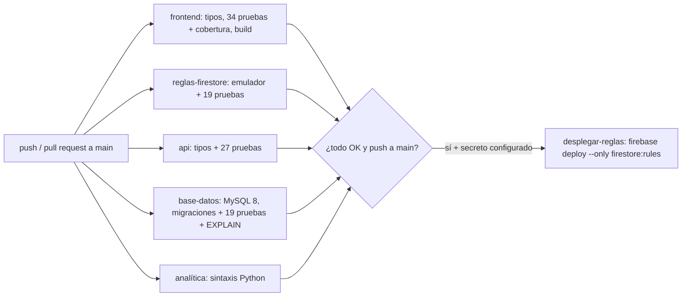

# E4 - Gestión del Proyecto y Calidad de Software (CE024)

!!! abstract "Evidencia CE024 — Calidad de Software"
    Calidad del **producto**, con pruebas automatizadas e integración, despliegue y operación continuas, y calidad del **proceso**, con gestión ágil del proyecto, aseguramiento y auditoría. Todas las cifras de este documento se midieron el 2026-10-24 sobre el repositorio `academia-school-platform`.

## Portada

| Campo | Detalle |
|---|---|
| Título del sistema | Plataforma Web Integral de Gestión Académica CERMAT |
| Estudiantes | David Robert Yucra Mamani (líder), Gladys Rosaura Yana Pari, Denilson Leeke Mamani Flores, Cárdenas Vilca Rennzo |
| Semestre | 2026-2 (9° ciclo) |
| Fecha | 2026-10-24 |
| Despliegue | [https://academia-school-platform.vercel.app](https://academia-school-platform.vercel.app) |

## Resumen Ejecutivo

**Calidad del producto.** El sistema cuenta con **99 pruebas automáticas en cuatro niveles**, y las 99 pasan:

- 34 pruebas unitarias del frontend.
- 27 de la API: 20 de sus rutas y de su conexión a MySQL, y 7 de la carga inicial desde Firestore.
- 19 de reglas de seguridad de Firestore, ejecutadas en el emulador.
- 19 de la base de datos MySQL.

La cobertura de los módulos de lógica probados es de 91 % de líneas y 94 % de ramas.

Las pruebas encontraron **tres fallas activas en producción**. Las reglas publicadas, del 22-jun-2026, permitían que cualquier usuario se asignara el rol de auxiliar o docente, permitían listar sin sesión las matrículas pagadas (nombres y teléfonos) y bloqueaban la matrícula pública de visitantes. La causa raíz fue que la primera línea de `firestore.rules` (`#`) impedía compilar el archivo, así que las versiones posteriores nunca llegaron a producción. Las tres fallas quedaron corregidas en el código: con las reglas de junio fallan 10 pruebas, y con las corregidas pasan las 19. El 2026-10-24 se publicaron el frontend y las reglas corregidas, y se verificó en producción que las tres fallas quedaron cerradas ([sección 2.7](#27-cierre-en-produccion-2026-10-24)).

**Operación continua.** Un pipeline de GitHub Actions con 6 trabajos verifica tipos, pruebas y build en cada cambio. También ejecuta las migraciones y pruebas de la base en un MySQL 8 real, y publica las reglas de Firestore solo si todo lo anterior pasó. La operación se observa con endpoints `/health`, la vista de conciliación Firestore ↔ MySQL y el registro de pruebas de restauración. Cada componente tiene una ruta de reversión documentada. Desde el 2026-10-24 la base real `cermat_db` tiene las migraciones aplicadas, y la API y la analítica se conectan con cuentas de mínimo privilegio ([sección 2.7](#27-cierre-en-produccion-2026-10-24)). Ese mismo día la capa relacional pasó al VPS del colegio, con HTTPS, respaldo diario y una prueba de punta a punta. Los tres defectos de la base que aparecieron al hacerlo se analizan en la [sección 2.8](#28-analisis-del-incidente-sincronizacion-con-el-vps-inc-06).

**Calidad del proceso.**

- **Gestión ágil:** Project Charter, historias de usuario con criterios de aceptación ligados a pruebas, Product Backlog priorizado y Sprint 1 en curso, con su retrospectiva.
- **Aseguramiento:** matriz de calidad ISO/IEC 25010 con métricas reales, lista de revisión obligatoria para cada cambio e inventario de defectos de código.
- **Auditoría CMMI-DEV 2.0 (estilo SCAMPI C):** ubica al proyecto en **nivel 1**, con prácticas de nivel 2 parcialmente implementadas. El plan de mejora prioriza las brechas para alcanzar el nivel 2.

## Sección 1: Pruebas

### 1.1 Estrategia por niveles

| Nivel | Herramienta | Qué valida | Ubicación |
|---|---|---|---|
| Unitarias (frontend) | Vitest 3.2 | Lógica pura: códigos de padres, payload del QR, fechas locales, montos en soles, importación Excel, tokens de invitación y esquemas Zod | `src/**/*.test.ts` |
| Integración de la API | Vitest + Supertest; Firebase Admin y MySQL simulados | Autenticación, autorización por rol y titularidad, validación, manejo de errores y fecha local | `server/test/*.test.ts` |
| Seguridad (reglas) | Vitest + `@firebase/rules-unit-testing` + emulador de Firestore | Reglas por rol, privacidad, control de cupos y **el código real de `createEnrollment`** ejecutado como visitante | `tests/firestore-rules/reglas.test.ts` |
| Base de datos | Procedimientos de aserción SQL sobre MySQL 8.0 | Funciones, triggers, restricciones, idempotencia y `ROLLBACK` | `server/src/db/92_pruebas_bd.sql` |

### 1.2 Casos de prueba automatizados

| Suite | Grupo de casos | N° |
|---|---|---:|
| Unitarias | Código de acceso para padres: formato, normalización y caracteres ambiguos | 4 |
| Unitarias | QR permanente firmado, QR diario y rechazo de QR ajenos | 5 |
| Unitarias | Fechas locales (no UTC), cambio de mes y últimos N días | 5 |
| Unitarias | Conversión segura de fechas de Firestore (Timestamp, texto, valores inválidos) | 3 |
| Unitarias | Formato en soles y valores inválidos | 3 |
| Unitarias | Importación Excel: celdas, listas y lote que no se detiene por un error | 3 |
| Unitarias | Tokens de invitación: SHA-256 y unicidad | 3 |
| Unitarias | Formulario de matrícula: turno, cuotas, nombre, teléfono, correo y precio | 4 |
| Unitarias | Registro de pagos: monto, cuota y método | 4 |
| API | Autenticación (sin token / token inválido) | 1 |
| API | `/sync/payment`: solo admin, registrador del token, validación, 422 del trigger, 500 sin filtrar detalles | 5 |
| API | `/sync/enrollment`: titularidad, no auto-marcar pagado, admin | 3 |
| API | `/sync/attendance-log`: titularidad, auxiliar sin claim, docente, manual solo admin, duplicados | 6 |
| API | `/asistencia/log` con fecha local y solo admin; `/asistencia/riesgo` por procedimiento | 3 |
| API | Conexión a MySQL: vuelve al pool si la llamada termina bien y se cierra si falla, para no dejar una transacción abierta | 2 |
| API | Carga inicial desde Firestore: mismo esquema que `/api/sync`, valores por defecto, pago al contado, hora de Perú con el servidor en UTC, docente del QR diario y marcación sin hora rechazada | 7 |
| Reglas | Matrícula pública: registro con cupo, duplicado, ciclo cerrado, sobrecupo, cupo sin matrícula, manipulación del contador | 6 |
| Reglas | Privacidad: listar pagadas, leer existentes, verificar inexistencia, lectura del alumno con sesión | 4 |
| Reglas | Roles: sin invitación, invitación vigente, ajena, vencida, reintento, docentes, alumno, cambio de rol | 8 |
| Reglas | Pagos: solo admin, monto > 0, no se borran, anulación | 1 |
| BD | Funciones de saldo, pago y asistencia (días lectivos, cero asistencias, docentes) | 7 |
| BD | Triggers de copia de alumno y auditoría de anulación | 2 |
| BD | Pago que llega antes que su matrícula y conciliación | 2 |
| BD | Idempotencia de asistencia | 1 |
| BD | Rechazos: borrar pago, cuota excedida, monto negativo, FK, borrar con pagos, 0 cuotas | 6 |
| BD | Sin filas a medias tras un rechazo | 1 |
| | **Total** | **99** |

### 1.3 Reporte de ejecución (2026-10-24)

| Suite | Comando | Resultado | Duración |
|---|---|---|---|
| Unitarias frontend | `npm run test:coverage` | **34/34 OK** | 1,9 s |
| API REST | `cd server && npm test` | **27/27 OK** | 1,2 s |
| Reglas de Firestore | `npm run test:rules` | **19/19 OK** | 5,8 s + arranque del emulador |
| Base de datos | `mysql -t cermat_prueba < server/src/db/92_pruebas_bd.sql` | **19/19 OK** | < 1 s |
| **Total** | | **99/99 OK** | |

### 1.4 Reporte de cobertura

Cobertura de líneas y ramas (V8) de los módulos de lógica de negocio:

| Módulo | Líneas | Ramas | Funciones |
|---|---:|---:|---:|
| `lib/parentAccess.ts` | 100 % | 100 % | 100 % |
| `lib/date.ts` | 95,0 % | 96,0 % | 100 % |
| `lib/money.ts` | 100 % | 100 % | 100 % |
| `lib/qrPayload.ts` | 87,1 % | 82,6 % | 100 % |
| `lib/excelImport.ts` | 63,3 % | 92,3 % | 66,7 % |
| `features/enrollments/invite.ts` | 100 % | 100 % | 100 % |
| `features/enrollments/schemas.ts` | 100 % | 100 % | 100 % |
| `features/payments/schemas.ts` | 100 % | 100 % | 100 % |
| **Total** | **91,0 %** | **94,3 %** | **91,7 %** |

!!! warning "Alcance real de la cobertura"
    Los porcentajes corresponden a los módulos de lógica, no a las 41 748 líneas del frontend. Las pantallas React no tienen pruebas de componentes; la capa de acceso a Firebase se cubre con la suite de reglas, que ejecuta el código real de matrícula. Las pruebas de componentes están en el plan de mejora (sección 4.5).

### 1.5 Evidencia de pruebas sobre flujos críticos

| Flujo crítico | Riesgo | Pruebas que lo cubren |
|---|---|---|
| Matrícula pública | Sobreventa de cupos, duplicados, bloqueo del visitante | 6 de reglas (con `createEnrollment` real), 4 unitarias del formulario, 3 de API |
| Pagos | Dinero mal registrado, borrado o anulado sin rastro | 1 de reglas, 4 unitarias, 5 de API, 10 de BD |
| Asistencia por QR | Suplantación, duplicados, fecha incorrecta | 10 unitarias (QR y fechas), 9 de API, 5 de BD |
| Roles y privacidad | Escalamiento de privilegios, exposición de datos de menores | 12 de reglas, 1 de API de autenticación y controles de titularidad en todas las rutas |

### 1.6 Las pruebas detectan defectos reales

La misma suite de reglas se ejecutó contra la versión **que estaba publicada en producción** hasta el 2026-10-24 (ruleset `3743ae00…`, 22-jun-2026), descargada en modo solo lectura. Esa versión ya fue reemplazada por la corregida ([sección 2.7](#27-cierre-en-produccion-2026-10-24)).

| Grupo | Con las reglas del 22-jun | Con reglas corregidas | Defecto que revela |
|---|---|---|---|
| Matrícula pública | 2 fallan | OK | El visitante no puede leer el id de matrícula inexistente ni sumar el cupo: la matrícula pública no se completa |
| Privacidad | 4 fallan | OK | Cualquiera, sin sesión, puede listar matrículas pagadas con nombre y teléfono |
| Roles | 4 fallan | OK | Cualquier cuenta puede crearse un perfil de auxiliar o docente sin invitación |
| Resto | 9 pasan | OK | — |
| **Total** | **10 fallan / 9 pasan** | **19/19** | |

## Sección 2: Integración, Despliegue y Operación Continua

### 2.1 Pipeline CI/CD

### 2.2 Configuración de automatización

| Elemento | Detalle |
|---|---|
| Archivo | `.github/workflows/ci.yml` |
| Disparadores | `push` y `pull_request` a `main`, y ejecución manual |
| Puertas de calidad | El build y la publicación solo ocurren si pasan tipos y pruebas. El trabajo de base de datos falla si alguna prueba devuelve `FALLÓ`. |
| Artefactos | Reporte de cobertura, métricas de lint (JSON), resultado de las pruebas de BD y planes de ejecución |
| Despliegue de reglas | Solo en `push` a `main`, después de los 5 trabajos de verificación. Usa el entorno `produccion` (permite exigir aprobación manual) y el secreto `FIREBASE_SERVICE_ACCOUNT`; sin el secreto, se omite con un aviso. |
| Frontend | Vercel publica `main`. Para que solo se publique lo verificado, se recomienda activar en Vercel la espera de los checks de GitHub. |

### 2.3 Evidencias de integración y despliegue

Cada paso del pipeline se ejecutó en local el 2026-10-24 con los mismos comandos y versiones (Node 22/24, MySQL 8.0.30, Java 21, Firebase CLI 14.15). La primera ejecución en GitHub ocurrirá al subir los cambios.

!!! note "Capturas a adjuntar"
    Pestaña *Actions* con los 6 trabajos en verde y el detalle del trabajo `base-datos` (tabla de 19 pruebas).

### 2.4 Observabilidad en producción

| Señal | Mecanismo | Estado |
|---|---|---|
| Disponibilidad de API y MySQL | `GET /health` de la API y de la analítica; panel admin "Infraestructura" | Implementado |
| Registro de accesos de la API | `morgan` (formato combined) | Implementado, sin centralizar |
| Integridad de la réplica | `v_conciliacion_pagos` (0 filas = sin eventos perdidos) | Implementado |
| Recuperabilidad | `backups/registro-restauraciones.jsonl` (RTO medido y collation verificada en cada prueba) | Implementado |
| Respaldos diarios de MySQL | Temporizador `academia-respaldo` de systemd en el VPS; `journalctl` registra cada ejecución | Implementado (2026-10-24) |
| Sincronizaciones hacia MySQL | Registro de la API con la hora y el estado de cada `POST /api/sync`, y avisos `[sync]` en la consola del panel | Implementado, sin alertas |
| Historial de despliegues del frontend | Panel de Vercel (en producción: commit `c06f5a2`, 2026-10-24) | Disponible |
| Alertas automáticas de caída | — | **Brecha**: plan de mejora 4.5 |
| Errores en el navegador | 105 llamadas `console.*` sin centralizar | **Brecha**: plan de mejora 4.5 |

### 2.5 Estrategia de rollback y respaldos

| Componente | Cómo se revierte | Evidencia |
|---|---|---|
| Frontend (Vercel) | Promover el despliegue anterior desde el panel (inmediato) o revertir el commit | Historial de despliegues de Vercel |
| Reglas de Firestore | Revertir el commit; el pipeline publica la versión anterior ya probada. La consola de Firebase conserva el historial de rulesets. | Ruleset de producción identificado por id y fecha |
| API y analítica (VPS) | Volver a la copia guardada antes de cada cambio (`dist.antes-AAAAMMDD` y `main.py.antes-AAAAMMDD`) y reiniciar con PM2 como `academia` | Manual de despliegue §9.6.2 |
| Migración de la base | Respaldo previo con `backup.js`, servicios detenidos y migraciones re-ejecutables | Manual de despliegue §9.6.1 |
| Base MySQL | `scripts/backup.js` (con `--routines`, SHA-256) y `scripts/restore.js` (verificación, RTO y collation) | RTO medido: 0,23 s en la base real (REC-05), 0,33 s en el VPS (REC-13) y 0,41 s del VPS a la PC (REC-14), todos del 2026-10-24; 0,27–0,38 s en la base de prueba |
| Datos de Firestore | — | **Brecha**: respaldo programado en el plan de mejora |

### 2.6 Análisis del incidente: reglas sin publicar desde junio

| Aspecto | Detalle |
|---|---|
| Detección | 2026-10-24, al ejecutar la suite de reglas contra la versión publicada |
| Impacto | Auto-asignación de rol auxiliar o docente, listado público de matrículas pagadas, matrícula pública bloqueada y colecciones de julio (`attendanceDayState`, `studentQrSignatures`) sin reglas en producción. La app publicada en Vercel (15-oct) ya usa esas colecciones. |
| Causa raíz | La línea 1 de `firestore.rules` (`# // firestore.rules`) no es sintaxis válida: el emulador responde `L1:1 token recognition error at: '#'`. Cualquier `firebase deploy` fallaba, y no había un proceso que lo hiciera visible. |
| Corrección | Comentario válido en la línea 1. Regla de rol con invitación vigente, cupo público ligado a la creación de la pre-matrícula y lectura de matrículas pagadas restringida a lecturas individuales con sesión. |
| Prevención | Ninguna regla se publica sin pasar las 19 pruebas (CI), y la publicación es automática tras el CI, no un paso manual que se olvida. |
| Cierre | 2026-10-24: se publicó primero el frontend y después las reglas corregidas, desde la consola de Firebase. Verificado en producción ([sección 2.7](#27-cierre-en-produccion-2026-10-24)). |

### 2.7 Cierre en producción (2026-10-24)

| Verificación | Resultado |
|---|---|
| Versión del frontend en producción | Commit `c06f5a2` (bundle `index-BmprsKxb.js`). Las páginas cargan los datos de Firestore sin errores en la consola |
| Cabeceras de seguridad | `X-Content-Type-Options`, `Referrer-Policy`, `Content-Security-Policy: frame-ancestors` (solo el dominio del colegio), `Permissions-Policy` y HSTS |
| Reglas de Firestore | Publicadas desde la consola, después del frontend |
| Visitante sin sesión: listar matrículas pagadas | Denegado (403) |
| Visitante sin sesión: listar matrículas, usuarios o pagos | Denegado (403) |
| Visitante: comprobar que una matrícula no existe (antiduplicados) | Permitido (404) |
| Visitante: leer ciclos publicados | Permitido (200) |
| Pre-matrícula pública de prueba | "Solicitud enviada"; el equipo cancela el registro de prueba |
| Clave de servicio de Firebase | Rotada: nueva `ddf50bfe…`. La de enero (`283b43c3…`), que estuvo en los ZIP versionados, fue eliminada y ya no figura en la lista pública de claves de Google |
| Cuentas de `scripts/teachers.json` | Contraseñas restablecidas o cuentas inhabilitadas |
| Archivos `.env` | Siguen versionados por decisión del equipo: solo contienen la configuración web pública de Firebase y contraseñas de MySQL vacías. Condición: ninguna contraseña en un `.env` versionado |
| Dominio | `www.cermatschool.edu.pe` se retiró del proyecto de Vercel; la academia queda solo en `academia-school-platform.vercel.app` |
| Base MySQL real (`cermat_db`) | Respaldo previo con SHA-256 y revisión de restricciones sin conflictos. Migraciones 02–04 aplicadas: 3 FK, 7 CHECK, 4 funciones, 5 procedimientos, 6 triggers, 3 vistas y 4 roles. El único pago sin matrícula quedó con una matrícula provisional, visible en `v_conciliacion_pagos` |
| Cuentas de mínimo privilegio | `cermat_api`, `cermat_analitica` y `cermat_respaldo`, con contraseñas aleatorias de 32 caracteres solo en `server/.env.local` y `analytics/.env.local` (no versionados). INSERT y DELETE directos de la API, y UPDATE de la analítica → error 1142 |
| Respaldo y restauración en la base real (REC-05) | `backup.js` con `cermat_respaldo`; `restore.js` en `cermat_db_verificacion`: RTO 0,23 s, filas, 9 rutinas, 6 triggers y 3 vistas completos |
| API y analítica | En línea en el VPS del colegio desde el 2026-10-24: PM2 bajo el usuario `academia` con arranque por systemd, puertos solo en 127.0.0.1 y Nginx con HTTPS en `api-academia` y `analitica-academia`. Ambos `/health` responden con MySQL conectado, cada uno con su cuenta. Se corrigió el arranque de la analítica, que fallaba por una inicialización doble de Firebase |
| Restauración en otro servidor | El respaldo de la PC se restauró en el VPS en 0,33 s (REC-13), y el primer respaldo diario del VPS se restauró en la PC en 0,41 s (REC-14) |
| Prueba de punta a punta | A las 22:10 y 22:11, dos cambios de estado de la pre-matrícula de prueba llegaron al MySQL del VPS con respuesta 200 |
| Respaldo diario | Temporizador de systemd en el VPS a las 03:00; primera ejecución correcta a las 22:18 |
| Carga inicial de la réplica | A las 22:56, `cargaInicial.ts` copió lo que Firestore ya tenía, con las mismas validaciones y procedimientos que `/api/sync`. El MySQL del VPS pasó de 2 matrículas (1 provisional), 1 pago y 0 asistencias a 10 matrículas (0 provisionales), 2 pagos y 7 asistencias, sin rechazos ni errores. Repetirla no duplica |
| Sitio del colegio | 5 de 5 cabeceras de seguridad y versión de Nginx oculta; la página sigue sirviendo los mismos 17 911 bytes |

Las pruebas como visitante se hicieron con consultas REST sin credenciales que solo informan si la operación fue permitida o denegada, sin mostrar datos. Las de la base real se ejecutaron entre las 16:29 y las 16:40 (UTC−5), sin mostrar contraseñas.

Las capturas del día, con los datos personales tapados, están en [Evidencias del despliegue del 2026-10-24](infraestructura/evidencias-despliegue-2026-10-24.md).

**Lección aprendida.** Los despliegues de `05fbe9e` y `e96eea1` quedaron en estado *Blocked* en Vercel (plan Hobby), y el push no lo mostraba; el propietario lo resolvió desde su cuenta. Desde ahora un cambio se da por terminado solo cuando la versión en producción se verifica (bundle y cabeceras), no al hacer push.

### 2.8 Análisis del incidente: sincronización con el VPS (INC-06)

| Aspecto | Detalle |
|---|---|
| Detección | 2026-10-24, 20:40 y 20:42. Al cancelar la pre-matrícula de prueba, la consola mostró `[sync] /api/sync/enrollment respondió 500` y el registro de la API, `Data truncated for column 'turno' at row 1` |
| Impacto | Ninguna matrícula con turno mañana, el valor por defecto, llegaba a MySQL. Una réplica del VPS mostró que además fallaban la asistencia por QR, las funciones de saldo y `sp_estado_cuenta`. Firebase siguió operando, porque la sincronización no bloquea al usuario |
| Causa raíz 1 | La etiqueta `mañana` del ENUM `matriculas.turno` estaba guardada como `ma├▒ana`. En junio la tabla se creó desde una sesión en cp850 y `schema.sql` no fijaba la codificación. El VPS la heredó con el respaldo |
| Causa raíz 2 | La base del VPS se creó con `utf8mb4_unicode_ci`. Las tablas del respaldo traen `utf8mb4_0900_ai_ci`, y las rutinas toman la collation de la base: `Illegal mix of collations` |
| Causa raíz 3 | El `EXIT HANDLER FOR SQLEXCEPTION` de los procedimientos no atrapa errores de clase 01, como el 1265 en modo estricto. La API devolvía al pool la conexión con la transacción abierta. Por eso el `ALTER` de la corrección esperó más de 20 minutos, y la siguiente llamada en esa conexión habría guardado escrituras a medias |
| Contención | API y analítica detenidas desde otra ventana: MySQL deshizo la transacción y liberó el bloqueo |
| Corrección (22:06) | Migración `05_corregir_turno.sql` y `SET NAMES utf8mb4` en todos los scripts. Base del VPS en `utf8mb4_0900_ai_ci`, rutinas re-creadas con `03` y permisos repuestos con `04`. La API cierra la conexión cuando una llamada falla (`ejecutar` en `server/src/db/mysql.ts`) y la analítica cierra siempre la suya. `restore.js` crea la base con la collation del respaldo y la verifica |
| Verificación | Cada defecto se reprodujo primero en la PC: con la llamada exacta de la API, con una réplica del VPS (misma collation y mismo respaldo) y con MySQL real. Con MySQL real, antes el `ALTER` quedaba bloqueado; después pasó en 51 ms y sin escrituras a medias. Las 19 pruebas de la base pasan incluso cargando los scripts desde cp850, y 2 pruebas nuevas cubren la conexión |
| Recuperación | A las 22:10 y 22:11, dos cambios de estado de la pre-matrícula de prueba llegaron a MySQL con respuesta 200 |
| Prevención | Migraciones con los servicios detenidos y una espera máxima de 60 s. Reproducir cada falla en una réplica antes de tocar producción. `restore.js` verifica la collation, y la prueba de restauración ejecuta las funciones en la copia |

## Sección 3: Gestión Ágil del Proyecto de Software

### 3.1 Project Charter

| Campo | Detalle |
|---|---|
| Proyecto | Plataforma Web Integral de Gestión Académica CERMAT |
| Sponsor | Dirección de Academia La Prepa Cermat |
| Objetivo general | Centralizar oferta, matrícula, pagos, asistencia y comunicación con padres en una plataforma con portales por rol |
| Objetivos medibles | Matrícula pública operativa sin intervención manual. Cero fallas críticas en reglas de seguridad (verificado por CI). 100 % de pruebas en verde antes de cada publicación. RTO de la base relacional < 1 h. |
| Alcance | 22 requerimientos funcionales y 10 no funcionales del [E1](e1-definicion-sistema-ce021.md). Fuera de alcance: app móvil nativa, pasarela de pagos, facturación electrónica. |
| EDT | Sitio público · Gestión académica · Matrícula y pagos · Usuarios y roles · Asistencia QR · Contenidos · Infraestructura y sincronización (detalle en [Gestión TI E3](gestion-ti/e3-plan-gestion-proyecto-ce0121.md)) |
| Equipo | Líder técnico y Scrum Master: David Robert Yucra Mamani. Equipo de desarrollo: Gladys Rosaura Yana Pari, Denilson Leeke Mamani Flores y Cárdenas Vilca Rennzo. Product Owner: responsable designado por la Dirección (a confirmar). |
| Riesgos principales | Reglas publicadas distintas de las probadas (mitigado con CI) · Secretos en el historial del repositorio · Conocimiento concentrado en una persona · Falsos positivos del antivirus al ejecutar scripts SQL |
| Criterio de éxito | Pipeline en verde, reglas corregidas publicadas y aceptación de los flujos críticos por la Dirección |

### 3.2 Historias de usuario

| ID | Historia | Criterios de aceptación | Pruebas |
|---|---|---|---|
| HU-01 | Como **postulante** quiero pre-matricularme sin crear una cuenta para reservar mi cupo. | Ciclo abierto con cupo: se registra y descuenta 1 cupo. Mismo teléfono en el grupo: se rechaza con mensaje claro. Ciclo cerrado o grupo lleno: se rechaza. | Reglas › matrícula pública (6) |
| HU-02 | Como **administrador** quiero registrar y anular pagos para llevar la caja. | Solo un administrador. Monto > 0. Un pago nunca se borra. La anulación queda auditada con su autor. | Reglas › pagos, API › payment (5), BD 1–3, 9, 13–15 |
| HU-03 | Como **auxiliar invitado** quiero activar mi cuenta con el enlace recibido. | Sin invitación, o con una vencida o de otro, no se crea el perfil. Un reintento del mismo usuario sí funciona. | Reglas › roles (8) |
| HU-04 | Como **padre** quiero consultar la asistencia con un código fácil de dictar. | Acepta minúsculas, espacios y el código sin prefijo. Excluye 0/O y 1/I. | Unitarias › parentAccess (4) |
| HU-05 | Como **auxiliar** quiero registrar asistencia escaneando el QR del alumno. | El QR firmado se acepta. El formato antiguo se detecta. Un reenvío no duplica. Solo registra quien tiene el rol. | Unitarias › qrPayload (5), API › attendance (6), BD 12 |
| HU-06 | Como **Dirección** quiero ver qué alumnos están en riesgo de abandonar. | Calcula sobre días lectivos. Incluye a quien nunca asistió. Excluye docentes. | BD 4–7, API › riesgo |
| HU-07 | Como **administrador** quiero importar alumnos desde Excel. | Una fila con error no detiene el lote. El error indica la fila real del archivo. | Unitarias › excelImport (3) |
| HU-08 | Como **equipo técnico** quiero que las reglas solo se publiquen si pasan sus pruebas. | El pipeline bloquea la publicación si una prueba falla. | CI › desplegar-reglas |

### 3.3 Product Backlog

| ID | Ítem | Prioridad | Estado |
|---|---|---|---|
| PB-01 | Suites de pruebas automáticas (4 niveles) y pipeline CI | Alta | Hecho (Sprint 1) |
| PB-02 | Corregir reglas: rol con invitación, privacidad de matrículas, cupo público, compilación | Alta | Hecho (Sprint 1; publicado el 2026-10-24) |
| PB-03 | Capa de datos MySQL: integridad, procedimientos, triggers, roles, respaldo y restauración | Alta | Hecho (Sprint 1) |
| PB-04 | Publicar reglas corregidas y verificar la matrícula pública en producción | Alta | Hecho (2026-10-24) |
| PB-05 | Aplicar las migraciones MySQL en la base real | Alta | Hecho (2026-10-24): migraciones 02–04 con respaldo previo y cuentas de mínimo privilegio verificadas |
| PB-06 | Retirar secretos del historial y rotar la clave de servicio | Alta | Hecho en lo esencial (2026-10-24): clave rotada y contraseñas de docentes restablecidas; los `.env`, sin contraseñas, siguen versionados por decisión del equipo |
| PB-07 | 0 errores de TypeScript | Alta | Hecho (Sprint 1) |
| PB-08 | Monitor externo con alertas sobre la URL y `/health` | Media | Pendiente |
| PB-09 | Reducir `any` en módulos de dinero y asistencia | Media | Pendiente |
| PB-10 | Carga diferida de páginas (bundle inicial de 2,8 MB) | Media | Pendiente |
| PB-11 | Respaldo programado de Firestore con prueba de restauración | Media | Pendiente |
| PB-12 | Pruebas de componentes de matrícula y pagos | Media | Pendiente |
| PB-13 | Operación continua de la capa relacional (VM-APP01 o VPS puente) | Alta | En curso (2026-10-24): API, MySQL y analítica 24/7 en el VPS del colegio, con HTTPS y prueba de punta a punta; faltan los 30 días sin diferencias de conciliación y el monitor de `/health` ([Gestión TI E3](gestion-ti/e3-plan-gestion-proyecto-ce0121.md), CR-03) |
| PB-18 | Respaldo diario automático de MySQL y copia verificada fuera del VPS | Alta | Hecho (2026-10-24): temporizador de systemd y REC-14 |
| PB-19 | Carga inicial en MySQL de los datos anteriores de Firestore y reintento de los envíos fallidos | Media | En parte (2026-10-24): carga inicial hecha (10 matrículas, 2 pagos y 7 asistencias; 0 provisionales); el reintento sigue pendiente (decisión del equipo) |

### 3.4 Sprint Backlog — Sprint 1 "Calidad y seguridad"

Duración: 2 semanas, desde el 2026-10-24. Objetivo: que ningún defecto crítico llegue a producción sin ser detectado.

| Tarea | PB | Estado | Evidencia |
|---|---|---|---|
| Migraciones de integridad y programación MySQL | PB-03 | Hecho | `server/src/db/02`–`04`, 19 pruebas OK |
| Respaldo con rutinas y verificación; restauración con RTO | PB-03 | Hecho | `scripts/backup.js`, `scripts/restore.js` |
| Autorización por rol y titularidad en `/api/sync` | PB-01 | Hecho | 15 pruebas de API |
| Pruebas unitarias del frontend con cobertura | PB-01 | Hecho | 34 pruebas, 91 % |
| Corrección y pruebas de `firestore.rules` | PB-02 | Hecho | 19 pruebas en el emulador |
| Pipeline CI con publicación condicionada | PB-01 | Hecho | `.github/workflows/ci.yml` |
| Corregir dominio (Vercel) en CORS y SEO | — | Hecho | `analytics/main.py`, `index.html`, `sitemap.xml` |
| 0 errores de TypeScript (66 al inicio) sin cambiar el JavaScript generado | PB-07 | Hecho | `npm run typecheck` |
| Corrección de 7 defectos funcionales hallados al tipar | — | Hecho | 3 pruebas nuevas y verificación en el navegador |
| Subir cambios y primera ejecución del CI | PB-01 | Pendiente | Pestaña *Actions* |
| Publicar reglas y verificarlas en producción | PB-04 | Hecho | Sección 2.7 |
| Rotar la clave de servicio y las contraseñas expuestas | PB-06 | Hecho | Sección 2.7 |
| Aplicar las migraciones MySQL en la base real | PB-05 | Hecho | Sección 2.7; REC-05 |
| Llevar la capa relacional al VPS del colegio | PB-13 | Hecho | Manual de despliegue §9; PR-38 y PR-39 |
| Corregir los 3 defectos de la base hallados en el VPS | — | Hecho | Sección 2.8; 2 pruebas nuevas de API |
| Respaldo diario en el VPS y copia verificada en la PC | PB-18 | Hecho | REC-14 |
| Carga inicial de Firestore a MySQL en el VPS | PB-19 | Hecho | 7 pruebas nuevas de API; sección 2.7 |

### 3.5 Ceremonias y métricas de avance

| Ceremonia | Cadencia | Registro |
|---|---|---|
| Planificación | Inicio de cada sprint | Sprint Backlog (sección 3.4) |
| Seguimiento diario | Asíncrono, en el grupo del equipo | Estado de las tareas del sprint |
| Revisión | Fin de sprint, con la Dirección | Acta con la aceptación de las historias |
| Retrospectiva | Fin de sprint | Acciones de mejora (abajo) |

**Métricas del Sprint 1 (al 2026-10-24):** 16 de 17 tareas hechas. Pruebas automáticas: de 0 a 99. Errores de TypeScript: de 66 a 0. Defectos corregidos en código: 18.

- **3 críticos de seguridad en producción**, cerrados en producción el 2026-10-24.
- **4 de lógica de datos:** riesgo calculado sobre 30 días calendario, alumnos sin asistencias que no aparecían en el cálculo de riesgo, docentes contados como alumnos y fecha UTC en el registro manual de asistencia.
- **7 funcionales hallados al eliminar los errores de tipos:** fechas del blog como "Invalid Date", post sin imagen que no se podía guardar, fecha de publicación reiniciada al editar, post sin autor, vínculo del alumno vacío en la réplica, animación de la galería que no corría y un ejemplo inválido de código de padres.
- **1 de operación, hallado al levantar la capa local:** la analítica no arrancaba con `python main.py` porque `uvicorn.run("main:app")` reimportaba el módulo y Firebase se inicializaba dos veces, lo que dejaba a PM2 en un ciclo de reinicios. Se corrigió pasando el objeto `app`; el defecto venía del commit `e574500` (19-ago).
- **3 de la base relacional, hallados al llevarla al VPS** ([sección 2.8](#28-analisis-del-incidente-sincronizacion-con-el-vps-inc-06)): la etiqueta `mañana` dañada desde junio, las rutinas del VPS con otra collation que las tablas y la transacción que quedaba abierta tras errores de clase 01.

**Retrospectiva del Sprint 1:**

| Qué funcionó | Qué mejorar | Acción |
|---|---|---|
| Probar contra lo publicado reveló fallas que la lectura del código no mostraba | Las reglas estuvieron 4 meses sin publicarse sin que nadie lo notara | Publicación solo vía CI (HU-08) |
| Verificar producción después de publicar mostró que Vercel había bloqueado dos despliegues | Los push `05fbe9e` y `e96eea1` quedaron *Blocked* sin que el equipo lo notara | Dar un cambio por terminado solo al verificar la versión en producción (bundle y cabeceras) |
| Las pruebas de BD en un MySQL aislado no tocaron datos reales | Ejecutar SQL con `cmd /c` desde PowerShell provocó una cuarentena del antivirus (falso positivo) | Ejecutar scripts desde Git Bash; excepción en el antivirus para `server/src/db` |
| Los hallazgos quedaron documentados con su evidencia | El historial de git muestra un solo autor y commits genéricos ("mejoras") | Commits descriptivos y cambios revisados por un segundo integrante (sección 4.2) |
| Reproducir cada falla en una réplica del VPS antes de tocar producción permitió corregir los tres defectos de una vez | La migración se aplicó con los servicios encendidos y quedó bloqueada más de 20 minutos por una transacción abierta | Migraciones con los servicios detenidos y una espera máxima de 60 s; la API cierra la conexión ante un error |

### 3.6 Comparación con otros marcos de proceso

| Aspecto | Scrum (adaptado, usado) | RUP | Cascada (predictivo PMBOK) |
|---|---|---|---|
| Ciclo de vida | Iterativo e incremental en sprints de 2 semanas | Iterativo dentro de 4 fases | Lineal, una sola entrega |
| Fases | Sin fases formales; cada sprint entrega un incremento | Inicio, elaboración, construcción, transición | Requisitos, diseño, construcción, pruebas, despliegue |
| Disciplinas | Integradas en cada sprint | 9 disciplinas (modelado de negocio, requisitos, análisis y diseño, implementación, pruebas, despliegue, configuración, gestión, entorno) | Una por fase |
| Roles | Product Owner, Scrum Master, equipo | Más de 30 roles (analista, arquitecto, tester…) | Jefe de proyecto y especialistas por fase |
| Artefactos | Backlogs, incremento, definición de terminado | Modelos UML, documento de arquitectura, casos de uso | Documentos firmados por fase |
| Cuándo conviene | Requisitos cambiantes y cliente cercano | Sistemas grandes que exigen arquitectura temprana | Requisitos estables y contratos cerrados |

**Adaptación elegida.** Se usa Scrum ligero porque el equipo es pequeño, la Dirección está cerca y los requisitos cambiaron durante la construcción: grupos, sedes y turnos se agregaron después del inicio. Se toman de **RUP** los artefactos de análisis y diseño que el proyecto ya produjo (casos de uso, UML y vistas de arquitectura del [E1](e1-definicion-sistema-ce021.md)) y su disciplina de **gestión de configuración** (migraciones numeradas y entornos separados). No se adopta Cascada: el sistema ya está en operación y recibe cambios continuos.

## Sección 4: Aseguramiento y Auditoría de la Calidad del Software

### 4.1 Matriz de calidad (ISO/IEC 25010)

| Característica | Atributo | Métrica | Valor actual | Meta | Riesgo |
|---|---|---|---|---|---|
| Adecuación funcional | Corrección | Flujos críticos con pruebas automáticas | 4 de 4 | 4 de 4 | Bajo |
| Seguridad | Confidencialidad / autorización | Fallas de reglas detectadas por la suite | 0 en producción desde el 2026-10-24 (3 con las reglas de junio) | 0 publicadas | Bajo |
| Seguridad | Integridad | Restricciones de BD que rechazan datos inválidos | 6 de 6 | 100 % | Bajo |
| Seguridad | Responsabilidad | Cambios de pagos y matrículas auditados | 100 % (triggers) | 100 % | Bajo |
| Fiabilidad | Recuperabilidad | RTO de MySQL medido | 0,23 s en la base real (REC-05); 0,33 s y 0,41 s en otro servidor (REC-13 y REC-14); 0,27–0,38 s en la base de prueba | < 1 h | Bajo (respaldo diario desde el 2026-10-24: RPO ≤ 24 h) |
| Fiabilidad | Disponibilidad | Disponibilidad medida por monitor externo | No medida | 99 % mensual | **Alto** |
| Mantenibilidad | Analizabilidad | Errores de TypeScript (`tsc --noEmit`) | 0 (66 al inicio del sprint) | 0 | Bajo |
| Mantenibilidad | Modificabilidad | Usos de `any` (ESLint: src, server, scripts) | 233 (240 al inicio del sprint) | < 120 | Medio |
| Mantenibilidad | Capacidad de prueba | Pruebas automáticas | 99 | En aumento cada sprint | Bajo |
| Mantenibilidad | Modularidad | Archivos de más de 800 líneas | 8 | ≤ 3 | Medio |
| Eficiencia de desempeño | Comportamiento temporal | JS inicial | 2,84 MB (781 KB gzip) | < 1 MB | Medio |
| Compatibilidad | Interoperabilidad | Diferencias Firestore ↔ MySQL | Vista de conciliación disponible; los datos anteriores se cargaron el 2026-10-24 (0 matrículas provisionales); falta el reintento de los envíos fallidos (PB-19) | 0 filas | Medio |

### 4.2 Instrumentos de aseguramiento

| Instrumento | Uso | Ubicación |
|---|---|---|
| Lista de revisión de cambios | Obligatoria en cada pull request: tipos, pruebas, reglas, secretos, migraciones y reversión | `.github/pull_request_template.md` |
| Definición de terminado | Una tarea está terminada si tiene prueba, el CI está en verde y queda documentada su forma de reversión | Esta sección |
| Inspección automatizada de reglas | Cada cambio de `firestore.rules` se valida con 19 casos en el emulador | `tests/firestore-rules/` |
| Inspección de migraciones | Cada migración se ejecuta en un MySQL limpio en CI antes de llegar a la base real | Trabajo `base-datos` |
| Auditorías por fase | 104 documentos de hallazgo, riesgo y decisión antes de cambiar código | `docs/AUDITORIA_*.md`, `docs/FASE_*.md` |

### 4.3 Evaluación de la calidad del código

**Atributos internos (medidos):** 41 748 líneas en `src/`, organizadas en 13 módulos de dominio; TypeScript sin modo estricto pero con 0 errores; 233 usos de `any`; 8 archivos de más de 800 líneas.

**Atributos externos:** 18 defectos corregidos en este sprint, encontrados por las pruebas, por la revisión de tipos, al poner en marcha la capa local y al llevarla al VPS (secciones 2.8 y 3.5).

| Code smell | Evidencia | Impacto | Acción |
|---|---|---|---|
| Componentes gigantes | `AdminEnrollmentsPage.tsx` (1 261 líneas), `AdminConfigPage.tsx` (1 193), `AuxiliarDashboard.tsx` (1 099) | Difíciles de probar y revisar | Extraer hooks y subcomponentes |
| Código duplicado | `normalizePhone` definida 4 veces | Reglas de normalización divergentes entre módulos | Unificar en `src/lib/phone.ts` |
| Tipado débil | 233 `any` (ESLint `no-explicit-any`) | Errores que el compilador no detecta (así se ocultaban 7 defectos) | Tipos de dominio en `types.ts` |
| Carga anticipada | 51 páginas importadas sin `lazy()` en `App.tsx` | Bundle inicial de 2,8 MB | Carga diferida por ruta |
| Registro de depuración | 105 llamadas `console.*` | Ruido y posible exposición de datos personales en la consola | Logger con niveles |

**Deuda técnica pagada mediante refactorización (Sprint 1):**

| Antes | Después |
|---|---|
| SQL embebido en las rutas de la API y escrito con root sin contraseña | Escritura solo por procedimientos almacenados con la cuenta `cermat_api` de mínimo privilegio |
| La misma consulta de riesgo copiada en dos endpoints y con un cálculo erróneo | Un solo procedimiento, `sp_riesgo_inasistencia`, probado |
| `backup.js` armaba un comando de shell con la contraseña visible | `execFileSync` con `MYSQL_PWD`, rutinas incluidas y hash de verificación |
| Fecha de asistencia en UTC y hora local en la misma fila | Fecha y hora en la misma zona horaria, con prueba de regresión |
| Errores de la API devolvían el mensaje interno | Respuestas 400/422/500 tipadas, sin filtrar detalles |
| 66 errores de TypeScript que ocultaban 7 defectos funcionales | 0 errores. En 19 de 20 archivos el JavaScript generado es idéntico (verificado con el compilador de Vite); los defectos se corrigieron aparte, con pruebas |
| Conversión de fechas repetida con `new Date(...)` sobre un `Timestamp` | Un solo helper probado, `toDateSafe` |
| `any` en la sincronización de matrículas | Tipos de dominio `SyncEnrollment` |
| Scripts SQL sin codificación declarada: una sesión en cp850 dañó la etiqueta `mañana` | `SET NAMES utf8mb4` en todos los scripts y migración 05 |
| La API devolvía al pool conexiones con una transacción abierta tras errores de clase 01 | La API cierra la conexión cuando una llamada falla (`ejecutar`), con 2 pruebas |
| `restore.js` creaba la base con una collation fija y solo contaba objetos | Crea la base con la collation del respaldo y verifica que coincida con la de las rutinas |

### 4.4 Informe de auditoría técnica

**Listas de verificación (2026-10-24):**

| Área | Ítem | Resultado |
|---|---|---|
| Gestión de proyecto | Project Charter, backlog priorizado y sprint con objetivo | Cumple |
| Gestión de proyecto | Registro de riesgos y decisiones | Cumple (Gestión TI y `docs/AUDITORIA_*`) |
| Gestión de proyecto | Estimación de esfuerzo registrada | **No cumple** |
| Ingeniería | Requisitos trazables a código y pruebas | Cumple (E1 §12 y sección 3.2) |
| Ingeniería | Arquitectura documentada | Cumple (E1 y E3) |
| Ingeniería | Validación con usuarios mediante acta | **No cumple** |
| Software | Build reproducible y pruebas automáticas | Cumple |
| Software | Cero errores de compilación de tipos | Cumple (puerta del CI) |
| Software | Repositorio sin secretos | Cumple parcialmente: la clave de los ZIP fue revocada y las contraseñas de docentes restablecidas (2026-10-24); los `.env`, sin contraseñas, siguen versionados por decisión del equipo |
| Software | Cambios revisados por un segundo integrante | **No cumple** (plantilla creada, sin revisiones registradas) |

**Madurez del proceso (CMMI-DEV 2.0, valoración estilo SCAMPI C):**

| Área de práctica | Evidencia principal | Valoración |
|---|---|---|
| Desarrollo y gestión de requisitos (RDM) | RF01–RF22, RNF01–RNF10 y trazabilidad | Ampliamente implementada |
| Solución técnica (TS) | Arquitectura y decisiones documentadas | Ampliamente implementada |
| Verificación y validación (VV) | 99 pruebas automáticas; validación sin acta | Ampliamente implementada (verificación) / parcial (validación) |
| Aseguramiento de calidad del proceso (PQA) | 104 auditorías por fase | Ampliamente implementada |
| Integración de producto (PI) | Pipeline que integra 4 componentes | Parcialmente implementada (falta la primera ejecución) |
| Planificación (PLAN) | Charter y backlog recientes | Parcialmente implementada |
| Monitoreo y control (MC) | Estado del sprint y métricas | Parcialmente implementada |
| Revisiones entre pares (PR) | Plantilla creada, sin registros | Parcialmente implementada |
| Gestión de configuración (CM) | Git y migraciones numeradas; secretos del historial revocados el 2026-10-24 | Parcialmente implementada |
| Gestión de riesgos (RSK) | Matrices de riesgo | Parcialmente implementada |
| Estimación (EST) | — | No implementada |

**Conclusión: nivel de madurez 1 (Inicial).** Las prácticas técnicas (requisitos, solución, verificación) superan ese nivel. Las de gestión (estimación, revisiones registradas, configuración sin secretos, seguimiento por métricas) aún no sostienen el **nivel 2 (Gestionado)**.

### 4.5 Plan de mejora de la calidad

| # | Acción | Métrica | Meta | Plazo |
|---|---|---|---|---|
| 1 | Publicar las reglas corregidas y probar una matrícula sin sesión en producción | Fallas críticas publicadas | 0 | Hecho (2026-10-24) |
| 2 | Subir los cambios y obtener el primer pipeline en verde | Trabajos en verde | 6 de 6 | Sprint 1 |
| 3 | Retirar secretos del historial y rotar la clave de servicio | Secretos vigentes en git | 0 | Hecho en lo esencial (2026-10-24) |
| 4 | Revisión obligatoria de cada cambio por un segundo integrante | Cambios revisados | 100 % | Desde Sprint 2 |
| 5 | Estimar cada ítem del backlog y medir la velocidad | Sprints con estimación | 100 % | Desde Sprint 2 |
| 6 | Monitor externo con alertas sobre la URL y `/health` | Disponibilidad medida | 99 % mensual | Sprint 2 |
| 7 | Carga diferida de páginas | JS inicial | < 1 MB | Sprint 2 |
| 8 | Tipar los módulos de dinero y asistencia | Usos de `any` | < 120 | Sprints 2–3 |
| 9 | Pruebas de componentes de matrícula y pagos | Casos de componentes | ≥ 20 | Sprint 3 |
| 10 | Respaldo programado de Firestore con prueba de restauración | RPO | ≤ 24 h | Sprint 3 |
| 11 | Programar el respaldo diario de MySQL y el arranque automático de los servicios | RPO de MySQL | ≤ 24 h | Hecho (2026-10-24): temporizador de systemd y servicio `pm2-academia` en el VPS |
| 12 | Reintento de los envíos fallidos a MySQL (PB-19; la carga inicial se hizo el 2026-10-24) | Diferencias en `v_conciliacion_pagos` | 0 filas | Por decidir |

Cumplir las acciones 2 a 5 lleva las áreas PLAN, MC, PR y CM al nivel 2 (Gestionado).

## Anexos

| Anexo | Ubicación |
|---|---|
| Reportes de pruebas | Salida de `npm run test:coverage`, `npm run test:rules`, `cd server && npm test` y `92_pruebas_bd.sql`; reporte HTML de cobertura en `coverage/index.html` |
| Capturas del pipeline y de observabilidad | Pestaña *Actions* tras la primera ejecución; panel admin "Infraestructura" (`/health`) |
| Artefactos ágiles | Secciones 3.1 a 3.5 (Charter, historias, Product Backlog, Sprint Backlog, retrospectiva) |
| Matriz de calidad y checklists de auditoría | Secciones 4.1 y 4.4; `.github/pull_request_template.md` |
| Evidencia de sustentación | Exposición breve ante el docente (pendiente) |

## Rúbrica de Evaluación

| Criterio | Excelente | Bueno | Regular | Deficiente |
|---|---|---|---|---|
| Cobertura y calidad de pruebas | Pruebas efectivas cubren componentes críticos | Pruebas funcionales | Pruebas limitadas | Sin pruebas |
| Automatización (CI/CD) | Pipeline automatizado completo | Pipeline funcional | Automatización parcial | Sin automatización |
| Operación y observabilidad en producción | Monitoreo, alertas y rollback evidenciados en producción | Observabilidad funcional | Observabilidad parcial | Sin observabilidad |
| Gestión ágil del proyecto | Project Charter y artefactos ágiles completos y coherentes entre sí | Gestión ágil funcional | Gestión ágil parcial | Sin gestión ágil |
| Adaptación o comparación de marcos de proceso | Compara y adapta marcos de proceso con criterio fundamentado | Comparación básica | Comparación superficial | Sin comparación |
| Aseguramiento de la calidad del proceso | Matriz de calidad e instrumentos de aseguramiento completos | Aseguramiento funcional | Aseguramiento parcial | Sin aseguramiento |
| Auditoría de madurez del proceso (CMMI/SCAMPI) | Auditoría estructurada con deuda técnica gestionada y plan de mejora documentado | Auditoría general | Auditoría superficial | Sin auditoría |
| Sustentación y defensa técnica | Explica y defiende con dominio las decisiones tomadas | Explica con solvencia | Explica con dificultad | No sustenta |
