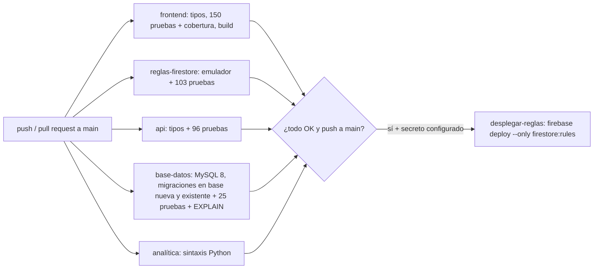
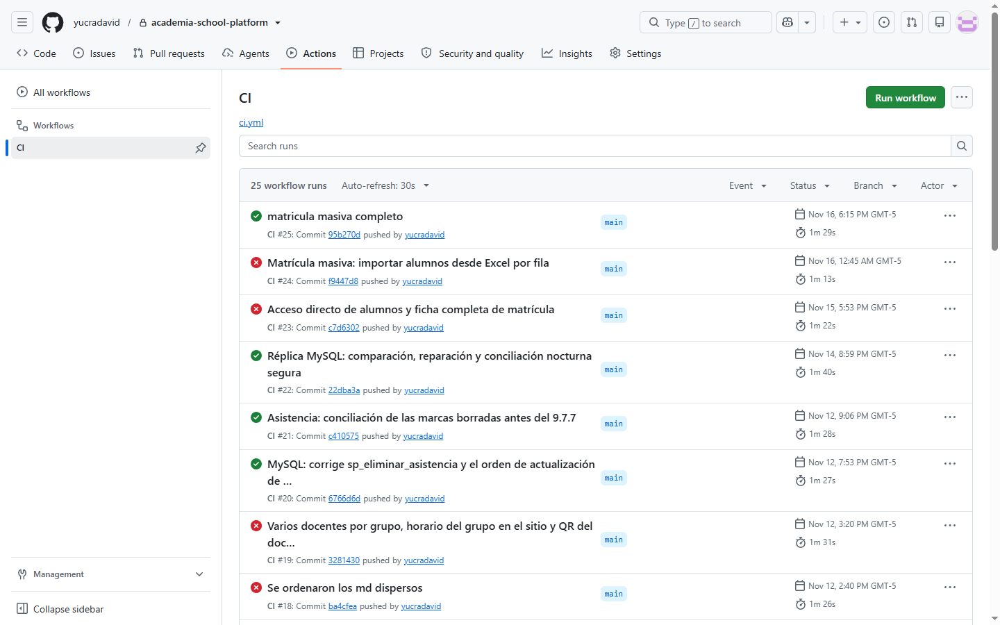
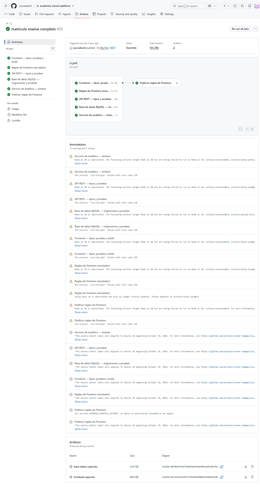
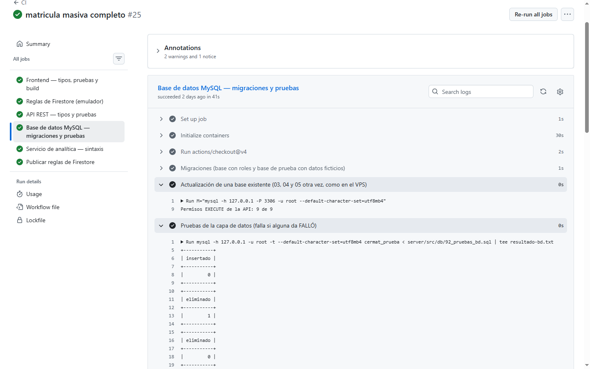
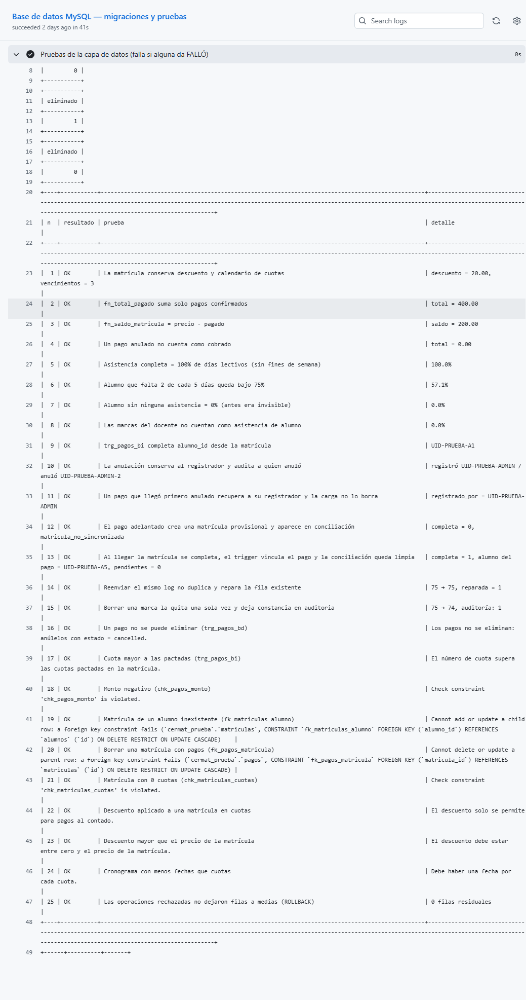

# E4 - Gestión del Proyecto y Calidad de Software (CE024)

!!! abstract "Evidencia CE024 — Calidad de Software"
    Calidad del **producto**, con pruebas automatizadas e integración, despliegue y operación continuas, y calidad del **proceso**, con gestión ágil del proyecto, aseguramiento y auditoría. Las cifras se midieron por primera vez el 2026-10-24. Se volvieron a medir el 2026-11-16 sobre el commit `f9447d8` del repositorio `academia-school-platform`, con los mismos comandos del CI. Cada tabla indica la fecha de su medición.

## Portada

| Campo | Detalle |
|---|---|
| Título del sistema | Plataforma Web Integral de Gestión Académica CERMAT |
| Estudiantes | David Robert Yucra Mamani (líder), Gladys Rosaura Yana Pari, Denilson Leeke Mamani Flores, Cárdenas Vilca Rennzo |
| Semestre | 2026-2 (9° ciclo) |
| Fecha | 2026-11-18 (primera versión: 2026-10-24) |
| Despliegue | [https://academia-school-platform.vercel.app](https://academia-school-platform.vercel.app) |
| Documento | [Word](assets/software/informes/CE024_S2_E4_Gestion_del_Proyecto_y_Calidad_de_Software.docx) y [PDF](assets/software/informes/CE024_S2_E4_Gestion_del_Proyecto_y_Calidad_de_Software.pdf), generados desde esta página |

## Resumen Ejecutivo

**Calidad del producto.** El sistema cuenta con **378 pruebas automáticas en cuatro niveles** al 2026-11-18; el 2026-10-24 eran 99:

- 150 pruebas unitarias del frontend (34 al 2026-10-24).
- 100 de la API: rutas de sincronización, cuentas de alumnos, usuarios del personal, conexión a MySQL, conversión desde Firestore, comparación de la réplica, migración de accesos y respaldo de Firestore (27 al 2026-10-24).
- 103 de reglas de seguridad de Firestore, ejecutadas en el emulador (19 al 2026-10-24).
- 25 de la base de datos MySQL (19 al 2026-10-24).

Las 378 pasan en la verificación completa del 2026-11-18. El total creció en dos pasos: 372 el 2026-11-16, 376 con las 4 de API del respaldo de Firestore y 378 con las 2 de reglas del defecto de recursos del alumno ([sección 1.6](#16-las-pruebas-detectan-defectos-reales)). La verificación del 2026-11-16 encontró que la última entrega, la de matrícula masiva por Excel (`f9447d8`), se había publicado con 6 pruebas en rojo (2 de API y 4 de reglas) y 34 errores de tipos. Se corrigió el mismo día y la corrección se publicó el 2026-11-16 (`95b270d`) ([sección 1.3](#13-reporte-de-ejecucion-2026-11-16)). La cobertura de los módulos de lógica medidos es de 89 % de líneas y 94 % de ramas.

Las pruebas encontraron **tres fallas activas en producción**. Las reglas publicadas, del 22-jun-2026, permitían que cualquier usuario se asignara el rol de auxiliar o docente, permitían listar sin sesión las matrículas pagadas (nombres y teléfonos) y bloqueaban la matrícula pública de visitantes. La causa raíz fue que la primera línea de `firestore.rules` (`#`) impedía compilar el archivo, así que las versiones posteriores nunca llegaron a producción. Las tres fallas quedaron corregidas en el código: con las reglas de junio fallan 10 pruebas, y con las corregidas pasan las 19. El 2026-10-24 se publicaron el frontend y las reglas corregidas, y se verificó en producción que las tres fallas quedaron cerradas ([sección 2.7](#27-cierre-en-produccion-2026-10-24)).

**Operación continua.** Un pipeline de GitHub Actions con 6 trabajos verifica tipos, pruebas y build en cada cambio. También ejecuta las migraciones y pruebas de la base en un MySQL 8 real, y está preparado para publicar las reglas de Firestore solo si todo lo anterior pasó; hoy omite ese paso porque falta el secreto `FIREBASE_SERVICE_ACCOUNT`. En GitHub terminaron en verde la ejecución #22 (commit `22dba3a`, réplica reparable) y la #25 (commit `95b270d`, la corrección del 16 de noviembre), con capturas en la [sección 2.3](#23-evidencias-de-integracion-y-despliegue).

La operación se observa con:

- los endpoints `/health`;
- la vista de conciliación Firestore ↔ MySQL;
- la comparación nocturna de la réplica (desde el 2026-11-14);
- el registro de pruebas de restauración.

Cada componente tiene una ruta de reversión documentada. Desde el 2026-10-24 la base real `cermat_db` tiene las migraciones aplicadas, y la API y la analítica se conectan con cuentas de mínimo privilegio ([sección 2.7](#27-cierre-en-produccion-2026-10-24)). Ese mismo día la capa relacional pasó al VPS del colegio, con HTTPS, respaldo diario y una prueba de punta a punta. Los tres defectos de la base que aparecieron al hacerlo se analizan en la [sección 2.8](#28-analisis-del-incidente-sincronizacion-con-el-vps-inc-06). Los paquetes del VPS del 12 y el 14 de noviembre se describen en la [sección 2.9](#29-entregas-de-noviembre-en-produccion).

**Calidad del proceso.**

- **Gestión ágil:** Project Charter, historias de usuario con criterios de aceptación ligados a pruebas, Product Backlog priorizado, Sprint 1 cerrado con su retrospectiva y Sprint 2 en curso.
- **Aseguramiento:** matriz de calidad ISO/IEC 25010 con métricas reales, lista de revisión obligatoria para cada cambio e inventario de defectos de código.
- **Auditoría CMMI-DEV 2.0 (estilo SCAMPI C):** ubica al proyecto en **nivel 1**, con prácticas de nivel 2 parcialmente implementadas. El plan de mejora prioriza las brechas para alcanzar el nivel 2.

## Sección 1: Pruebas

### 1.1 Estrategia por niveles

| Nivel | Herramienta | Qué valida | Ubicación |
|---|---|---|---|
| Unitarias (frontend) | Vitest 3.2 | Lógica pura: códigos de padres, payload y resumen del QR, código rotativo, fechas locales, montos, importación Excel, ficha de matrícula, usuario y contraseña del alumno, comprobantes, estado de cuenta, docentes por grupo, horarios, filtros de listas y esquemas Zod | `src/**/*.test.ts` |
| Integración de la API | Vitest + Supertest; Firebase Admin y MySQL simulados | Autenticación, autorización por rol y titularidad, cuentas de alumnos y de personal, validación, manejo de errores, fecha local, conversión desde Firestore y comparación de la réplica | `server/test/*.test.ts` |
| Seguridad (reglas) | Vitest + `@firebase/rules-unit-testing` + emulador de Firestore | Reglas por rol, privacidad, ficha y documento, control de cupos y de precio, comprobantes, QR rotativo, cuentas desactivadas, talleres y **el código real de `createEnrollment`** ejecutado como visitante | `tests/firestore-rules/reglas.test.ts` |
| Base de datos | Procedimientos de aserción SQL sobre MySQL 8.0 | Funciones, triggers, restricciones, idempotencia, reparación, borrado auditado y `ROLLBACK` | `server/src/db/92_pruebas_bd.sql` |

### 1.2 Casos de prueba automatizados

Inventario al 2026-11-16, por archivo de prueba (unitarias y API) y por bloque (reglas y BD).

| Suite | Grupo de casos | N° |
|---|---|---:|
| Unitarias | Código de acceso para padres: formato, normalización y caracteres ambiguos | 4 |
| Unitarias | QR permanente firmado, resumen de la firma por día y sentido, y código rotativo del docente | 9 |
| Unitarias | Fechas locales (no UTC), rangos de fechas de los filtros y conversión segura de fechas de Firestore | 22 |
| Unitarias | Montos en soles, teléfonos para WhatsApp, CSV y textos sin tildes | 15 |
| Unitarias | Importación Excel genérica y matrícula masiva por fila | 7 |
| Unitarias | Tokens de invitación: SHA-256 y unicidad | 3 |
| Unitarias | Esquemas de matrícula y de pago: turno, cuotas, descuento, cronograma, monto y método | 14 |
| Unitarias | Ficha de matrícula: documento, menor de edad, apoderado, nombres y apellidos | 14 |
| Unitarias | Acceso del alumno: usuario `nombre.apellido` y reglas de la contraseña | 11 |
| Unitarias | Comprobantes, resumen de pagos y estado de cuenta (vencidas, próximas y cronograma) | 14 |
| Unitarias | Usuarios del panel, docentes por grupo y horario del grupo | 11 |
| Unitarias | Filtros de listas, mensajes, sincronización de matrículas y textos de la portada | 26 |
| API | Rutas `/api/sync`: autenticación, pagos, matrículas, asistencia, marcas borradas, activación y cuentas desactivadas | 22 |
| API | `/api/cuentas`: 401 y 403, contraseña inicial, usuario ocupado, unión con confirmación, reintento a medias, restablecer, desactivar y corregir el documento | 21 |
| API | `/api/usuarios`: solo admin, listar, crear docente o auxiliar, rechazos, contraseña y desactivar, sin tocar administradores ni alumnos | 10 |
| API | Conversión desde Firestore: esquema de `/api/sync`, valores por defecto, contado, hora de Perú y docente del QR | 11 |
| API | Comparación de la réplica y su ventana de días | 10 |
| API | Conciliación de marcas borradas: frenos, ventana y repetición | 9 |
| API | Migración de accesos (plan e idempotencia) | 8 |
| API | `/asistencia` y conexión a MySQL que se cierra si la llamada falla | 5 |
| Reglas | Matrícula pública (con `createEnrollment` real) y privacidad de matrículas | 14 |
| Reglas | Ficha de matrícula, documento y acceso directo de alumnos | 11 |
| Reglas | Roles, personal sin claims, activación del alumno y personal desactivado | 26 |
| Reglas | Solicitudes de WhatsApp y mensajes de Contacto | 16 |
| Reglas | Recursos por grupo, comprobantes y pagos | 10 |
| Reglas | Código de padres, QR fuera del perfil y resumen de la firma | 10 |
| Reglas | QR del docente cada 2 minutos y primera marca del día | 5 |
| Reglas | Editar matrícula, talleres con cupo y varios docentes por grupo | 9 |
| BD | Descuento, cronograma, funciones de saldo, pago y asistencia | 8 |
| BD | Triggers, registrador del pago, pago adelantado y conciliación | 5 |
| BD | Idempotencia y reparación de asistencia; borrado auditado | 2 |
| BD | Rechazos: borrar pago, cuota excedida, monto negativo, FK, borrar con pagos, 0 cuotas, descuento en cuotas, descuento mayor que el precio y cronograma incompleto | 9 |
| BD | Sin filas a medias tras un rechazo | 1 |
| | **Total** | **372** |

Después de este inventario se sumaron 4 pruebas de API del respaldo de Firestore (REC-11) y 2 de reglas que listan los recursos generales con las consultas del portal del alumno ([sección 1.6](#16-las-pruebas-detectan-defectos-reales)). Total al 2026-11-18: **378**.

### 1.3 Reporte de ejecución (2026-11-16)

Script que reproduce `.github/workflows/ci.yml` en local (Node 24, Java 21, MySQL 8.0.30). Se midieron dos versiones:

- el commit publicado `f9447d8`;
- la corrección hecha ese mismo día y publicada el 2026-11-16 (`95b270d`).

| Suite | Comando | `f9447d8` (publicado) | Con la corrección | 2026-10-24 |
|---|---|---|---|---|
| Tipos del frontend | `npm run typecheck` | **34 errores** | **0 errores** | 0 |
| Tipos de la API | `cd server && npm run typecheck` | 0 errores | **0 errores** | 0 |
| Unitarias frontend | `npm run test:coverage` | 150/150 | **150/150 OK** (3,0 s) | 34/34 |
| API REST | `cd server && npm test` | **94/96** | **96/96 OK** (1,5 s) | 27/27 |
| Reglas de Firestore | `npm run test:rules` | **97/101** | **101/101 OK** (15 s más el arranque del emulador) | 19/19 |
| Base de datos | `mysql -t cermat_prueba < server/src/db/92_pruebas_bd.sql` | 25/25 | 25/25 (la corrección no toca SQL) | 19/19 |
| Build de producción | `npm run build` | OK | **OK** | OK |
| **Total de pruebas** | | **366/372** | **372/372** | 99/99 |

Ese mismo día se agregaron 4 pruebas de API para el respaldo de Firestore (REC-11). Con ellas, la API tiene 100 y el proyecto **376**, todas en verde según la verificación posterior del CI.

**Verificación completa del 2026-11-18**, con el mismo script, después de corregir los recursos del alumno: tipos del frontend y de la API sin errores, 150/150 unitarias, 100/100 de API, 103/103 de reglas y build OK. La base no se repitió porque la corrección no toca SQL; sus 25 pruebas pasaron ese mismo día en una instancia MySQL aislada ([E2 §2.3](e2-base-datos-ce022.md)). Total: **378/378**.

!!! warning "La entrega de matrícula masiva (`f9447d8`) se publicó sin pasar el CI; se corrigió el mismo día"
    La verificación para este informe encontró los defectos. Vercel publica `main` sin esperar al CI (PB-27).

    | Falla | Causa | Corrección |
    |---|---|---|
    | 34 errores de tipos | El proyecto compila sin `strictNullChecks`, y así `if (row.ok)` no estrecha la unión `BulkEnrollmentEntry`. Además faltaba `cycleId` en `QuickEnrollGroup` y un import, y se leía `cycle.name` de un tipo que no lo tiene | Guardas `isValidBulkRow` e `isInvalidBulkRow`; tipo e import completos. No cambia lo que hace la pantalla |
    | API: conversión desde Firestore | La prueba usaba un descuento en cuotas, que la regla nueva prohíbe | La prueba usa cuotas sin descuento, y agrega un caso al contado con descuento |
    | API: matrícula activada (400) | El cuerpo de la prueba (descuento 999 sobre un precio de 1) ya no pasa el esquema, que se valida antes de leer Firestore | Cuerpo válido pero distinto de Firestore: la prueba sigue mostrando que la API usa Firestore |
    | Regla: indicador de contraseña | La prueba escribía el valor que ya tenía (`true`), y eso no es un cambio. No había hueco | La prueba intenta borrar el indicador, y se rechaza |
    | Regla: comprobantes del alumno | A la prueba le faltaba el perfil de alumno, que la regla exige desde el 15-nov. En producción los alumnos lo tienen | Perfiles en la preparación de la prueba |
    | Regla: QR fuera del perfil | Al pasar de `changedKeys()` a `affectedKeys()`, borrar un campo cuenta como cambio, y `studentQR` no estaba en la lista. El alumno ya no podía borrar su QR viejo | `studentQR` va en la lista; otra condición impide volver a escribirlo |
    | Regla: cuenta desactivada | Desde el 15-nov, una cuenta desactivada no leía su propio perfil. El docente o auxiliar lo necesita para ver «Tu cuenta está desactivada» | El personal desactivado lee su perfil; el alumno desactivado sigue sin leerlo |

    **Impacto.** Solo dos fallas eran defectos del sistema, ambos de bajo impacto si esas reglas ya se publicaron:

    - el QR viejo no se borra del perfil (la migración del VPS ya los había borrado);
    - el personal desactivado no ve su aviso (igual no tiene acceso).

    Las otras cuatro eran de las pruebas o de los tipos.

    **Mejora de seguridad.** El cambio a `affectedKeys()` de esa entrega cierra un hueco. Con `changedKeys()`, el alumno podía agregar o borrar campos de su perfil fuera de la lista, por ejemplo borrar `passwordInicial` y esconder el aviso.

    **Publicado:** la corrección se subió el 2026-11-16 (`95b270d`), con las reglas verificadas sin sesión.

### 1.4 Reporte de cobertura

Cobertura de líneas y ramas (V8) de los módulos de lógica de negocio que mide la configuración de cobertura, al 2026-11-16:

| Módulo | Líneas | Ramas | Funciones |
|---|---:|---:|---:|
| `lib/parentAccess.ts` | 100 % | 100 % | 100 % |
| `lib/date.ts` | 97,1 % | 97,5 % | 100 % |
| `lib/money.ts` | 100 % | 100 % | 100 % |
| `lib/qrPayload.ts` | 87,1 % | 82,6 % | 100 % |
| `lib/excelImport.ts` | 50,8 % | 92,3 % | 50,0 % |
| `features/enrollments/invite.ts` | 100 % | 100 % | 100 % |
| `features/enrollments/schemas.ts` | 94,3 % | 91,7 % | 100 % |
| `features/payments/schemas.ts` | 100 % | 90,0 % | 100 % |
| **Total** | **89,0 %** | **93,8 %** | **87,5 %** |

!!! warning "Alcance real de la cobertura"
    Los porcentajes corresponden a los 8 módulos de lógica de la configuración, no a las 56 685 líneas del frontend. Los módulos nuevos con prueba propia (ficha, accesos, comprobantes, estado de cuenta, código rotativo) se ejecutan en las 150 pruebas, pero todavía no entran en el reporte: hay que agregarlos a la configuración de cobertura (plan de mejora, acción 14). Las pantallas React no tienen pruebas de componentes. La capa de acceso a Firebase se cubre con la suite de reglas, que ejecuta el código real de matrícula.

### 1.5 Evidencia de pruebas sobre flujos críticos

| Flujo crítico | Riesgo | Pruebas que lo cubren |
|---|---|---|
| Matrícula pública | Sobreventa de cupos, duplicados, bloqueo del visitante, precio alterado | 10 de reglas (con `createEnrollment` real), 7 de la ficha, 5 unitarias del esquema, 4 de API |
| Pagos y comprobantes | Dinero mal registrado, borrado o anulado sin rastro; comprobante falsificado o duplicado | 6 de reglas, 23 unitarias (pagos, comprobante y estado de cuenta), 5 de API, 12 de BD |
| Asistencia por QR | Suplantación, marcas fabricadas, duplicados, fecha incorrecta | 9 unitarias (QR, resumen y código rotativo), 11 de reglas, 9 de API de sincronización, 9 de conciliación y 6 de BD |
| Acceso de alumnos | Cuenta ajena, contraseña expuesta, unión indebida de cuentas | 21 de API, 11 unitarias, 11 de reglas (ficha, documento y acceso directo) |
| Roles y privacidad | Escalamiento de privilegios, exposición de datos de menores, personal desactivado con acceso | 26 de reglas, 10 de API de usuarios y controles de titularidad en todas las rutas |
| Réplica relacional | Datos faltantes o distintos de Firestore | 10 de comparación, 11 de conversión, 9 de conciliación y 5 de BD (pago adelantado, reparación y borrado) |

### 1.6 Las pruebas detectan defectos reales

La misma suite de reglas se ejecutó contra la versión **que estaba publicada en producción** hasta el 2026-10-24 (ruleset `3743ae00…`, 22-jun-2026), descargada en modo solo lectura. Esa versión ya fue reemplazada por la corregida ([sección 2.7](#27-cierre-en-produccion-2026-10-24)).

| Grupo | Con las reglas del 22-jun | Con reglas corregidas | Defecto que revela |
|---|---|---|---|
| Matrícula pública | 2 fallan | OK | El visitante no puede leer el id de matrícula inexistente ni sumar el cupo: la matrícula pública no se completa |
| Privacidad | 4 fallan | OK | Cualquiera, sin sesión, puede listar matrículas pagadas con nombre y teléfono |
| Roles | 4 fallan | OK | Cualquier cuenta puede crearse un perfil de auxiliar o docente sin invitación |
| Resto | 9 pasan | OK | — |
| **Total** | **10 fallan / 9 pasan** | **19/19** | |

**Defecto hallado el 2026-11-18: recursos generales del alumno.** Al tomar las capturas del E3 con datos de prueba, el inicio del portal del alumno mostró «No se pudieron cargar tus recursos». Cada consulta de `fetchResourcesForStudent` se repitió por separado en el emulador. Las reglas rechazaban las 2 que listan los recursos generales para estudiantes (`groupId` nulo o vacío y `targetAudience` con «estudiantes»), y una sola consulta rechazada tumbaba todo el bloque. Las pruebas leían esos recursos por su id, pero no los listaban con la consulta del portal, y Firestore evalúa distinto una consulta que una lectura.

| Paso | Resultado |
|---|---|
| Prueba nueva con las mismas consultas del portal | Falla con las reglas anteriores: el defecto queda reproducido |
| Regla corregida: condiciones que Firestore puede comprobar en una consulta (`"estudiantes" in targetAudience`, `groupId == null`), sin perder los recursos antiguos | Las pruebas de recursos pasan, incluidos un visitante y un alumno desactivado que siguen sin poder listar |
| Portal: una consulta rechazada ya no tumba las demás (`recursosSiSePermite`) | El alumno ve los recursos públicos y los de su grupo aunque falte publicar la regla |
| Publicación (2026-11-18): frontend de `04dce19` en Vercel (bundle `index-DN35Sjy6.js`) y la regla en Firestore a las 15:49, publicada a mano porque el CI no tiene el secreto | Sin sesión, en producción: matrículas pagadas, usuarios, pagos y recursos generales del alumno responden 403; una matrícula inexistente, 404; los recursos públicos, 200 |

Con ellas, las reglas suman 103 pruebas y el proyecto 378. La lección es la misma de octubre: probar con la consulta que usa la pantalla, no solo con la lectura del documento.

## Sección 2: Integración, Despliegue y Operación Continua

### 2.1 Pipeline CI/CD

### 2.2 Configuración de automatización

| Elemento | Detalle |
|---|---|
| Archivo | `.github/workflows/ci.yml` |
| Disparadores | `push` y `pull_request` a `main`, y ejecución manual |
| Puertas de calidad | El build y la publicación solo ocurren si pasan tipos y pruebas. El trabajo de base de datos falla si alguna prueba devuelve `FALLÓ`. Desde noviembre, además, falla si una base existente no conserva los 9 permisos `EXECUTE` de la API después de re-ejecutar `03`, `04` y `05`, o si la migración `06` no deja sus 2 columnas. |
| Artefactos | Reporte de cobertura, métricas de lint (JSON), resultado de las pruebas de BD y planes de ejecución |
| Despliegue de reglas | Solo en `push` a `main`, después de los 5 trabajos de verificación. Usa el entorno `produccion` (permite exigir aprobación manual) y el secreto `FIREBASE_SERVICE_ACCOUNT`; sin el secreto, se omite con un aviso. |
| Frontend | Vercel publica `main`. Para que solo se publique lo verificado, se recomienda activar en Vercel la espera de los checks de GitHub. El 2026-11-16 se publicó `f9447d8` con las comprobaciones en rojo ([sección 1.3](#13-reporte-de-ejecucion-2026-11-16)), lo que confirma que hace falta esa espera. |

### 2.3 Evidencias de integración y despliegue

Cada paso del pipeline se ejecutó en local el 2026-10-24 con los mismos comandos y versiones (Node 22/24, MySQL 8.0.30, Java 21, Firebase CLI 14.15). En GitHub, la ejecución #22 (commit `22dba3a`, réplica reparable) terminó en verde, y Vercel publicó ese frontend. El 2026-11-16 se repitió todo en local con el script que reproduce el CI ([sección 1.3](#13-reporte-de-ejecucion-2026-11-16)).

**Ejecución #25 en GitHub Actions (capturada el 2026-11-18).** Es la del commit `95b270d`, que publicó la corrección del 2026-11-16 ([sección 1.3](#13-reporte-de-ejecucion-2026-11-16)). Los 6 trabajos terminaron en verde en 1 min 29 s. El trabajo de base de datos re-ejecutó `03`, `04` y `05` sobre una base existente, comprobó los 9 permisos `EXECUTE` de la API y pasó las 25 pruebas.

La lista también muestra las ejecuciones en rojo: la #18 y la #19, del 12 de noviembre, y la #23 y la #24, del 15 y el 16. En los dos casos la siguiente ejecución volvió a verde (#20 y #25). Vercel publica `main` aunque el CI falle, y así se publicó `f9447d8`: por eso sigue abierto PB-27.

El trabajo «Publicar reglas de Firestore» terminó en verde sin publicar nada. Su aviso dice «Sin secreto FIREBASE_SERVICE_ACCOUNT: se omite la publicación automática de reglas». Mientras no se configure ese secreto, las reglas se publican a mano con `firebase deploy --only firestore:rules`.

???+ example "Ejecución #25: los 6 trabajos en verde, avisos y artefactos"
    

???+ example "Trabajo de base de datos: 9 de 9 permisos y las 25 pruebas en OK"
    

    

La corrección de recursos del alumno se subió el 2026-11-18 (`04dce19`). Su verificación local está en la [sección 1.3](#13-reporte-de-ejecucion-2026-11-16), y la comprobación en producción, en la [sección 1.6](#16-las-pruebas-detectan-defectos-reales).

### 2.4 Observabilidad en producción

| Señal | Mecanismo | Estado |
|---|---|---|
| Disponibilidad de API y MySQL | `GET /health` de la API y de la analítica; panel admin "Infraestructura" | Implementado |
| Registro de accesos de la API | `morgan` (formato combined) | Implementado, sin centralizar |
| Integridad de la réplica | `v_conciliacion_pagos` (0 filas = sin eventos perdidos) | Implementado |
| Recuperabilidad | `backups/registro-restauraciones.jsonl` (RTO medido y collation verificada en cada prueba) | Implementado |
| Respaldos diarios de MySQL | Temporizador `academia-respaldo` de systemd en el VPS; `journalctl` registra cada ejecución | Implementado (2026-10-24) |
| Coincidencia Firestore ↔ MySQL | Temporizador `academia-replica` a las 03:30: repara, concilia y compara; el servicio queda en `failed` si quedan diferencias o un documento rechazado | Implementado (2026-11-14); primera corrida `SUCCESS` |
| Sincronizaciones hacia MySQL | Registro de la API con la hora y el estado de cada `POST /api/sync`, y avisos `[sync]` en la consola del panel | Implementado, sin alertas |
| Rutas de cuentas en el VPS | `/api/cuentas` y `/api/usuarios` responden 401 sin sesión (comprobado el 2026-11-16) | Implementado |
| Historial de despliegues del frontend | Panel de Vercel (2026-11-16: bundle `index-B3ptOLs7.js`, con la entrega `f9447d8`) | Disponible |
| Alertas automáticas de caída | — (un `failed` de la réplica se ve solo al revisarlo) | **Brecha**: plan de mejora 4.5 |
| Errores en el navegador | 94 llamadas `console.*` sin centralizar (105 al 2026-10-24) | **Brecha**: plan de mejora 4.5 |

### 2.5 Estrategia de rollback y respaldos

| Componente | Cómo se revierte | Evidencia |
|---|---|---|
| Frontend (Vercel) | Promover el despliegue anterior desde el panel (inmediato) o revertir el commit | Historial de despliegues de Vercel |
| Reglas de Firestore | Revertir el commit; el pipeline publica la versión anterior ya probada. La consola de Firebase conserva el historial de rulesets. | Ruleset de producción identificado por id y fecha |
| API y analítica (VPS) | Volver a la copia guardada antes de cada cambio (`dist.antes-AAAAMMDD` y `main.py.antes-AAAAMMDD`) y reiniciar con PM2 como `academia`. Desde el 14-nov la API se reemplaza con la carpeta `dist` completa y la anterior queda en `dist.antes-replica-20261112` | Manual de despliegue §9.6.2 y §9.7.9 |
| Conciliación nocturna | `systemctl disable --now academia-replica.timer`; cada cambio que hizo queda en `auditoria` y el respaldo de las 03:00 es anterior | Manual de despliegue §9.7.9 |
| Paquetes del VPS | Cada paquete lleva `SHA256SUMS`, respaldo previo y un bloque que se detiene ante el primer error y vuelve a levantar los servicios | Manual §9.7.7 a §9.7.9 |
| Migración de la base | Respaldo previo con `backup.js`, servicios detenidos y migraciones re-ejecutables | Manual de despliegue §9.6.1 |
| Base MySQL | `scripts/backup.js` (con `--routines`, SHA-256) y `scripts/restore.js` (verificación, RTO y collation) | RTO medido: 0,23 s en la base real (REC-05), 0,33 s en el VPS (REC-13) y 0,41 s del VPS a la PC (REC-14), todos del 2026-10-24; 0,27–0,38 s en la base de prueba |
| Datos de Firestore | `respaldoFirestore.js` exporta todo a NDJSON con `.sha256` y manifiesto; `restaurarFirestore.js` restaura solo en el emulador y compara conteos y huella | Verificado con datos ficticios el 2026-11-16 (237 documentos, huella idéntica, 0,63 s). **Falta** programarlo en el VPS y correrlo con datos reales (PB-11) |

### 2.6 Análisis del incidente: reglas sin publicar desde junio

| Aspecto | Detalle |
|---|---|
| Detección | 2026-10-24, al ejecutar la suite de reglas contra la versión publicada |
| Impacto | Auto-asignación de rol auxiliar o docente, listado público de matrículas pagadas, matrícula pública bloqueada y colecciones de julio (`attendanceDayState`, `studentQrSignatures`) sin reglas en producción. La app publicada en Vercel (15-oct) ya usa esas colecciones. |
| Causa raíz | La línea 1 de `firestore.rules` (`# // firestore.rules`) no es sintaxis válida: el emulador responde `L1:1 token recognition error at: '#'`. Cualquier `firebase deploy` fallaba, y no había un proceso que lo hiciera visible. |
| Corrección | Comentario válido en la línea 1. Regla de rol con invitación vigente, cupo público ligado a la creación de la pre-matrícula y lectura de matrículas pagadas restringida a lecturas individuales con sesión. |
| Prevención | Ninguna regla se publica sin pasar la suite de reglas en el CI (19 pruebas entonces, 101 el 2026-11-16), y la publicación es automática tras el CI, no un paso manual que se olvida. |
| Cierre | 2026-10-24: se publicó primero el frontend y después las reglas corregidas, desde la consola de Firebase. Verificado en producción ([sección 2.7](#27-cierre-en-produccion-2026-10-24)). |

### 2.7 Cierre en producción (2026-10-24)

| Verificación | Resultado |
|---|---|
| Versión del frontend en producción | Commit `c06f5a2` (bundle `index-BmprsKxb.js`). Las páginas cargan los datos de Firestore sin errores en la consola |
| Cabeceras de seguridad | `X-Content-Type-Options`, `Referrer-Policy`, `Content-Security-Policy: frame-ancestors` (solo el dominio del colegio), `Permissions-Policy` y HSTS |
| Reglas de Firestore | Publicadas desde la consola, después del frontend |
| Visitante sin sesión: listar matrículas pagadas | Denegado (403) |
| Visitante sin sesión: listar matrículas, usuarios o pagos | Denegado (403) |
| Visitante: comprobar que una matrícula no existe (antiduplicados) | Permitido (404) |
| Visitante: leer ciclos publicados | Permitido (200) |
| Pre-matrícula pública de prueba | "Solicitud enviada"; el equipo cancela el registro de prueba |
| Clave de servicio de Firebase | Rotada: nueva `ddf50bfe…`. La de enero (`283b43c3…`), que estuvo en los ZIP versionados, fue eliminada y ya no figura en la lista pública de claves de Google |
| Cuentas de `scripts/teachers.json` | Contraseñas restablecidas o cuentas inhabilitadas |
| Archivos `.env` | Siguen versionados por decisión del equipo: solo contienen la configuración web pública de Firebase y contraseñas de MySQL vacías. Condición: ninguna contraseña en un `.env` versionado |
| Dominio | `www.cermatschool.edu.pe` se retiró del proyecto de Vercel; la academia queda solo en `academia-school-platform.vercel.app` |
| Base MySQL real (`cermat_db`) | Respaldo previo con SHA-256 y revisión de restricciones sin conflictos. Migraciones 02–04 aplicadas: 3 FK, 7 CHECK, 4 funciones, 5 procedimientos, 6 triggers, 3 vistas y 4 roles. El único pago sin matrícula quedó con una matrícula provisional, visible en `v_conciliacion_pagos` |
| Cuentas de mínimo privilegio | `cermat_api`, `cermat_analitica` y `cermat_respaldo`, con contraseñas aleatorias de 32 caracteres solo en `server/.env.local` y `analytics/.env.local` (no versionados). INSERT y DELETE directos de la API, y UPDATE de la analítica → error 1142 |
| Respaldo y restauración en la base real (REC-05) | `backup.js` con `cermat_respaldo`; `restore.js` en `cermat_db_verificacion`: RTO 0,23 s, filas, 9 rutinas, 6 triggers y 3 vistas completos |
| API y analítica | En línea en el VPS del colegio desde el 2026-10-24: PM2 bajo el usuario `academia` con arranque por systemd, puertos solo en 127.0.0.1 y Nginx con HTTPS en `api-academia` y `analitica-academia`. Ambos `/health` responden con MySQL conectado, cada uno con su cuenta. Se corrigió el arranque de la analítica, que fallaba por una inicialización doble de Firebase |
| Restauración en otro servidor | El respaldo de la PC se restauró en el VPS en 0,33 s (REC-13), y el primer respaldo diario del VPS se restauró en la PC en 0,41 s (REC-14) |
| Prueba de punta a punta | A las 22:10 y 22:11, dos cambios de estado de la pre-matrícula de prueba llegaron al MySQL del VPS con respuesta 200 |
| Respaldo diario | Temporizador de systemd en el VPS a las 03:00; primera ejecución correcta a las 22:18 |
| Carga inicial de la réplica | A las 22:56, `cargaInicial.ts` copió lo que Firestore ya tenía, con las mismas validaciones y procedimientos que `/api/sync`. El MySQL del VPS pasó de 2 matrículas (1 provisional), 1 pago y 0 asistencias a 10 matrículas (0 provisionales), 2 pagos y 7 asistencias, sin rechazos ni errores. Repetirla no duplica |
| Sitio del colegio | 5 de 5 cabeceras de seguridad y versión de Nginx oculta; la página sigue sirviendo los mismos 17 911 bytes |

Las pruebas como visitante se hicieron con consultas REST sin credenciales que solo informan si la operación fue permitida o denegada, sin mostrar datos. Las de la base real se ejecutaron entre las 16:29 y las 16:40 (UTC−5), sin mostrar contraseñas.

Las capturas del día, con los datos personales tapados, están en [Evidencias del despliegue del 2026-10-24](infraestructura/evidencias-despliegue-2026-10-24.md).

**Lección aprendida.** Los despliegues de `05fbe9e` y `e96eea1` quedaron en estado *Blocked* en Vercel (plan Hobby), y el push no lo mostraba; el propietario lo resolvió desde su cuenta. Desde ahora un cambio se da por terminado solo cuando la versión en producción se verifica (bundle y cabeceras), no al hacer push.

### 2.8 Análisis del incidente: sincronización con el VPS (INC-06)

| Aspecto | Detalle |
|---|---|
| Detección | 2026-10-24, 20:40 y 20:42. Al cancelar la pre-matrícula de prueba, la consola mostró `[sync] /api/sync/enrollment respondió 500` y el registro de la API, `Data truncated for column 'turno' at row 1` |
| Impacto | Ninguna matrícula con turno mañana, el valor por defecto, llegaba a MySQL. Una réplica del VPS mostró que además fallaban la asistencia por QR, las funciones de saldo y `sp_estado_cuenta`. Firebase siguió operando, porque la sincronización no bloquea al usuario |
| Causa raíz 1 | La etiqueta `mañana` del ENUM `matriculas.turno` estaba guardada como `ma├▒ana`. En junio la tabla se creó desde una sesión en cp850 y `schema.sql` no fijaba la codificación. El VPS la heredó con el respaldo |
| Causa raíz 2 | La base del VPS se creó con `utf8mb4_unicode_ci`. Las tablas del respaldo traen `utf8mb4_0900_ai_ci`, y las rutinas toman la collation de la base: `Illegal mix of collations` |
| Causa raíz 3 | El `EXIT HANDLER FOR SQLEXCEPTION` de los procedimientos no atrapa errores de clase 01, como el 1265 en modo estricto. La API devolvía al pool la conexión con la transacción abierta. Por eso el `ALTER` de la corrección esperó más de 20 minutos, y la siguiente llamada en esa conexión habría guardado escrituras a medias |
| Contención | API y analítica detenidas desde otra ventana: MySQL deshizo la transacción y liberó el bloqueo |
| Corrección (22:06) | Migración `05_corregir_turno.sql` y `SET NAMES utf8mb4` en todos los scripts. Base del VPS en `utf8mb4_0900_ai_ci`, rutinas re-creadas con `03` y permisos repuestos con `04`. La API cierra la conexión cuando una llamada falla (`ejecutar` en `server/src/db/mysql.ts`) y la analítica cierra siempre la suya. `restore.js` crea la base con la collation del respaldo y la verifica |
| Verificación | Cada defecto se reprodujo primero en la PC: con la llamada exacta de la API, con una réplica del VPS (misma collation y mismo respaldo) y con MySQL real. Con MySQL real, antes el `ALTER` quedaba bloqueado; después pasó en 51 ms y sin escrituras a medias. Las 19 pruebas de la base pasan incluso cargando los scripts desde cp850, y 2 pruebas nuevas cubren la conexión |
| Recuperación | A las 22:10 y 22:11, dos cambios de estado de la pre-matrícula de prueba llegaron a MySQL con respuesta 200 |
| Prevención | Migraciones con los servicios detenidos y una espera máxima de 60 s. Reproducir cada falla en una réplica antes de tocar producción. `restore.js` verifica la collation, y la prueba de restauración ejecuta las funciones en la copia |

### 2.9 Entregas de noviembre en producción

Cada entrega se probó primero en los emuladores y en un MySQL temporal. En el VPS se aplicó con un paquete con huellas, respaldo previo y verificación de salud y permisos.

| Fecha | Entrega | Verificación en producción |
|---|---|---|
| 2026-10-30 | Push de `bb02659`: paneles, comprobantes con QR, lógica entre roles y seguridad de accesos | El 12-nov se comprobó que producción tiene el bundle y las reglas nuevas: un comprobante inexistente da 404 sin sesión |
| 2026-11-12, 20:52 | VPS: marcas borradas en MySQL, activación del alumno, cuentas desactivadas y alertas sin duplicar | 5 huellas, respaldo previo, salud `ok`, 9 de 9 permisos y `sp_eliminar_asistencia` presente |
| 2026-11-12, 21:07 | VPS: conciliación de las marcas borradas antes de esa entrega | 7 marcas en MySQL y 7 en Firestore: nada que borrar |
| 2026-11-13/14 | Push de `22dba3a`: réplica reparable | CI #22 en verde; Vercel publicó el frontend |
| 2026-11-14, 21:47 | VPS: réplica reparable y conciliación nocturna | 22 huellas; 3 diferencias de milisegundos reparadas; comparación final «coinciden»; temporizador habilitado y primera corrida `SUCCESS` |
| 2026-11-15/16 | VPS: rutas `/api/cuentas` y `/api/usuarios` (manual §9.7.10, sin hora registrada) | El 2026-11-16 responden 401 sin sesión |
| 2026-11-16 | Push de `f9447d8`: matrícula masiva por fila y configuración institucional | Vercel la publicó (el bundle contiene sus textos), aunque no pasaba las comprobaciones del CI. Se corrigió y se publicó el mismo día (`95b270d`) ([sección 1.3](#13-reporte-de-ejecucion-2026-11-16)). El manual aún no registra la migración 06 en el VPS |

**Lección aprendida.** Desde el 2026-10-28 cada entrega declara su orden de publicación (reglas o frontend primero) con una tabla de qué combinación falla. Así la ventana de riesgo queda del lado del administrador, que es quien despliega ([E3 §4.1](e3-sistema-funcional-ce023.md#41-instrucciones-de-instalacion)). La entrega del 16-nov muestra el hueco que queda: Vercel publica `main` aunque el CI esté en rojo.

## Sección 3: Gestión Ágil del Proyecto de Software

### 3.1 Project Charter

| Campo | Detalle |
|---|---|
| Proyecto | Plataforma Web Integral de Gestión Académica CERMAT |
| Sponsor | Dirección de Academia La Prepa Cermat |
| Objetivo general | Centralizar oferta, matrícula, pagos, asistencia y comunicación con padres en una plataforma con portales por rol |
| Objetivos medibles | Matrícula pública operativa sin intervención manual. Cero fallas críticas en reglas de seguridad (verificado por CI). 100 % de pruebas en verde antes de cada publicación. RTO de la base relacional < 1 h. |
| Alcance | 30 requerimientos funcionales y 11 no funcionales del [E1](e1-definicion-sistema-ce021.md) (22 y 10 al inicio del Sprint 1). Fuera de alcance: app móvil nativa, pasarela de pagos, facturación electrónica. |
| EDT | Sitio público · Gestión académica · Matrícula y pagos · Usuarios y roles · Asistencia QR · Contenidos · Infraestructura y sincronización (detalle en [Gestión TI E3](gestion-ti/e3-plan-gestion-proyecto-ce0121.md)) |
| Equipo | Líder técnico y Scrum Master: David Robert Yucra Mamani. Equipo de desarrollo: Gladys Rosaura Yana Pari, Denilson Leeke Mamani Flores y Cárdenas Vilca Rennzo. Product Owner: responsable designado por la Dirección (a confirmar). |
| Riesgos principales | Reglas publicadas distintas de las probadas (mitigado con CI) · Secretos en el historial del repositorio · Conocimiento concentrado en una persona · Falsos positivos del antivirus al ejecutar scripts SQL · Publicación en Vercel aunque el CI esté en rojo · Contraseña inicial predecible de los alumnos (riesgo aceptado, ADR-11) |
| Criterio de éxito | Pipeline en verde, reglas corregidas publicadas y aceptación de los flujos críticos por la Dirección |

### 3.2 Historias de usuario

| ID | Historia | Criterios de aceptación | Pruebas |
|---|---|---|---|
| HU-01 | Como **postulante** quiero pre-matricularme sin crear una cuenta para reservar mi cupo. | Ciclo abierto con cupo: se registra y descuenta 1 cupo. Mismo teléfono en el grupo: se rechaza con mensaje claro. Ciclo cerrado o grupo lleno: se rechaza. | Reglas › matrícula pública (6) |
| HU-02 | Como **administrador** quiero registrar y anular pagos para llevar la caja. | Solo un administrador. Monto > 0. Un pago nunca se borra. La anulación queda auditada con su autor. | Reglas › pagos, API › payment (5), BD 1–3, 9, 13–15 |
| HU-03 | Como **auxiliar invitado** quiero activar mi cuenta con el enlace recibido. | Sin invitación, o con una vencida o de otro, no se crea el perfil. Un reintento del mismo usuario sí funciona. | Reglas › roles (8) |
| HU-04 | Como **padre** quiero consultar la asistencia con un código fácil de dictar. | Acepta minúsculas, espacios y el código sin prefijo. Excluye 0/O y 1/I. | Unitarias › parentAccess (4) |
| HU-05 | Como **auxiliar** quiero registrar asistencia escaneando el QR del alumno. | El QR firmado se acepta. El formato antiguo se detecta. Un reenvío no duplica. Solo registra quien tiene el rol. | Unitarias › qrPayload (5), API › attendance (6), BD 12 |
| HU-06 | Como **Dirección** quiero ver qué alumnos están en riesgo de abandonar. | Calcula sobre días lectivos. Incluye a quien nunca asistió. Excluye docentes. | BD 4–7, API › riesgo |
| HU-07 | Como **administrador** quiero importar alumnos desde Excel. | Una fila con error no detiene el lote. El error indica la fila real del archivo. | Unitarias › excelImport (3) |
| HU-08 | Como **equipo técnico** quiero que las reglas solo se publiquen si pasan sus pruebas. | El pipeline bloquea la publicación si una prueba falla. | CI › desplegar-reglas |
| HU-09 | Como **administrador** quiero crear el acceso del alumno con usuario y contraseña. | Usuario sugerido si está ocupado; unir solo con confirmación; reintento sin duplicar; tarjeta sin el DNI. | API › cuentas (21); unitarias › usuario (6) |
| HU-10 | Como **administrador** quiero entregar un comprobante con QR de cada pago. | Se crea con el pago, numeración sin repetir, página pública sin sesión, «ANULADO» al anular. | Reglas › comprobantes (3); unitarias › comprobante (3) |
| HU-11 | Como **auxiliar** quiero que el QR del docente no sirva desde fuera del local. | El código cambia cada 2 minutos; uno de hace varios minutos se rechaza. | Reglas › QR del docente (3); unitarias › código rotativo (2) |
| HU-12 | Como **Dirección** quiero que MySQL coincida con Firestore sin revisarlo a mano. | Comparación y reparación cada noche; servicio en `failed` si quedan diferencias. | API › comparación (10) y conciliación (9); BD 11 y 14–15 |
| HU-13 | Como **administrador** quiero desactivar a un docente o auxiliar que se va. | Pierde el rol aunque tenga claims; no se reactiva solo. | Reglas › personal desactivado (5); API › usuarios (10) |

### 3.3 Product Backlog

| ID | Ítem | Prioridad | Estado |
|---|---|---|---|
| PB-01 | Suites de pruebas automáticas (4 niveles) y pipeline CI | Alta | Hecho (Sprint 1) |
| PB-02 | Corregir reglas: rol con invitación, privacidad de matrículas, cupo público, compilación | Alta | Hecho (Sprint 1; publicado el 2026-10-24) |
| PB-03 | Capa de datos MySQL: integridad, procedimientos, triggers, roles, respaldo y restauración | Alta | Hecho (Sprint 1) |
| PB-04 | Publicar reglas corregidas y verificar la matrícula pública en producción | Alta | Hecho (2026-10-24) |
| PB-05 | Aplicar las migraciones MySQL en la base real | Alta | Hecho (2026-10-24): migraciones 02–04 con respaldo previo y cuentas de mínimo privilegio verificadas |
| PB-06 | Retirar secretos del historial y rotar la clave de servicio | Alta | Hecho en lo esencial (2026-10-24): clave rotada y contraseñas de docentes restablecidas; los `.env`, sin contraseñas, siguen versionados por decisión del equipo |
| PB-07 | 0 errores de TypeScript | Alta | Hecho (Sprint 1) |
| PB-08 | Monitor externo con alertas sobre la URL y `/health` | Media | Pendiente |
| PB-09 | Reducir `any` en módulos de dinero y asistencia | Media | Hecho en lo medido: 71 usos en todo el código (meta < 120); 0 en `features/payments` y 1 en `features/attendance` |
| PB-10 | Carga diferida de páginas (bundle inicial de 2,8 MB; 3,1 MB al 2026-11-16) | Media | Pendiente |
| PB-11 | Respaldo programado de Firestore con prueba de restauración | Media | En parte: scripts y prueba de restauración listos (2026-11-16, `infra/README.md`); falta programarlo en el VPS |
| PB-12 | Pruebas de componentes de matrícula y pagos | Media | Pendiente |
| PB-13 | Operación continua de la capa relacional (VM-APP01 o VPS puente) | Alta | En curso: API, MySQL y analítica 24/7 en el VPS del colegio desde el 2026-10-24, con HTTPS y prueba de punta a punta. Desde el 2026-11-14, la comparación nocturna mide las diferencias cada día. Faltan los 30 días seguidos sin diferencias y el monitor de `/health` ([Gestión TI E3](gestion-ti/e3-plan-gestion-proyecto-ce0121.md), CR-03) |
| PB-18 | Respaldo diario automático de MySQL y copia verificada fuera del VPS | Alta | Hecho (2026-10-24): temporizador de systemd y REC-14 |
| PB-19 | Carga inicial en MySQL de los datos anteriores de Firestore y reintento de los envíos fallidos | Media | Hecho. La carga inicial, el 2026-10-24 (10 matrículas, 2 pagos y 7 asistencias; 0 provisionales). En lugar del reintento inmediato, la reparación nocturna desde Firestore funciona desde el 2026-11-14 (ADR-12) |
| PB-20 | Paneles unificados: marco común, filtros, tablas y formularios rehechos en todos los módulos | Media | Hecho (2026-10-26/28) |
| PB-21 | Lógica entre roles y reglas: docente e auxiliar sin claims, recursos por grupo, precio de la pre-matrícula y lecturas del docente | Alta | Hecho (octubre y 12-nov) |
| PB-22 | Comprobantes de pago con QR (A4 y ticket de 80 mm) | Alta | Hecho (2026-10-28) |
| PB-23 | Seguridad de accesos: activación sin leer la matrícula, códigos de padres revocables, firma fuera del perfil y de las marcas, QR rotativo del docente y cuentas desactivadas | Alta | Hecho (28-oct y 12-nov), con su migración en el VPS |
| PB-24 | Editar matrícula, Estado de cuenta, talleres con cupo y varios docentes por grupo | Alta | Hecho (2026-11-12) |
| PB-25 | Ficha de matrícula y acceso directo de alumnos; módulo Usuarios | Alta | Hecho en el código; las rutas de la API están activas en el VPS al 2026-11-16. Falta confirmar la titularidad de `cermatacademia.edu.pe` y validar el aviso de privacidad |
| PB-26 | Matrícula masiva por fila y configuración institucional de pago | Alta | En el código y publicado (2026-11-16). La corrección de tipos y pruebas (372/372) se publicó el 2026-11-16 (`95b270d`); falta registrar la migración 06 en el VPS |
| PB-27 | Que Vercel publique solo los commits con el CI en verde | Alta | Pendiente (lección del 2026-11-16) |

### 3.4 Sprint Backlog — Sprint 1 "Calidad y seguridad"

Duración: 2 semanas, del 2026-10-24 al 2026-11-07. Objetivo: que ningún defecto crítico llegue a producción sin ser detectado.

| Tarea | PB | Estado | Evidencia |
|---|---|---|---|
| Migraciones de integridad y programación MySQL | PB-03 | Hecho | `server/src/db/02`–`04`, 19 pruebas OK |
| Respaldo con rutinas y verificación; restauración con RTO | PB-03 | Hecho | `scripts/backup.js`, `scripts/restore.js` |
| Autorización por rol y titularidad en `/api/sync` | PB-01 | Hecho | 15 pruebas de API |
| Pruebas unitarias del frontend con cobertura | PB-01 | Hecho | 34 pruebas, 91 % |
| Corrección y pruebas de `firestore.rules` | PB-02 | Hecho | 19 pruebas en el emulador |
| Pipeline CI con publicación condicionada | PB-01 | Hecho | `.github/workflows/ci.yml` |
| Corregir dominio (Vercel) en CORS y SEO | — | Hecho | `analytics/main.py`, `index.html`, `sitemap.xml` |
| 0 errores de TypeScript (66 al inicio) sin cambiar el JavaScript generado | PB-07 | Hecho | `npm run typecheck` |
| Corrección de 7 defectos funcionales hallados al tipar | — | Hecho | 3 pruebas nuevas y verificación en el navegador |
| Subir cambios y primera ejecución del CI | PB-01 | Hecho | El CI corre en GitHub con cada push; ejecución #22 en verde |
| Publicar reglas y verificarlas en producción | PB-04 | Hecho | Sección 2.7 |
| Rotar la clave de servicio y las contraseñas expuestas | PB-06 | Hecho | Sección 2.7 |
| Aplicar las migraciones MySQL en la base real | PB-05 | Hecho | Sección 2.7; REC-05 |
| Llevar la capa relacional al VPS del colegio | PB-13 | Hecho | Manual de despliegue §9; PR-38 y PR-39 |
| Corregir los 3 defectos de la base hallados en el VPS | — | Hecho | Sección 2.8; 2 pruebas nuevas de API |
| Respaldo diario en el VPS y copia verificada en la PC | PB-18 | Hecho | REC-14 |
| Carga inicial de Firestore a MySQL en el VPS | PB-19 | Hecho | 7 pruebas nuevas de API; sección 2.7 |

**Trabajo agregado durante el Sprint 1 (25 al 30 de octubre).** Salió de una auditoría de solo lectura con 171 hallazgos, cada uno verificado en el código antes de corregirlo.

| Tarea | PB | Estado | Evidencia |
|---|---|---|---|
| Menú del admin en 7 módulos, bandeja de Solicitudes y colores institucionales en los 4 paneles | PB-20 | Hecho | `docs/FASE_UIX_*.md` |
| Marco único de paneles, filtros, tablas y formularios en todos los módulos | PB-20 | Hecho | `components/panel/*`, `components/admin/list/*` (15 pruebas) |
| Correcciones de lógica entre roles y reglas | PB-21 | Hecho | Reglas: de 35 a 60 pruebas |
| Comprobantes de pago con QR | PB-22 | Hecho | `features/receipts/*`, página `/comprobante/:id` |
| Seguridad de accesos y su migración en el VPS | PB-23 | Hecho | `migrarAccesos.ts` (8 pruebas de API) |

### 3.4.1 Sprint Backlog — Sprint 2 "Operación y acceso de alumnos"

Desde el 2026-11-08, en curso. Objetivo: que la réplica se repare sola y que el alumno tenga acceso desde el primer día.

| Tarea | PB | Estado | Evidencia |
|---|---|---|---|
| Marcas con resumen de la firma, precio de la pre-matrícula en las reglas y «Confirmada» | PB-23 | Hecho (12-nov) | Reglas: 64 pruebas |
| Cuentas de personal desactivadas, sedes renombradas, editar matrícula, Estado de cuenta y talleres con cupo | PB-24 | Hecho (12-nov) | Reglas: 75; API: 40 |
| Varios docentes por grupo, horario del grupo en el sitio y QR del docente cada 2 minutos | PB-23, PB-24 | Hecho (12-nov) | Reglas: 83 |
| Borrado auditado de marcas en MySQL y conciliación de las anteriores | PB-19 | Hecho (12-nov, aplicado en el VPS) | `sp_eliminar_asistencia`; 9 pruebas de conciliación |
| Réplica reparable y conciliación nocturna | PB-19 | Hecho (14-nov, aplicado en el VPS) | 10 pruebas de comparación; temporizador en `SUCCESS` |
| Ficha de matrícula, acceso directo de alumnos y módulo Usuarios | PB-25 | Hecho (15-nov) | API: 21 de cuentas y 10 de usuarios; reglas: 101 |
| Matrícula masiva por fila y configuración institucional | PB-26 | Hecho; corrección publicada el 2026-11-16 | 372/372 y 0 errores de tipos (sección 1.3) |
| Actualizar la documentación del EPE | — | Hecho (16-nov) | Este documento |
| Exigir el CI en verde antes de publicar en Vercel | PB-27 | Pendiente | — |

### 3.5 Ceremonias y métricas de avance

| Ceremonia | Cadencia | Registro |
|---|---|---|
| Planificación | Inicio de cada sprint | Sprint Backlog (sección 3.4) |
| Seguimiento diario | Asíncrono, en el grupo del equipo | Estado de las tareas del sprint |
| Revisión | Fin de sprint, con la Dirección | Acta con la aceptación de las historias |
| Retrospectiva | Fin de sprint | Acciones de mejora (abajo) |

**Métricas del Sprint 1:** al 2026-10-24 estaban hechas 16 de las 17 tareas planificadas; al cierre, las 17 y las 5 agregadas. Pruebas automáticas: de 0 a 99 el 2026-10-24. Errores de TypeScript: de 66 a 0. Defectos corregidos en código hasta el 2026-10-24: 18.

**Métricas del Sprint 2 (al 2026-11-16):** 8 de 9 tareas hechas. Pruebas automáticas: de 99 a 372, todas en verde después de corregir la última entrega; 378 al 2026-11-18. Usos de `any`: de 233 a 71. Los defectos de lógica y seguridad corregidos en octubre y noviembre se listan en el [E3 §3.4](e3-sistema-funcional-ce023.md#34-manejo-de-errores-y-validaciones).

- **3 críticos de seguridad en producción**, cerrados en producción el 2026-10-24.
- **4 de lógica de datos:** riesgo calculado sobre 30 días calendario, alumnos sin asistencias que no aparecían en el cálculo de riesgo, docentes contados como alumnos y fecha UTC en el registro manual de asistencia.
- **7 funcionales hallados al eliminar los errores de tipos:** fechas del blog como "Invalid Date", post sin imagen que no se podía guardar, fecha de publicación reiniciada al editar, post sin autor, vínculo del alumno vacío en la réplica, animación de la galería que no corría y un ejemplo inválido de código de padres.
- **1 de operación, hallado al levantar la capa local:** la analítica no arrancaba con `python main.py` porque `uvicorn.run("main:app")` reimportaba el módulo y Firebase se inicializaba dos veces, lo que dejaba a PM2 en un ciclo de reinicios. Se corrigió pasando el objeto `app`; el defecto venía del commit `e574500` (19-ago).
- **3 de la base relacional, hallados al llevarla al VPS** ([sección 2.8](#28-analisis-del-incidente-sincronizacion-con-el-vps-inc-06)): la etiqueta `mañana` dañada desde junio, las rutinas del VPS con otra collation que las tablas y la transacción que quedaba abierta tras errores de clase 01.

**Retrospectiva del Sprint 1:**

| Qué funcionó | Qué mejorar | Acción |
|---|---|---|
| Probar contra lo publicado reveló fallas que la lectura del código no mostraba | Las reglas estuvieron 4 meses sin publicarse sin que nadie lo notara | Publicación solo vía CI (HU-08) |
| Verificar producción después de publicar mostró que Vercel había bloqueado dos despliegues | Los push `05fbe9e` y `e96eea1` quedaron *Blocked* sin que el equipo lo notara | Dar un cambio por terminado solo al verificar la versión en producción (bundle y cabeceras) |
| Las pruebas de BD en un MySQL aislado no tocaron datos reales | Ejecutar SQL con `cmd /c` desde PowerShell provocó una cuarentena del antivirus (falso positivo) | Ejecutar scripts desde Git Bash; excepción en el antivirus para `server/src/db` |
| Los hallazgos quedaron documentados con su evidencia | El historial de git muestra un solo autor y commits genéricos ("mejoras") | Commits descriptivos y cambios revisados por un segundo integrante (sección 4.2) |
| Reproducir cada falla en una réplica del VPS antes de tocar producción permitió corregir los tres defectos de una vez | La migración se aplicó con los servicios encendidos y quedó bloqueada más de 20 minutos por una transacción abierta | Migraciones con los servicios detenidos y una espera máxima de 60 s; la API cierra la conexión ante un error |

**Observaciones del Sprint 2 hasta el 2026-11-16** (la retrospectiva formal se hace al cerrar el sprint):

| Qué funcionó | Qué mejorar | Acción |
|---|---|---|
| Declarar en cada entrega qué combinación de reglas y frontend falla permitió publicar sin cortar el servicio | La entrega del 16-nov se publicó con 6 pruebas y los tipos en rojo | Correr el script del CI antes de cada push y exigir los checks en Vercel (PB-27) |
| Los paquetes del VPS con huellas, respaldo previo y un bloque que se detiene solo se aplicaron sin incidentes | El 14-nov un `!!` dentro de comillas dobles se reemplazó por el comando anterior del historial, sin consecuencias | Mensajes sin `!` en los bloques del VPS |
| La comparación campo por campo encontró diferencias que nadie veía (milisegundos) | La réplica dependía de que cada envío llegara | Reparación nocturna (ADR-12) |

### 3.6 Comparación con otros marcos de proceso

| Aspecto | Scrum (adaptado, usado) | RUP | OpenUP | Cascada (predictivo PMBOK) |
|---|---|---|---|---|
| Ciclo de vida | Iterativo e incremental en sprints de 2 semanas | Iterativo dentro de 4 fases | Iterativo dentro de las 4 fases de RUP, con iteraciones cortas | Lineal, una sola entrega |
| Fases | Sin fases formales; cada sprint entrega un incremento | Inicio, elaboración, construcción, transición | Las mismas 4 fases que RUP | Requisitos, diseño, construcción, pruebas, despliegue |
| Disciplinas | Integradas en cada sprint | 9 disciplinas (modelado de negocio, requisitos, análisis y diseño, implementación, pruebas, despliegue, configuración, gestión, entorno) | Menos disciplinas, centradas en requisitos, arquitectura, desarrollo, pruebas y gestión del proyecto | Una por fase |
| Roles | Product Owner, Scrum Master, equipo | Más de 30 roles (analista, arquitecto, tester…) | Pocos roles: interesado, analista, arquitecto, desarrollador, tester y jefe de proyecto | Jefe de proyecto y especialistas por fase |
| Artefactos | Backlogs, incremento, definición de terminado | Modelos UML, documento de arquitectura, casos de uso | Visión, casos de uso, cuaderno de arquitectura, plan de iteración y lista de trabajo | Documentos firmados por fase |
| Cuándo conviene | Requisitos cambiantes y cliente cercano | Sistemas grandes que exigen arquitectura temprana | Equipos pequeños que quieren la arquitectura temprana de RUP sin su peso | Requisitos estables y contratos cerrados |

**Adaptación elegida.** Se usa Scrum ligero porque el equipo es pequeño, la Dirección está cerca y los requisitos cambiaron durante la construcción: grupos, sedes y turnos se agregaron después del inicio. Se toman de **RUP** los artefactos de análisis y diseño que el proyecto ya produjo (casos de uso, UML y vistas de arquitectura del [E1](e1-definicion-sistema-ce021.md)) y su disciplina de **gestión de configuración** (migraciones numeradas y entornos separados). No se adopta Cascada: el sistema ya está en operación y recibe cambios continuos.

## Sección 4: Aseguramiento y Auditoría de la Calidad del Software

### 4.1 Matriz de calidad (ISO/IEC 25010)

| Característica | Atributo | Métrica | Valor actual | Meta | Riesgo |
|---|---|---|---|---|---|
| Adecuación funcional | Corrección | Flujos críticos con pruebas automáticas | 6 de 6 | 6 de 6 | Bajo |
| Adecuación funcional | Corrección | Pruebas automáticas en verde | 378 de 378 al 2026-11-18 (366 de 372 en la entrega publicada `f9447d8`) | 100 % antes de publicar | Medio: falta impedir que se publique con el CI en rojo (PB-27) |
| Seguridad | Confidencialidad / autorización | Fallas de reglas detectadas por la suite | 0 fallas de seguridad publicadas desde el 2026-10-24 (3 con las reglas de junio). En `f9447d8`, 2 reglas negaban funciones legítimas (borrar el QR viejo y el aviso del personal desactivado), sin abrir accesos; se corrigieron el 2026-11-16 | 0 publicadas | Bajo |
| Seguridad | Confidencialidad | Datos que el personal no debe leer: documento del alumno, firma del QR, secreto del QR del docente | Ninguno legible por docentes ni auxiliares (pruebas de reglas) | 0 | Bajo |
| Seguridad | Autenticidad | Contraseñas iniciales de alumnos sin cambiar | No medido; el panel muestra la métrica «Contraseña inicial» | 0 después de 7 días | Medio (riesgo aceptado, ADR-11) |
| Seguridad | Integridad | Restricciones de BD que rechazan datos inválidos | 9 de 9 | 100 % | Bajo |
| Seguridad | Responsabilidad | Cambios de pagos y matrículas auditados | 100 % (triggers) | 100 % | Bajo |
| Fiabilidad | Recuperabilidad | RTO de MySQL medido | 0,23 s en la base real (REC-05); 0,33 s y 0,41 s en otro servidor (REC-13 y REC-14); 0,27–0,38 s en la base de prueba | < 1 h | Bajo (respaldo diario desde el 2026-10-24: RPO ≤ 24 h) |
| Fiabilidad | Disponibilidad | Disponibilidad medida por monitor externo | No medida | 99 % mensual | **Alto** |
| Mantenibilidad | Analizabilidad | Errores de TypeScript (`tsc --noEmit`) | 0 con la corrección del 2026-11-16 (34 en `f9447d8`; 0 el 2026-10-24 y 66 al inicio del Sprint 1) | 0 | Bajo |
| Mantenibilidad | Modificabilidad | Usos de `any` (ESLint: src, server, scripts) | 71 (233 el 2026-10-24; 240 al inicio del Sprint 1) | < 120 | Bajo |
| Mantenibilidad | Capacidad de prueba | Pruebas automáticas | 378 (99 el 2026-10-24) | En aumento cada sprint | Bajo |
| Mantenibilidad | Modularidad | Archivos de más de 800 líneas | 11 (8 el 2026-10-24) | ≤ 3 | Medio |
| Eficiencia de desempeño | Comportamiento temporal | JS inicial | 3,14 MB (890 KB gzip); 2,84 MB el 2026-10-24 | < 1 MB | Medio |
| Compatibilidad | Interoperabilidad | Diferencias Firestore ↔ MySQL | 0 en la comparación del 2026-11-14, después de reparar 3 de milisegundos; desde entonces se miden cada noche | 0 diferencias 30 días seguidos | Bajo |

### 4.2 Instrumentos de aseguramiento

| Instrumento | Uso | Ubicación |
|---|---|---|
| Lista de revisión de cambios | Obligatoria en cada pull request: tipos, pruebas, reglas, secretos, migraciones y reversión | `.github/pull_request_template.md` |
| Definición de terminado | Una tarea está terminada si tiene prueba, el CI está en verde y queda documentada su forma de reversión | Esta sección |
| Inspección automatizada de reglas | Cada cambio de `firestore.rules` se valida con 103 casos en el emulador | `tests/firestore-rules/` |
| Inspección de migraciones | Cada migración se ejecuta en un MySQL limpio y sobre una base existente en el CI antes de llegar a la base real | Trabajo `base-datos` |
| Auditorías por fase | 108 documentos de hallazgo, riesgo y decisión antes de cambiar código (104 el 2026-10-24) | `docs/AUDITORIA_*.md`, `docs/FASE_*.md`, `docs/PLAN_*.md` |
| Orden de publicación por entrega | Tabla de qué combinación de reglas y frontend falla, y el orden que la evita | `docs/FASE_*.md` y manual de despliegue §5.2 |
| Paquetes del VPS verificables | `SHA256SUMS`, respaldo previo, bloque que se detiene ante el primer error y comprobación de salud y permisos | Manual de despliegue §9.7 |
| Revisión por un segundo modelo | Scripts críticos revisados por otro agente de IA (Codex). Por ejemplo, la conciliación de marcas: sus 2 hallazgos se corrigieron. No reemplaza la revisión por un integrante | Manual de despliegue §9.7.8 |

### 4.3 Evaluación de la calidad del código

**Atributos internos (medidos el 2026-11-16):**

- 56 685 líneas en `src/` (41 748 el 2026-10-24), organizadas en 17 módulos de dominio.
- TypeScript sin modo estricto: 0 errores después de corregir los 34 de la última entrega. Sin `strictNullChecks`, `if (x.ok)` no estrecha una unión discriminada: esa fue la causa, y se resolvió con guardas de tipo.
- 71 usos de `any`.
- 11 archivos de más de 800 líneas.

**Atributos externos:** 18 defectos corregidos en el Sprint 1 hasta el 2026-10-24, encontrados por las pruebas, por la revisión de tipos, al poner en marcha la capa local y al llevarla al VPS (secciones 2.8 y 3.5). A eso se suman los de la auditoría de octubre y noviembre ([E3 §3.4](e3-sistema-funcional-ce023.md#34-manejo-de-errores-y-validaciones)).

| Code smell | Evidencia (2026-11-16) | Impacto | Acción |
|---|---|---|---|
| Componentes gigantes | `AdminConfigPage.tsx` (1 785 líneas), `AdminEnrollmentsPage.tsx` (1 351), `AdminCycloFormPage.tsx` (981) | Difíciles de probar y revisar; el más grande creció desde el 24-oct | Extraer hooks y subcomponentes |
| Código duplicado | `normalizePhone` definida 2 veces (4 el 2026-10-24); `src/lib/phone.ts` ya existe para WhatsApp | Reglas de normalización divergentes entre módulos | Terminar de unificar en `src/lib/phone.ts` |
| Tipado débil | 71 `any` (233 el 2026-10-24) | Errores que el compilador no detecta (así se ocultaban 7 defectos) | Tipos de dominio en `types.ts` |
| Carga anticipada | Ninguna página con `lazy()` en `App.tsx` | Bundle inicial de 3,1 MB | Carga diferida por ruta |
| Registro de depuración | 94 llamadas `console.*` (105 el 2026-10-24) | Ruido y posible exposición de datos personales en la consola | Logger con niveles |

**Deuda técnica pagada mediante refactorización (Sprint 1):**

| Antes | Después |
|---|---|
| SQL embebido en las rutas de la API y escrito con root sin contraseña | Escritura solo por procedimientos almacenados con la cuenta `cermat_api` de mínimo privilegio |
| La misma consulta de riesgo copiada en dos endpoints y con un cálculo erróneo | Un solo procedimiento, `sp_riesgo_inasistencia`, probado |
| `backup.js` armaba un comando de shell con la contraseña visible | `execFileSync` con `MYSQL_PWD`, rutinas incluidas y hash de verificación |
| Fecha de asistencia en UTC y hora local en la misma fila | Fecha y hora en la misma zona horaria, con prueba de regresión |
| Errores de la API devolvían el mensaje interno | Respuestas 400/422/500 tipadas, sin filtrar detalles |
| 66 errores de TypeScript que ocultaban 7 defectos funcionales | 0 errores. En 19 de 20 archivos el JavaScript generado es idéntico (verificado con el compilador de Vite); los defectos se corrigieron aparte, con pruebas |
| Conversión de fechas repetida con `new Date(...)` sobre un `Timestamp` | Un solo helper probado, `toDateSafe` |
| `any` en la sincronización de matrículas | Tipos de dominio `SyncEnrollment` |
| Scripts SQL sin codificación declarada: una sesión en cp850 dañó la etiqueta `mañana` | `SET NAMES utf8mb4` en todos los scripts y migración 05 |
| La API devolvía al pool conexiones con una transacción abierta tras errores de clase 01 | La API cierra la conexión cuando una llamada falla (`ejecutar`), con 2 pruebas |
| `restore.js` creaba la base con una collation fija y solo contaba objetos | Crea la base con la collation del respaldo y verifica que coincida con la de las rutinas |
| Cuatro paneles con marcos distintos y cada lista con su propio filtro y paginación (oct.) | Un marco único (`PanelShell`) y componentes de lista compartidos, con 15 pruebas |
| La réplica dependía de que cada envío llegara; nadie medía las diferencias (nov.) | Comparación campo por campo y reparación nocturna con los mismos procedimientos |
| Cada marca guardaba la firma del QR, legible por el personal (nov.) | La marca guarda un resumen que las reglas recalculan |
| El horario y el cálculo de cuotas vencidas se repetían en varias pantallas (nov.) | Una sola función para cada uno (`groupScheduleText`, `accountStatement`), con pruebas |

### 4.4 Informe de auditoría técnica

**Listas de verificación (2026-10-24, revisadas el 2026-11-16):**

| Área | Ítem | Resultado |
|---|---|---|
| Gestión de proyecto | Project Charter, backlog priorizado y sprint con objetivo | Cumple |
| Gestión de proyecto | Registro de riesgos y decisiones | Cumple (Gestión TI, `docs/AUDITORIA_*`, ADR-01 a ADR-12) |
| Gestión de proyecto | Estimación de esfuerzo registrada | **No cumple** |
| Ingeniería | Requisitos trazables a código y pruebas | Cumple (E1, Anexo B: 28 de 30 RF con prueba) |
| Ingeniería | Arquitectura documentada | Cumple (E1 y E3) |
| Ingeniería | Validación con usuarios mediante acta | **No cumple** |
| Software | Build reproducible y pruebas automáticas | Cumple (378 en verde al 2026-11-18) |
| Software | Cero errores de compilación de tipos | Cumple; la entrega del 16-nov lo rompió (34 errores) y se corrigió el mismo día |
| Software | Solo se publica lo que pasa el CI | **No cumple.** Las reglas se publican a mano, porque el CI no tiene el secreto `FIREBASE_SERVICE_ACCOUNT` y omite ese paso (ejecución #25, [sección 2.3](#23-evidencias-de-integracion-y-despliegue)). En el frontend, Vercel publicó `f9447d8` sin esperar al CI |
| Software | Repositorio sin secretos | Cumple parcialmente: la clave de los ZIP fue revocada y las contraseñas de docentes restablecidas (2026-10-24); los `.env`, sin contraseñas, siguen versionados por decisión del equipo |
| Software | Cambios revisados por un segundo integrante | **No cumple** (plantilla creada, sin revisiones registradas; solo revisiones automatizadas de scripts críticos) |

**Madurez del proceso (CMMI-DEV 2.0, valoración estilo SCAMPI C):**

| Área de práctica | Evidencia principal | Valoración |
|---|---|---|
| Desarrollo y gestión de requisitos (RDM) | RF01–RF30, RNF01–RNF11 y trazabilidad | Ampliamente implementada |
| Solución técnica (TS) | Arquitectura y 12 decisiones documentadas | Ampliamente implementada |
| Verificación y validación (VV) | 378 pruebas automáticas; validación sin acta | Ampliamente implementada (verificación) / parcial (validación) |
| Aseguramiento de calidad del proceso (PQA) | 108 auditorías por fase y orden de publicación por entrega | Ampliamente implementada |
| Integración de producto (PI) | Pipeline que integra 4 componentes y corre en GitHub (ejecuciones #22 y #25 en verde); paquetes del VPS verificables | Ampliamente implementada; falta impedir publicar con el CI en rojo |
| Planificación (PLAN) | Charter y backlog recientes | Parcialmente implementada |
| Monitoreo y control (MC) | Estado del sprint y métricas | Parcialmente implementada |
| Revisiones entre pares (PR) | Plantilla creada, sin registros | Parcialmente implementada |
| Gestión de configuración (CM) | Git y migraciones numeradas; secretos del historial revocados el 2026-10-24 | Parcialmente implementada |
| Gestión de riesgos (RSK) | Matrices de riesgo | Parcialmente implementada |
| Estimación (EST) | — | No implementada |

**Conclusión: nivel de madurez 1 (Inicial).** Las prácticas técnicas (requisitos, solución, verificación) superan ese nivel. Las de gestión (estimación, revisiones registradas, configuración sin secretos, seguimiento por métricas) aún no sostienen el **nivel 2 (Gestionado)**.

### 4.5 Plan de mejora de la calidad

| # | Acción | Métrica | Meta | Plazo |
|---|---|---|---|---|
| 1 | Publicar las reglas corregidas y probar una matrícula sin sesión en producción | Fallas críticas publicadas | 0 | Hecho (2026-10-24) |
| 2 | Subir los cambios y obtener el primer pipeline en verde | Trabajos en verde | 6 de 6 | Hecho (ejecuciones #22 y #25 en verde) |
| 3 | Retirar secretos del historial y rotar la clave de servicio | Secretos vigentes en git | 0 | Hecho en lo esencial (2026-10-24) |
| 4 | Revisión obligatoria de cada cambio por un segundo integrante | Cambios revisados | 100 % | Desde Sprint 2 |
| 5 | Estimar cada ítem del backlog y medir la velocidad | Sprints con estimación | 100 % | Desde Sprint 2 |
| 6 | Monitor externo con alertas sobre la URL y `/health` | Disponibilidad medida | 99 % mensual | Sprint 2 |
| 7 | Carga diferida de páginas | JS inicial | < 1 MB | Sprint 2 |
| 8 | Tipar los módulos de dinero y asistencia | Usos de `any` | < 120 | Hecho en lo medido: 71 (2026-11-16) |
| 9 | Pruebas de componentes de matrícula y pagos | Casos de componentes | ≥ 20 | Sprint 3 |
| 10 | Respaldo programado de Firestore con prueba de restauración | RPO | ≤ 24 h | Sprint 3 |
| 11 | Programar el respaldo diario de MySQL y el arranque automático de los servicios | RPO de MySQL | ≤ 24 h | Hecho (2026-10-24): temporizador de systemd y servicio `pm2-academia` en el VPS |
| 12 | Reparar los envíos fallidos a MySQL (PB-19; la carga inicial se hizo el 2026-10-24) | Diferencias Firestore ↔ MySQL | 0 | Hecho (2026-11-14): conciliación nocturna; meta siguiente, 30 días seguidos en `SUCCESS` |
| 13 | Corregir la entrega del 16-nov: 34 errores de tipos, 2 pruebas de API y 4 de reglas | Pruebas en verde y errores de tipos | 372 de 372 y 0 | Hecho y publicado el 2026-11-16 (`95b270d`), con las reglas verificadas sin sesión |
| 14 | Agregar a la cobertura los módulos nuevos con prueba (ficha, accesos, comprobantes, estado de cuenta, código rotativo) | Módulos medidos | ≥ 13 | Sprint 3 |
| 15 | Hacer que Vercel espere los checks de GitHub (PB-27) | Publicaciones con el CI en rojo | 0 | Sprint 2 |
| 16 | Medir las contraseñas iniciales sin cambiar después de 7 días | Cuentas con `passwordInicial` vencida | 0 | Sprint 3 |
| 17 | Configurar en GitHub el secreto `FIREBASE_SERVICE_ACCOUNT` para que el CI publique las reglas (hallazgo del 2026-11-18) | Publicaciones de reglas hechas a mano | 0 | Sprint 3 |

Cumplir las acciones 2 a 5 lleva las áreas PLAN, MC, PR y CM al nivel 2 (Gestionado). La acción 2 ya se cumplió; la 15 evita que se pierda.

## Anexos

| Anexo | Ubicación |
|---|---|
| Reportes de pruebas | Salida de `npm run test:coverage`, `npm run test:rules`, `cd server && npm test` y `92_pruebas_bd.sql`; reporte HTML de cobertura en `coverage/index.html` |
| Capturas del pipeline y de observabilidad | Pestaña *Actions*: ejecución #25 en verde, sus 6 trabajos y el de base de datos con 9 de 9 permisos y 25 pruebas en OK ([sección 2.3](#23-evidencias-de-integracion-y-despliegue)); panel admin "Infraestructura" con `/health` ([Evidencias del despliegue](infraestructura/evidencias-despliegue-2026-10-24.md)); estado de la réplica con `journalctl -u academia-replica.service` en el VPS, todavía sin captura |
| Artefactos ágiles | Secciones 3.1 a 3.5 (Charter, historias, Product Backlog, Sprint Backlog, retrospectiva) |
| Matriz de calidad y checklists de auditoría | Secciones 4.1 y 4.4; `.github/pull_request_template.md` |
| Evidencia de sustentación | Exposición breve ante el docente el 2026-11-19, con el reparto por integrante y el guion de la [Guía de sustentación](e5-presentacion-sustentacion-ce0217.md) |

## Rúbrica de Evaluación

| Criterio | Excelente | Bueno | Regular | Deficiente |
|---|---|---|---|---|
| Cobertura y calidad de pruebas | Pruebas efectivas cubren componentes críticos | Pruebas funcionales | Pruebas limitadas | Sin pruebas |
| Automatización (CI/CD) | Pipeline automatizado completo | Pipeline funcional | Automatización parcial | Sin automatización |
| Operación y observabilidad en producción | Monitoreo, alertas y rollback evidenciados en producción | Observabilidad funcional | Observabilidad parcial | Sin observabilidad |
| Gestión ágil del proyecto | Project Charter y artefactos ágiles completos y coherentes entre sí | Gestión ágil funcional | Gestión ágil parcial | Sin gestión ágil |
| Adaptación o comparación de marcos de proceso | Compara y adapta marcos de proceso con criterio fundamentado | Comparación básica | Comparación superficial | Sin comparación |
| Aseguramiento de la calidad del proceso | Matriz de calidad e instrumentos de aseguramiento completos | Aseguramiento funcional | Aseguramiento parcial | Sin aseguramiento |
| Auditoría de madurez del proceso (CMMI/SCAMPI) | Auditoría estructurada con deuda técnica gestionada y plan de mejora documentado | Auditoría general | Auditoría superficial | Sin auditoría |
| Sustentación y defensa técnica | Explica y defiende con dominio las decisiones tomadas | Explica con solvencia | Explica con dificultad | No sustenta |
