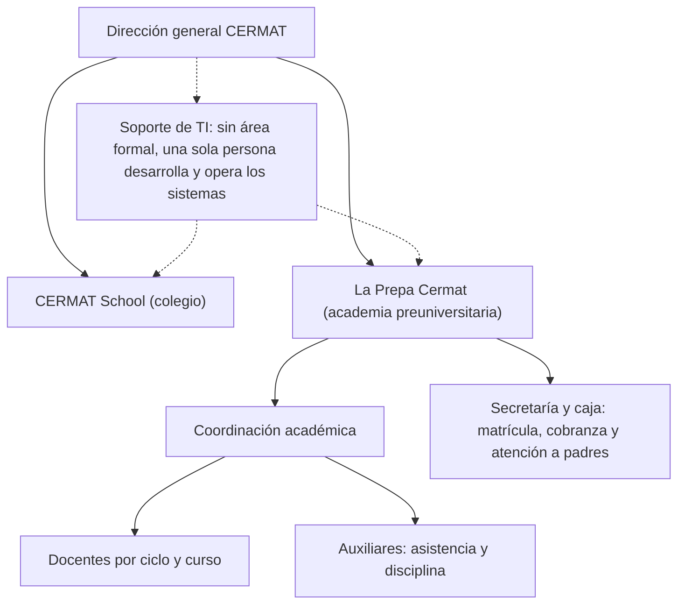
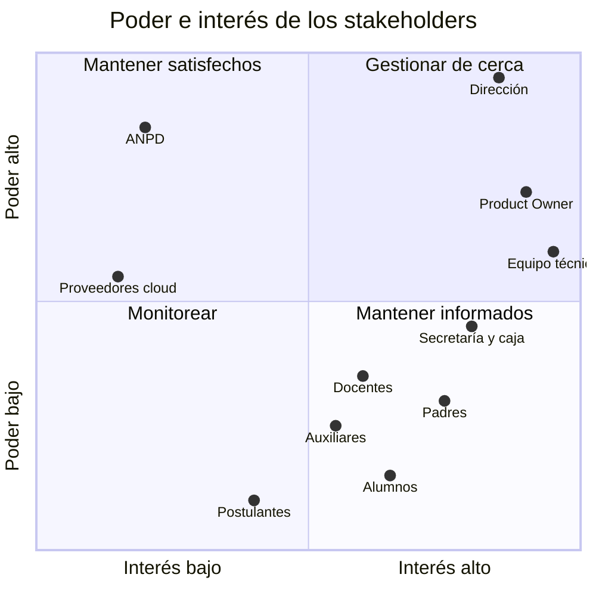
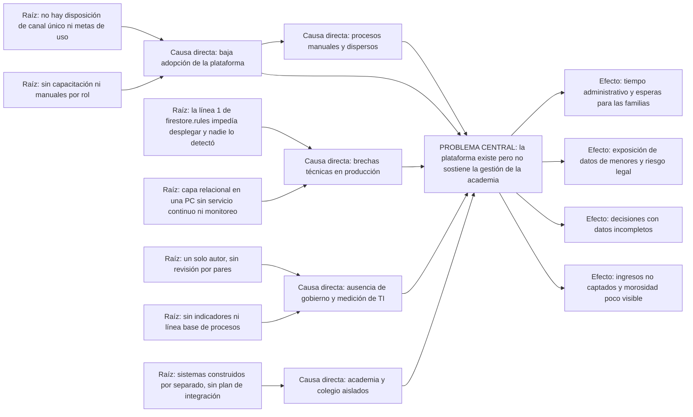
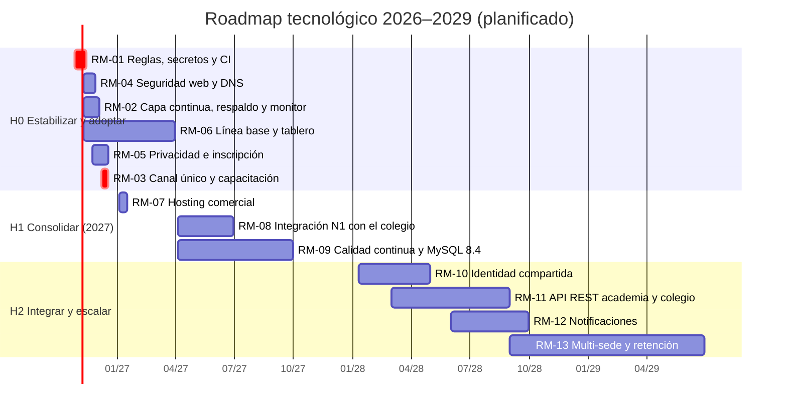

# E1 — Diagnóstico Organizacional y Alineamiento Estratégico (CE0111–CE0115)

!!! abstract "Evidencias CE011 — Gestión e Innovación de TI"
    CE0111 Diagnóstico organizacional · CE0112 Alineamiento estratégico · CE0113 Caso de negocio (detallado en el [E2](e2-business-case-ce0113.md)) · CE0114 Roadmap de tecnología · CE0115 Matriz de riesgos estratégicos. Los conteos de uso son agregados de Firestore al 2026-10-24, sin datos personales. Toda cifra estimada se marca como supuesto.

## Portada

| Campo | Detalle |
|---|---|
| Título | Diagnóstico organizacional y alineamiento estratégico de TI — CERMAT (Academia La Prepa Cermat) |
| Estudiantes | David Robert Yucra Mamani (líder), Gladys Rosaura Yana Pari, Denilson Leeke Mamani Flores, Cárdenas Vilca Rennzo |
| Semestre | 2026-2 (9° ciclo), UPeU campus Juliaca, sección g1 |
| Fecha | 2026-10-24 |
| Competencia | CE011 — Gestión e Innovación de TI |
| Organización | CERMAT, Azángaro (Puno, Perú): colegio CERMAT School y academia preuniversitaria La Prepa Cermat |

## Resumen ejecutivo

CERMAT opera un colegio y una academia preuniversitaria con varias sedes. Su ecosistema digital tiene tres sistemas formales que no se comunican entre sí: la **plataforma de la academia** (React y Firebase, publicada en Vercel), una **capa local** (API, MySQL y analítica en una PC) y el **sistema de gestión del colegio** (Angular, Laravel y PostgreSQL en un VPS). Junto a ellos siguen en uso cuadernos, hojas de cálculo y WhatsApp.

La plataforma está desplegada y tiene buena base técnica (90 pruebas automáticas, CI con 6 trabajos, reglas por rol en 22 colecciones), pero opera como **piloto con volumen bajo**: 8 matrículas, 2 pagos, 7 marcas de asistencia y 0 consultas de padres en diez meses. Hay tres brechas que explican buena parte de ese uso bajo:

- Las reglas publicadas el 22-jun-2026 **bloqueaban la matrícula pública** y **exponían el listado de matrículas pagadas**. Se corrigió en producción el 2026-10-24.
- No existe una disposición institucional de canal único ni capacitación.
- La capa relacional solo sincroniza cuando su PC está encendida.

La madurez digital medida con un modelo de 8 dimensiones es **1,75 de 5** (inicial a gestionado). El problema central y sus causas raíz se analizan en la sección 1.4. El roadmap (1.5) prioriza estabilizar y adoptar antes de integrar con el colegio. La matriz de riesgos (1.6) ubica como críticos la dependencia de una sola persona, la exposición de datos de menores (tratada el 2026-10-24) y la baja adopción.

## 1.1 Contexto organizacional

### Descripción del sector y entorno competitivo

CERMAT compite en la **educación privada de la provincia de Azángaro**: educación básica regular (colegio) y preparación preuniversitaria (academia) para los exámenes de admisión de las universidades de la región. La academia trabaja por **ciclos** con campañas de matrícula cortas, lo que concentra la carga administrativa en pocas semanas.

No se cuenta con un estudio de mercado propio. La tabla resume la valoración del equipo con el modelo de cinco fuerzas [1]; debe validarse con la Dirección.

| Fuerza | Intensidad | Sustento |
|---|---|---|
| Rivalidad entre academias | Alta | Varias academias en la provincia y en Juliaca compiten por los mismos postulantes con precio, horarios y resultados de ingreso. |
| Amenaza de sustitutos | Media-alta | Centros preuniversitarios de las propias universidades y contenido gratuito en línea. |
| Poder de negociación de las familias | Media-alta | Alta sensibilidad al precio y decisión influida por la confianza y la comunicación con la academia. |
| Poder de los proveedores clave (docentes) | Media | Los docentes con buenos resultados son escasos y pueden migrar. |
| Amenaza de nuevos competidores | Alta | Abrir una academia requiere poca inversión. |

**Lectura estratégica:** con rivalidad alta y bajo costo de entrada, la diferenciación sostenible no es solo académica: también es **servicio** (matrícula sin esperas, información clara a los padres, seguimiento del alumno). Ese es el espacio donde actúa la TI.

### Estructura organizacional

Estructura funcional relevada por el equipo (pendiente de validación con la Dirección):

No existe un área de TI. El desarrollo y la operación de la plataforma de la academia y del sistema del colegio dependen del mismo autor (líder de este equipo): el historial de git registra un único autor humano en 49 de 52 commits; los 3 restantes son de herramientas de generación.

### Cadena de valor

Cadena de valor adaptada a un servicio educativo [1], con el sistema que soporta cada actividad hoy y su brecha.

| Tipo | Actividad | Sistema que la soporta hoy | Evidencia de uso (al 2026-10-24) | Brecha |
|---|---|---|---|---|
| Primaria | Captación y admisión | Sitio público de la plataforma, redes sociales y WhatsApp | 7 mensajes de contacto; 1 post | La pre-matrícula en línea estuvo bloqueada en producción hasta el 2026-10-24; desde entonces funciona |
| Primaria | Matrícula y cobranza | Plataforma (matrículas y pagos) y, sobre todo, cuaderno y hojas de cálculo | 8 matrículas (2 pendientes, 5 pagadas, 1 cancelada) y 2 pagos | La mayor parte del proceso sigue siendo manual |
| Primaria | Planificación académica | Plataforma (ciclos, grupos, sedes, turnos) | 1 ciclo, 1 grupo y 1 sede cargados | La oferta real no está cargada |
| Primaria | Dictado y recursos | Plataforma (recursos y talleres) | 6 recursos, 1 taller | Uso marginal |
| Primaria | Seguimiento del alumno | Asistencia por QR y analítica de riesgo | 7 marcas, solo entre el 2026-01-27 y el 2026-04-02 | Sin uso desde abril |
| Primaria | Comunicación con las familias | Código de consulta para padres y WhatsApp | 0 consultas registradas | El canal digital no se adoptó |
| Apoyo | Dirección y planificación | — | No hay tablero de indicadores en uso | Decisiones sin datos consolidados |
| Apoyo | Gestión de personas | Invitaciones por rol de la plataforma | 3 docentes y 1 auxiliar con perfil | — |
| Apoyo | Finanzas | Pagos en la plataforma y caja manual | 2 pagos confirmados, 0 anulados | Sin conciliación sistemática |
| Apoyo | Tecnología | Plataforma, capa local y sistema del colegio | Ver inventario (1.3) | Sistemas aislados; sin gobierno de TI |

### Mapa de stakeholders

| Stakeholder | Interés principal | Influencia | Estrategia de gestión |
|---|---|---|---|
| Dirección CERMAT (sponsor) | Control, cumplimiento y costo | Decide adopción y presupuesto | Gestionar de cerca: revisión de cada sprint e indicadores mensuales |
| Product Owner (a designar por la Dirección) | Que la plataforma resuelva la operación diaria | Prioriza el backlog | Gestionar de cerca: participación semanal |
| Secretaría y caja | Menos trabajo repetitivo y menos errores | Su uso define la adopción | Capacitación y registro rápido en el panel |
| Docentes y auxiliares | Registro de asistencia simple | Media | Capacitación corta por rol |
| Padres y apoderados | Saber si su hijo asiste y cuánto debe | Baja individual, alta colectiva | Código de consulta y comunicación clara |
| Alumnos y postulantes | Matrícula sin esperas y acceso a recursos | Baja | Pre-matrícula en línea y portal del alumno |
| Equipo técnico (EPE) | Calidad, continuidad y sustentación | Alta en lo técnico | Backlog, CI y revisión por pares |
| ANPD (Autoridad Nacional de Protección de Datos Personales) | Cumplimiento de la Ley N.° 29733 | Puede sancionar | Mantener satisfecha: política, consentimiento e inscripción del banco de datos |
| Proveedores (Google Firebase, Vercel, RackNerd) | Uso conforme a sus términos | Cambian precios y condiciones | Monitorear términos, cuotas y costos |

## 1.2 Análisis estratégico

### Misión, visión y objetivos estratégicos

CERMAT no tiene un plan estratégico escrito que el equipo haya podido revisar. La siguiente es una **formulación de trabajo** construida a partir de la oferta publicada y de las necesidades declaradas en el [Brief EPE](../brief-epe.md); debe ser validada y aprobada por la Dirección.

| Elemento | Formulación de trabajo |
|---|---|
| Misión | Preparar a los estudiantes de Azángaro para su ingreso a la universidad con enseñanza exigente y un servicio cercano, ordenado y transparente con las familias. |
| Visión 2029 | Ser la academia de referencia de la provincia por sus resultados de ingreso y por una gestión digital que da a las familias información confiable y oportuna. |

| ID | Objetivo estratégico | Indicador | Meta propuesta |
|---|---|---|---|
| OE1 | Crecer en matrícula y retener a los alumnos durante el ciclo | Matrículas por ciclo y tasa de abandono | Por definir con la línea base 2026 |
| OE2 | Hacer eficiente y controlada la gestión administrativa | Minutos de personal por matrícula | ≤ 12 min en 2027 (hoy ≈ 40 min, supuesto) |
| OE3 | Fortalecer la confianza de las familias con información oportuna | Alumnos cuyos padres consultan al menos una vez al mes | ≥ 50 % en 2027 |
| OE4 | Proteger los datos personales de los alumnos y cumplir la normativa | Fallas críticas de seguridad publicadas | 0 |
| OE5 | Integrar la gestión del colegio y de la academia bajo una visión CERMAT | Procesos con datos compartidos entre ambos sistemas | ≥ 2 en 2028 |

### Análisis FODA sustentado con evidencia

| Factor | Descripción | Evidencia |
|---|---|---|
| **F1** | Plataforma propia desplegada con portales por rol | 6 portales (público, admin, docente, alumno, auxiliar y consulta para padres); 22 colecciones con reglas por rol; [E3 de Software](../e3-sistema-funcional-ce023.md) |
| **F2** | Calidad técnica verificable | 90 pruebas automáticas (34 unitarias, 18 de API, 19 de reglas, 19 de base de datos) y CI con 6 trabajos ([E4 de Software](../e4-calidad-operacion-ce024.md)) |
| **F3** | Control de cupos y duplicados por diseño | Matrícula en una transacción con id determinístico `grupo__teléfono` (`src/features/enrollments/api.ts`) |
| **F4** | Datos con integridad y recuperación probada | MySQL con 3 FK, 7 CHECK, 6 triggers y 4 roles, aplicados en la base real el 2026-10-24; restauración de la base real con RTO de 0,23 s ([E2 de Software](../e2-base-datos-ce022.md)) |
| **F5** | Infraestructura del colegio ya profesionalizada | VPS con UFW, TLS con renovación automática y PostgreSQL solo local; dominio `.edu.pe` |
| **D1** | Adopción muy baja | 8 matrículas, 2 pagos, 7 marcas de asistencia y 0 consultas de padres en diez meses |
| **D2** | Producción desactualizada sin detección | Las reglas del 22-jun-2026 fallaban 10 de 19 pruebas (auto-asignación de rol, listado público de matrículas pagadas y matrícula pública bloqueada) y nadie lo detectó en 4 meses. Se corrigió en producción el 2026-10-24; la publicación automática por CI sigue pendiente |
| **D3** | Conocimiento concentrado en una persona | 49 de 52 commits de un único autor; sin revisiones registradas |
| **D4** | Capa relacional intermitente y sin respaldo de Firestore | La API y MySQL corren en una PC que solo sincroniza encendida; no hay respaldo programado de Firestore ni monitor con alertas |
| **D5** | Gestión sin medición | No hay registro de esfuerzo ni tiempos de proceso; auditoría CMMI en nivel 1 ([E4 de Software](../e4-calidad-operacion-ce024.md#44-informe-de-auditoria-tecnica)) |
| **O1** | Integración con el sistema del colegio | Mismo autor, API Laravel publicada y dominio institucional con correo en Google |
| **O2** | Familias con acceso móvil a internet | La consulta por código y la pre-matrícula funcionan desde el celular sin instalar nada |
| **O3** | Crecimiento multi-sede a bajo costo marginal | El modelo de datos ya admite varias sedes, grupos y turnos |
| **O4** | Servicios en la nube con cuotas gratuitas suficientes | Firebase sin costo con el uso actual; VPS de US$ 35,99 al año |
| **A1** | Exigencias de protección de datos de menores | Ley N.° 29733 y su reglamento [5], [6]; datos alojados fuera del Perú (Firebase, Vercel y VPS en EE. UU.) |
| **A2** | Rivalidad alta y estacionalidad | Campañas de matrícula cortas por ciclo |
| **A3** | Condiciones y precios de proveedores en dólares | Vercel Hobby es solo para uso personal no comercial [7]; cuotas de Firebase [8] |
| **A4** | Exposición del dominio institucional | Sin registros SPF, DMARC, CAA ni DNSSEC; el sitio del colegio no envía cabeceras de seguridad y muestra la versión de nginx (verificado el 2026-10-24) |

**FODA cruzado (estrategias):**

| Estrategia | Combinación | Iniciativa del roadmap |
|---|---|---|
| FO: usar la plataforma y la experiencia del autor para integrar con el colegio y captar alumnos del colegio | F1, F5, O1, O3 | RM-08, RM-11 |
| FA: publicar solo lo que pasa las pruebas y formalizar la privacidad | F2, A1 | RM-01, RM-05 |
| DO: llevar la capa relacional a servicio continuo con la infraestructura disponible | D4, O4 | RM-02 |
| DA: disposición de canal único, capacitación y transferencia de conocimiento | D1, D3, A2 | RM-03, RM-06 |

### Análisis PESTEL (breve)

| Factor | Situación | Implicancia para TI |
|---|---|---|
| Político | Academias preuniversitarias con menor regulación sectorial que los colegios | Mayor libertad para digitalizar procesos propios |
| Económico | Familias sensibles al precio; servicios en la nube cobrados en dólares | Priorizar soluciones de bajo costo recurrente y vigilar el tipo de cambio |
| Social | Comunicación con familias por WhatsApp y celular | Canales móviles sin instalación (web responsiva, código de padres) |
| Tecnológico | Conectividad y energía variables en la sede | La vía crítica debe estar en la nube; la capa local no debe ser indispensable |
| Ecológico | Uso de papel en fichas, recibos y listas | La digitalización reduce papel (beneficio cualitativo) |
| Legal | Ley N.° 29733 y su reglamento (D.S. N.° 016-2024-JUS), datos de menores y transferencia internacional | Política de privacidad, consentimiento, inscripción del banco de datos y medidas de seguridad |

### Factores críticos de éxito

| ID | Factor crítico de éxito | Indicador | Meta |
|---|---|---|---|
| FCE1 | Patrocinio activo de la Dirección con una disposición de canal único de matrícula | Disposición emitida y revisiones de sprint con asistencia de la Dirección | Disposición antes del 2026-12-18; 3 de 3 revisiones |
| FCE2 | Matrícula en línea y panel siempre disponibles | Disponibilidad mensual medida por monitor externo | ≥ 99 % |
| FCE3 | Datos confiables de cupos y pagos | Incidentes de sobrecupo o duplicados; diferencias de conciliación | 0 y 0 |
| FCE4 | Protección de los datos de menores | Pruebas de reglas contra lo publicado | 19 de 19 |
| FCE5 | Capacidad técnica que no dependa de una persona | Personas capaces de desplegar y restaurar | ≥ 2 |
| FCE6 | Personal capacitado y familias informadas | Personal capacitado por rol | 100 % antes de la campaña 2027 |

### Alineamiento estratégico (CE0112)

Cada objetivo estratégico se conecta con una brecha, una iniciativa, un objetivo SMART del proyecto ([E2](e2-business-case-ce0113.md#21-justificacion-del-proyecto)) y un indicador del sistema ([E5](e5-propuesta-solucion-tic-ce0141.md#56-indicadores-de-uso-valor-y-mejora-ce0145)).

| Objetivo estratégico | FCE | Brecha que lo impide (1.3) | Iniciativa (1.5) | Objetivo del proyecto (E2) | Indicador (E5) |
|---|---|---|---|---|---|
| OE1 Crecer y retener | FCE1, FCE6 | BR-01, BR-07 | RM-03, RM-08, RM-13 | OBJ-1, OBJ-5 | IU-01, IV-05 |
| OE2 Eficiencia y control | FCE3 | BR-01, BR-03, BR-06 | RM-02, RM-03, RM-06 | OBJ-2, OBJ-3 | IV-01, IV-02 |
| OE3 Confianza de las familias | FCE2, FCE6 | BR-01 | RM-03, RM-12 | OBJ-1 | IU-04 |
| OE4 Protección de datos | FCE4, FCE5 | BR-02, BR-04, BR-08, BR-09 | RM-01, RM-04, RM-05 | OBJ-4 | IM-01, IM-02 |
| OE5 Integración CERMAT | FCE5 | BR-07 | RM-08, RM-10, RM-11 | — (fase posterior) | IM-06 |

## 1.3 Diagnóstico digital / TI

### Inventario de sistemas de información existentes

| ID | Sistema | Propósito | Usuarios | Tecnología y alojamiento | Datos | Estado | Integración |
|---|---|---|---|---|---|---|---|
| SI-01 | Plataforma de la academia | Oferta, matrícula, pagos, asistencia QR, recursos, talleres y consulta de padres | Admin, docentes, alumnos, auxiliar, padres y visitantes | React 18 + TypeScript + Vite en Vercel (plan Hobby); Firebase Auth, Firestore y Storage | 22 colecciones con reglas por rol | En producción, piloto con volumen bajo | Envía eventos a SI-02 |
| SI-02 | Capa local de la academia | Réplica relacional, reportes, auditoría y analítica de riesgo | Admin (vía panel) | API Node.js/Express (3001), MySQL 8 y FastAPI (8000) con PM2 en una PC | Matrículas, pagos, asistencia, alertas y auditoría | Operativa solo con la PC encendida | Recibe de SI-01 (URL en `config/services`) |
| SI-03 | Sistema de gestión del colegio | Gestión escolar del colegio | Personal del colegio | Angular + Laravel (PHP 8.4) + PostgreSQL 16 en VPS RackNerd (Ubuntu 24.04, 2 vCPU, 2 GB) | Base `cermat_produccion` (116 migraciones) | En producción en `cermatschool.edu.pe` y `api.cermatschool.edu.pe` | Ninguna con SI-01 |
| SI-04 | Correo del dominio institucional | Correo del colegio | Personal | Google (registros MX del dominio) | Correos | En uso | Ninguna |
| SI-05 | Herramientas informales | Registro manual de matrículas, pagos y asistencia; mensajes a padres | Secretaría, docentes, auxiliares | Cuadernos, hojas de cálculo y WhatsApp | Datos dispersos sin control de acceso | En uso para la mayoría de los trámites | Ninguna (re-digitación) |

El mapa visual del ecosistema y la integración propuesta están en el [E5, sección 5.2](e5-propuesta-solucion-tic-ce0141.md#52-ecosistema-de-sistemas-de-informacion-ce0141-y-ce0143).

### Nivel de madurez digital

**Modelo usado:** modelo de madurez digital de 8 dimensiones con escala de capacidad 1–5 adaptada de CMMI [4] y de los niveles de capacidad de COBIT 2019 [3].

| Nivel | Nombre | Descripción |
|---|---|---|
| 1 | Inicial | Prácticas improvisadas que dependen de personas; sin registros. |
| 2 | Gestionado | Prácticas repetibles en algunos procesos; herramientas aisladas; controles parciales. |
| 3 | Definido | Procesos y herramientas estandarizados, documentados y adoptados por toda la unidad. |
| 4 | Medido | Indicadores cuantitativos con metas y control periódico. |
| 5 | Optimizado | Mejora continua basada en datos e innovación. |

| Dimensión | Nivel actual | Justificación con evidencia | Meta 2027 |
|---|---|---|---|
| Estrategia y gobierno de TI | 1 ■□□□□ | Sin plan estratégico de TI ni instancia de decisión; el charter y el backlog existen desde oct-2026 | 3 |
| Procesos digitalizados | 2 ■■□□□ | La plataforma cubre matrícula, pagos y asistencia, pero la mayoría de trámites sigue siendo manual (8 matrículas) | 3 |
| Datos y analítica | 2 ■■□□□ | Réplica MySQL con integridad en el motor y analítica de riesgo; sincronización intermitente; sin respaldo de Firestore | 3 |
| Aplicaciones y sistemas de información | 3 ■■■□□ | Plataforma con 6 portales y sistema del colegio en producción, ambos documentados | 4 |
| Infraestructura y operación | 2 ■■□□□ | PaaS y VPS endurecido; capa local en una PC sin UPS; sin monitor con alertas | 3 |
| Seguridad y cumplimiento | 2 ■■□□□ | 19 pruebas de reglas y roles de mínimo privilegio. Las 3 fallas de las reglas de producción y la clave expuesta en el historial se corrigieron el 2026-10-24; siguen sin política de privacidad ni registros SPF/DMARC/CAA/DNSSEC | 3 |
| Integración e interoperabilidad | 1 ■□□□□ | Academia y colegio no comparten identidad ni datos; solo existe Firestore → MySQL | 2 |
| Personas y cultura digital | 1 ■□□□□ | Sin capacitación ni disposición de uso; 0 consultas de padres; conocimiento en una persona | 3 |
| **Promedio** | **1,75** | Entre inicial y gestionado | **3,0** |

La versión de julio de este documento calificaba la madurez como "medio-alta"; con un modelo explícito y los datos de uso reales, la calificación correcta es 1,75.

### Brechas tecnológicas

| ID | Brecha | Estado actual (evidencia) | Estado objetivo | Iniciativa | Prioridad |
|---|---|---|---|---|---|
| BR-01 | Adopción institucional | 8 matrículas en la plataforma; trámites mayormente manuales | ≥ 60 % de las matrículas de 2027 en la plataforma | RM-03 | Crítica |
| BR-02 | Reglas de producción desactualizadas | **Cerrada el 2026-10-24:** versión corregida publicada y verificada como visitante sin sesión (antes fallaban 10 de 19 pruebas) | 19 de 19 contra lo publicado | RM-01 | Crítica (cerrada) |
| BR-03 | Capa relacional sin servicio continuo | PC que sincroniza solo encendida | Servicio continuo en VM-APP01 (diseño CE03) o VPS puente | RM-02 | Alta |
| BR-04 | Respaldo y monitoreo | Sin respaldo programado de Firestore ni alertas | RPO ≤ 24 h y disponibilidad medida | RM-02 | Alta |
| BR-05 | Licencia de hosting | Vercel Hobby (uso personal no comercial) | Plan comercial o alternativa evaluada | RM-07 | Media |
| BR-06 | Medición y gobierno | Sin indicadores de proceso ni registro de esfuerzo | Tablero mensual de uso, valor y mejora | RM-06 | Alta |
| BR-07 | Integración academia–colegio | Ninguna | Enlace desde el sitio del colegio (decisión vigente), subdominio opcional y API REST | RM-08, RM-11 | Media |
| BR-08 | Seguridad web y DNS | Sin cabeceras en el colegio; la SPA ya publica sus cabeceras de seguridad (2026-10-24); versión de nginx visible; sin SPF, DMARC, CAA ni DNSSEC | Cabeceras publicadas y registros DNS configurados | RM-04 | Alta |
| BR-09 | Cumplimiento de protección de datos | Sin política de privacidad ni consentimiento en `src/` (búsqueda del 2026-10-24); banco de datos sin inscribir | Política, consentimiento e inscripción | RM-05 | Alta |
| BR-10 | Continuidad del conocimiento | Un único autor; secretos en el historial (revocados el 2026-10-24) | ≥ 2 personas capaces; historial limpio | RM-01, RM-03 | Crítica |

### Problemas operativos asociados a TI

| Problema | Evidencia | Efecto operativo |
|---|---|---|
| La pre-matrícula pública no se completaba en producción (resuelto el 2026-10-24) | Pruebas de reglas contra la versión publicada ([E4 de Software, 1.6](../e4-calidad-operacion-ce024.md#16-las-pruebas-detectan-defectos-reales)); cierre en [E4 §2.7](../e4-calidad-operacion-ce024.md#27-cierre-en-produccion-2026-10-24) | Los postulantes debían acudir o llamar; el canal en línea no captaba |
| Cualquier persona sin sesión podía listar matrículas pagadas con nombre y teléfono (resuelto el 2026-10-24) | Mismo reporte | Exposición de datos de menores y riesgo legal |
| Reportes de MySQL incompletos | La sincronización ocurre solo con la PC encendida | Decisiones con datos parciales; la conciliación pierde valor |
| Asistencia sin registros desde abril | 7 marcas entre el 2026-01-27 y el 2026-04-02 | El cálculo de riesgo de abandono no tiene datos |
| Re-digitación entre cuaderno, hojas y plataforma | Proceso AS-IS ([E4](e4-modelado-procesos-ce0131.md)) | Tiempo de personal y errores de transcripción |

## 1.4 Identificación del problema

### Definición estructurada del problema

| Elemento | Descripción |
|---|---|
| Qué | La matrícula, la cobranza y el seguimiento de asistencia de la academia se gestionan con procesos mayormente manuales, y la plataforma que los digitaliza opera con adopción mínima y brechas técnicas abiertas en producción. |
| Quién lo sufre | Secretaría y caja (trabajo repetitivo), familias (esperas y poca información), Dirección (sin datos consolidados) y alumnos menores de edad (datos expuestos). |
| Dónde | Sede principal de la academia en Azángaro y todos los canales de atención. |
| Desde cuándo | Plataforma en piloto desde enero de 2026; reglas desactualizadas en producción entre el 22-jun-2026 y el 2026-10-24. |
| Magnitud | 8 matrículas y 2 pagos en la plataforma en diez meses; 0 consultas de padres; 3 fallas críticas de seguridad publicadas (corregidas en producción el 2026-10-24). |
| Consecuencia | Tiempo administrativo, ingresos no captados, decisiones sin datos y riesgo legal y reputacional. |

**Enunciado:** *CERMAT no aprovecha la plataforma que ya construyó porque no existe una decisión institucional de uso, la versión publicada tiene fallas que bloquean el canal en línea y exponen datos, y no hay medición ni capacidad técnica distribuida para sostenerla.*

### Causas raíz (árbol de problemas)

| Causa raíz | Evidencia | Cómo se verifica que se eliminó |
|---|---|---|
| R1 Sin disposición de canal único | No existe documento de la Dirección; uso de 8 matrículas | Disposición emitida y adopción mensual ≥ 60 % |
| R2 Sin capacitación | No hay manuales ni registros de capacitación | 100 % del personal capacitado (registro de asistencia) |
| R3 Despliegue de reglas que fallaba sin aviso | Error `L1:1 token recognition error at: '#'` del emulador | Publicación solo vía CI; 19 de 19 pruebas contra lo publicado |
| R4 Capa relacional intermitente | PC con PM2; sin monitor | Disponibilidad medida y 0 diferencias de conciliación |
| R5 Un solo autor | 49 de 52 commits | 100 % de cambios revisados por un segundo integrante |
| R6 Sin medición | No hay tiempos de proceso ni registro de horas | Línea base AS-IS medida y tablero mensual |
| R7 Sin plan de integración | Academia y colegio sin identidad ni datos comunes | Integración N1 publicada (E5) |

### Impacto estratégico

| Objetivo afectado | Impacto actual | Cuantificación |
|---|---|---|
| OE1 Crecer y retener | El canal en línea no capta; el riesgo de abandono no se calcula por falta de asistencia | Beneficio de captación y retención del caso base no capturado: S/ 1 800 al año con adopción plena ([E2](e2-business-case-ce0113.md)) |
| OE2 Eficiencia | Cada matrícula manual consume ≈ 40 min de personal (supuesto) frente a ≈ 10,5 min en el proceso TO-BE | Ahorro potencial de S/ 6,42 por matrícula ([E4](e4-modelado-procesos-ce0131.md)) |
| OE3 Confianza | 0 consultas de padres en la plataforma | — |
| OE4 Protección de datos | Listado público de matrículas pagadas con nombre y teléfono | Infracciones sancionables con multas de hasta 100 UIT según la Ley N.° 29733 [5] |
| OE5 Integración | Doble registro y doble identidad entre colegio y academia | — |

### Justificación de la intervención

1. **La inversión principal ya está hecha.** El desarrollo de enero a octubre de 2026 es costo hundido: lo que se decide ahora es completar el cierre técnico y la adopción, con una inversión de CERMAT de S/ 1 166 en tiempo de su personal ([E2](e2-business-case-ce0113.md#244-flujo-de-caja-y-evaluacion-economica-a-3-anos)).
2. **Las brechas críticas son corregibles en semanas.** Las reglas corregidas ya pasan 19 de 19 pruebas; falta publicarlas.
3. **El valor depende de la adopción, no de más desarrollo.** El caso base es positivo para CERMAT solo si la adopción sostenida supera el 64,1 % o el volumen supera las 40 matrículas por ciclo.
4. **No intervenir mantiene el riesgo legal.** Mientras las reglas actuales sigan publicadas, los datos de matrículas pagadas son listables sin sesión.

## 1.5 Roadmap de tecnología (CE0114)

| ID | Horizonte | Iniciativa | Objetivo estratégico | Brecha | Responsable | Indicador de logro |
|---|---|---|---|---|---|---|
| RM-01 | H0 (nov-2026) | Publicar las reglas corregidas (hecho el 2026-10-24), retirar secretos (clave rotada el 2026-10-24) y obtener el primer CI en verde (PB-04, PB-06) | OE4 | BR-02, BR-10 | Equipo técnico | 19 de 19 pruebas contra lo publicado |
| RM-02 | H0 (nov–dic 2026) | Operación continua de la capa relacional, respaldo de Firestore y monitor con alertas (PB-13, PB-11, PB-08) | OE2, OE4 | BR-03, BR-04 | Equipo técnico | RPO ≤ 24 h; disponibilidad medida |
| RM-03 | H0 (dic-2026) | Disposición de canal único, manuales y capacitación por rol (PB-15) | OE1, OE2, OE3 | BR-01, BR-10 | Dirección y Product Owner | 100 % del personal capacitado |
| RM-04 | H0 (nov-2026) | Cabeceras de seguridad en Vercel y Nginx, ocultar la versión de nginx, SPF, DMARC y CAA; DNSSEC si el registro lo permite | OE4 | BR-08 | Responsable técnico | Verificación externa de cabeceras y DNS |
| RM-05 | H0 (dic-2026) | Política de privacidad, aviso de consentimiento e inscripción del banco de datos (PB-16) | OE4 | BR-09 | Dirección | Política publicada; constancia de inscripción |
| RM-06 | H0 (nov-2026 a mar-2027) | Línea base AS-IS y tablero de indicadores de uso y valor (PB-14) | OE2 | BR-06 | Product Owner | Tablero mensual publicado |
| RM-07 | H1 (ene-2027) | Hosting comercial (Vercel Pro o alternativa evaluada) y revisión anual de proveedores | OE4 | BR-05 | Dirección | Contrato o plan vigente |
| RM-08 | H1 (2027) | Integración N0–N1 con el colegio: enlace desde su sitio (decisión vigente de la institución), subdominio institucional solo si la Dirección lo aprueba y oferta publicada en JSON | OE5, OE1 | BR-07 | Responsable técnico | Enlace activo; subdominio según la decisión de la Dirección |
| RM-09 | H1 (2027) | Calidad continua: pruebas de componentes, tipado, carga diferida y migración de MySQL 8.0 a 8.4 LTS | OE4 | — | Equipo técnico | JS inicial < 1 MB; MySQL con soporte |
| RM-10 | H2 (2028) | Identidad compartida para el personal con la cuenta institucional de Google en ambos sistemas | OE5 | BR-07 | Responsable técnico | Inicio de sesión único para el personal |
| RM-11 | H2 (2028) | API REST de intercambio academia–colegio (alumnos del colegio, oferta y matrícula confirmada) | OE5, OE1 | BR-07 | Responsable técnico | ≥ 2 procesos con datos compartidos |
| RM-12 | H2 (2028) | Notificaciones por correo institucional (SPF, DKIM y DMARC) y evaluación de WhatsApp | OE3 | — | Responsable técnico | Confirmaciones automáticas enviadas |
| RM-13 | H2 (2028–2029) | Todas las sedes y grupos en la plataforma; analítica de retención | OE1 | — | Dirección | Sedes cargadas / sedes reales |

**Regla de secuencia:** no se integra con el colegio (H1–H2) mientras la plataforma no supere el hito de continuidad del 2027-03-31 (adopción y beneficios medidos, ver [E3](e3-plan-gestion-proyecto-ce0121.md#33-gestion-del-cronograma)). Integrar un sistema que no se usa multiplica el riesgo sin aumentar el valor.

## 1.6 Matriz de riesgos estratégicos (CE0115)

Escala: probabilidad (P) e impacto (I) de 1 a 5; nivel por P × I: **Bajo** 1–4, **Medio** 5–9, **Alto** 10–14, **Crítico** 15–25. Los riesgos de ejecución del proyecto están en el [E3, sección 3.5](e3-plan-gestion-proyecto-ce0121.md#35-gestion-de-riesgos).

| ID | Riesgo estratégico (causa → evento → efecto) | P | I | P×I | Nivel | Respuesta | Responsable | Indicador de alerta |
|---|---|---|---|---|---|---|---|---|
| RE-01 | Sin disposición institucional → el personal sigue con cuaderno → la plataforma no genera valor | 4 | 4 | 16 | Crítico | Disposición de canal único, capacitación, registro rápido y metas mensuales (RM-03) | Dirección | Adopción mensual < 50 % dos meses seguidos |
| RE-02 | Un solo autor mantiene ambos sistemas → se ausenta → nadie puede desplegar ni restaurar | 4 | 5 | 20 | Crítico | Transferencia de conocimiento, revisión por pares, documentación y contrato de mantenimiento | Dirección | Cambios sin revisión > 0 |
| RE-03 | Reglas de producción desactualizadas → listado público de matrículas pagadas → exposición de datos de menores | 4 | 5 | 20 | Crítico | Reglas corregidas publicadas y verificadas el 2026-10-24 (desde la consola); falta la publicación vía CI (RM-01) | Equipo técnico | Pruebas contra lo publicado < 19 de 19 |
| RE-04 | Sin política, consentimiento ni inscripción → fiscalización de la ANPD → sanción y daño reputacional | 3 | 4 | 12 | Alto | RM-05; informar la transferencia internacional de datos | Dirección | Política no publicada al 2026-12-18 |
| RE-05 | Dominio sin SPF, DMARC, CAA ni DNSSEC y sitios sin cabeceras → suplantación o ataque web → pérdida de confianza | 3 | 3 | 9 | Medio | RM-04 | Responsable técnico | Reporte DMARC con fuentes no autorizadas |
| RE-06 | Firestore sin respaldo y capa local en una PC → falla o borrado → pérdida de datos operativos | 2 | 5 | 10 | Alto | Respaldo programado y prueba de restauración (RM-02) | Equipo técnico | Último respaldo verificado > 24 h |
| RE-07 | Proveedores cambian condiciones o precios en dólares → costo mayor o incumplimiento de licencia | 3 | 3 | 9 | Medio | Plan comercial presupuestado, alternativa evaluada y exportación periódica | Dirección | Aviso de cambio de términos o tipo de cambio > S/ 3,74 |
| RE-08 | Volumen bajo → beneficios menores a los costos → VAN privado negativo (pesimista: S/ −8 809) | 3 | 4 | 12 | Alto | Hito de continuidad del 2027-03-31 y optimización de costos ([E2](e2-business-case-ce0113.md#25-riesgos-iniciales)) | Dirección | Matrículas por ciclo < 40 |
| RE-09 | Competidores con mejor experiencia digital → pérdida de postulantes | 3 | 3 | 9 | Medio | Pre-matrícula en línea, código de padres e integración con el colegio | Dirección | Caída de matrículas por ciclo |
| RE-10 | Integración con el colegio mal protegida (API con CORS sin restringir) → acceso indebido entre sistemas | 2 | 4 | 8 | Medio | Diseño de integración con autenticación por servicio, CORS restringido y mínimo privilegio ([E5](e5-propuesta-solucion-tic-ce0141.md#53-seguridad-y-gobernanza)) | Responsable técnico | Endpoint sin autenticación detectado |

**Mapa de calor (riesgo inherente):**

| Probabilidad \ Impacto | 1 | 2 | 3 | 4 | 5 |
|---|---|---|---|---|---|
| **5** | | | | | |
| **4** | | | | RE-01 | RE-02, RE-03 |
| **3** | | | RE-05, RE-07, RE-09 | RE-04, RE-08 | |
| **2** | | | | RE-10 | RE-06 |
| **1** | | | | | |

## Referencias

[1] M. E. Porter, *Competitive Advantage: Creating and Sustaining Superior Performance*. New York, NY, USA: Free Press, 1985.

[2] A. L. Mendelow, "Environmental scanning: The impact of the stakeholder concept," en *Proc. 2nd Int. Conf. Information Systems (ICIS)*, Cambridge, MA, USA, 1981, pp. 407–417.

[3] ISACA, *COBIT 2019 Framework: Governance and Management Objectives*. Schaumburg, IL, USA: ISACA, 2018.

[4] CMMI Institute, *CMMI Model V2.0*. Pittsburgh, PA, USA: CMMI Institute, 2018.

[5] Congreso de la República del Perú, "Ley N.° 29733, Ley de Protección de Datos Personales," *Diario Oficial El Peruano*, 3 de julio de 2011.

[6] Ministerio de Justicia y Derechos Humanos, "Decreto Supremo N.° 016-2024-JUS, que aprueba el Reglamento de la Ley N.° 29733," *Diario Oficial El Peruano*, 2024.

[7] Vercel Inc., "Pricing." [En línea]. Disponible: https://vercel.com/pricing

[8] Google, "Firebase pricing." [En línea]. Disponible: https://firebase.google.com/pricing

## Rúbrica de evaluación

| Criterio | Excelente | Bueno | Regular | Deficiente |
| --- | --- | --- | --- | --- |
| Análisis del contexto organizacional | Analiza profundamente el entorno con evidencia y sustento estratégico. | Analiza el contexto con identificación clara de problemas. | Describe la organización de forma general. | Descripción superficial sin análisis estructurado. |
| Identificación de brechas estratégicas | Identifica brechas críticas con análisis fundamentado y evidencia objetiva. | Identifica brechas coherentes con objetivos organizacionales. | Identifica brechas generales sin sustento. | No identifica brechas relevantes. |
| Alineamiento estratégico del proyecto | Evidencia alineamiento claro y coherente entre estrategia, problema y propuesta TI. | Justifica el proyecto en función de objetivos organizacionales. | Relación débil o implícita. | No demuestra relación entre estrategia y proyecto. |
| Sustentación y defensa técnica | Explica y defiende con dominio las decisiones tomadas. | Explica con solvencia. | Explica con dificultad. | No sustenta. |
