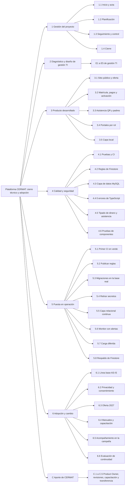
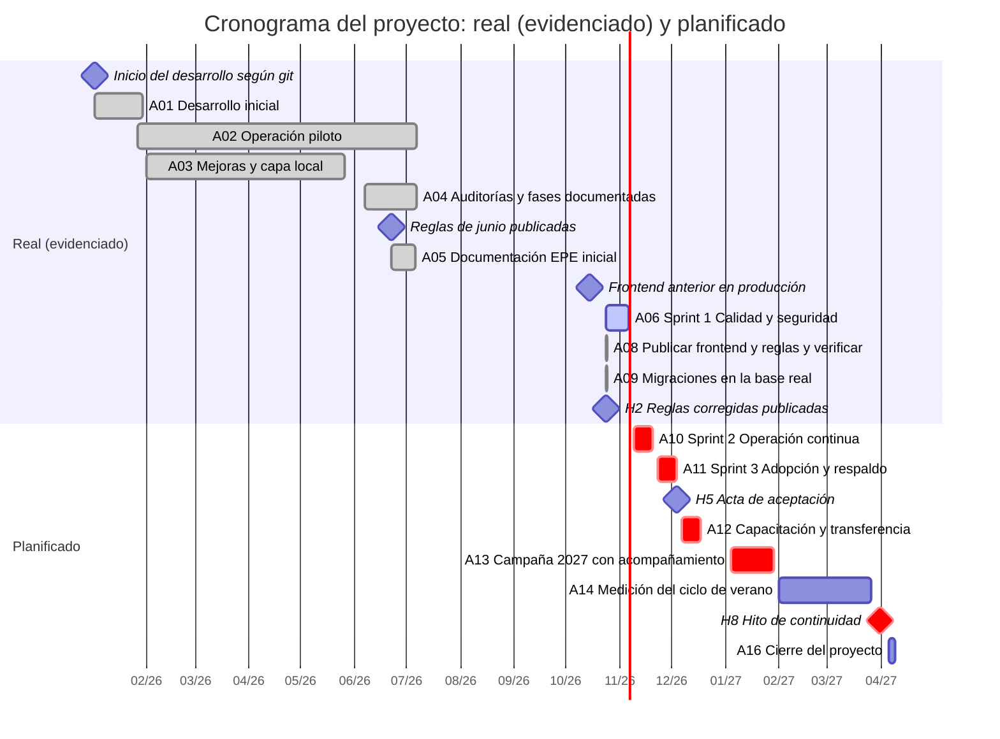

# E3 — Plan de Gestión del Proyecto (CE0121–CE0125)

!!! abstract "Evidencias CE012 — Gestión de Proyectos"
    CE0121 Acta de constitución · CE0122 Plan de gestión (alcance, tiempo, costo y recursos) · CE0123 EDT y cronograma · CE0124 Análisis económico (en el [E2](e2-business-case-ce0113.md#244-flujo-de-caja-y-evaluacion-economica-a-3-anos)) · CE0125 Plan de gestión de riesgos. El presupuesto y la línea base están en la hoja "Presupuesto" de [business-case.xlsx](../assets/gestion-ti/business-case.xlsx). El Project Charter de software, el Product Backlog y el Sprint 1 viven en el [E4 de Software](../e4-calidad-operacion-ce024.md#31-project-charter) y aquí se enlazan, no se duplican.

## Portada

| Campo | Detalle |
|---|---|
| Título | Plan de gestión del proyecto — Plataforma Web Integral CERMAT: cierre técnico y adopción institucional |
| Estudiantes | David Robert Yucra Mamani (líder), Gladys Rosaura Yana Pari, Denilson Leeke Mamani Flores, Cárdenas Vilca Rennzo |
| Semestre | 2026-2 (9° ciclo), UPeU campus Juliaca, sección g1 |
| Fecha | 2026-10-24 |
| Competencia | CE012 — Gestión de Proyectos |
| Enfoque | Híbrido: marco predictivo del PMBOK [1] para el acta, la EDT, la línea base de costos y los hitos; ejecución con Scrum ligero [3] en sprints de 2 semanas |

## Resumen ejecutivo

El proyecto empezó el **2026-01-02** (primer commit de desarrollo, "Implement Admin & Public MVP") y termina, según este plan, el **2027-04-09**. Lo ejecutado está evidenciado: desarrollo intensivo en enero de 2026 (43 commits), operación piloto entre el 2026-01-27 y el 2026-07-07, auditorías y fases documentadas entre el 2026-06-07 y el 2026-07-07, y el Sprint 1 de calidad desde el 2026-10-24, con 12 de 13 tareas hechas. Lo pendiente es el cierre técnico (Sprints 1 a 3), la capacitación, el acompañamiento en la campaña de matrícula 2027 y un **hito de continuidad el 2027-03-31**.

| Cifra del plan | Valor |
|---|---|
| Presupuesto total del proyecto (BAC, horas valorizadas) | S/ 21 346 |
| Trabajo ya ejecutado (costo hundido valorizado) | S/ 16 000 (640 h) |
| Trabajo planificado (equipo + CERMAT) | S/ 4 860, más S/ 486 de contingencia |
| Desembolso de CERMAT en el año 0 | S/ 1 166 (tiempo de su personal; el equipo EPE aporta S/ 4 180 de trabajo planificado) |
| Paquetes de trabajo | 35 en 6 entregables más el aporte de CERMAT |
| Hitos | 3 reales y 9 planificados |
| Riesgos del proyecto | 12, de los que 2 se cerraron el 2026-10-24 (exposición total P×I de los abiertos = 89, antes 117; meta al cierre ≤ 40) |

## 3.1 Acta de constitución

| Campo | Detalle |
|---|---|
| Nombre | Plataforma Web Integral CERMAT — cierre técnico y adopción institucional |
| Sponsor | Dirección general de CERMAT, en representación de la Academia La Prepa Cermat |
| Director del proyecto y Scrum Master | David Robert Yucra Mamani |
| Product Owner | Responsable designado por la Dirección (a confirmar en la revisión del Sprint 1; mientras tanto, el sponsor actúa como Product Owner interino) |
| Equipo | Gladys Rosaura Yana Pari, Denilson Leeke Mamani Flores y Cárdenas Vilca Rennzo (desarrollo, pruebas y documentación) |
| Justificación estratégica | Responde a los objetivos estratégicos OE1 a OE5 y cierra las brechas BR-01 a BR-10 del [E1](e1-diagnostico-organizacional-ce0111.md#alineamiento-estrategico-ce0112). El business case muestra un VAN de S/ 1 247 para CERMAT en el escenario base ([E2](e2-business-case-ce0113.md)). |
| Objetivos SMART | OBJ-1 ≥ 60 % de las matrículas de 2027 en la plataforma · OBJ-2 ≤ 12 min de personal por matrícula al 31-03-2027 · OBJ-3 p90 ≤ 24 h de respuesta a la pre-matrícula en la campaña 2027 · OBJ-4 19 de 19 pruebas de reglas contra lo publicado y 0 incidentes de cupo desde el 06-11-2026 · OBJ-5 VAN de la vista A ≥ 0 recalculado el 31-03-2027 (detalle en el [E2](e2-business-case-ce0113.md#21-justificacion-del-proyecto)) |
| Alcance preliminar: incluye | Cierre técnico (publicación de reglas, migraciones en la base real, retiro de secretos, operación continua de la capa relacional, monitor con alertas, respaldo de Firestore, carga diferida, tipado y pruebas de componentes); adopción (línea base AS-IS, privacidad y consentimiento, oferta 2027, manuales, capacitación y acompañamiento); gestión (seguimiento, hito de continuidad y cierre) |
| Alcance preliminar: excluye | Aplicación móvil nativa, pasarela de pagos, facturación electrónica, integración con el sistema del colegio (fase posterior, RM-08 a RM-11), hardware del host on-premise de CE03, endurecimiento del servidor y DNS del colegio (tarea operativa RM-04) |
| Entregables principales | 1 Gestión del proyecto · 2 Diagnóstico y diseño de gestión TI · 3 Producto desarrollado · 4 Calidad y seguridad · 5 Puesta en operación · 6 Adopción y cambio (sección 3.2) |
| Hitos principales | H2 reglas corregidas publicadas (2026-11-06) · H5 acta de aceptación (2026-12-04) · H6 personal capacitado (2026-12-18) · H7 campaña 2027 en la plataforma (2027-01-04) · H8 hito de continuidad (2027-03-31) · H9 cierre (2027-04-09) |
| Stakeholders | Dirección, Product Owner, secretaría y caja, docentes, auxiliares, padres, alumnos y postulantes, equipo técnico, ANPD y proveedores (mapa de poder e interés en el [E1](e1-diagnostico-organizacional-ce0111.md#mapa-de-stakeholders)) |
| Supuestos | La Dirección designa al Product Owner y emite una disposición de canal único · cada integrante dispone de ≈ 8 h por semana hasta diciembre · la campaña de matrícula del ciclo de verano empieza en enero de 2027 · Firebase sigue sin costo con el volumen previsto · la publicación de reglas se aprueba en el Sprint 1 · supuestos económicos S01 a S48 del E2 |
| Restricciones | Fin del semestre académico en diciembre de 2026 · CERMAT no tiene presupuesto de TI aprobado: su aporte es tiempo del personal y la operación desde 2027 · 4 estudiantes a tiempo parcial y un solo autor que conoce el código · el VPS del colegio (2 GB) queda reservado a componentes ligeros según CE03 · los scripts SQL no se ejecutan desde PowerShell por los falsos positivos del antivirus · cumplimiento de la Ley N.° 29733 |
| Riesgos de alto nivel | Publicación de reglas postergada (R-01), baja disponibilidad del equipo (R-02), Product Owner sin designar (R-03) y resistencia del personal (R-06) (sección 3.5) |
| Presupuesto resumido | BAC S/ 21 346 valorizado; desembolso de CERMAT en el año 0: S/ 1 166 en tiempo de su personal; operación desde 2027: S/ 2 438 al año (escenario base) |
| Criterios de éxito | 19 de 19 pruebas de reglas contra lo publicado · 6 de 6 trabajos del CI en verde · 30 días con 0 diferencias en `v_conciliacion_pagos` · RPO ≤ 24 h de Firestore probado con una restauración · 100 % del personal capacitado · acta de aceptación de los flujos críticos firmada por la Dirección · criterios del hito de continuidad cumplidos ([E2, 2.4.6](e2-business-case-ce0113.md#246-recomendacion-y-criterios-del-hito-de-continuidad)) |
| Relación con otros documentos | El Project Charter de software del [E4 de Software, 3.1](../e4-calidad-operacion-ce024.md#31-project-charter) es el derivado de esta acta para el producto: comparte sponsor, equipo y objetivos |
| Aprobación | **Pendiente de ejecución.** Procedimiento: presentar el acta en la revisión del Sprint 1 (2026-11-06) y recoger la firma del sponsor y del director del proyecto. Criterio de aceptación: acta firmada sin observaciones abiertas. Evidencia a adjuntar: acta firmada en PDF. |

## 3.2 Gestión del alcance

### EDT / WBS

### Diccionario de la EDT

Horas: reales estimadas por analogía (no hubo registro de horas) y planificadas por paquete. Costo a S/ 25 por hora técnica salvo indicación. Detalle y fórmulas en la hoja "Presupuesto".

| Código | Paquete de trabajo | Entregable y criterio de aceptación | Responsable | Horas | Costo | Estado |
|---|---|---|---|---|---|---|
| 1.1 | Inicio y acta de constitución | Acta de la sección 3.1, firmada por el sponsor | Director del proyecto | 4 | S/ 100 | Real (firma pendiente) |
| 1.2 | Planificación | Este plan, el presupuesto y el backlog extendido | Director del proyecto | 12 | S/ 300 | Real |
| 1.3 | Seguimiento y control | Informe de cada sprint con valor ganado y riesgos | Scrum Master | 20 | S/ 500 | Planificado |
| 1.4 | Cierre | Acta de cierre y lecciones aprendidas | Director del proyecto | 4 | S/ 100 | Planificado |
| 2 | Diagnóstico y diseño de gestión TI | E1 a E5 de gestión TI con sus artefactos | Equipo | 56 | S/ 1 400 | Real |
| 3.1 | Sitio público y oferta académica | Páginas públicas en producción | Equipo | 80 | S/ 2 000 | Real |
| 3.2 | Matrícula, pagos y activación | Matrícula transaccional, pagos con cuotas y activación por invitación | Equipo | 140 | S/ 3 500 | Real |
| 3.3 | Asistencia QR y consulta de padres | QR firmado, registro diario y consulta por código | Equipo | 90 | S/ 2 250 | Real |
| 3.4 | Portales por rol | Admin, docente, alumno y auxiliar con rutas protegidas | Equipo | 110 | S/ 2 750 | Real |
| 3.5 | Capa local | API, MySQL y analítica con PM2 | Equipo | 60 | S/ 1 500 | Real |
| 4.1 | Pruebas automáticas y CI (PB-01) | 99 pruebas y 6 trabajos de CI | Equipo | 40 | S/ 1 000 | Real |
| 4.2 | Corrección de reglas (PB-02) | 19 de 19 pruebas en el emulador | Equipo | 12 | S/ 300 | Real |
| 4.3 | Capa de datos MySQL (PB-03) | Integridad, roles, respaldo y restauración probada | Equipo | 24 | S/ 600 | Real |
| 4.4 | 0 errores de TypeScript (PB-07) | `npm run typecheck` sin errores y 7 defectos corregidos | Equipo | 12 | S/ 300 | Real |
| 4.5 | Tipado de dinero y asistencia (PB-09) | Usos de `any` < 120 | Equipo | 8 | S/ 200 | Planificado |
| 4.6 | Pruebas de componentes (PB-12) | ≥ 20 casos de matrícula y pagos | Equipo | 12 | S/ 300 | Planificado |
| 5.1 | Primer CI en verde | 6 de 6 trabajos en verde en GitHub | Líder | 2 | S/ 50 | Planificado |
| 5.2 | Publicar reglas (PB-04) | 19 de 19 pruebas contra lo publicado y una matrícula sin sesión verificada | Líder | 4 | S/ 100 | Planificado; ejecutado el 2026-10-24 |
| 5.3 | Migraciones en la base real (PB-05) | Migraciones aplicadas y 19 pruebas de BD en verde | Equipo | 4 | S/ 100 | Planificado; ejecutado el 2026-10-24 (migraciones 02–04 en `cermat_db`, cuentas de mínimo privilegio y restauración REC-05 verificadas) |
| 5.4 | Retirar secretos (PB-06) | 0 archivos sensibles en el historial; clave rotada | Líder | 6 | S/ 150 | Planificado; clave rotada el 2026-10-24 (los `.env`, sin contraseñas, siguen versionados por decisión del equipo) |
| 5.5 | Capa relacional continua (PB-13) | Servicio continuo en VM-APP01 o VPS puente; 30 días sin diferencias de conciliación | Equipo | 16 | S/ 400 | Planificado; en curso desde el 2026-10-24: servicio continuo en el VPS del colegio (CR-03); faltan los 30 días sin diferencias de conciliación |
| 5.6 | Monitor con alertas (PB-08) | Alertas sobre la URL y `/health` | Equipo | 4 | S/ 100 | Planificado |
| 5.7 | Carga diferida (PB-10) | JS inicial < 1 MB | Equipo | 8 | S/ 200 | Planificado |
| 5.8 | Respaldo de Firestore (PB-11) | Exportación programada y restauración probada (RPO ≤ 24 h) | Equipo | 12 | S/ 300 | Planificado |
| 6.1 | Línea base AS-IS (PB-14) | 10 trámites cronometrados con hoja de registro ([E4](e4-modelado-procesos-ce0131.md#434-plan-de-medicion)) | Equipo y Product Owner | 8 | S/ 200 | Planificado |
| 6.2 | Privacidad y consentimiento (PB-16) | Política publicada y aviso de consentimiento en la matrícula | Equipo y Dirección | 6 | S/ 150 | Planificado |
| 6.3 | Oferta 2027 (PB-17) | Ciclos, grupos y sedes 2027 cargados y revisados por el Product Owner | Equipo | 4 | S/ 100 | Planificado |
| 6.4 | Manuales y capacitación (PB-15) | Manual de una página por rol y sesiones con registro de asistencia | Equipo | 18 | S/ 450 | Planificado |
| 6.5 | Acompañamiento en la campaña 2027 | Soporte en sede durante las primeras semanas | Equipo | 12 | S/ 300 | Planificado |
| 6.6 | Evaluación de continuidad | Libro recalculado con datos reales e informe a la Dirección | Director del proyecto | 4 | S/ 100 | Planificado |
| C.1 | Product Owner | Backlog priorizado y aceptación de historias (S/ 30 por h) | Dirección | 12 | S/ 360 | Planificado |
| C.2 | Revisiones de sprint | Asistencia a 3 revisiones (S/ 30 por h) | Dirección | 3 | S/ 90 | Planificado |
| C.3 | Capacitación administrativa y auxiliar | 3 personas × 3 h (S/ 10 por h) | Secretaría y auxiliar | 9 | S/ 90 | Planificado |
| C.4 | Capacitación docente | 3 docentes × 2 h (S/ 20 por h) | Docentes | 6 | S/ 120 | Planificado |
| C.5 | Transferencia de conocimiento | El responsable técnico de CERMAT despliega y restaura solo | Responsable técnico | 16 | S/ 400 | Planificado |

### Control de cambios

1. **Solicitud:** issue en el repositorio con descripción, motivo, horas estimadas y riesgo.
2. **Análisis de impacto (máximo 2 días):** alcance, cronograma, costo, riesgo y pruebas afectadas.
3. **Decisión:** el Product Owner aprueba cambios de hasta 8 h que no muevan un hito; el sponsor aprueba los mayores, los que mueven un hito o los que consumen la reserva de contingencia.
4. **Registro:** el cambio entra al backlog con su identificador y se anota en el registro de cambios.
5. **Implementación:** pull request con la lista de revisión obligatoria, revisión de un segundo integrante y CI en verde.
6. **Verificación:** el Product Owner lo acepta en la revisión del sprint.

| ID | Fecha | Cambio | Motivo | Decisión |
|---|---|---|---|---|
| CR-01 | 2026-10-24 | La capa relacional se aloja en VM-APP01 o en un VPS puente, no en el VPS del colegio (PB-13) | El diseño de CE03 reserva el VPS de 2 GB para componentes ligeros | Incorporado en este plan; la exclusión del VPS del colegio quedó sustituida por CR-03 |
| CR-02 | 2026-10-24 | La integración con el sistema del colegio pasa a una fase posterior | Integrar antes de lograr adopción multiplica el riesgo sin valor (E1, 1.5) | Incorporado en este plan |
| CR-03 | 2026-10-24 | Mientras no exista VM-APP01, la capa relacional se aloja en el VPS del colegio, con un usuario propio y servicios solo en 127.0.0.1 (PB-13) | La PC solo sincronizaba encendida. La medición dejó 1,3 GiB disponibles con todo en marcha, por encima del 25 % que exige el diseño (S1-E2 §10.5) | Aplicado el 2026-10-24 por el equipo técnico; queda pendiente su aprobación formal según este procedimiento |

## 3.3 Gestión del cronograma

### Lista de actividades

| ID | Actividad (EDT) | Predecesoras | Inicio | Fin | Tipo | Responsable |
|---|---|---|---|---|---|---|
| A01 | Desarrollo inicial: MVP público y administrativo, portales y talleres (3.1 a 3.4) | — | 2026-01-02 | 2026-01-30 | Real: 43 commits en enero | Líder |
| A02 | Operación piloto con registros reales (3.2, 3.3) | A01 | 2026-01-27 | 2026-07-07 | Real: fechas de Firestore | Dirección y líder |
| A03 | Mejoras incrementales y capa local (3.5) | A01 | 2026-02-01 | 2026-05-26 | Real: commits de feb, abr y may | Líder |
| A04 | Auditorías y fases documentadas (3) | A03 | 2026-06-07 | 2026-07-07 | Real: fechas en `docs/AUDITORIA_*` y `docs/FASE_*` | Líder |
| A05 | Documentación EPE inicial (2) | A04 | 2026-06-22 | 2026-07-06 | Real | Equipo |
| A06 | Sprint 1 Calidad y seguridad (4.1 a 4.4, 5.1 a 5.4) | A04 | 2026-10-24 | 2026-11-06 | En curso: 12 de 13 tareas | Equipo |
| A07 | Actualización de diagnóstico, business case y plan (1.1, 1.2, 2) | A05 | 2026-10-24 | 2026-10-24 | Real | Equipo |
| A08 | Publicar reglas y verificar la matrícula sin sesión (5.1, 5.2) | A06 (pruebas en verde) | 2026-10-26 | 2026-11-06 | Real: ejecutada el 2026-10-24, antes de lo planificado | Líder y sponsor |
| A09 | Migraciones en la base real y retiro de secretos (5.3, 5.4) | A08 | 2026-11-02 | 2026-11-06 | Real: ejecutada el 2026-10-24, antes de lo planificado (los `.env`, sin contraseñas, siguen versionados por decisión del equipo) | Equipo |
| A10 | Sprint 2 Operación continua (5.5, 5.6, 5.7, 4.5, 6.1) | A08 | 2026-11-09 | 2026-11-20 | Planificado (crítica) | Equipo |
| A11 | Sprint 3 Adopción y respaldo (5.8, 4.6, 4.5, 6.2, 6.3, 6.4) | A10 | 2026-11-23 | 2026-12-04 | Planificado (crítica) | Equipo |
| A12 | Capacitación por rol y transferencia de conocimiento (6.4, C.3 a C.5) | A11 | 2026-12-07 | 2026-12-18 | Planificado (crítica) | Equipo y CERMAT |
| A13 | Acompañamiento en la campaña de matrícula 2027 (6.5) | A12 | 2027-01-04 | 2027-01-29 | Planificado (crítica) | Equipo |
| A14 | Medición de indicadores del ciclo de verano (6.6) | A13 | 2027-02-01 | 2027-03-26 | Planificado | Product Owner |
| A15 | Evaluación de continuidad (6.6) | A14 | 2027-03-29 | 2027-03-31 | Planificado (crítica) | Director del proyecto y sponsor |
| A16 | Cierre del proyecto (1.4) | A15 | 2027-04-05 | 2027-04-09 | Planificado | Director del proyecto |
| A17 | Seguimiento y control (1.3) | — | 2026-10-24 | 2027-03-31 | Planificado (continuo) | Scrum Master |

Las fechas de A13 a A16 dependen del calendario de la academia (supuesto: campaña del ciclo de verano en enero de 2027) y se confirman con la Dirección en el Sprint 1.

### Diagrama de Gantt

En la sección "Real" solo hay fechas evidenciadas por git, Firestore, los documentos fechados y el panel de Vercel. Lo planificado empieza el 2026-10-24; la ruta crítica se muestra en rojo.

### Hitos principales

| ID | Hito | Fecha | Tipo | Criterio o evidencia |
|---|---|---|---|---|
| H0 | Inicio del desarrollo | 2026-01-02 | Real | Commit "Implement Admin & Public MVP" |
| H0b | Publicación de las reglas vigentes (con 3 fallas) | 2026-06-22 | Real | Ruleset de producción identificado en el [E4 de Software](../e4-calidad-operacion-ce024.md#26-analisis-del-incidente-reglas-sin-publicar-desde-junio) |
| H0c | Última publicación del frontend | 2026-10-15 | Real | Historial de despliegues de Vercel |
| H1 | Acta de constitución firmada | 2026-11-06 | Planificado | Firma del sponsor |
| H2 | Reglas corregidas publicadas y matrícula sin sesión verificada | 2026-11-06 (cumplido el 2026-10-24) | Real | Consulta sin sesión denegada (403) y pre-matrícula de prueba exitosa ([E4 de Software, 2.7](../e4-calidad-operacion-ce024.md#27-cierre-en-produccion-2026-10-24)) |
| H3 | Capa relacional en servicio continuo con monitor | 2026-11-20 | Planificado | Alertas activas y 0 diferencias de conciliación |
| H4 | Línea base AS-IS medida | 2026-11-20 | Planificado | 10 trámites cronometrados |
| H5 | Acta de aceptación de los flujos críticos | 2026-12-04 | Planificado | Firma de la Dirección |
| H6 | Personal capacitado y disposición de canal único | 2026-12-18 | Planificado, crítico | 100 % de asistencia y disposición emitida |
| H7 | Inicio de la campaña 2027 en la plataforma | 2027-01-04 | Planificado, crítico | Primera matrícula del ciclo de verano registrada |
| H8 | Hito de continuidad | 2027-03-31 | Planificado, crítico | Criterios del [E2, 2.4.6](e2-business-case-ce0113.md#246-recomendacion-y-criterios-del-hito-de-continuidad) |
| H9 | Cierre del proyecto | 2027-04-09 | Planificado | Acta de cierre y lecciones aprendidas |

**Ruta crítica:** A06 → A08 → A10 → A11 → A12 → A13 → A14 → A15 → A16. A09 también se ejecutó el 2026-10-24, y la tarea operativa RM-04 tiene holgura dentro de su sprint. A08 (publicar las reglas) era el punto más sensible, porque sin matrícula pública no hay campaña en línea que acompañar, y se cumplió el 2026-10-24, antes de lo planificado.

## 3.4 Gestión de costos

### Presupuesto detallado

| Entregable de la EDT | Horas reales | Horas planificadas | Costo real (hundido) | Costo planificado | Financia |
|---|---|---|---|---|---|
| 1 Gestión del proyecto | 16 | 24 | S/ 400 | S/ 600 | Equipo EPE |
| 2 Diagnóstico y diseño de gestión TI | 56 | 0 | S/ 1 400 | S/ 0 | Equipo EPE |
| 3 Producto desarrollado | 480 | 0 | S/ 12 000 | S/ 0 | Equipo EPE |
| 4 Calidad y seguridad | 88 | 20 | S/ 2 200 | S/ 500 | Equipo EPE |
| 5 Puesta en operación | 0 | 56 | S/ 0 | S/ 1 400 | Equipo EPE |
| 6 Adopción y cambio | 0 | 52 | S/ 0 | S/ 1 300 | Equipo EPE |
| C Aporte de CERMAT | 0 | 46 | S/ 0 | S/ 1 060 | CERMAT |
| **Subtotal** | **640** | **198** | **S/ 16 000** | **S/ 4 860** | |
| Reserva de contingencia (10 % del trabajo planificado) | | | | S/ 486 | Equipo EPE S/ 380 y CERMAT S/ 106 |
| **Presupuesto total del proyecto (BAC)** | | | | **S/ 21 346** | |

**Estimaciones justificadas:** las horas reales se estimaron por analogía con el tamaño del producto (41 748 líneas en `src/`, 13 módulos de dominio y 104 documentos de auditoría), porque no hubo registro de horas; las planificadas, por juicio experto del equipo para cada paquete con su criterio de aceptación. Las tarifas son los supuestos S08 a S11 del [E2](e2-business-case-ce0113.md#241-supuestos-del-modelo). La reserva de contingencia (S40) cubre riesgos identificados; no se define reserva de gestión porque CERMAT no tiene presupuesto de TI aprobado.

**Coherencia con el E2:** el BAC (S/ 21 346) es la inversión del año 0 de la vista B, y la parte de CERMAT con su contingencia (S/ 1 166) es la inversión de la vista A.

### Línea base de costos

Trabajo planificado por mes (equipo y CERMAT), en soles:

| Mes | oct-26 | nov-26 | dic-26 | ene-27 | feb-27 | mar-27 | abr-27 |
|---|---|---|---|---|---|---|---|
| Valor planificado del mes | 155 | 2 200 | 1 655 | 575 | 25 | 150 | 100 |
| Línea base acumulada | 155 | 2 355 | 4 010 | 4 585 | 4 610 | 4 760 | 4 860 |
| Acumulada con contingencia | 171 | 2 591 | 4 411 | 5 044 | 5 071 | 5 236 | 5 346 |

Noviembre concentra el 45 % del valor planificado (Sprints 1 a 3). Sumando el costo hundido de S/ 16 000, la línea base termina en el BAC de S/ 21 346.

### Control presupuestal

| Elemento | Definición |
|---|---|
| Registro de esfuerzo | Desde el Sprint 2, cada integrante registra sus horas por paquete en una hoja compartida (cierra la brecha de estimación del [E4 de Software](../e4-calidad-operacion-ce024.md#44-informe-de-auditoria-tecnica)) |
| Medición | Al cierre de cada sprint: PV = línea base acumulada; EV = % completado × costo planificado del paquete; AC = horas registradas × tarifa |
| Índices | CPI = EV ÷ AC; SPI = EV ÷ PV; estimación al cierre (EAC) = S/ 16 000 + costo planificado ÷ CPI |
| Umbrales | CPI o SPI entre 0,90 y 0,95: alerta en la revisión del sprint. Menor que 0,90: plan de acción y, si hace falta, uso de la contingencia con aprobación del sponsor |
| Registro de la contingencia | Cada uso se anota con fecha, riesgo que lo motiva, monto y aprobador |
| Primer informe | **Pendiente de ejecución:** al cierre del Sprint 2 (2026-11-20). Criterio de aceptación: PV, EV, AC, CPI y SPI calculados. Evidencia a adjuntar: hoja de horas y cálculo |

## 3.5 Gestión de riesgos

### Identificación y análisis cualitativo

Escala de 1 a 5; nivel por P × I: Bajo 1–4, Medio 5–9, Alto 10–14, Crítico 15–25. Los riesgos estratégicos de la organización están en el [E1, 1.6](e1-diagnostico-organizacional-ce0111.md#16-matriz-de-riesgos-estrategicos-ce0115).

| ID | Riesgo (causa → evento → efecto) | P | I | P×I | Prioridad | Estrategia | Respuesta | Responsable | Disparador | Estado |
|---|---|---|---|---|---|---|---|---|---|---|
| R-01 | Decisión postergada → las reglas corregidas no se publican → matrícula pública bloqueada y datos expuestos | 4 | 5 | 20 | Crítico | Evitar | Publicar en el Sprint 1 vía CI (entorno `produccion`, aprobación del sponsor) y verificar una matrícula sin sesión | Líder y sponsor | Sin aprobación al 2026-11-04 | Cerrado (2026-10-24): reglas publicadas desde la consola y verificadas en producción |
| R-02 | Fin de semestre → poca disponibilidad del equipo → tareas de los Sprints 2 y 3 incompletas | 4 | 3 | 12 | Alto | Mitigar | Capacidad fija de ≈ 40 h por sprint, orden por prioridad; PB-09 y PB-10 pasan a mantenimiento si hace falta | Scrum Master | Más de 25 % pendiente a mitad de sprint | Abierto |
| R-03 | Product Owner sin designar o sin tiempo → aceptación y priorización demoradas | 3 | 4 | 12 | Alto | Mitigar | Solicitar la designación en la revisión del Sprint 1; el sponsor actúa como interino | Sponsor | Sin Product Owner al 2026-11-06 | Abierto |
| R-04 | Sin alojamiento continuo para la capa relacional (host sin presupuesto, VPS reservado) → la sincronización sigue intermitente | 3 | 3 | 9 | Medio | Mitigar | VPS puente del mismo plan (US$ 35,99 al año) hasta que exista VM-APP01 | Líder | Sin decisión al 2026-11-13 | Abierto |
| R-05 | La rotación de la clave de servicio rompe la sincronización o el CI | 2 | 4 | 8 | Medio | Mitigar | Rotación en ventana acordada, prueba en CI y procedimiento de reversión | Líder | `/health` falla tras la rotación | Cerrado (2026-10-24): clave rotada y la nueva comprobada como válida; la API local la toma al reiniciarse |
| R-06 | Resistencia del personal o capacitación insuficiente → baja adopción en la campaña | 3 | 4 | 12 | Alto | Mitigar | Manual de una página por rol, práctica guiada, registro rápido y acompañamiento en enero | Product Owner | Menos de 50 % de matrículas en la plataforma en la segunda semana de enero | Abierto |
| R-07 | Pedidos nuevos durante los sprints → crecimiento del alcance | 3 | 3 | 9 | Medio | Mitigar | Control de cambios (3.2); los pedidos van al backlog | Product Owner | Más de 8 h de cambios no planificados en un sprint | Abierto |
| R-08 | Falsos positivos del antivirus → scripts SQL en cuarentena → retraso de migraciones | 3 | 2 | 6 | Medio | Mitigar | Ejecutar desde Git Bash y excepción para `server/src/db` | Equipo | Archivo en cuarentena | Abierto |
| R-09 | Registros manuales incompletos → no se puede medir la línea base → beneficios no verificables | 3 | 3 | 9 | Medio | Mitigar | Cronometraje prospectivo de 10 trámites con hoja de registro | Product Owner | Menos de 10 trámites medidos al 2026-12-04 | Abierto |
| R-10 | La campaña 2027 empieza antes de lo supuesto → capacitación desfasada | 2 | 3 | 6 | Medio | Mitigar | Confirmar el calendario con la Dirección en el Sprint 1 | Director del proyecto | Campaña antes del 2026-12-18 | Abierto |
| R-11 | Cambio de condiciones de Vercel o Firebase durante el proyecto | 2 | 2 | 4 | Bajo | Aceptar | Monitorear avisos de los proveedores; usar contingencia | Líder | Aviso del proveedor | Abierto |
| R-12 | Cuenta de administrador comprometida durante la transición → exposición de datos | 2 | 5 | 10 | Alto | Mitigar | MFA en cuentas admin, revisión de claims y procedimiento de incidentes del [SGSI](../infraestructura/s2-e1-sgsi-ce0321-ce0324.md) | Líder | Inicio de sesión anómalo | Abierto |

**Mapa de calor de los riesgos del proyecto:**

| Probabilidad \ Impacto | 1 | 2 | 3 | 4 | 5 |
|---|---|---|---|---|---|
| **5** | | | | | |
| **4** | | | R-02 | | R-01 |
| **3** | | R-08 | R-04, R-07, R-09 | R-03, R-06 | |
| **2** | | R-11 | R-10 | R-05 | R-12 |
| **1** | | | | | |

### Plan de respuesta y seguimiento

| Prioridad | Tratamiento | Frecuencia de revisión |
|---|---|---|
| Crítico | Respuesta inmediata con responsable y fecha dentro del sprint en curso | Seguimiento diario asíncrono |
| Alto | Plan de respuesta en el sprint en curso | Revisión de cada sprint |
| Medio | Respuesta planificada y vigilancia del disparador | Quincenal |
| Bajo | Aceptación y monitoreo | Mensual |

**Métrica de seguimiento:** exposición total (suma de P × I de los riesgos abiertos) = **89** al 2026-10-24 (era 117 antes de cerrar ese día R-01 y R-05); meta al cierre ≤ 40. Se recalcula en cada revisión de sprint y se informa junto con el valor ganado.

## 3.6 Gestión ágil

### Marco de trabajo

Scrum ligero con sprints de 2 semanas, Product Owner designado por la Dirección y Scrum Master del equipo. La comparación con RUP y Cascada y la justificación de la adaptación están en el [E4 de Software, 3.6](../e4-calidad-operacion-ce024.md#36-comparacion-con-otros-marcos-de-proceso).

### Product backlog

El backlog del producto (PB-01 a PB-12, con prioridad y estado) está en el [E4 de Software, 3.3](../e4-calidad-operacion-ce024.md#33-product-backlog). Este plan lo extiende con los ítems de gestión TI:

| ID | Ítem | Prioridad | Criterio de aceptación | EDT |
|---|---|---|---|---|
| PB-13 | Operación continua de la capa relacional (VM-APP01 o VPS puente) | Alta | 30 días sin diferencias en `v_conciliacion_pagos` y `/health` bajo monitoreo | 5.5 |
| PB-14 | Medición de la línea base AS-IS | Alta | 10 trámites cronometrados con hoja de registro firmada por quien midió | 6.1 |
| PB-15 | Manuales por rol y capacitación | Alta | Manual de una página por rol; 100 % de asistencia; ejercicio práctico aprobado | 6.4 |
| PB-16 | Política de privacidad y consentimiento | Alta | Política publicada en el sitio y aviso de consentimiento en la matrícula | 6.2 |
| PB-17 | Configuración de la oferta 2027 | Media | Ciclos, grupos y sedes 2027 cargados y revisados por el Product Owner | 6.3 |

### Sprint planning

| Sprint | Fechas | Objetivo | Ítems | Capacidad | Incremento esperado |
|---|---|---|---|---|---|
| Sprint 1 | 2026-10-24 a 2026-11-06 | Que ningún defecto crítico llegue a producción sin ser detectado | PB-01 a PB-07 (hechos) | 12 de 13 tareas hechas ([E4 de Software, 3.4](../e4-calidad-operacion-ce024.md#34-sprint-backlog-sprint-1-calidad-y-seguridad)) | Reglas corregidas publicadas y CI en verde |
| Sprint 2 | 2026-11-09 a 2026-11-20 | Operación continua y observable | PB-13, PB-08, PB-10, PB-09 (parte) y PB-14 | 40 h | Capa relacional continua, monitor con alertas, carga diferida y línea base medida |
| Sprint 3 | 2026-11-23 a 2026-12-04 | Lista para la campaña 2027 | PB-11, PB-12, PB-09 (resto), PB-16, PB-17 y PB-15 (manuales) | ≈ 42 h | Respaldo de Firestore, pruebas de componentes, privacidad, oferta 2027 y manuales |
| Transición | 2026-12-07 a 2026-12-18 | Personal capacitado | PB-15 (sesiones) y C.3 a C.5 | 14 h del equipo y 23 h de CERMAT (la transferencia continúa 8 h en enero) | Personal capacitado y responsable técnico autónomo |

**Definición de terminado:** la del [E4 de Software, 4.2](../e4-calidad-operacion-ce024.md#42-instrumentos-de-aseguramiento) (prueba, CI en verde y reversión documentada), más dos condiciones de gestión: el cambio queda en el manual de operación y actualiza su indicador del [E5](e5-propuesta-solucion-tic-ce0141.md#56-indicadores-de-uso-valor-y-mejora-ce0145).

### Incrementos y métricas de seguimiento

| Métrica | Fórmula | Valor al 2026-10-24 | Meta |
|---|---|---|---|
| Avance del sprint | Tareas hechas ÷ tareas del sprint | 16 de 17 (94 %) en el Sprint 1, al 2026-10-24 | 100 % al cierre de cada sprint |
| Velocidad | Horas de ítems terminados por sprint | Sin registro (empieza en el Sprint 2) | Estable ±15 % |
| Desvío de estimación | Horas reales ÷ horas estimadas por ítem | Sin registro | Entre 0,85 y 1,15 |
| Defectos escapados a producción | Defectos encontrados en producción por sprint | 3 críticos heredados de junio | 0 |
| Pruebas automáticas | Total en CI | 99 | En aumento cada sprint |
| Exposición de riesgo | Suma de P × I abiertos | 89 (117 antes de cerrar R-01 y R-05 el 2026-10-24) | ≤ 40 al cierre |

Las ceremonias (planificación, seguimiento diario asíncrono, revisión con la Dirección y retrospectiva) y la retrospectiva del Sprint 1 están en el [E4 de Software, 3.5](../e4-calidad-operacion-ce024.md#35-ceremonias-y-metricas-de-avance).

## Referencias

[1] Project Management Institute, *A Guide to the Project Management Body of Knowledge (PMBOK Guide)*, 7th ed. Newtown Square, PA, USA: PMI, 2021.

[2] Project Management Institute, *Process Groups: A Practice Guide*. Newtown Square, PA, USA: PMI, 2022.

[3] K. Schwaber y J. Sutherland, *The Scrum Guide*, nov. 2020. [En línea]. Disponible: https://scrumguides.org

[4] Project Management Institute y Agile Alliance, *Agile Practice Guide*. Newtown Square, PA, USA: PMI, 2017.

## Rúbrica de evaluación

| Criterio | Excelente | Bueno | Regular | Deficiente |
| --- | --- | --- | --- | --- |
| Acta de Constitución | Formula acta completa con objetivos SMART, justificación estratégica, stakeholders identificados y criterios de éxito definidos. | Define objetivos, alcance preliminar y stakeholders de forma clara. | Presenta acta con información general y poco precisa. | No define formalmente el proyecto ni sus objetivos. |
| Gestión del Alcance | Define alcance detallado con EDT estructurada, diccionario de trabajo y control de cambios establecido. | Presenta EDT/WBS coherente con entregables definidos. | Define alcance general sin desglose estructurado. | No delimita entregables ni estructura de trabajo. |
| Gestión del Cronograma | Presenta cronograma detallado, secuenciado, con dependencias, hitos críticos y coherencia total con el alcance. | Presenta cronograma estructurado con actividades y hitos definidos. | Presenta cronograma básico sin coherencia total con el alcance. | No presenta planificación temporal clara. |
| Gestión de Costos | Desarrolla presupuesto detallado con línea base de costos, estimaciones justificadas y control presupuestal definido. | Presenta presupuesto coherente alineado al alcance y cronograma. | Presenta estimación general sin estructura presupuestal clara. | No estima costos o lo hace de manera informal. |
| Gestión de Riesgos | Desarrolla matriz completa con evaluación cualitativa, priorización y plan formal de respuesta y seguimiento. | Presenta matriz de riesgos con análisis básico de probabilidad e impacto. | Enumera riesgos sin análisis estructurado. | No identifica riesgos relevantes. |
| Gestión Ágil (si aplica) | Integra marco ágil coherente (backlog priorizado, sprints definidos, criterios de aceptación y métricas de seguimiento). | Define backlog, iteraciones y entregables incrementales. | Menciona prácticas ágiles sin estructura clara. | No aplica prácticas ágiles cuando corresponden. |
| Sustentación y defensa técnica | Explica y defiende con dominio las decisiones tomadas. | Explica con solvencia. | Explica con dificultad. | No sustenta. |
