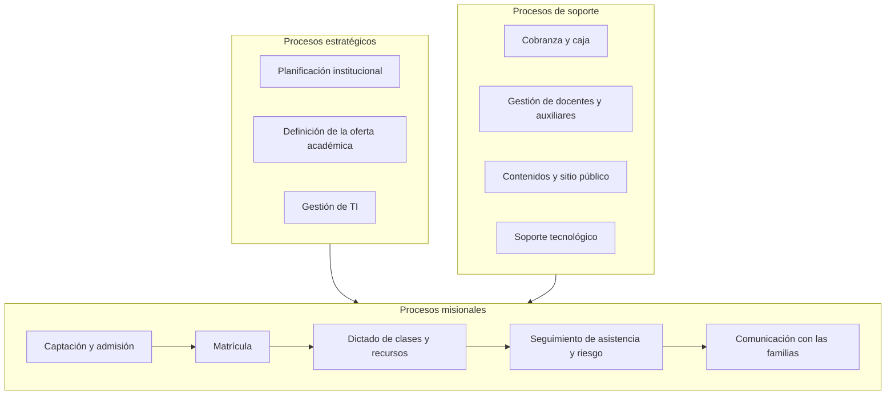
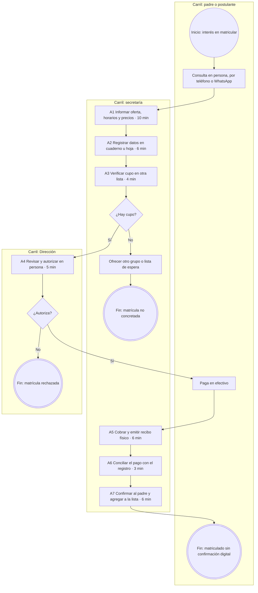
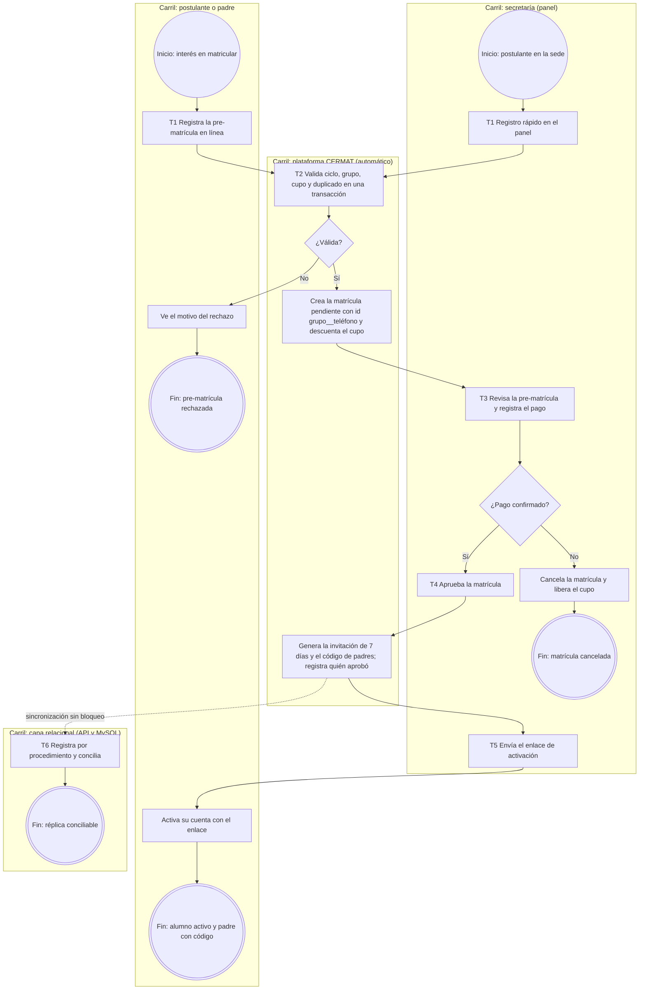

# E4 — Modelado de Procesos AS-IS / TO-BE (CE0131–CE0135)

!!! abstract "Evidencias CE013 — Gestión de Procesos"
    CE0131 Identificación y caracterización · CE0132 Modelado AS-IS · CE0133 Modelado TO-BE · CE0134 Automatización con TIC · CE0135 Indicadores y evaluación de impacto. Diagramas BPMN 2.0 editables (abren en bpmn.io y Camunda Modeler): [matricula-as-is.bpmn](../assets/gestion-ti/bpmn/matricula-as-is.bpmn) y [matricula-to-be.bpmn](../assets/gestion-ti/bpmn/matricula-to-be.bpmn). Los tiempos del proceso manual son **supuestos a validar** con el plan de medición de la sección 4.3.4; los cálculos están en la hoja "Proceso" de [business-case.xlsx](../assets/gestion-ti/business-case.xlsx).

## Portada

| Campo | Detalle |
|---|---|
| Título | Modelado y rediseño del proceso de matrícula — Academia La Prepa Cermat |
| Estudiantes | David Robert Yucra Mamani (líder), Gladys Rosaura Yana Pari, Denilson Leeke Mamani Flores, Cárdenas Vilca Rennzo |
| Semestre | 2026-2 (9° ciclo), UPeU campus Juliaca, sección g1 |
| Fecha | 2026-10-24 |
| Competencia | CE013 — Gestión de Procesos |
| Proceso analizado | Matrícula de un alumno en un ciclo y grupo, desde la consulta hasta la activación de su acceso |

## Resumen ejecutivo

El proceso de matrícula se eligió con una matriz de priorización (4,80 de 5) porque es la puerta de entrada de los datos del alumno, del grupo y del pago, y allí nacen los duplicados, los errores de cupo y las esperas. En el AS-IS cada matrícula consume **40 minutos de personal** (35 de secretaría y 5 de la Dirección) con 7 actividades manuales y una espera de autorización presencial. El TO-BE, que ya está implementado en la plataforma, la reduce a **10,5 minutos** con 4 actividades manuales y 4 automatizaciones verificadas por pruebas.

| Dimensión | AS-IS | TO-BE | Mejora |
|---|---|---|---|
| Tiempo de personal por matrícula | 40 min | 10,5 min | −73,8 % |
| Costo de personal por matrícula | S/ 8,33 | S/ 1,92 | −77,0 % |
| Costo total por matrícula (con la plataforma imputada) | S/ 8,33 | S/ 5,73 | −31,2 % |
| Tiempo de ciclo (consulta → confirmación) | 1 a 3 días (supuesto) | ≤ 24 h (meta medida con marcas de tiempo) | — |
| Sobrecupo y duplicados | Posibles y no medidos | 0 por diseño (transacción e id determinístico) | Calidad |

**Condición:** las mejoras de calidad y de captación solo se materializan cuando se publiquen las reglas corregidas: con las reglas vigentes del 22-jun-2026 la pre-matrícula pública no se completa.

## Identificación y caracterización de procesos (CE0131)

### Mapa de procesos

### Priorización del proceso a rediseñar

Puntajes de 1 a 5 asignados por el equipo con la evidencia del [E1](e1-diagnostico-organizacional-ce0111.md); pesos: impacto en el problema 35 %, frecuencia 20 %, dolor actual 25 %, viabilidad con las TIC existentes 20 %.

| Proceso | Impacto en el problema | Frecuencia | Dolor actual | Viabilidad con TIC | Total |
|---|---|---|---|---|---|
| **Matrícula** | 5 | 4 | 5 | 5 | **4,80** |
| Cobranza y cuotas | 4 | 4 | 4 | 4 | 4,00 |
| Seguimiento de asistencia | 3 | 5 | 3 | 4 | 3,60 |
| Captación y admisión | 4 | 3 | 4 | 3 | 3,60 |
| Comunicación con las familias | 3 | 4 | 3 | 4 | 3,40 |

### Caracterización del proceso de matrícula

| Elemento | Descripción |
|---|---|
| Objetivo | Matricular al postulante en el ciclo y grupo elegidos, con cupo garantizado, pago registrado y acceso activo, en el menor tiempo posible |
| Dueño | Secretaría y caja (operación), con supervisión de la Dirección |
| Alcance | Desde la consulta del postulante hasta la activación de la cuenta del alumno y la entrega del código de consulta al padre |
| Disparador | Interés de un postulante durante la campaña de un ciclo |
| Reglas de negocio | Solo ciclos publicados y abiertos; el grupo debe pertenecer al ciclo y a la sede; un teléfono por grupo; cupo no superable; pago mayor que cero; un pago no se borra, se anula con auditoría ([E1 de Software](../e1-definicion-sistema-ce021.md)) |
| Recursos | Personal de secretaría, Dirección, plataforma (TO-BE) o cuaderno y hojas (AS-IS) |
| Requisito legal | Ley N.° 29733: datos de menores con consentimiento de padres o tutores y finalidad declarada |

**SIPOC:**

| Proveedores | Entradas | Proceso | Salidas | Clientes |
|---|---|---|---|---|
| Postulante y padre; Dirección (oferta) | Datos del alumno y del apoderado, ciclo, grupo, turno, modalidad de pago | Consultar → registrar → validar cupo → aprobar → cobrar → confirmar → activar | Matrícula pagada, recibo, cupo descontado, acceso del alumno, código de padres | Alumno, padre, docentes (listas del grupo), Dirección (reportes) |

## 4.1 Proceso actual (AS-IS) (CE0132)

### Descripción narrativa

Descripción elaborada por el equipo a partir del [Brief EPE](../brief-epe.md) y de la operación de la sede. **No hay entrevistas formales registradas**; la descripción se validará con la secretaría durante la medición del Sprint 2 (sección 4.3.4).

1. El padre o postulante consulta en la sede, por teléfono o por WhatsApp.
2. Secretaría informa la oferta, horarios y precios (A1) y anota los datos en un cuaderno o una hoja de cálculo (A2).
3. Secretaría revisa en otra lista si el grupo tiene cupo (A3). Si no lo tiene, ofrece otro grupo o una lista de espera.
4. La Dirección revisa el caso en persona y autoriza (A4). Si no está disponible, el trámite espera.
5. El padre paga en efectivo; secretaría emite un recibo físico y anota el pago en caja (A5).
6. Al cierre del día, secretaría concilia el pago con el registro de matrícula (A6).
7. Secretaría confirma verbalmente al padre y agrega al alumno a la lista del grupo (A7). No hay confirmación digital ni acceso para el alumno.

### Diagrama BPMN (AS-IS)

Carriles representados con `subgraph`. El modelo BPMN 2.0 formal, con carriles, compuertas, anotaciones de problemas y diagrama editable, está en [matricula-as-is.bpmn](../assets/gestion-ti/bpmn/matricula-as-is.bpmn).

### Actividades y tiempos (supuestos a validar)

| ID | Actividad | Rol | Minutos de personal | Costo (S/) |
|---|---|---|---|---|
| A1 | Atender la consulta e informar oferta, horarios y precios | Secretaría | 10 | 1,67 |
| A2 | Registrar los datos del postulante en cuaderno u hoja de cálculo | Secretaría | 6 | 1,00 |
| A3 | Verificar el cupo en la lista del grupo (otro registro) | Secretaría | 4 | 0,67 |
| A4 | Revisar y autorizar la matrícula en persona | Dirección | 5 | 2,50 |
| A5 | Cobrar, emitir el recibo físico y anotar en caja | Secretaría | 6 | 1,00 |
| A6 | Conciliar el pago con el registro de matrícula | Secretaría | 3 | 0,50 |
| A7 | Confirmar al padre y agregar al alumno a la lista del grupo | Secretaría | 6 | 1,00 |
| | **Total por matrícula** | | **40** (35 + 5) | **8,33** |

Costo hora supuesto: secretaría S/ 10 y Dirección S/ 30 (supuestos S08 y S09 del [E2](e2-business-case-ce0113.md#241-supuestos-del-modelo)).

### Indicadores actuales

| Indicador | Valor AS-IS | Origen |
|---|---|---|
| Tiempo de personal por matrícula | 40 min | Supuesto (tabla anterior) |
| Costo de personal por matrícula | S/ 8,33 | Derivado del supuesto |
| Tiempo de ciclo (primera consulta → confirmación) | 1 a 3 días; mediana supuesta de 2 días hábiles | Supuesto: depende de la disponibilidad de la Dirección y del pago |
| Costo anual de personal del proceso (162 matrículas, año 3 del caso base) | S/ 1 350 | Derivado (hoja "Proceso") |
| Incidentes de sobrecupo o de matrícula duplicada | No registrados: no existe control que los detecte | No medible hoy |
| Autorizaciones con autor y fecha registrados | No sistemático | Registro en papel |
| Matrículas con confirmación verificable al padre | 0 % (confirmación verbal) | Descripción del proceso |
| Matrículas registradas en la plataforma | 8 (2 pendientes, 5 pagadas, 1 cancelada) entre el 2026-01-27 y el 2026-07-07 | Firestore, conteo real |
| Tiempo pre-matrícula → aprobación en la plataforma | Solo 2 registros con ambas fechas y ≈ 1 min; parecen pruebas del administrador | **No se usa como indicador** |

### Problemas detectados

| Problema | Actividad | Tipo de desperdicio (Lean) | Efecto |
|---|---|---|---|
| Re-digitación de los mismos datos en cuaderno, hojas y listas | A2, A7 | Sobreprocesamiento | Tiempo y errores de transcripción |
| Cupo verificado en un registro distinto al de la matrícula | A3 | Defecto potencial | Sobrecupo o matrícula perdida por listas desincronizadas |
| Autorización presencial de la Dirección | A4 | Espera | 1 a 3 días de ciclo; el postulante puede matricularse en otra academia |
| Pago desconectado de la matrícula | A5, A6 | Sobreprocesamiento y defecto | Conciliación manual; morosidad poco visible |
| Sin control de duplicados | A2 | Defecto | Un alumno registrado dos veces |
| Confirmación verbal | A7 | Defecto | Llamadas repetidas del padre; sin acceso para el alumno |
| Datos personales en papel sin control de acceso | A2, A5 | Riesgo | Incumplimiento potencial de la Ley N.° 29733 |
| Sin datos del proceso | Todas | — | No se puede medir ni mejorar |

## 4.2 Proceso propuesto (TO-BE) (CE0133 y CE0134)

### Rediseño del flujo

El TO-BE ya está implementado en la plataforma; falta su adopción y la publicación de las reglas corregidas.

1. **Dos canales de entrada con las mismas reglas.** El postulante registra la pre-matrícula en línea desde el sitio público, o secretaría la registra con el registro rápido del panel cuando acude a la sede.
2. **Validación automática en una transacción:** ciclo abierto, grupo del ciclo y de la sede, cupo disponible y teléfono no repetido en el grupo. Si algo falla, el postulante ve el motivo.
3. La matrícula queda **pendiente** con id determinístico `grupo__teléfono` y el cupo se descuenta en la misma transacción.
4. Secretaría revisa la pre-matrícula y registra el pago en el panel. Si no hay pago, cancela y el cupo se libera.
5. Al **aprobar**, el sistema genera la invitación de activación (vigencia de 7 días) y el código de consulta para el padre, y registra quién aprobó y cuándo.
6. Secretaría envía el enlace; el alumno activa su cuenta; el padre consulta la asistencia con su código.
7. En paralelo, la matrícula y el pago se replican en MySQL por procedimientos almacenados y la vista de conciliación detecta cualquier evento perdido.

La autorización de la Dirección deja de ser un paso del flujo: la Dirección define las reglas (cupos, precios, ciclos abiertos) y revisa indicadores en el panel.

### Diagrama BPMN (TO-BE)

Modelo formal: [matricula-to-be.bpmn](../assets/gestion-ti/bpmn/matricula-to-be.bpmn).

### Automatizaciones propuestas

| Automatización | Cómo funciona (evidencia en el código) | Problema AS-IS que elimina | Pruebas que la respaldan |
|---|---|---|---|
| Validación transaccional de cupo | `createEnrollment` lee el grupo dentro de `runTransaction`, rechaza si `enrolledCount >= capacity` y suma el cupo en la misma transacción; `updateEnrollmentStatus` lo libera al cancelar (`src/features/enrollments/api.ts`) | Sobrecupo por listas desincronizadas (A3) | 6 pruebas de reglas de matrícula pública: sobrecupo, cupo sin matrícula y manipulación del contador, entre otras |
| Deduplicación por id determinístico | El id de la matrícula es `groupId__teléfonoNormalizado`; si ya existe, la transacción falla con un mensaje claro | Alumno registrado dos veces (A2) | Prueba de reglas "duplicado" |
| Ciclo abierto y grupo válido | Funciones `isEnrollmentCycleOpen`, `isEnrollmentGroupInCycle` e `isEnrollmentGroupCampusValid` en `firestore.rules` | Matrículas en ciclos cerrados o grupos ajenos | Prueba de reglas "ciclo cerrado" |
| Activación por invitación | `markPaidAndCreateStudentInvite` crea, en una transacción, una invitación con token aleatorio de 24 caracteres cuyo hash SHA-256 es el id, con vencimiento de 7 días; reutiliza la vigente si existe | Confirmación verbal sin acceso (A7) | 3 pruebas unitarias de tokens; 8 pruebas de reglas de roles |
| Código de consulta para padres | Se genera al aprobar, sin caracteres ambiguos (0/O, 1/I) | Llamadas del padre para conocer la asistencia | 4 pruebas unitarias del código de padres |
| Trazabilidad de decisiones | `approvedBy`, `approvedAt`, `cancelledBy`, `cancelledAt` y `statusUpdatedAt` en cada matrícula; auditoría por triggers en MySQL | Autorización sin registro (A4) | Pruebas de BD de auditoría de anulación |
| Sincronización conciliable | `syncService` envía matrícula y pago a la API sin bloquear la operación; la API escribe solo por procedimientos y `v_conciliacion_pagos` lista los pagos sin matrícula (0 filas = sin eventos perdidos) | Conciliación manual del pago (A6) | 8 pruebas de API de sincronización; 2 de BD de conciliación |
| Registro rápido por secretaría | `useQuickEnrollmentSubmit` registra en el panel a quien acude a la sede con las mismas validaciones | Canal presencial sin control | 4 pruebas unitarias del formulario de matrícula |

### Actividades y tiempos del TO-BE

| ID | Actividad | Rol | Minutos de personal | Costo (S/) |
|---|---|---|---|---|
| T1 | Pre-matrícula en línea (autoservicio) o registro rápido de secretaría (promedio ponderado) | Postulante o secretaría | 4 | 0,67 |
| T2 | Validar ciclo, grupo, cupo y duplicado en una transacción | Sistema | 0 | 0,00 |
| T3 | Revisar la pre-matrícula y registrar el pago en el panel | Secretaría | 4 | 0,67 |
| T4 | Aprobar: el sistema genera la invitación y el código de padres | Secretaría | 1 | 0,17 |
| T5 | Enviar el enlace de activación | Secretaría | 1 | 0,17 |
| T6 | Sincronizar con MySQL y conciliar | Sistema | 0 | 0,00 |
| T7 | Revisar indicadores de matrícula en el panel (prorrateo por matrícula) | Dirección | 0,5 | 0,25 |
| | **Total por matrícula** | | **10,5** (10 + 0,5) | **1,92** |

### Nuevos indicadores

| ID | Indicador | Fórmula | Fuente de datos | Meta | Frecuencia |
|---|---|---|---|---|---|
| IV-01 | Minutos de personal por matrícula | Promedio de 10 trámites cronometrados | Hoja de cronometraje | ≤ 12 min | Por ciclo |
| IV-02 | Tiempo de respuesta a la pre-matrícula | p50 y p90 de (`approvedAt` o `cancelledAt`) − `createdAt` | Firestore `enrollments` | p90 ≤ 24 h | Semanal en campaña |
| IV-03 | Costo de personal por matrícula | Σ (minutos × costo hora del rol) | Cronometraje y supuestos S08 y S09 | ≤ S/ 2,50 | Por ciclo |
| IV-04 | Incidentes de sobrecupo o duplicado | Grupos con matrículas activas > `capacity`; duplicados detectados después del registro | Firestore `groups` y `enrollments` | 0 | Por ciclo |
| IU-01 | Adopción | Matrículas en la plataforma ÷ matrículas totales | Firestore y registro de secretaría | ≥ 60 % en 2027 | Mensual |
| IP-01 | Activación oportuna | Invitaciones usadas en 7 días ÷ invitaciones emitidas | Firestore `invites` (`used`, `usedAt`) | ≥ 90 % | Por ciclo |
| IP-02 | Conciliación | Filas en `v_conciliacion_pagos` | MySQL | 0 | Mensual |
| IP-03 | Confirmación verificable | Matrículas pagadas con código de padres ÷ matrículas pagadas | Firestore `enrollments` | 100 % | Por ciclo |

### Mejora estimada en eficiencia

| Medida | AS-IS | TO-BE | Variación |
|---|---|---|---|
| Actividades manuales | 7 | 4 | −3 |
| Actividades automáticas | 0 | 4 (validación, alta con cupo, invitación y código, réplica) | +4 |
| Decisiones que requieren a la Dirección | 1 por matrícula | 0 (la Dirección fija reglas) | −1 |
| Minutos de personal por matrícula | 40 | 10,5 | −73,8 % |
| Horas de personal al año (162 matrículas) | 108 h | 28,4 h | −79,7 h |

## 4.3 Análisis comparativo (CE0135)

### 4.3.1 Reducción de tiempos

| Medida | AS-IS | TO-BE | Reducción | Cómo se verifica |
|---|---|---|---|---|
| Tiempo de personal por matrícula | 40 min | 10,5 min | 29,5 min (−73,8 %) | Cronometraje de 10 trámites en cada situación |
| Secretaría por matrícula | 35 min | 10 min | 25 min | Ídem |
| Dirección por matrícula | 5 min | 0,5 min | 4,5 min | Ídem |
| Tiempo de ciclo (consulta → confirmación) | 1 a 3 días (supuesto) | ≤ 24 h en el p90 (meta) | Al menos 1 día | Marcas de tiempo de Firestore |
| Horas de personal al año (162 matrículas) | 108 h | 28,4 h | 79,7 h | Volumen real × tiempos medidos |

### 4.3.2 Reducción de costos

| Medida | AS-IS | TO-BE | Reducción |
|---|---|---|---|
| Costo de personal por matrícula | S/ 8,33 | S/ 1,92 | S/ 6,42 (−77,0 %) |
| Costo anual de personal del proceso (162 matrículas, año 3 base) | S/ 1 350 | S/ 311 | S/ 1 040 (= beneficio B1 del año 3 en el [E2](e2-business-case-ce0113.md#23-evaluacion-de-beneficios)) |
| Costo de plataforma imputado por matrícula | — | S/ 3,81 | — |
| **Costo total por matrícula** | **S/ 8,33** | **S/ 5,73** | **S/ 2,60 (−31,2 %)** |

**Criterio de imputación:** la plataforma soporta varios procesos (matrícula, pagos, asistencia, comunicación). A la matrícula se le imputa la parte de los costos anuales de operación (S/ 2 438) proporcional a su participación en los beneficios (25,3 %), repartida entre las 162 matrículas del año 3. Incluso cargando ese costo, el proceso TO-BE es 31,2 % más barato por matrícula.

### 4.3.3 Mejora en calidad

| Dimensión de calidad | AS-IS | TO-BE | Evidencia |
|---|---|---|---|
| Sobrecupo | Posible; no se detecta | 0 por diseño: el cupo se valida y descuenta en una transacción | Pruebas de reglas de sobrecupo y de manipulación del contador |
| Matrícula duplicada | Posible | 0 por diseño: id determinístico `grupo__teléfono` | Prueba de reglas "duplicado" |
| Matrícula en ciclo cerrado | Posible | Bloqueada por las reglas | Prueba de reglas "ciclo cerrado" |
| Trazabilidad de la aprobación | No sistemática | 100 %: autor y fecha en cada matrícula | Campos `approvedBy` y `approvedAt` |
| Conciliación de pagos | Manual | Automática; meta de 0 filas en la vista | Pruebas de BD de conciliación |
| Confirmación al padre | Verbal | 100 % de las pagadas con enlace de activación y código de padres | Indicador IP-03 |
| Protección de datos | Papel sin control de acceso | Acceso por rol verificado con 19 pruebas y publicado en producción el 2026-10-24 | [E4 de Software, 1.6](../e4-calidad-operacion-ce024.md#16-las-pruebas-detectan-defectos-reales) |

### 4.3.4 Plan de medición

**Pendiente de ejecución.** Los tiempos del AS-IS son supuestos; este plan los convierte en mediciones antes de la campaña 2027 (paquete 6.1 del [E3](e3-plan-gestion-proyecto-ce0121.md#diccionario-de-la-edt), PB-14).

| Paso | Procedimiento | Cuándo | Criterio de aceptación | Evidencia a adjuntar |
|---|---|---|---|---|
| 1. Línea base AS-IS | Cronometrar N = 10 matrículas manuales reales (al menos 3 presenciales y 3 telefónicas), con hora de inicio y fin de cada actividad A1 a A7, sin intervenir. Registrar también la fecha de la primera consulta y la de confirmación. | Sprint 2 (2026-11-09 a 2026-11-20) | 10 trámites completos. Con un coeficiente de variación supuesto de 0,3, 10 observaciones estiman la media con ±21 % al 95 % (t₉ = 2,26); si el coeficiente medido supera 0,4, se amplía a 20 trámites | Hojas de cronometraje firmadas por el observador |
| 2. Validación del modelo | Revisar con la secretaría las actividades A1 a A7 y corregir el diagrama si difiere | Sprint 2 | Diagrama AS-IS aprobado por la secretaría | Versión corregida del `.bpmn` |
| 3. Medición TO-BE en el sistema | Exportar de `enrollments` solo `createdAt`, `approvedAt`, `cancelledAt` y `status`, sin nombres ni teléfonos; calcular p50 y p90 del tiempo de respuesta. Excluir registros de prueba (creados y aprobados por una cuenta de administrador en menos de 2 minutos se revisan uno por uno) | Campaña 2027 (enero) | p90 ≤ 24 h (OBJ-3) | CSV agregado y cálculo |
| 4. Medición TO-BE de personal | Cronometrar 10 trámites en el panel (registro rápido, revisión, pago, aprobación y envío del enlace) | Campaña 2027 | Promedio ≤ 12 min (OBJ-2) | Hojas de cronometraje |
| 5. Actualización del modelo | Reemplazar los supuestos S12 y S13 del libro por los valores medidos y recalcular | Antes del 2027-03-31 | Libro recalculado para el hito de continuidad | `business-case.xlsx` actualizado |

## Referencias

[1] Object Management Group, *Business Process Model and Notation (BPMN), Version 2.0*, formal/2011-01-03, ene. 2011.

[2] ISO/IEC 19510:2013, *Information technology — Object Management Group Business Process Model and Notation*. Ginebra, Suiza: ISO, 2013.

[3] M. Dumas, M. La Rosa, J. Mendling y H. A. Reijers, *Fundamentals of Business Process Management*, 2nd ed. Berlín, Alemania: Springer, 2018.

[4] J. P. Womack y D. T. Jones, *Lean Thinking*. New York, NY, USA: Simon & Schuster, 1996.

## Rúbrica de evaluación

| Criterio | Excelente | Bueno | Regular | Deficiente |
| --- | --- | --- | --- | --- |
| Modelado AS-IS | Modelado detallado con identificación clara de ineficiencias. | Modelado correcto del proceso actual. | Representación básica sin análisis crítico. | Incorrecto o incompleto. |
| Propuesta TO-BE | Rediseño innovador con mejora cuantificada en eficiencia y calidad. | Rediseño coherente apoyado en TIC. | Propone mejoras generales. | No responde al problema. |
| Análisis comparativo | Cuantifica mejoras en tiempo, costo y calidad. | Evidencia mejoras esperadas. | Comparación descriptiva básica. | No presenta comparación. |
| Sustentación y defensa técnica | Explica y defiende con dominio las decisiones tomadas. | Explica con solvencia. | Explica con dificultad. | No sustenta. |
