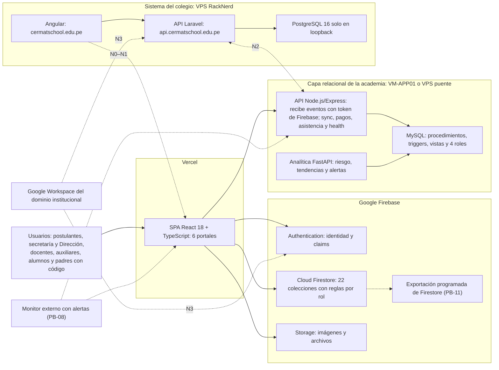
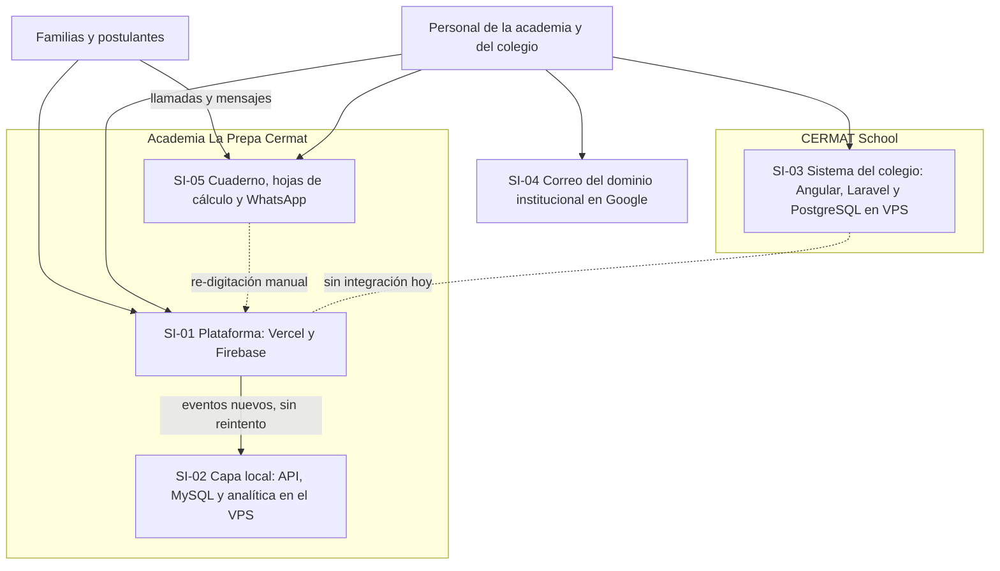
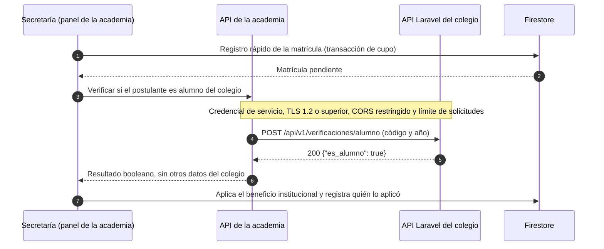

# E5 — Propuesta de Solución TIC Integrada al Ecosistema de Sistemas de Información (CE0141–CE0145)

!!! abstract "Evidencias CE014 — Gestión de Sistemas de Información"
    CE0141 Mapa del ecosistema · CE0142 Arquitectura conceptual · CE0143 Integración y flujos de información · CE0144 Plan de implementación y gestión · CE0145 Indicadores de uso, valor y mejora. Lo implementado se distingue de lo propuesto en cada tabla. La infraestructura de soporte se diseña en la línea CE03 ([S1-E2](../infraestructura/s1-e2-diseno-centro-datos-hibrido-ce0331.md) y [S2-E3](../infraestructura/s2-e3-implementacion-control-cd-ce0332-ce0333.md)) y la seguridad en el [SGSI](../infraestructura/s2-e1-sgsi-ce0321-ce0324.md).

## Portada

| Campo | Detalle |
|---|---|
| Título | Solución TIC integrada: la Plataforma CERMAT en el ecosistema de sistemas de información de CERMAT |
| Estudiantes | David Robert Yucra Mamani (líder), Gladys Rosaura Yana Pari, Denilson Leeke Mamani Flores, Cárdenas Vilca Rennzo |
| Semestre | 2026-2 (9° ciclo), UPeU campus Juliaca, sección g1 |
| Fecha | 2026-10-24 |
| Competencia | CE014 — Gestión de Sistemas de Información |
| Producción | [https://academia-school-platform.vercel.app](https://academia-school-platform.vercel.app) (academia) · `cermatschool.edu.pe` y `api.cermatschool.edu.pe` (colegio) |

## Resumen ejecutivo

La solución es la **Plataforma Web Integral CERMAT**: una SPA en Vercel con Firebase como capa operativa y una capa relacional (API, MySQL y analítica) para réplica, auditoría y reportes. Hoy convive, sin integración, con el **sistema de gestión del colegio** (Angular, Laravel y PostgreSQL en un VPS) y con herramientas informales. La propuesta tiene tres ejes:

1. **Estabilizar y adoptar** (2026–2027): publicar las reglas corregidas (hecho el 2026-10-24), dar servicio continuo a la capa relacional, respaldar Firestore, monitorear y medir.
2. **Integrar por niveles** (2027–2028): enlace desde el sitio del colegio, que es la decisión vigente de la institución (N0), y un subdominio institucional solo si la Dirección lo aprueba (N1), intercambio de datos por API REST/JSON con la API Laravel del colegio (N2), identidad compartida para el personal con la cuenta institucional de Google (N3) y notificaciones desde el dominio institucional (N4).
3. **Gobernar y sostener**: accesos por rol, cumplimiento de la Ley N.° 29733, corrección de hallazgos reales (reglas, cabeceras, DNS), costos de S/ 2 438 al año coherentes con el [E2](e2-business-case-ce0113.md) y 22 indicadores de uso, valor y mejora con línea base real.

## 5.1 Arquitectura de la solución (CE0142)

### Diagrama de arquitectura (objetivo 2027–2028)

Líneas continuas: implementado. Líneas punteadas: propuesto. N0 a N3 son los niveles de integración de la tabla «Integraciones»; PB-08 y PB-11 son elementos del Product Backlog.



### Componentes principales

| Componente | Tecnología | Responsabilidad | Alojamiento | Estado |
|---|---|---|---|---|
| SPA multi-portal | React 18, TypeScript, Vite, TanStack Query, Tailwind | Sitio público y portales admin, docente, alumno, auxiliar y consulta de padres | Vercel (plan Hobby; plan comercial presupuestado) | Implementado |
| Identidad | Firebase Authentication con claims de administrador | Sesión y rol | Google Cloud | Implementado |
| Datos operativos | Cloud Firestore, 22 colecciones | Fuente de verdad de la operación | Google Cloud | Implementado; reglas corregidas publicadas el 2026-10-24 |
| Archivos | Firebase Storage | Imágenes y recursos | Google Cloud | Implementado |
| API de sincronización | Node.js/Express con helmet, CORS por lista y morgan | Recibe eventos y escribe en MySQL solo por procedimientos | VPS del colegio desde el 2026-10-24 (antes, PC con PM2) → VM-APP01 | Implementado; servicio continuo en curso (PB-13, CR-03) |
| Base relacional | MySQL 8 con 3 FK, 7 CHECK, 6 triggers, 4 funciones, 5 procedimientos, 3 vistas y 4 roles | Réplica auditable, conciliación y reportes | Ídem | Implementado ([E2 de Software](../e2-base-datos-ce022.md)) |
| Analítica | Python/FastAPI | Riesgo de inasistencia, tendencias, pagos y alertas | Ídem | Implementado |
| Respaldo de Firestore | Exportación programada con prueba de restauración | RPO ≤ 24 h | Google Cloud | Propuesto (PB-11) |
| Monitor | Servicio externo de chequeo HTTP con alertas | Disponibilidad medida de la SPA y de `/health` | Externo o VM-MON01 de CE03 | Propuesto (PB-08) |
| Sistema del colegio | Angular, Laravel (PHP 8.4), PostgreSQL 16 | Gestión escolar | VPS RackNerd (2 vCPU, 2 GB, Ubuntu 24.04) | Implementado (otro proyecto del mismo autor) |

### Integraciones

| Origen → destino | Mecanismo | Datos | Seguridad | Estado |
|---|---|---|---|---|
| SPA → Firebase | SDK de Firebase | Toda la operación | Reglas por rol y claims; 19 pruebas en el emulador | Implementado |
| SPA → API (VPS) | HTTPS POST sin bloqueo (fire-and-forget), URL en `config/services` con caché de 5 min | Matrícula, pago y marca de asistencia | Token de Firebase; `requireAuth`, `requireAdmin` y titularidad; 27 pruebas | Implementado; 24/7 en el VPS desde el 2026-10-24 |
| API → MySQL | Procedimientos almacenados | Ídem | Cuenta `cermat_api` sin `INSERT`, `UPDATE` ni `DELETE` directos | Implementado |
| Analítica → MySQL | Lectura de vistas y procedimientos | Asistencia, pagos y alertas | Cuenta de lectura | Implementado |
| Panel admin → `/health` | HTTP | Estado de API y MySQL | Solo administradores | Implementado |
| Firestore → respaldo | Exportación programada | Todas las colecciones | Cuenta de servicio con mínimo privilegio | Propuesto |
| Sitio del colegio → SPA | Enlace e inserción controlada (`frame-ancestors` limitado al dominio del colegio, ya definido en `vercel.json` como cambio local) | Ninguno | CSP | Previsto (N0–N1) |
| API de la academia ↔ API Laravel | REST/JSON versionado | Verificación de alumno del colegio, oferta pública | Credencial de servicio, TLS, CORS restringido | Propuesto (N2) |
| Google Workspace → Firebase Auth y Laravel | OpenID Connect con la cuenta del dominio | Identidad del personal | Restricción al dominio institucional | Propuesto (N3) |
| Plataforma → correo institucional | Envío autenticado desde el dominio | Confirmaciones y alertas | SPF, DKIM y DMARC | Propuesto (N4) |

## 5.2 Ecosistema de sistemas de información (CE0141 y CE0143)

### Mapa de sistemas actuales



| Proceso | SI-01 Plataforma | SI-02 Capa local | SI-03 Colegio | SI-04 Correo | SI-05 Informales |
|---|---|---|---|---|---|
| Captación y admisión | ◐ sitio y pre-matrícula (operativa desde el 2026-10-24) | — | — | — | ● llamadas y WhatsApp |
| Matrícula | ◐ 8 matrículas | ◐ réplica | — | — | ● cuaderno y hojas |
| Cobranza | ◐ 2 pagos | ◐ estado de cuenta | — | — | ● caja manual |
| Asistencia | ◐ 7 marcas (ene–abr) | ◐ riesgo | — | — | ● listas |
| Comunicación con familias | ◐ código (0 consultas) | — | — | — | ● WhatsApp |
| Gestión escolar del colegio | — | — | ● | — | ◐ |
| Comunicación interna | — | — | — | ● | ● WhatsApp |

● soporte principal · ◐ soporte parcial · — sin soporte.

### Integración propuesta

| Nivel | Qué integra | Mecanismo | Datos que cruzan | Requisitos previos | Fase |
|---|---|---|---|---|---|
| N0 Enlace | El sitio del colegio enlaza a la academia | Hipervínculo o inserción controlada | Ninguno | Publicar la plataforma estable | RM-08 (2027) |
| N1 Dominio institucional | `academia.cermatschool.edu.pe` como dominio de la plataforma | Registro CNAME en Punto.pe hacia Vercel; TLS automático | Ninguno | Plan comercial de hosting; registros CAA | RM-08 (2027) |
| N2 Intercambio de datos | API de la academia ↔ API Laravel del colegio | REST/JSON con contrato OpenAPI 3.1 | Verificación booleana de alumno del colegio; oferta pública de la academia | CORS del colegio restringido; credencial de servicio; consentimiento | RM-11 (2028) |
| N3 Identidad compartida | Personal (administración y docentes) inicia sesión con su cuenta institucional en ambos sistemas | OpenID Connect con Google: Firebase Authentication y Laravel (Socialite) restringidos al dominio | Identidad del personal; el rol sigue en cada sistema | Cuentas institucionales para todo el personal | RM-10 (2028) |
| N4 Notificaciones | Confirmación de matrícula, enlace de activación y alertas de inasistencia | Correo autenticado desde el dominio; WhatsApp como opción evaluada por costo | Correo del apoderado y mensaje mínimo | SPF, DKIM y DMARC configurados | RM-12 (2028) |

**Decisiones de diseño:** alumnos y padres no entran a la identidad compartida (son menores o externos y el código de padres ya resuelve su necesidad). Cada sistema conserva su base y sus roles; solo se intercambia lo mínimo necesario.

### Flujo de información del caso N2 (propuesto)



Contrato de ejemplo (fragmento; la versión completa se publicará como OpenAPI 3.1):

```json
{
  "solicitud": { "codigo_alumno": "texto", "anio": 2027 },
  "respuesta": { "es_alumno": true, "verificado_en": "2027-01-04T09:15:00-05:00" },
  "errores": { "401": "credencial inválida", "404": "sin coincidencia", "429": "límite de solicitudes" }
}
```

### Interoperabilidad

| Aspecto | Estándar adoptado |
|---|---|
| Estilo y formato | REST con JSON (RFC 8259) y UTF-8 |
| Contrato | OpenAPI 3.1, versionado en la ruta (`/api/v1`) |
| Fechas | ISO 8601 con zona `America/Lima` (la plataforma ya corrigió el uso de UTC en asistencia) |
| Autenticación entre sistemas | Credencial de servicio (OAuth 2.0 *client credentials* [5] o token de servicio de Laravel) rotada cada 6 meses |
| Identidad del personal | OpenID Connect con Google [6] |
| Errores | Códigos HTTP y cuerpo JSON sin detalles internos (como ya hace la API: 400, 422 y 500 tipados) |
| Idempotencia | Clave de idempotencia por evento, como `firestore_log_id` en la réplica de asistencia |
| Trazabilidad | Identificador de correlación por solicitud en los registros de ambas APIs |

## 5.3 Seguridad y gobernanza

### Gestión de accesos

| Rol | Cómo obtiene acceso | Qué puede hacer | Control técnico | Evidencia |
|---|---|---|---|---|
| Administrador | Claim `admin` asignado por el responsable técnico | Gestión completa de oferta, matrículas, pagos, usuarios y contenidos | `isAdmin()` en reglas; `requireAdmin` en la API | Pruebas de reglas y de API |
| Docente | Invitación vigente (`teacherInvites`) | Portal docente, recursos y su asistencia | Reglas de roles con invitación | 8 pruebas de roles |
| Auxiliar | Invitación vigente (`auxiliarInvites`) | Registro de asistencia por QR | Reglas de roles y titularidad en `/api/sync` | Pruebas de reglas y de API |
| Alumno | Invitación de activación tras la matrícula pagada (hash SHA-256, 7 días) | Sus cursos, recursos, matrícula y asistencia | Reglas por titularidad | 3 pruebas de tokens |
| Padre | Código CERMAT, sin cuenta | Lectura de la asistencia resumida de su hijo | Colección `parentAttendance` de solo lectura por código | 4 pruebas del código |
| Visitante | Sin sesión | Oferta pública y pre-matrícula con reglas de cupo | Reglas de matrícula pública | 6 pruebas |
| Servicio (API) | Cuenta MySQL `cermat_api`; clave de servicio de Firebase | Solo ejecutar procedimientos; verificar tokens | Mínimo privilegio en MySQL; clave rotada el 2026-10-24 (PB-06) | 19 pruebas de BD |
| Servidor del colegio | Usuario Linux no root con sudo; usuario de BD sin superusuario | Administración del VPS | UFW (22, 80 y 443), PostgreSQL solo en loopback | Manual del propietario |

**Ciclo de vida de accesos:** alta solo por invitación o claim; baja al cerrar el ciclo o al cesar el personal; revisión trimestral de los claims de administrador; evaluar MFA para cuentas de administrador en Firebase.

### Protección de datos (Ley N.° 29733)

| Obligación | Estado al 2026-10-24 | Acción | Responsable |
|---|---|---|---|
| Consentimiento de padres o tutores para datos de menores | Sin aviso de consentimiento en los formularios (búsqueda en `src/` sin resultados) | Aviso y casilla en la pre-matrícula y el registro rápido, con versión aceptada registrada (PB-16) | Dirección y equipo |
| Información de la finalidad (política de privacidad) | No publicada | Publicar finalidad, plazo de conservación, derechos y canal de atención | Dirección |
| Inscripción de los bancos de datos | No realizada | Inscribir los bancos "alumnos y apoderados" y "pagos" en el Registro Nacional de Protección de Datos Personales | Dirección |
| Medidas de seguridad | Parciales: reglas probadas y publicadas, cabeceras de la SPA y del colegio, roles de BD y TLS (2026-10-24) | Respaldo de Firestore y del colegio, y monitoreo (sección siguiente) | Equipo técnico |
| Transferencia internacional | Datos en Firebase, Vercel y VPS en EE. UU., sin informar | Declararla en la política y en el consentimiento | Dirección |
| Derechos de acceso, rectificación, cancelación y oposición | Sin procedimiento | Canal y plazo de respuesta | Dirección |
| Conservación y minimización | Sin regla | Eliminar pre-matrículas no concretadas al cierre de cada ciclo; conservar matrículas y pagos durante el plazo contable | Dirección |

El análisis de riesgos, la declaración de aplicabilidad y los procedimientos de incidentes están en el [SGSI de Infraestructura](../infraestructura/s2-e1-sgsi-ce0321-ce0324.md).

### Cumplimiento y hallazgos reales

| Hallazgo (fecha de verificación) | Riesgo | Corrección | Estado |
|---|---|---|---|
| Reglas publicadas el 22-jun-2026: cualquier cuenta se asigna rol de auxiliar o docente, cualquiera lista matrículas pagadas sin sesión y la matrícula pública está bloqueada; 10 de 19 pruebas fallan (2026-10-24) | Escalamiento de privilegios, exposición de datos de menores y pérdida del canal en línea | Reglas corregidas (19 de 19 en el emulador) y publicación solo vía CI tras las pruebas | **Corregido en producción (2026-10-24):** publicado desde la consola; listar matrículas pagadas sin sesión → 403 y pre-matrícula de prueba exitosa (hito H2 cumplido) |
| Causa raíz: la línea 1 de `firestore.rules` (`#`) impedía compilar y cada despliegue fallaba sin aviso | Versiones probadas que nunca llegan a producción | Comentario válido y trabajo de CI `desplegar-reglas` condicionado | Corregido y publicado (2026-10-24); falta el secreto del CI |
| Secretos (ZIP y `.env`) en el historial del repositorio | Exposición de credenciales | Retirar del historial y rotar la clave de servicio (PB-06) | **Tratado (2026-10-24):** clave revocada y reemplazada; contraseñas de `teachers.json` restablecidas; los `.env`, sin contraseñas, siguen versionados por decisión del equipo |
| La SPA de la academia solo envía HSTS (2026-10-24) | Clickjacking y otros ataques de navegador | `vercel.json` con `X-Content-Type-Options`, `Referrer-Policy`, `Permissions-Policy` y `frame-ancestors` limitado al colegio; falta añadir una política de contenido completa | **Publicado y verificado (2026-10-24)** |
| El sitio del colegio no enviaba cabeceras de seguridad y mostraba la versión de nginx | Clickjacking, detección de tipos y reconocimiento de versión | `server_tokens off` y cabeceras equivalentes en Nginx | Hecho (2026-10-24): 5 de 5 cabeceras y versión oculta |
| El dominio no tiene CAA, SPF, DMARC ni DNSSEC (2026-10-24) | Suplantación del correo institucional y emisión de certificados no autorizada | SPF con el remitente de Google, DKIM, DMARC en modo de monitoreo y luego cuarentena, CAA para la autoridad de los certificados; DNSSEC si el registro lo permite | Pendiente (RM-04) |
| API del colegio con CORS sin restringir, correo saliente en modo registro y respaldos sin implantar | Acceso entre orígenes y pérdida de datos | Restringir CORS antes de N2; respaldos con `pg_dump` y restauración probada ([S2-E3](../infraestructura/s2-e3-implementacion-control-cd-ce0332-ce0333.md)) | Pendiente |

### Gobernanza

**Responsabilidades (RACI):** R = responsable, A = rinde cuentas, C = consultado, I = informado.

| Actividad | Dirección | Product Owner | Responsable técnico | Equipo EPE | Secretaría |
|---|---|---|---|---|---|
| Aprobar alcance, presupuesto y proveedores | A | R | C | I | I |
| Priorizar el backlog | I | A/R | C | C | C |
| Publicar cambios en producción | I | C | A/R | R | I |
| Altas, bajas y claims de acceso | A | C | R | I | I |
| Respaldo y restauración | I | I | A/R | C | — |
| Protección de datos (política, derechos, inscripción) | A/R | C | C | C | I |
| Revisión mensual de indicadores | A | R | C | I | I |

**Objetivos de COBIT 2019 [2] aplicados:** EDM01 (marco de gobierno: comité mensual Dirección–Product Owner–técnico) · APO02 (estrategia: roadmap del E1) · APO12 (riesgo: matrices del E1 y E3) · APO13 y DSS05 (seguridad: SGSI y reglas probadas) · BAI06 (cambios: PR con revisión y CI) · BAI08 (conocimiento: transferencia C.5 y documentación) · DSS01 (operación: rutinas de la sección 5.5) · DSS04 (continuidad: respaldos y RTO) · MEA01 (desempeño: indicadores de 5.6) · MEA03 (cumplimiento: Ley N.° 29733).

**Políticas mínimas:** ningún cambio llega a producción sin revisión de un segundo integrante y CI en verde; mínimo privilegio en todos los roles; respaldo 3-2-1 según CE03; revisión trimestral de accesos; revisión anual de términos y costos de proveedores.

## 5.4 Escalabilidad y sostenibilidad

### Capacidad de crecimiento

| Componente | Límite o cuota | Uso estimado 2027 (1 sede) | Uso estimado con 3 sedes | Acción |
|---|---|---|---|---|
| Firestore: lecturas por día | 50 000 gratuitas | ≈ 10 500 (21 %) | ≈ 31 500 (63 %) | Medir en la consola; pasar al plan de pago por uso si supera el 80 % |
| Firestore: escrituras por día | 20 000 gratuitas | < 500 | < 1 500 | Ninguna |
| Firestore: almacenamiento | 1 GiB gratuito | Decenas de MB (supuesto) | < 1 GiB | Medir en la consola |
| Modelo de datos | Sedes, grupos, turnos y horarios | 1 sede cargada | Varias sedes sin cambio de modelo | Cargar la oferta real (PB-17) |
| Capa relacional (VM-APP01 del diseño CE03) | 2 vCPU, 4 GB y 60 GB | MySQL < 100 MB en 3 años (supuesto SUP-07 de CE03) | Igual orden | Ninguna |
| VPS del colegio | 2 vCPU y 2 GB | ≈ 845 MB proyectados (41 %) con componentes ligeros | — | Prueba de capacidad pendiente; la capa de la academia no se aloja aquí |

Estimación de lecturas (supuesto a validar con la pestaña de uso de Firebase): administración 10 sesiones × 400 lecturas + alumnos 60 × 40 + docentes y auxiliar 4 × 200 + padres 30 consultas × 10 + visitantes 200 × 15 ≈ 10 500 al día; con 3 sedes se triplican las sesiones.

### Costos futuros

| Rubro anual (escenario base del E2) | 2027 | 2028 | 2029 |
|---|---|---|---|
| Hosting comercial de la SPA (Vercel Pro, 1 miembro) | S/ 816 | S/ 816 | S/ 816 |
| VPS institucional imputado | S/ 122 | S/ 122 | S/ 122 |
| Firebase | S/ 0 | S/ 0 | S/ 0 |
| Operación (2 h al mes) | S/ 600 | S/ 600 | S/ 600 |
| Mantenimiento (3 h al mes) | S/ 900 | S/ 900 | S/ 900 |
| **Total** | **S/ 2 438** | **S/ 2 438** | **S/ 2 438** |

**Fuera del caso base:** con 3 sedes, Firebase podría pasar al plan de pago por uso; la reserva del escenario pesimista del E2 (US$ 60 al año) cubre el primer tramo. El host on-premise de CE03 es una inversión institucional aparte. **Palanca de ahorro:** un hosting estático comercial sin costo de licencia elevaría el VAN base en S/ 1 959 ([E2, 2.4.5](e2-business-case-ce0113.md#245-analisis-de-sensibilidad)); se evaluará verificando términos y cuotas antes de migrar.

### Evolución tecnológica

| Componente | Versión actual | Horizonte de soporte | Acción | Cuándo |
|---|---|---|---|---|
| MySQL 8.0 (imagen del CI) | 8.0 | Fin de vida en abril de 2026 (vencido) | Migrar a MySQL 8.4 LTS | RM-09 (2027) |
| Node.js (CI y API) | 22 LTS | Hasta abril de 2027 | Migrar a Node 24 LTS (soporte hasta abril de 2028) | Primer trimestre de 2027 |
| Python (analítica, CI) | 3.11 | Seguridad hasta octubre de 2027 | Migrar a 3.12 o superior | 2027 |
| React y Vite | React 18, Vite 5 | React 19 estable desde diciembre de 2024 | Actualizar después de tener pruebas de componentes (PB-12) | 2027 |
| PHP (colegio) | 8.4 | Soporte activo hasta dic-2026 y de seguridad hasta dic-2028 | Planificar la siguiente versión | 2028 |
| PostgreSQL (colegio) | 16 | Hasta noviembre de 2028 | Migrar a una versión mayor | 2028 |
| Ubuntu (VPS) | 24.04 LTS | Soporte estándar hasta 2029 | — | 2029 |

**Sostenibilidad organizacional:** transferencia de conocimiento al responsable técnico de CERMAT (C.5), revisión por pares, documentación de este perfil de egreso, CI con 99 pruebas que permite cambiar sin miedo y un presupuesto anual de mantenimiento aprobado.

## 5.5 Plan de implementación y gestión del sistema de información (CE0144)

### Fases

| Fase | Periodo | Contenido | Responsable | Criterio de salida |
|---|---|---|---|---|
| F0 Estabilización | 2026-10-24 a 2026-11-20 | Sprints 1 y 2: reglas publicadas, migraciones, secretos, capa relacional continua, monitor | Equipo EPE | H2 y H3 del [E3](e3-plan-gestion-proyecto-ce0121.md#hitos-principales) cumplidos |
| F1 Adopción en la sede principal | 2026-11-23 a 2027-03-31 | Sprint 3, capacitación, campaña 2027 y medición | Product Owner y equipo | Hito de continuidad aprobado (H8) |
| F2 Integración N0–N1 | 2027-04 a 2027-06 | Enlace, subdominio institucional (si la Dirección lo aprueba) y oferta pública | Responsable técnico | Enlace activo; subdominio con TLS si se aprueba |
| F3 Integración N2–N3 | 2028 | API REST con el colegio e identidad compartida del personal | Responsable técnico | Contrato OpenAPI publicado y pruebas de integración en verde |
| F4 Notificaciones y multi-sede | 2028–2029 | Correo autenticado, todas las sedes y analítica de retención | Dirección y responsable técnico | Sedes cargadas = sedes reales |

### Capacitación

| Rol | Contenido | Duración | Modalidad y material | Evaluación |
|---|---|---|---|---|
| Secretaría (2 personas) | Registro rápido, revisión de pre-matrículas, pagos y cuotas, aprobación, envío del enlace, cancelación y reportes | 3 h | Práctica guiada con datos de prueba; manual de una página | Matricular, cobrar y aprobar un caso sin ayuda |
| Auxiliar (1 persona) | Escaneo de QR, registro excepcional y día de asistencia | 3 h | Práctica en la puerta de ingreso; manual de una página | Registrar 10 ingresos sin errores |
| Docentes (3 personas) | Portal docente, recursos y asistencia | 2 h | Taller corto; manual de una página | Publicar un recurso y revisar asistencia |
| Dirección | Lectura de indicadores y decisiones del hito de continuidad | Dentro de las revisiones de sprint | Tablero mensual | — |
| Responsable técnico de CERMAT | Despliegue, reglas, respaldo y restauración, monitor e incidentes | 16 h | Transferencia con el líder del equipo | Desplegar y restaurar solo |
| Padres | Consulta de asistencia por código | — | Guía breve entregada al matricular | Consultas registradas (IU-04) |

### Soporte y operación

| Nivel | Quién | Atiende | Tiempo objetivo de respuesta (propuesto) |
|---|---|---|---|
| N1 | Administrador de la academia (secretaría) | Dudas de uso, altas y bajas, reenvío de enlaces | Mismo día |
| N2 | Responsable técnico de CERMAT | Incidentes, despliegues, respaldos y accesos | Severidad 1 (matrícula o pagos caídos, exposición de datos): 1 h para responder y 4 h para resolver o revertir; severidad 2: 4 h y 2 días |
| N3 | Equipo desarrollador y proveedores (Firebase, Vercel, RackNerd) | Defectos de código y fallas de plataforma | Según el canal de soporte del proveedor |

| Rutina | Tareas |
|---|---|
| Diaria | Revisar alertas del monitor y `/health`; atender pre-matrículas pendientes de más de 24 h |
| Semanal | Revisar la conciliación (`v_conciliacion_pagos` = 0 filas), verificar el último respaldo y aplicar actualizaciones de seguridad |
| Mensual | Restauración de prueba, revisión de claims de administrador, tablero de indicadores y costos de proveedores |
| Por ciclo | Configurar la oferta, cerrar el ciclo anterior y depurar pre-matrículas no concretadas |

**Continuidad:** SPA RTO de 15 min promoviendo el despliegue anterior en Vercel; MySQL RTO de 1 h y RPO de 24 h (diseño CE03; restauración ya medida en 0,23 s en la base real, en 0,27–0,38 s en la base de prueba y en otro servidor, con 0,33 s y 0,41 s; respaldo diario en el VPS desde el 2026-10-24); Firestore RPO ≤ 24 h cuando exista la exportación programada (PB-11).

## 5.6 Indicadores de uso, valor y mejora (CE0145)

Línea base real: conteos agregados de Firestore al 2026-10-24, sin datos personales. Lo no medido se indica como tal; no se presenta el piloto como adopción masiva.

| ID | Indicador | Fórmula | Línea base real | Meta 2027 | Fuente | Frecuencia |
|---|---|---|---|---|---|---|
| **Uso** | | | | | | |
| IU-01 | Adopción | Matrículas en la plataforma ÷ matrículas totales | 8 matrículas (2 pendientes, 5 pagadas, 1 cancelada) del 2026-01-27 al 2026-07-07; total por medir | ≥ 60 % | Firestore y registro de secretaría | Mensual |
| IU-02 | Usuarios con perfil | Perfiles por rol | 8 (4 alumnos, 3 docentes, 1 auxiliar; administradores por claim) | 100 % de los alumnos matriculados con cuenta activa | `users` | Mensual |
| IU-03 | Asistencia digital | Días lectivos con marcas QR ÷ días lectivos | 7 registros, solo del 2026-01-27 al 2026-04-02 | ≥ 95 % | `attendanceLogs` | Mensual |
| IU-04 | Familias que consultan | Alumnos con al menos una consulta de su padre en el mes ÷ alumnos activos | 0 consultas registradas | ≥ 50 % | Consultas por código | Mensual |
| IU-05 | Captación en línea | Pre-matrículas públicas que pasan a pagadas por ciclo | Por medir (canal bloqueado en producción) | ≥ 2 adicionales por ciclo | `enrollments` | Por ciclo |
| IU-06 | Oferta cargada | Ciclos, grupos y sedes reales cargados ÷ existentes | 1 ciclo, 1 grupo y 1 sede | 100 % de la oferta 2027 | `cycles`, `groups`, `campuses` | Por ciclo |
| IU-07 | Contenidos y contacto | Publicaciones al mes; mensajes de contacto atendidos en ≤ 24 h | 6 recursos, 1 post, 1 taller; 7 mensajes de contacto (atención no medida) | ≥ 2 publicaciones al mes; 100 % atendidos en ≤ 24 h | `resources`, `posts`, `workshops`, `messages` | Mensual |
| **Valor** | | | | | | |
| IV-01 | Minutos de personal por matrícula | Promedio de 10 trámites cronometrados | ≈ 40 min (supuesto; se mide en nov-2026) | ≤ 12 min | Cronometraje | Por ciclo |
| IV-02 | Tiempo de respuesta a la pre-matrícula | p90 de (`approvedAt` o `cancelledAt`) − `createdAt` | No medible (2 registros de prueba de ≈ 1 min) | ≤ 24 h | `enrollments` | Semanal en campaña |
| IV-03 | Costo de personal por matrícula | Σ minutos × costo hora | S/ 8,33 (supuesto) | ≤ S/ 2,50 | Cronometraje y supuestos | Por ciclo |
| IV-04 | Incidentes de sobrecupo o duplicado | Conteo por ciclo | No medible en el proceso manual | 0 | `groups` y `enrollments` | Por ciclo |
| IV-05 | Retención | Alumnos en riesgo contactados que terminan el ciclo | Por medir (sin marcas de asistencia desde abril) | ≥ 1 retenido por ciclo | `sp_riesgo_inasistencia` y seguimiento | Por ciclo |
| IV-06 | Morosidad | Saldo vencido ÷ ingreso del ciclo | Por medir; 2 pagos confirmados y 0 anulados en la plataforma | −0,5 puntos | `v_estado_cuenta` | Mensual |
| IV-07 | VAN recalculado (vista A) | Libro del E2 con datos reales | S/ 1 247 (proyectado) | ≥ 0 | `business-case.xlsx` | 31-03-2027 y anual |
| **Mejora** | | | | | | |
| IM-01 | Seguridad de las reglas publicadas | Pruebas de reglas que pasan contra la versión publicada | 9 de 19 con las reglas de junio; tras publicar la versión corregida (2026-10-24), 0 fallas observadas en producción | 19 de 19 | CI y emulador | Cada publicación |
| IM-02 | Cumplimiento de privacidad | Ítems cumplidos: política, consentimiento, inscripción, transferencia informada y procedimiento de derechos | 0 de 5 | 5 de 5 | Lista de verificación | Trimestral |
| IM-03 | Disponibilidad | Minutos disponibles ÷ minutos del mes | No medida | ≥ 99 % | Monitor externo | Mensual |
| IM-04 | Recuperabilidad | Restauraciones de prueba exitosas; RPO de Firestore | MySQL: base real restaurada en 0,23 s (REC-05) y en otro servidor en 0,33 s y 0,41 s (REC-13 y REC-14), todas del 2026-10-24; base de prueba en 0,27–0,38 s; respaldo diario de MySQL; Firestore sin respaldo | 1 restauración al mes; RPO ≤ 24 h | Registro de restauraciones | Mensual |
| IM-05 | Integridad de la réplica | Filas en `v_conciliacion_pagos` | Vista disponible; sincronización 24/7 en el VPS y carga inicial hecha (2026-10-24) | 0 | MySQL | Semanal |
| IM-06 | Integración con el colegio | Niveles de integración activos y procesos con datos compartidos | 0 | N0 y N1 activos en 2027; ≥ 2 procesos en 2028 | Inventario de integraciones | Semestral |
| IM-07 | Calidad del cambio | Pruebas automáticas; cambios revisados por un segundo integrante | 99 pruebas; 0 revisiones registradas | En aumento; 100 % revisados | CI y repositorio | Por sprint |
| IM-08 | Seguridad web y DNS | Cabeceras de seguridad publicadas en ambos sitios; registros CAA, SPF, DMARC y DNSSEC | SPA y colegio con cabeceras de seguridad (2026-10-24; antes, la SPA solo con HSTS y el colegio sin ninguna); 0 de 4 registros | Cabeceras completas; 4 de 4 (DNSSEC si el registro lo permite) | Verificación externa | Trimestral |

**Ciclo de revisión:** el Product Owner prepara el tablero mensual con conteos agregados de Firestore y las vistas de MySQL (`v_estado_cuenta`, `v_asistencia_diaria`, `v_conciliacion_pagos`); la Dirección lo revisa en el comité mensual; cada trimestre se revisan costos y proveedores y cada año se recalcula el business case. Los indicadores de proceso IP-01 a IP-03 del [E4](e4-modelado-procesos-ce0131.md#nuevos-indicadores) complementan esta tabla.

## Referencias

[1] ISO/IEC 27001:2022, *Information security, cybersecurity and privacy protection — Information security management systems — Requirements*. Ginebra, Suiza: ISO, 2022.

[2] ISACA, *COBIT 2019 Framework: Governance and Management Objectives*. Schaumburg, IL, USA: ISACA, 2018.

[3] Congreso de la República del Perú, "Ley N.° 29733, Ley de Protección de Datos Personales," *Diario Oficial El Peruano*, 3 de julio de 2011.

[4] OpenAPI Initiative, *OpenAPI Specification v3.1.0*, feb. 2021. [En línea]. Disponible: https://spec.openapis.org/oas/v3.1.0

[5] D. Hardt, Ed., "The OAuth 2.0 Authorization Framework," RFC 6749, IETF, oct. 2012.

[6] N. Sakimura, J. Bradley, M. Jones, B. de Medeiros y C. Mortimore, "OpenID Connect Core 1.0," OpenID Foundation, 2014.

[7] M. Kucherawy y E. Zwicky, Eds., "Domain-based Message Authentication, Reporting, and Conformance (DMARC)," RFC 7489, IETF, mar. 2015.

[8] OWASP Foundation, "OWASP Secure Headers Project." [En línea]. Disponible: https://owasp.org/www-project-secure-headers/

## Rúbrica de evaluación

| Criterio | Excelente | Bueno | Regular | Deficiente |
| --- | --- | --- | --- | --- |
| Diseño de arquitectura | Arquitectura estructurada, integrada y alineada al ecosistema SI. | Arquitectura coherente con integración definida. | Arquitectura básica sin integración clara. | No presenta arquitectura clara. |
| Integración con sistemas existentes | Diseña integración completa considerando interoperabilidad y seguridad. | Define integración básica con sistemas existentes. | Integración mencionada sin detalle técnico. | No considera integración. |
| Sustento técnico y escalabilidad | Justifica solución considerando seguridad, escalabilidad y sostenibilidad. | Sustenta técnicamente la solución. | Justificación limitada. | Sin justificación técnica. |
| Sustentación y defensa técnica | Explica y defiende con dominio las decisiones tomadas. | Explica con solvencia. | Explica con dificultad. | No sustenta. |
