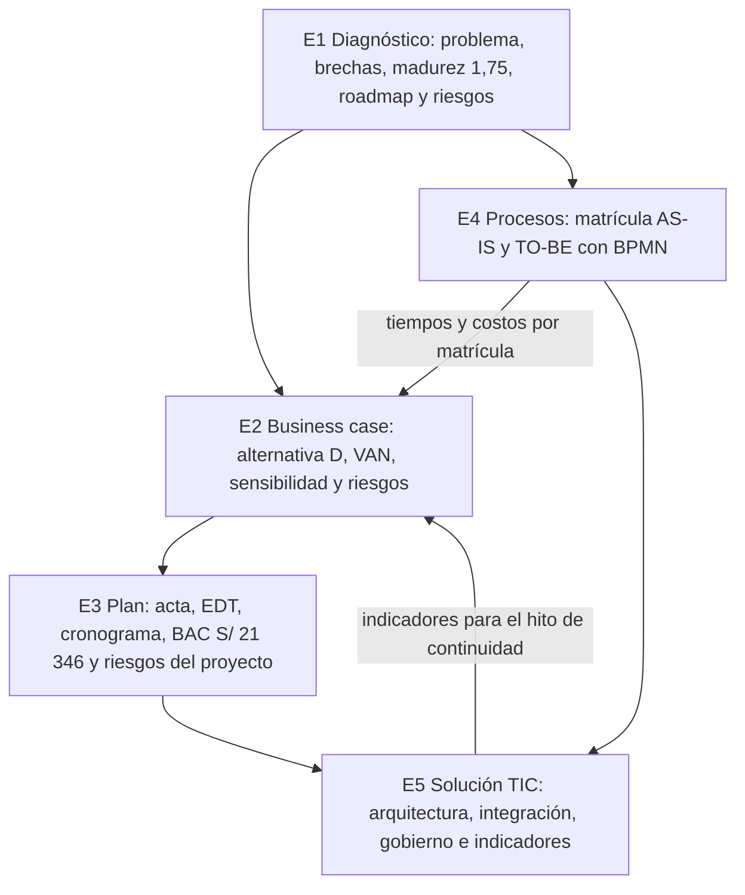

# A. Área de Gestión de Tecnologías de Información (CE01)

!!! abstract "Competencia CE01"
    Diseña y gestiona proyectos de tecnologías e información basándose en la guía del PMBOK y estándares de calidad a fin de lograr la construcción de resultados y el alcance de objetivos de la organización.

| Campo | Detalle |
|---|---|
| Proyecto | Proyecto de Gestión Integral de Tecnologías de Información para Transformación Organizacional: Plataforma Web Integral de Gestión Académica CERMAT |
| Organización | CERMAT, Azángaro (Puno, Perú): colegio CERMAT School y Academia La Prepa Cermat |
| Estudiantes | David Robert Yucra Mamani (líder), Gladys Rosaura Yana Pari, Denilson Leeke Mamani Flores, Cárdenas Vilca Rennzo |
| Semestre | 2026-2 (9° ciclo), UPeU campus Juliaca, sección g1 |
| Fecha | 2026-10-24 |

## Resumen del área

Mientras las líneas CE02 y CE03 documentan el sistema y su infraestructura, esta línea documenta **la gestión**: por qué CERMAT necesita la plataforma, cuánto vale, cómo se planifica su cierre y adopción, qué proceso transforma y cómo encaja con el sistema del colegio. El punto de partida es honesto: la plataforma está en producción y tiene buena base técnica, pero opera como **piloto con volumen bajo** (8 matrículas, 2 pagos, 7 marcas de asistencia y 0 consultas de padres al 2026-10-24) y con reglas publicadas que bloquean la matrícula en línea.

| Resultado clave | Valor | Dónde |
|---|---|---|
| Madurez digital (modelo de 8 dimensiones, escala 1–5) | 1,75 hoy; meta 3,0 en 2027 | [E1, 1.3](e1-diagnostico-organizacional-ce0111.md#nivel-de-madurez-digital) |
| VAN para CERMAT a 3 años (vista A, escenario base, 12 %) | S/ 1 247 (pesimista S/ −8 809; optimista S/ 13 245) | [E2, 2.4.4](e2-business-case-ce0113.md#244-flujo-de-caja-y-evaluacion-economica-a-3-anos) |
| Umbrales de equilibrio | 40 matrículas por ciclo o 64,1 % de adopción sostenida | [E2, 2.4.5](e2-business-case-ce0113.md#245-analisis-de-sensibilidad) |
| Presupuesto total del proyecto (BAC) | S/ 21 346, de los cuales CERMAT aporta S/ 1 166 | [E3, 3.4](e3-plan-gestion-proyecto-ce0121.md#34-gestion-de-costos) |
| Tiempo de personal por matrícula | 40 → 10,5 min (−73,8 %, supuestos con plan de medición) | [E4, 4.3](e4-modelado-procesos-ce0131.md#43-analisis-comparativo-ce0135) |
| Indicadores de uso, valor y mejora | 22, con línea base real | [E5, 5.6](e5-propuesta-solucion-tic-ce0141.md#56-indicadores-de-uso-valor-y-mejora-ce0145) |

## Competencias de Gestión de TI

| Competencia | Descripción (guía oficial) | Entregable |
|---|---|---|
| CE011 — Gestión e Innovación de TI | Administra un Plan Estratégico de TI alineado a la estrategia de negocio. Esta competencia permite diagnosticar brechas, priorizar iniciativas, justificar inversiones y orientar la tecnología hacia resultados organizacionales. | E1 y E2 |
| CE012 — Gestión de Proyectos | Aplica los principios de gestión en computación, las metodologías apropiadas a su campo y la toma de decisiones económicas considerando eventuales riesgos, como individuo y como miembro o líder de equipo, para gestionar proyectos en entornos multidisciplinarios. | E3 |
| CE013 — Gestión de Procesos | Gestiona los procesos de las organizaciones con soluciones TIC. Esta competencia permite modelar procesos actuales, identificar oportunidades de mejora, proponer rediseños y definir indicadores de desempeño. | E4 |
| CE014 — Gestión de Sistemas de Información | Apoya la prestación, el uso y la gestión de sistemas de información dentro de un entorno de sistemas de información. Esta competencia conecta la solución tecnológica con datos, seguridad, integración, operación y toma de decisiones. | E5 |

## Mapa de entregables y evidencias

| Evidencia | Contenido | Entregable y sección |
|---|---|---|
| CE0111 | Diagnóstico organizacional | [E1, 1.1 a 1.4](e1-diagnostico-organizacional-ce0111.md#11-contexto-organizacional) |
| CE0112 | Alineamiento estratégico | [E1, alineamiento estratégico](e1-diagnostico-organizacional-ce0111.md#alineamiento-estrategico-ce0112) |
| CE0113 | Caso de negocio | [E2 — Business Case](e2-business-case-ce0113.md) |
| CE0114 | Roadmap de tecnología | [E1, 1.5](e1-diagnostico-organizacional-ce0111.md#15-roadmap-de-tecnologia-ce0114) |
| CE0115 | Matriz de riesgos estratégicos | [E1, 1.6](e1-diagnostico-organizacional-ce0111.md#16-matriz-de-riesgos-estrategicos-ce0115) |
| CE0121 | Acta de constitución del proyecto | [E3, 3.1](e3-plan-gestion-proyecto-ce0121.md#31-acta-de-constitucion) |
| CE0122 | Plan de gestión: alcance, tiempo, costo y recursos | [E3, 3.2 a 3.4](e3-plan-gestion-proyecto-ce0121.md#32-gestion-del-alcance) |
| CE0123 | EDT y cronograma | [E3, 3.2](e3-plan-gestion-proyecto-ce0121.md#32-gestion-del-alcance) y [3.3](e3-plan-gestion-proyecto-ce0121.md#33-gestion-del-cronograma) |
| CE0124 | Análisis económico y evaluación de viabilidad | [E2, 2.4.4 y 2.4.5](e2-business-case-ce0113.md#244-flujo-de-caja-y-evaluacion-economica-a-3-anos) y [E3, 3.4](e3-plan-gestion-proyecto-ce0121.md#34-gestion-de-costos) |
| CE0125 | Plan de gestión de riesgos | [E3, 3.5](e3-plan-gestion-proyecto-ce0121.md#35-gestion-de-riesgos) |
| CE0131 | Identificación y caracterización de procesos | [E4, identificación y caracterización](e4-modelado-procesos-ce0131.md#identificacion-y-caracterizacion-de-procesos-ce0131) |
| CE0132 | Modelado AS-IS | [E4, 4.1](e4-modelado-procesos-ce0131.md#41-proceso-actual-as-is-ce0132) y [matricula-as-is.bpmn](../assets/gestion-ti/bpmn/matricula-as-is.bpmn) |
| CE0133 | Modelado TO-BE | [E4, 4.2](e4-modelado-procesos-ce0131.md#42-proceso-propuesto-to-be-ce0133-y-ce0134) y [matricula-to-be.bpmn](../assets/gestion-ti/bpmn/matricula-to-be.bpmn) |
| CE0134 | Automatización o mejora mediante TIC | [E4, automatizaciones](e4-modelado-procesos-ce0131.md#automatizaciones-propuestas) |
| CE0135 | Indicadores de desempeño y evaluación de impacto | [E4, nuevos indicadores](e4-modelado-procesos-ce0131.md#nuevos-indicadores) y [4.3](e4-modelado-procesos-ce0131.md#43-analisis-comparativo-ce0135) |
| CE0141 | Mapa del ecosistema de sistemas de información | [E5, 5.2](e5-propuesta-solucion-tic-ce0141.md#52-ecosistema-de-sistemas-de-informacion-ce0141-y-ce0143) |
| CE0142 | Arquitectura conceptual del sistema propuesto | [E5, 5.1](e5-propuesta-solucion-tic-ce0141.md#51-arquitectura-de-la-solucion-ce0142) |
| CE0143 | Modelo de integración y flujos de información | [E5, integración propuesta](e5-propuesta-solucion-tic-ce0141.md#integracion-propuesta) |
| CE0144 | Plan de implementación y gestión del sistema de información | [E5, 5.5](e5-propuesta-solucion-tic-ce0141.md#55-plan-de-implementacion-y-gestion-del-sistema-de-informacion-ce0144) |
| CE0145 | Indicadores de uso, valor y mejora | [E5, 5.6](e5-propuesta-solucion-tic-ce0141.md#56-indicadores-de-uso-valor-y-mejora-ce0145) |

## Cómo se encadenan los entregables

## Artefactos del área

| Artefacto | Ubicación |
|---|---|
| Modelo financiero con fórmulas (supuestos, proceso, presupuesto, flujo de caja, indicadores, sensibilidad y alternativas) | [business-case.xlsx](../assets/gestion-ti/business-case.xlsx) |
| Proceso de matrícula en BPMN 2.0 editable (bpmn.io o Camunda Modeler) | [matricula-as-is.bpmn](../assets/gestion-ti/bpmn/matricula-as-is.bpmn) · [matricula-to-be.bpmn](../assets/gestion-ti/bpmn/matricula-to-be.bpmn) |
| Scripts reproducibles | `perfil-egreso/scripts/generar-business-case.mjs` (genera el libro y verifica sus fórmulas) · `perfil-egreso/scripts/generar-bpmn.mjs` (genera y valida los BPMN) |

## Coherencia con las otras líneas

- **Ingeniería de Software:** requerimientos y arquitectura en el [E1](../e1-definicion-sistema-ce021.md), sistema funcional en el [E3](../e3-sistema-funcional-ce023.md), y Project Charter, Product Backlog y Sprint 1 en el [E4](../e4-calidad-operacion-ce024.md#31-project-charter), que el plan de gestión enlaza en lugar de duplicar.
- **Infraestructura:** el alojamiento de la capa relacional (VM-APP01 o VPS puente) sigue el [diseño de centro de datos híbrido](../infraestructura/s1-e2-diseno-centro-datos-hibrido-ce0331.md); la protección de datos y los incidentes, el [SGSI](../infraestructura/s2-e1-sgsi-ce0321-ce0324.md); los respaldos y el RTO, la [implementación del centro de datos](../infraestructura/s2-e3-implementacion-control-cd-ce0332-ce0333.md).
- **Sustentación:** la [guía de sustentación](../e5-presentacion-sustentacion-ce0217.md) reúne las preguntas de defensa de todas las líneas.

!!! note "Por qué 5 entregables"
    La tabla resumen de la guía agrupa CE01 en cuatro competencias, pero las plantillas detalladas, con contenido mínimo y rúbrica propios, definen cinco entregables: el Caso de Negocio (CE0113) tiene su propio documento. Se siguen esas plantillas: CE011 se documenta en el E1 y el E2, CE012 en el E3, CE013 en el E4 y CE014 en el E5.
