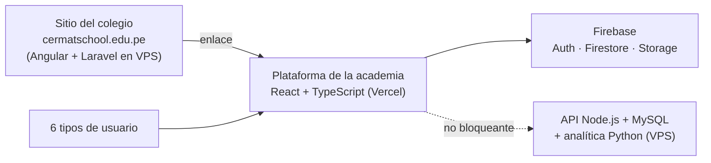

# Perfil de Egreso - Plataforma Web Integral CERMAT

!!! abstract "EPE — Sistema desplegado y en operación piloto"
    Evidencias del proyecto **Plataforma Web Integral de Gestión Académica CERMAT**, organizadas según la guía oficial vigente de evaluación del perfil de egreso (Escuela Profesional de Ingeniería de Sistemas, UPeU, versión de septiembre de 2026). El sistema está publicado en [academia-school-platform.vercel.app](https://academia-school-platform.vercel.app) y opera en piloto en la Academia La Prepa Cermat (Azángaro, Puno).

    Repositorio de esta documentación: [Perfil-de-egreso-Plataforma-Web-Integral-CERMAT](https://github.com/yucradavid/Perfil-de-egreso-Plataforma-Web-Integral-CERMAT) · Versión imprimible: [PDF completo](assets/perfil-egreso-completo.pdf) (2026-10-24)

## Proyecto

| Campo | Valor |
|---|---|
| Nombre | Plataforma Web Integral de Gestión Académica CERMAT |
| Tipo | EPE (Evaluación de Perfil de Egreso) |
| Organización | CERMAT — Academia La Prepa Cermat (el colegio CERMAT School tiene su propio sistema de gestión) |
| Equipo | David Robert Yucra Mamani (líder), Gladys Rosaura Yana Pari, Denilson Leeke Mamani Flores, Cárdenas Vilca Rennzo |
| Ciclo / semestre | 9° ciclo — 2026-2, campus Juliaca |
| Fecha de esta versión | 2026-10-24 |
| Despliegue | [https://academia-school-platform.vercel.app](https://academia-school-platform.vercel.app) |

## Entregables

### A. Gestión de Tecnologías de Información (CE01)

| Entregable | Evidencias | Contenido |
|---|---|---|
| [E1 — Diagnóstico organizacional y alineamiento estratégico](gestion-ti/e1-diagnostico-organizacional-ce0111.md) | CE0111–CE0115 | Contexto, FODA, madurez digital, problema y causas, roadmap y riesgos estratégicos |
| [E2 — Business case](gestion-ti/e2-business-case-ce0113.md) | CE0113 | Alternativas ponderadas, beneficios, costos y evaluación económica a 3 años |
| [E3 — Plan de gestión del proyecto](gestion-ti/e3-plan-gestion-proyecto-ce0121.md) | CE0121–CE0125 | Acta, EDT, cronograma, presupuesto, riesgos y gestión ágil |
| [E4 — Procesos AS-IS / TO-BE](gestion-ti/e4-modelado-procesos-ce0131.md) | CE0131–CE0135 | Proceso de matrícula en BPMN y comparación de tiempo, costo y calidad |
| [E5 — Propuesta de solución TIC integrada](gestion-ti/e5-propuesta-solucion-tic-ce0141.md) | CE0141–CE0145 | Ecosistema colegio + academia, integración, gobierno e indicadores de uso |

### B. Ingeniería de Software (CE02)

| Entregable | Competencia | Contenido |
|---|---|---|
| [E1 — Requerimientos y diseño del sistema](e1-definicion-sistema-ce021.md) | CE021 | 22 RF, 10 RNF, reglas de negocio, historias, prototipo, C4, ADR, UML y trazabilidad |
| [E2 — Plataforma de datos](e2-base-datos-ce022.md) | CE022 | Modelo, DDL/DML, procedimientos, funciones, triggers, roles, respaldo y 19 pruebas SQL |
| [E3 — Sistema funcional integrado](e3-sistema-funcional-ce023.md) | CE023 | Arquitectura, flujos, código, manejo de errores y despliegue |
| [E4 — Gestión del proyecto y calidad](e4-calidad-operacion-ce024.md) | CE024 | 99 pruebas, CI/CD, observabilidad, gestión ágil, ISO 25010 y CMMI |

### C. Infraestructura Tecnológica (CE03)

| Momento | Entregable | Códigos |
|---|---|---|
| Semestre 1 | [E1 — Análisis y diseño de red](infraestructura/s1-e1-analisis-diseno-red-ce0311.md) | CE0311 |
| Semestre 1 | [E2 — Análisis y diseño de centro de datos híbrido](infraestructura/s1-e2-diseno-centro-datos-hibrido-ce0331.md) | CE0331 |
| Semestre 1 | [Producto final: diseño técnico consolidado](infraestructura/s1-producto-final.md) | — |
| Semestre 2 | [E1 — Planificación e implementación del SGSI](infraestructura/s2-e1-sgsi-ce0321-ce0324.md) | CE0321–CE0324 |
| Semestre 2 | [E2 — Implementación, testing y monitoreo de red](infraestructura/s2-e2-implementacion-red-ce0312-ce0313.md) | CE0312–CE0313 |
| Semestre 2 | [E3 — Implementación, gestión y control de centro de datos](infraestructura/s2-e3-implementacion-control-cd-ce0332-ce0333.md) | CE0332–CE0333 |
| Semestre 2 | [Producto final: informe de implementación integral](infraestructura/s2-producto-final.md) | — |

Transversal: [Guía de sustentación y defensa técnica](e5-presentacion-sustentacion-ce0217.md).

## Resumen del sistema (medido el 2026-10-24)

| Indicador | Valor |
|---|---|
| Módulos de dominio | 13 (`src/features/*`) |
| Portales y guardas de ruta | 6 (público, admin, docente, estudiante, auxiliar y padres) |
| Colecciones de Firestore con reglas | 22 |
| Base relacional MySQL | 6 tablas de negocio + auditoría; 4 funciones, 5 procedimientos, 6 triggers y 3 vistas |
| Requerimientos | 22 funcionales y 10 no funcionales |
| Pruebas automáticas | 99 (34 unitarias, 27 de API, 19 de reglas de seguridad y 19 de base de datos) |
| Integración continua | 6 trabajos en GitHub Actions |
| Uso en piloto | 8 matrículas, 2 pagos, 7 marcas de asistencia y 8 usuarios con perfil |
| Estado de producción | Frontend y reglas corregidas publicados el 2026-10-24 y verificados como visitante sin sesión; capa relacional en el VPS del colegio, con prueba de punta a punta ([E4 §2.7](e4-calidad-operacion-ce024.md#27-cierre-en-produccion-2026-10-24)) |

## Arquitectura

| Capa | Tecnología | Rol |
|---|---|---|
| Presentación | React 18 + TypeScript + Vite en Vercel | Portales por rol |
| Identidad y datos | Firebase Auth, Firestore y Storage | Fuente de verdad, reglas por rol probadas |
| Réplica y analítica | Node.js + Express, MySQL 8, Python + FastAPI | Reportes, conciliación, auditoría y riesgo de inasistencia |
| Infraestructura | Vercel, Firebase y el VPS del colegio, que desde el 2026-10-24 aloja también la capa relacional | Base del diseño híbrido de la línea CE03 |

## Evidencia técnica (repositorio `academia-school-platform`)

| Evidencia | Ubicación |
|---|---|
| Rutas y portales | `src/App.tsx`, `src/routes/*` |
| Reglas de seguridad y sus pruebas | `firestore.rules`, `tests/firestore-rules/reglas.test.ts` |
| Módulos de dominio | `src/features/*` |
| Base relacional | `server/src/db/` (migraciones, pruebas y README) |
| API y sus pruebas | `server/src/`, `server/test/` |
| Analítica | `analytics/main.py` |
| Pipeline de CI | `.github/workflows/ci.yml` |
| Respaldo y restauración | `server/scripts/backup.js`, `server/scripts/restore.js` |

!!! success "Cerrado en producción el 2026-10-24"
    Frontend y reglas de Firestore corregidas publicados y verificados; pre-matrícula pública operativa; clave de servicio de Firebase rotada y contraseñas expuestas restablecidas. Base MySQL real migrada, con cuentas de mínimo privilegio y restauración probada en 0,23 s. La capa relacional corre en el VPS del colegio con HTTPS, tiene respaldo diario y su restauración también se probó en otro servidor: 0,33 s en el VPS y 0,41 s del VPS a la PC. Esa noche la réplica recibió con una carga inicial los datos que Firestore ya tenía ([E4 §2.7](e4-calidad-operacion-ce024.md#27-cierre-en-produccion-2026-10-24)).

!!! warning "Pendientes que solo puede cerrar el equipo"
    - Decidir el reintento de los envíos fallidos a MySQL: la carga inicial de los datos anteriores se hizo el 2026-10-24, pero un envío que falla no se repite.
    - Copiar cada semana los respaldos del VPS a la PC y verificarlos con `restore.js`.
    - Configurar el secreto `FIREBASE_SERVICE_ACCOUNT` en GitHub para que el CI publique las reglas.
    - Firmar las actas de validación con la academia y la declaración de ética de seguridad.
    - Ejecutar el laboratorio de infraestructura (Semestre 2) y adjuntar sus evidencias.
    - Validar con la Dirección los supuestos del business case.
    - Dar acceso al jurado al repositorio.
    - Preparar la sustentación individual ([guía](e5-presentacion-sustentacion-ce0217.md)).
