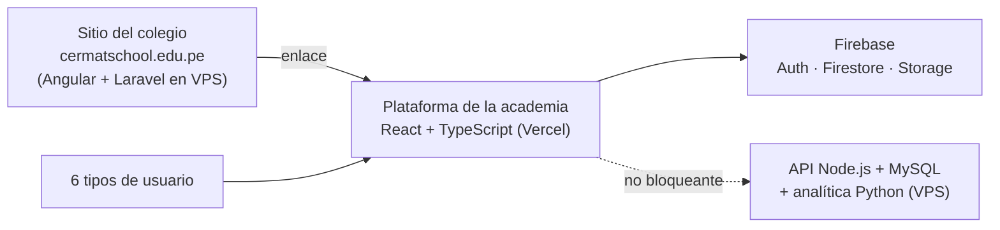

# Perfil de Egreso - Plataforma Web Integral CERMAT

!!! abstract "EPE — Sistema desplegado y en operación piloto"
    Evidencias del proyecto **Plataforma Web Integral de Gestión Académica CERMAT**, organizadas según la guía oficial vigente de evaluación del perfil de egreso (Escuela Profesional de Ingeniería de Sistemas, UPeU, versión de septiembre de 2026). El sistema está publicado en [academia-school-platform.vercel.app](https://academia-school-platform.vercel.app) y opera en piloto en la Academia La Prepa Cermat (Azángaro, Puno).

    Repositorio de esta documentación: [Perfil-de-egreso-Plataforma-Web-Integral-CERMAT](https://github.com/yucradavid/Perfil-de-egreso-Plataforma-Web-Integral-CERMAT) · Versión imprimible: [PDF completo](assets/perfil-egreso-completo.pdf)

## Proyecto

| Campo | Valor |
|---|---|
| Nombre | Plataforma Web Integral de Gestión Académica CERMAT |
| Tipo | EPE (Evaluación de Perfil de Egreso) |
| Organización | CERMAT — Academia La Prepa Cermat (el colegio CERMAT School tiene su propio sistema de gestión) |
| Equipo | David Robert Yucra Mamani (líder), Gladys Rosaura Yana Pari, Denilson Leeke Mamani Flores, Cárdenas Vilca Rennzo |
| Ciclo / semestre | 9° ciclo — 2026-2, campus Juliaca |
| Fecha de esta versión | 2026-11-16 (primera versión completa: 2026-10-24) |
| Despliegue | [https://academia-school-platform.vercel.app](https://academia-school-platform.vercel.app) |

## Entregables

### A. Gestión de Tecnologías de Información (CE01)

| Entregable | Evidencias | Contenido |
|---|---|---|
| [E1 — Diagnóstico organizacional y alineamiento estratégico](gestion-ti/e1-diagnostico-organizacional-ce0111.md) | CE0111–CE0115 | Contexto, FODA, madurez digital, problema y causas, roadmap y riesgos estratégicos |
| [E2 — Business case](gestion-ti/e2-business-case-ce0113.md) | CE0113 | Alternativas ponderadas, beneficios, costos y evaluación económica a 3 años |
| [E3 — Plan de gestión del proyecto](gestion-ti/e3-plan-gestion-proyecto-ce0121.md) | CE0121–CE0125 | Acta, EDT, cronograma, presupuesto, riesgos y gestión ágil |
| [E4 — Procesos AS-IS / TO-BE](gestion-ti/e4-modelado-procesos-ce0131.md) | CE0131–CE0135 | Proceso de matrícula en BPMN y comparación de tiempo, costo y calidad |
| [E5 — Propuesta de solución TIC integrada](gestion-ti/e5-propuesta-solucion-tic-ce0141.md) | CE0141–CE0145 | Ecosistema colegio + academia, integración, gobierno e indicadores de uso |

### B. Ingeniería de Software (CE02)

| Entregable | Competencia | Contenido |
|---|---|---|
| [E1 — Requerimientos y diseño del sistema](e1-definicion-sistema-ce021.md) | CE021 | 30 RF, 11 RNF, reglas de negocio, historias, prototipo, C4, ADR, UML y trazabilidad |
| [E2 — Plataforma de datos](e2-base-datos-ce022.md) | CE022 | Modelo, DDL/DML, procedimientos, funciones, triggers, roles, respaldo, conciliación nocturna y 25 pruebas SQL |
| [E3 — Sistema funcional integrado](e3-sistema-funcional-ce023.md) | CE023 | Arquitectura, flujos, código, manejo de errores y despliegue |
| [E4 — Gestión del proyecto y calidad](e4-calidad-operacion-ce024.md) | CE024 | 372 pruebas, CI/CD, observabilidad, gestión ágil, ISO 25010 y CMMI |

### C. Infraestructura Tecnológica (CE03)

| Momento | Entregable | Códigos |
|---|---|---|
| Semestre 1 | [E1 — Análisis y diseño de red](infraestructura/s1-e1-analisis-diseno-red-ce0311.md) | CE0311 |
| Semestre 1 | [E2 — Análisis y diseño de centro de datos híbrido](infraestructura/s1-e2-diseno-centro-datos-hibrido-ce0331.md) | CE0331 |
| Semestre 1 | [Producto final: diseño técnico consolidado](infraestructura/s1-producto-final.md) | — |
| Semestre 2 | [E1 — Planificación e implementación del SGSI](infraestructura/s2-e1-sgsi-ce0321-ce0324.md) | CE0321–CE0324 |
| Semestre 2 | [E2 — Implementación, testing y monitoreo de red](infraestructura/s2-e2-implementacion-red-ce0312-ce0313.md) | CE0312–CE0313 |
| Semestre 2 | [E3 — Implementación, gestión y control de centro de datos](infraestructura/s2-e3-implementacion-control-cd-ce0332-ce0333.md) | CE0332–CE0333 |
| Semestre 2 | [Producto final: informe de implementación integral](infraestructura/s2-producto-final.md) | — |

Transversal: [Guía de sustentación y defensa técnica](e5-presentacion-sustentacion-ce0217.md).

## Resumen del sistema (medido el 2026-11-16)

| Indicador | Valor |
|---|---|
| Módulos de dominio | 17 (`src/features/*`); 13 al 2026-10-24 |
| Portales y guardas de ruta | 6 (público, admin, docente, estudiante, auxiliar y padres), con 59 rutas |
| Colecciones de Firestore con reglas | 27 (22 al 2026-10-24) |
| Base relacional MySQL | 6 tablas de negocio + auditoría; 3 FK, 8 CHECK, 4 funciones, 6 procedimientos, 7 triggers y 3 vistas; migraciones 02 a 06 |
| API REST | Sincronización, cuentas de alumnos (`/api/cuentas`) y administración de usuarios (`/api/usuarios`) |
| Requerimientos | 30 funcionales y 11 no funcionales |
| Pruebas automáticas | 372 al 2026-11-16 (376 desde el 2026-11-17, con las 4 del respaldo de Firestore): 150 unitarias, 96 de API, 101 de reglas de seguridad y 25 de base de datos. Las 372 pasan con la corrección del 2026-11-16, que arregla 6 que había roto la última entrega. Ese día se sumaron 4 de API del respaldo de Firestore: 376 ([E4 §1.3](e4-calidad-operacion-ce024.md#13-reporte-de-ejecucion-2026-11-16)) |
| Integración continua | 6 trabajos en GitHub Actions |
| Réplica relacional | Comparación y reparación nocturna desde Firestore (03:30) desde el 2026-11-14; ese día Firestore y MySQL coincidieron |
| Uso en piloto | Al 2026-11-14: 10 matrículas, 3 pagos y 7 marcas de asistencia (conteo de la conciliación) |
| Estado de producción | Frontend del 2026-11-16 publicado en Vercel. Las rutas `/api/cuentas` y `/api/usuarios` están activas en el VPS y responden 401 sin sesión. Paquetes del VPS aplicados el 12 y el 14 de noviembre ([E3 §4.3](e3-sistema-funcional-ce023.md#43-evidencia-de-despliegue-y-ejecucion)) |

## Arquitectura

| Capa | Tecnología | Rol |
|---|---|---|
| Presentación | React 18 + TypeScript + Vite en Vercel | Portales por rol |
| Identidad y datos | Firebase Auth, Firestore y Storage | Fuente de verdad, reglas por rol probadas |
| Réplica, cuentas y analítica | Node.js + Express, MySQL 8, Python + FastAPI | Reportes, conciliación nocturna, auditoría, cuentas de alumnos y personal, y riesgo de inasistencia |
| Infraestructura | Vercel, Firebase y el VPS del colegio, que desde el 2026-10-24 aloja también la capa relacional | Base del diseño híbrido de la línea CE03 |

## Evidencia técnica (repositorio `academia-school-platform`)

| Evidencia | Ubicación |
|---|---|
| Rutas y portales | `src/App.tsx`, `src/routes/*` |
| Reglas de seguridad y sus pruebas | `firestore.rules`, `tests/firestore-rules/reglas.test.ts` |
| Módulos de dominio | `src/features/*` |
| Base relacional | `server/src/db/` (migraciones, pruebas y README) |
| API y sus pruebas | `server/src/`, `server/test/` |
| Analítica | `analytics/main.py` |
| Pipeline de CI | `.github/workflows/ci.yml` |
| Respaldo y restauración | `server/scripts/backup.js`, `server/scripts/restore.js` |
| Comparación y conciliación de la réplica | `server/src/scripts/compararReplica.ts`, `cargaInicial.ts`, `conciliarAsistencias.ts`; `deploy/systemd/academia-replica.*` |
| Cuentas de alumnos y de personal | `server/src/routes/cuentas.ts`, `server/src/routes/usuarios.ts`, `src/features/accesos/*` |
| Manual de despliegue y operación | `deploy/MANUAL-DESPLIEGUE-CERMAT.md` |

!!! success "Cerrado en producción el 2026-10-24"
    Frontend y reglas de Firestore corregidas publicados y verificados; pre-matrícula pública operativa; clave de servicio de Firebase rotada y contraseñas expuestas restablecidas. Base MySQL real migrada, con cuentas de mínimo privilegio y restauración probada en 0,23 s. La capa relacional corre en el VPS del colegio con HTTPS, tiene respaldo diario y su restauración también se probó en otro servidor: 0,33 s en el VPS y 0,41 s del VPS a la PC. Esa noche la réplica recibió con una carga inicial los datos que Firestore ya tenía ([E4 §2.7](e4-calidad-operacion-ce024.md#27-cierre-en-produccion-2026-10-24)).

!!! success "Avance del 25 de octubre al 16 de noviembre"
    - **Seguridad de accesos:**
        - la activación del alumno ya no lee la matrícula;
        - los códigos de padres se pueden revocar;
        - la firma del QR salió del perfil y de las marcas, que guardan un resumen;
        - el QR del docente cambia cada 2 minutos;
        - una cuenta de personal desactivada pierde su rol.
    - **Nuevas funciones:**
        - comprobantes de pago con QR;
        - estado de cuenta;
        - edición de matrículas con cambio de grupo;
        - talleres con cupo;
        - varios docentes por grupo;
        - ficha de matrícula con autorización de datos;
        - acceso directo de alumnos con usuario y contraseña;
        - módulo Usuarios;
        - configuración institucional;
        - matrícula masiva desde Excel, una fila por alumno.
    - **Réplica:**
        - las marcas borradas se eliminan en MySQL con auditoría;
        - la comparación campo por campo y la reparación corren cada noche (PB-19 cerrado el 2026-11-14).
    - **Pruebas:** de 99 a 372 ([E4](e4-calidad-operacion-ce024.md)).

!!! warning "Pendientes que solo puede cerrar el equipo"
    - Hacer que Vercel espere al CI antes de publicar (PB-27).
    - Registrar en el manual si se aplicó en el VPS la migración `06_matriculas_descuento_cronograma.sql` que necesita esa entrega.
    - Registrar a nombre de la academia el dominio `cermatacademia.edu.pe`, que usan las cuentas de los alumnos y que hoy no existe en el DNS (R-31), o cambiar el dominio de las cuentas.
    - Copiar cada semana los respaldos del VPS fuera del servidor y verificarlos con `restore.js`: el 2026-11-17 el más nuevo tenía 23 días (NC-10).
    - Aplicar los parches de dependencias: 3 avisos críticos y 20 altos el 2026-11-17 (NC-09, procedimiento PRO-03).
    - Configurar el secreto `FIREBASE_SERVICE_ACCOUNT` en GitHub para que el CI publique las reglas.
    - Firmar en una sola sesión con la Dirección el acta de validación, el acta de constitución, la autorización de pruebas, la validación de supuestos y el acta de revisión por la dirección; el equipo firma las dos declaraciones de ética.
    - Ejecutar en Hyper-V la evidencia del hipervisor y REC-07, y medir en la sede la velocidad del enlace (PR-41). La red de la sede, la VPN y la detección ya se probaron en el entorno virtual el 2026-11-17.
    - Validar con la Dirección los supuestos del business case y el aviso de privacidad de la ficha de matrícula.
    - Dar acceso al jurado al repositorio.
    - Preparar la sustentación individual ([guía](e5-presentacion-sustentacion-ce0217.md)).
