# Evidencias del despliegue del 2026-10-24

!!! abstract "Capturas del cierre en producción y del paso de la capa relacional al VPS"
    18 capturas de pantalla tomadas el 2026-10-24. Las horas son de Perú (UTC−5). Respaldan el cierre en producción del [E4 §2.7](../e4-calidad-operacion-ce024.md#27-cierre-en-produccion-2026-10-24), las pruebas PR-38 y PR-39 del [S2-E2](s2-e2-implementacion-red-ce0312-ce0313.md) (evidencia EV-12) y la capa relacional en el VPS del [S2-E3](s2-e3-implementacion-control-cd-ce0332-ce0333.md).

!!! warning "Datos tapados antes de publicar"
    Se cubrieron con rectángulos sólidos:

    - los nombres y teléfonos de los alumnos y de la pre-matrícula de prueba;
    - la cuenta de administrador;
    - la URL del despliegue y la barra de direcciones de Vercel;
    - el usuario de Vercel;
    - el identificador de la cuenta de servicio;
    - la clave después de sus primeros 8 caracteres.

    Las capturas originales no se publican.

## 1. Frontend en Vercel antes del cierre (antes de las 13:13)

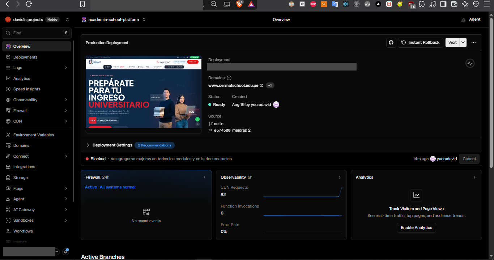

*Captura 1. Producción seguía con el despliegue del 19-ago (`e574500`), todavía con `www.cermatschool.edu.pe`. El último push (`e96eea1`) figura como **Blocked**.*

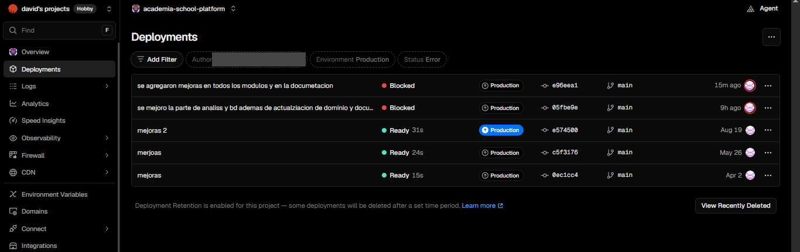

*Captura 2. `05fbe9e` y `e96eea1` quedaron bloqueados en Production. El último publicado era `e574500`.*

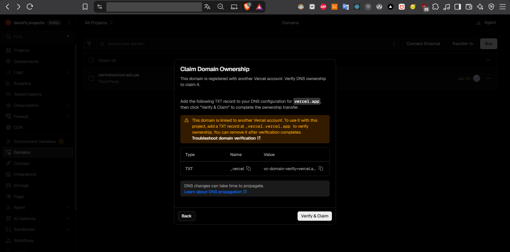

*Captura 3. Vercel pidió un registro TXT para verificar la propiedad de `cermatschool.edu.pe`, registrado en otra cuenta. No se agregó. Ese dominio y `www` apuntan al VPS del colegio, así que se quitaron del proyecto.*

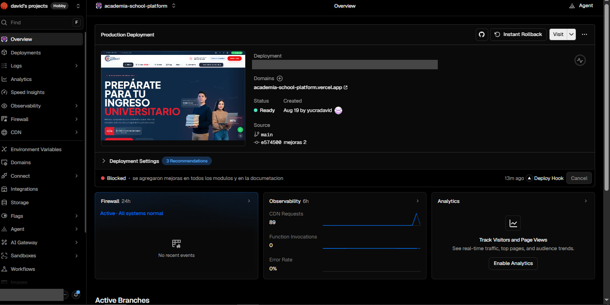

*Captura 4. Sin el dominio del colegio, el proyecto queda solo en `academia-school-platform.vercel.app`. El intento con un deploy hook también quedó bloqueado.*

## 2. Pre-matrícula pública en producción (13:25)

Con las reglas de Firestore corregidas ya publicadas, un visitante sin sesión volvió a completar la pre-matrícula. Las reglas de junio la bloqueaban.

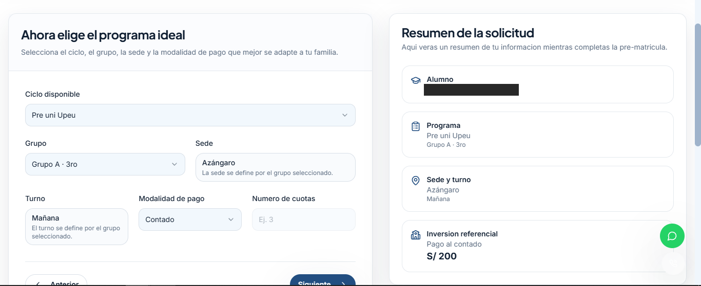

*Captura 5. El visitante elige el ciclo, el grupo, la sede y la modalidad de pago.*

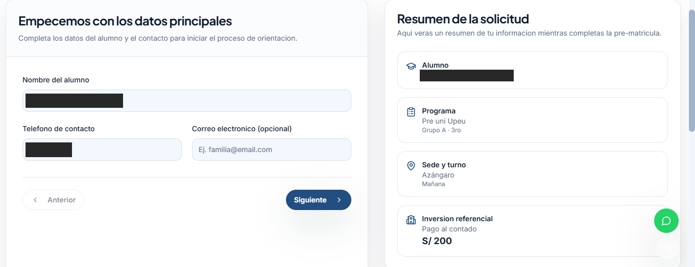

*Captura 6. Datos del alumno y del contacto (tapados).*

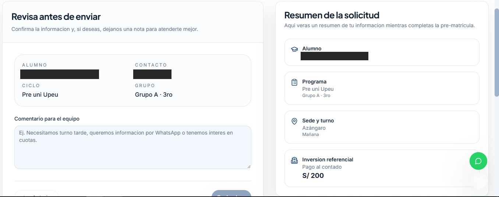

*Captura 7. Revisión antes de enviar.*

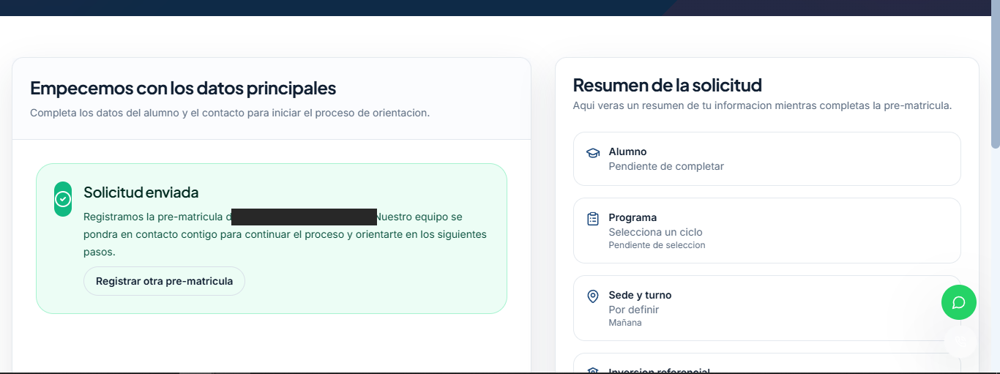

*Captura 8. Solicitud enviada. El registro de prueba aparece en el panel con fecha 24/10/2026 13:25:51 (captura 16). Después se canceló.*

## 3. Frontend nuevo, variables de entorno y clave rotada (13:13 a 13:42)

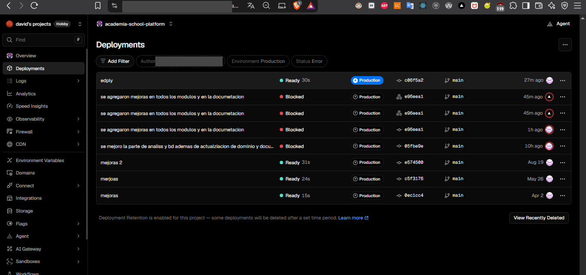

*Captura 9. `c06f5a2` en producción: se desplegó a las 13:13 y la captura es de las 13:40 aproximadamente. Los despliegues anteriores siguen bloqueados.*

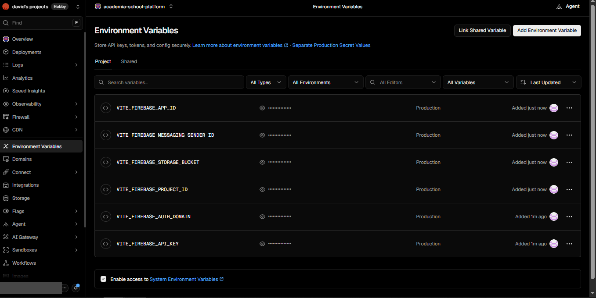

*Captura 10. Las 6 variables `VITE_FIREBASE_*` del entorno Production. Vercel no muestra los valores.*

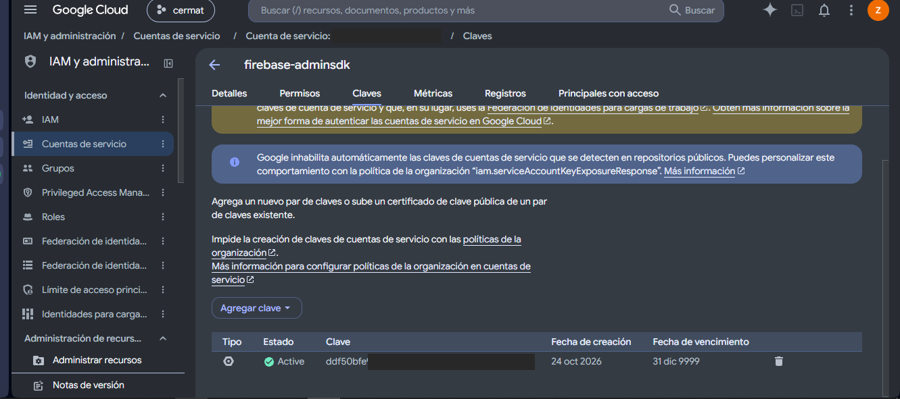

*Captura 11. La cuenta de servicio de Firebase muestra solo la clave nueva, `ddf50bfe…`, creada el 24-oct-2026. La de enero (`283b43c3…`), que estuvo en las copias ZIP, ya no figura (INC-02).*

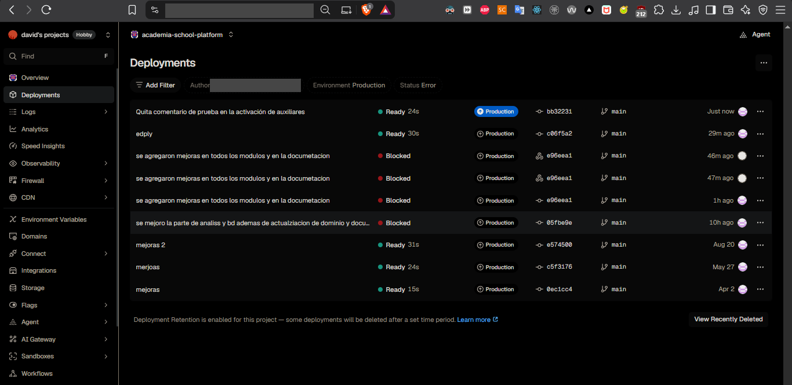

*Captura 12. `bb32231` en producción, hacia las 13:42. Desde `c06f5a2`, cada push a `main` se publica solo.*

## 4. Capa relacional en el VPS y panel de administración (noche)

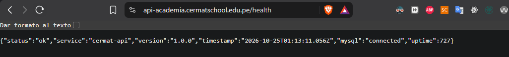

*Captura 13. `https://api-academia.cermatschool.edu.pe/health` responde `"status":"ok"` y `"mysql":"connected"`. El JSON usa hora UTC: las 01:13 del 25 son las 20:13 del 24 en Perú.*

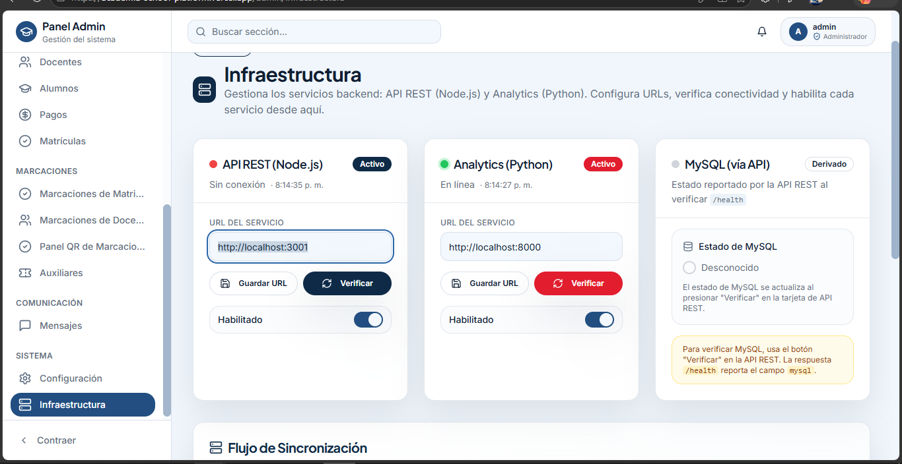

*Captura 14. Admin → Infraestructura a las 20:14, antes del cambio. El panel todavía apuntaba a la PC (`localhost`) y la API figuraba sin conexión.*

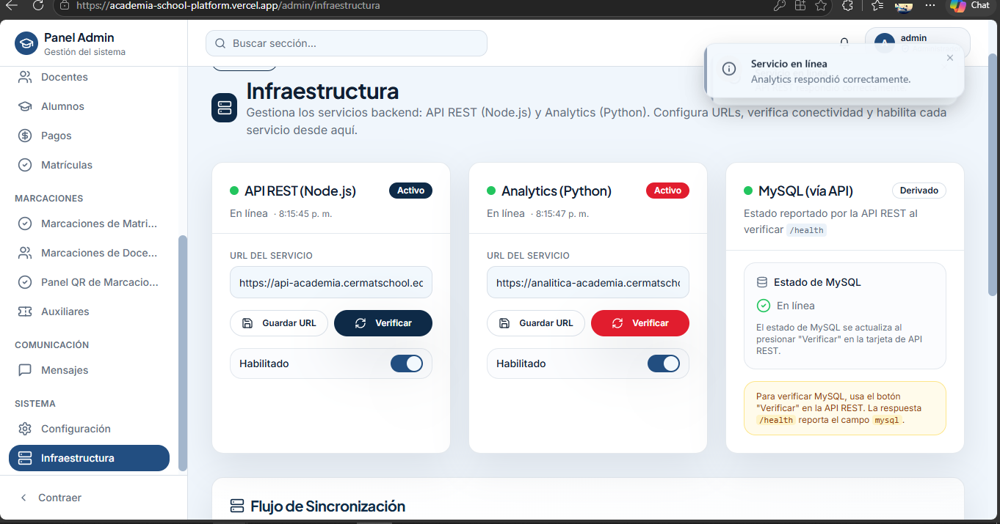

*Captura 15. A las 20:15, con las URL del VPS, la API, la analítica y MySQL quedaron «En línea».*

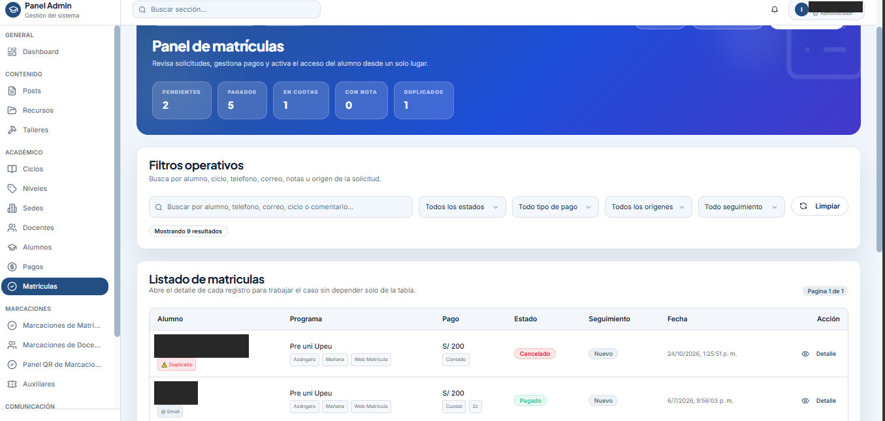

*Captura 16. Panel de matrículas. La primera fila es la pre-matrícula de prueba (13:25:51), cancelada y marcada como duplicada.*

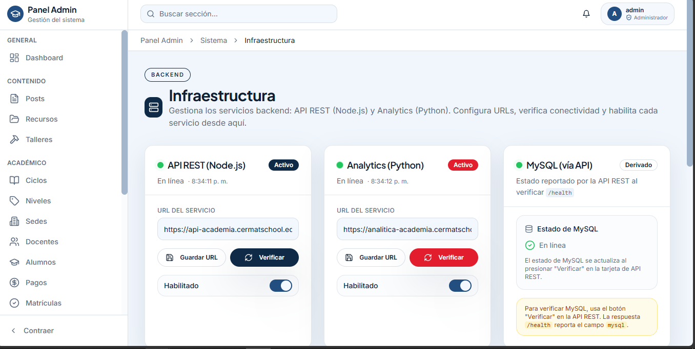

*Captura 17. A las 20:34, nueva verificación de la API y de la analítica en el VPS, con MySQL en línea.*

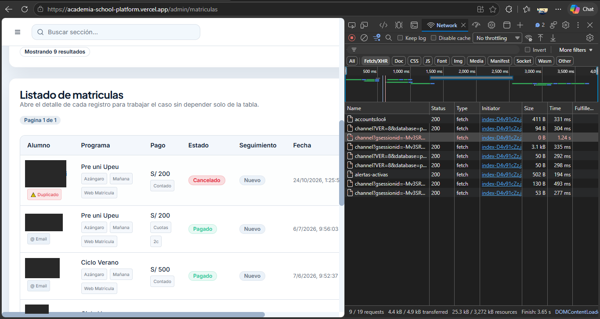

*Captura 18. En la pestaña Network del navegador, el panel carga las matrículas y `alertas-activas` responde 200 desde la analítica del VPS.*

## 5. Relación con los entregables

| Capturas | Qué respaldan | Dónde se analiza |
|---|---|---|
| 1 a 4 | Despliegues bloqueados en Vercel y retiro del dominio del colegio | [E4 §2.7](../e4-calidad-operacion-ce024.md#27-cierre-en-produccion-2026-10-24); [S2-E3 §10.2](s2-e3-implementacion-control-cd-ce0332-ce0333.md#102-historial-de-cambios-relevantes) |
| 5 a 8 | Pre-matrícula pública funcionando con las reglas corregidas | [E4 §2.7](../e4-calidad-operacion-ce024.md#27-cierre-en-produccion-2026-10-24) |
| 9, 10 y 12 | Frontend nuevo en producción, con cabeceras de seguridad y variables en Vercel | [E4 §2.7](../e4-calidad-operacion-ce024.md#27-cierre-en-produccion-2026-10-24); [E3 §4.3](../e3-sistema-funcional-ce023.md#43-evidencia-de-despliegue-y-ejecucion) |
| 11 | Rotación de la clave de servicio (INC-02) | [E4 §2.7](../e4-calidad-operacion-ce024.md#27-cierre-en-produccion-2026-10-24); [S2-E1](s2-e1-sgsi-ce0321-ce0324.md) |
| 13 a 18 | Capa relacional en el VPS con HTTPS y panel apuntando a ella (PR-38 y PR-39) | [S2-E2](s2-e2-implementacion-red-ce0312-ce0313.md); [S2-E3 §3.1](s2-e3-implementacion-control-cd-ce0332-ce0333.md#31-estado-actual-operativo-en-el-vps); [E3 §4.3](../e3-sistema-funcional-ce023.md#43-evidencia-de-despliegue-y-ejecucion) |

La carga inicial de Firestore a MySQL de las 22:56 no tiene captura. Su evidencia es la salida del script, que solo muestra conteos: [S2-E3 §7.8](s2-e3-implementacion-control-cd-ce0332-ce0333.md#78-carga-inicial-de-la-replica-relacional-2026-10-24).
