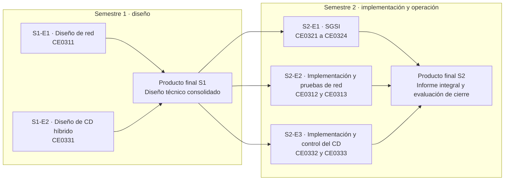

# C. Infraestructura Tecnológica (CE03)

!!! abstract "Competencia CE03"
    Diseña y ejecuta proyectos de infraestructura tecnológica para contribuir en la solución de problemas de la organización siguiendo estándares internacionales y presenta formalmente sus resultados demostrando una actitud ética de la ACM.

## Objeto del proyecto

La línea de infraestructura diseña, implementa, valida y opera una **arquitectura de seguridad híbrida on-premise + nube** para CERMAT (Azángaro, Puno), que reúne a la Academia La Prepa Cermat y a CERMAT School:

| Dominio | Qué contiene | Estado al 2026-10-24 |
|---|---|---|
| **On-premise** (sede principal, Azángaro) | Host de virtualización con OPNsense, servidor de aplicaciones (API Node.js, MySQL y analítica), Wazuh, monitoreo, respaldo, bastión y honeypot, segmentados en 6 VLAN | **Diseñado.** Hoy la capa local corre en una PC con PM2, sin firewall perimetral ni segmentación |
| **Nube IaaS** (VPS RackNerd, New York) | Sistema de gestión del colegio con Nginx, TLS, UFW y PostgreSQL local; extremo de la VPN | **En producción** desde el 2026-10-17; VPN y respaldos externos pendientes |
| **Nube PaaS** | Plataforma de la academia en Vercel; identidad y datos en Firebase | **En producción**; frontend con cabeceras de seguridad y reglas de Firestore corregidas publicados y verificados el 2026-10-24 |

La guía oficial toma como referencia VMware ESXi y AWS y permite ajustar la tecnología "siempre que se mantenga la equivalencia técnica". La tabla de equivalencias de esta página explica cada sustitución.

!!! warning "Implementado frente a diseñado"
    Cada documento separa lo **implementado con evidencia** (VPS, PaaS, base MySQL, pruebas y CI) de lo **pendiente de ejecución** (hipervisor, OPNsense, VPN, IDS/IPS, honeypot, SIEM y monitor externo). Lo pendiente incluye el procedimiento, el criterio de aceptación y la evidencia que se adjuntará. No se presentan resultados que no se hayan obtenido.

## Codificación de entregables

| Competencia | Código(s) | Momento | Entregable | Documento | Rúbrica |
|---|---|---|---|---|---|
| CE031: Conectividad | CE0311 | S1 | E1: Análisis y Diseño de Red | [S1-E1](s1-e1-analisis-diseno-red-ce0311.md) | 8 criterios (100 %) |
| CE033: Implementación de Centro de Datos | CE0331 | S1 | E2: Análisis y Diseño de Centro de Datos Híbrido | [S1-E2](s1-e2-diseno-centro-datos-hibrido-ce0331.md) | 8 criterios (100 %) |
| — | CE0311 + CE0331 | S1 | Producto final: Diseño Técnico Consolidado | [Producto final S1](s1-producto-final.md) | Rúbricas de S1-E1 y S1-E2 |
| CE032: Gestión de la Seguridad de la Información | CE0321, CE0322, CE0323, CE0324 | S2 | E1: Planificación e Implementación del SGSI | [S2-E1](s2-e1-sgsi-ce0321-ce0324.md) | 10 criterios (100 %) |
| CE031: Conectividad | CE0312, CE0313 | S2 | E2: Implementación, Testing y Monitoreo de Red | [S2-E2](s2-e2-implementacion-red-ce0312-ce0313.md) | 8 criterios (100 %) |
| CE033: Implementación de Centro de Datos | CE0332, CE0333 | S2 | E3: Implementación, Gestión y Control de Centro de Datos | [S2-E3](s2-e3-implementacion-control-cd-ce0332-ce0333.md) | 8 criterios (100 %) |
| — | CE031 + CE032 + CE033 | S2 | Producto final: Informe de Implementación Integral y Operativa | [Producto final S2](s2-producto-final.md) | Rúbricas de S2 y evaluación de cierre |

Nota interpretativa de la guía: CE031 primero diseña la red (S1) y luego la implementa, prueba y controla (S2); CE033 primero diseña la arquitectura (S1) y luego la despliega, opera y controla (S2); CE032 se evalúa como SGSI integral en S2.

## Distribución por semestre

## Reglas comunes de la guía

Todos los entregables se califican sobre **100 puntos** y se convierten a **nota sobre 20**.

| Nivel | Valor |
|---|---:|
| Excelente | 4 |
| Logrado | 3 |
| En proceso | 2 |
| Insuficiente | 1 |
| No evidenciado | 0 |

**Puntaje = peso × (nivel / 4).**

- La evidencia debe ser verificable y reproducible: no se evalúa como diseñado, implementado o probado lo que solo se describe de forma genérica.
- Ningún informe, captura, configuración o repositorio contiene contraseñas, llaves privadas, tokens, secretos ni datos personales reales. En esta documentación tampoco se publican IP públicas ni correos.
- La sustentación individual puede complementar la nota del equipo para verificar autoría, dominio técnico y capacidad de defensa.

## Equivalencias tecnológicas

| Referencia de la guía | Equivalente adoptado | Justificación | Estado |
|---|---|---|---|
| VMware ESXi | **Proxmox VE** (ESXi como alternativa si la institución dispone de licencia) | Sin costo de licencia; bridges con VLAN, bonds, ZFS, firewall y respaldo integrados. Tras la compra de VMware por Broadcom, la disponibilidad de una edición gratuita de ESXi es incierta | Diseñado |
| vSwitch | Linux bridge VLAN-aware (`vmbr0`) | Mismo papel: conmutador virtual con uplinks físicos | Diseñado |
| Port group con VLAN | Etiqueta `tag` en la NIC virtual de la VM | Asigna la VM a una VLAN sin configurar el sistema invitado | Diseñado |
| NIC teaming | Bond Linux 802.3ad (LACP) `bond0` | Agregación y redundancia de enlaces | Diseñado |
| Snapshots y respaldo de vSphere | vzdump + Proxmox Backup Server | Respaldo deduplicado, verificado y restaurable por VM | Diseñado |
| AWS VPC y CIDR | Espacio 10.20.0.0/16; red interna del VPS 10.20.0.0/24 en la interfaz `dum0` | Red privada de nube alcanzable solo por el túnel | Diseñado |
| Subred pública + Internet Gateway | Interfaz pública del VPS y enrutamiento del proveedor | El VPS recibe una IP pública propia | Implementado (provisto) |
| Route tables | Tabla `main` y tabla 220 de strongSwan | strongSwan instala las rutas de los selectores de tráfico | Diseñado |
| NAT Gateway | NAT saliente de OPNsense en la sede; no se requiere en el VPS | El VPS ya tiene IP pública | Diseñado |
| EC2 | VPS KVM de RackNerd (2 vCPU, 2 GB, 35 GB SSD, Ubuntu 24.04) | Ya contratado (US$ 35,99 al año) y en producción | **Implementado** |
| Security Group | UFW (nftables con estado) en el VPS | Entrada denegada por defecto; 22, 80 y 443/tcp permitidos | **Implementado** |
| NACL | Reglas nftables sin estado o filtro de red del proveedor | Segunda capa a nivel de red; disponibilidad del filtro del proveedor por confirmar | Pendiente |
| VPN Gateway (Site-to-Site IPsec) | strongSwan IKEv2 en el VPS ↔ OPNsense en la sede | Túnel IPsec equivalente con AES-256-GCM y PFS | Diseñado |
| IAM | Usuarios Linux con sudo y llaves SSH; roles de PostgreSQL y MySQL; claims de Firebase; cuentas de servicio | Mínimo privilegio por plataforma | Parcial |
| CloudWatch | Uptime Kuma (disponibilidad), Netdata (métricas) y Wazuh (eventos) | Monitoreo y alertas sin costo de licencia | Pendiente |
| Route 53 | DNS autoritativo de Punto.pe (servidores de RCP) | Dominio institucional `.edu.pe` | **Implementado** |
| ACM | Let's Encrypt con Certbot; certificados gestionados por Vercel | TLS 1.2/1.3 verificado el 2026-10-24 | **Implementado** |
| PaaS (Amplify/Elastic Beanstalk) | Vercel (frontend) y Firebase (Auth, Firestore, Storage) | Plataforma de la academia ya en producción | **Implementado** |
| GuardDuty o IDS | Suricata en OPNsense y Wazuh | IDS/IPS y correlación de eventos | Pendiente |

!!! note "AWS Academy como alternativa"
    Si el jurado requiere evidencia sobre AWS, el mismo diseño puede reproducirse en AWS Academy (VPC 10.20.0.0/16, EC2, Security Groups, NACL y Site-to-Site VPN hacia OPNsense), sujeto a los servicios habilitados en esa cuenta educativa. **No se usó en este proyecto.**

## Matrices y diagramas

| Entregable | Matriz (XLSX) | Diagrama editable (draw.io) |
|---|---|---|
| S1-E1 | [Componentes de red, VLAN, zonas, reglas, flujos y requisitos](../assets/infraestructura/s1-e1-matriz-componentes-red.xlsx) · [Pruebas de conectividad planeadas](../assets/infraestructura/s1-e1-matriz-pruebas-conectividad.xlsx) | [Topología general híbrida](../assets/infraestructura/diagramas/topologia-general-hibrida.drawio) · [Topología lógica](../assets/infraestructura/diagramas/topologia-logica-vlan.drawio) · [Zonas de seguridad y VPN](../assets/infraestructura/diagramas/zonas-seguridad-vpn.drawio) |
| S1-E2 | [Componentes y dimensionamiento del CD](../assets/infraestructura/s1-e2-matriz-componentes-dimensionamiento.xlsx) | [Arquitectura del CD híbrido](../assets/infraestructura/diagramas/arquitectura-centro-datos-hibrido.drawio) (rack, hipervisor y nube) |
| S2-E1 | [Inventario de activos](../assets/infraestructura/s2-e1-inventario-activos.xlsx) · [Riesgos](../assets/infraestructura/s2-e1-matriz-riesgos.xlsx) · [Declaración de Aplicabilidad](../assets/infraestructura/s2-e1-declaracion-aplicabilidad.xlsx) | — |
| S2-E2 | [Plan y resultados de pruebas de red](../assets/infraestructura/s2-e2-plan-resultados-pruebas-red.xlsx) | Diagramas de S1-E1 |
| S2-E3 | [Registro de pruebas de recuperación](../assets/infraestructura/s2-e3-registro-prueba-recuperacion.xlsx) · [Inventario final de activos](../assets/infraestructura/s2-e3-inventario-final-activos.xlsx) | Diagrama de S1-E2 |

Las matrices se generan con `perfil-egreso/scripts/generar-matrices-infra.mjs`, que contiene los mismos datos que las tablas de los informes. Para regenerarlas: `cd perfil-egreso && node scripts/generar-matrices-infra.mjs`.

## Cifras de la línea

| Indicador | Valor |
|---|---:|
| Componentes de red en la matriz | 31 |
| Flujos de información definidos | 22 |
| Reglas de firewall planeadas (OPNsense) | 35 |
| Componentes del centro de datos | 36 |
| Activos del SGSI | 33 |
| Riesgos evaluados (ISO/IEC 27005) | 29 |
| Controles del Anexo A en la SoA | 93 (92 aplicables) |
| Pruebas de red con resultado real / pendientes | 11 conformes y 2 no conformes / 24 pendientes |
| Pruebas de recuperación ejecutadas / pendientes | 5 / 7 (REC-05 en la base real: RTO de 0,23 s) |
