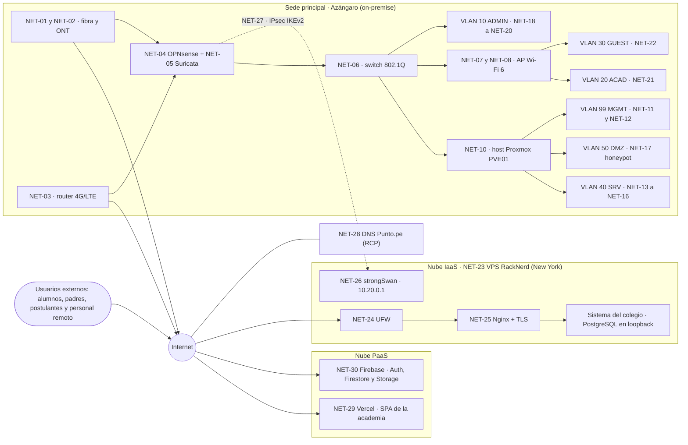
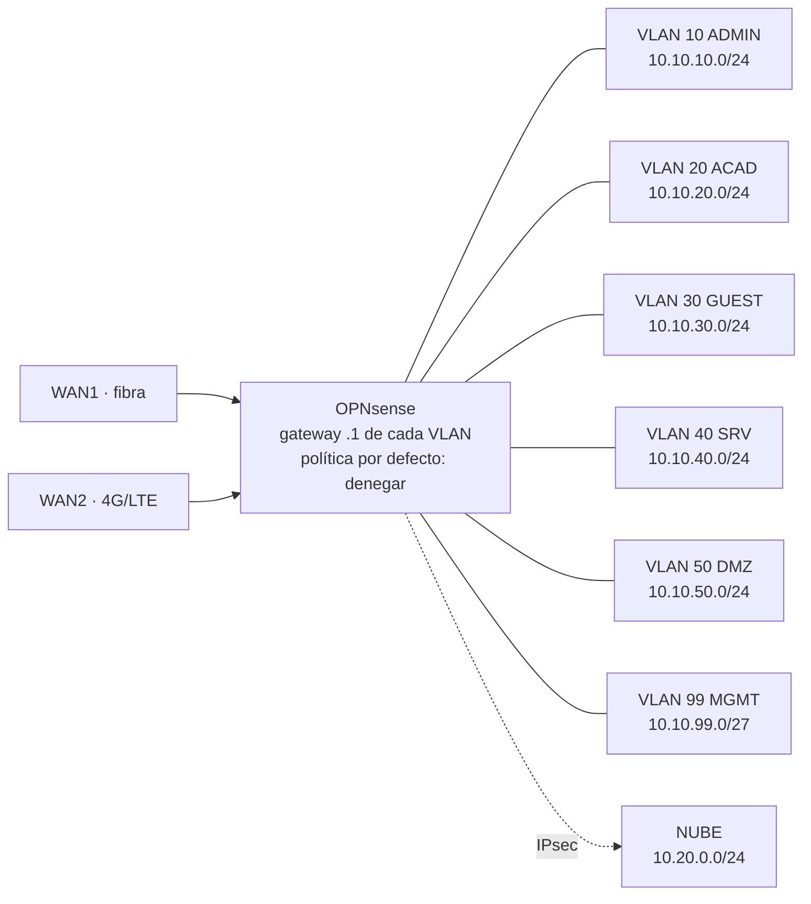
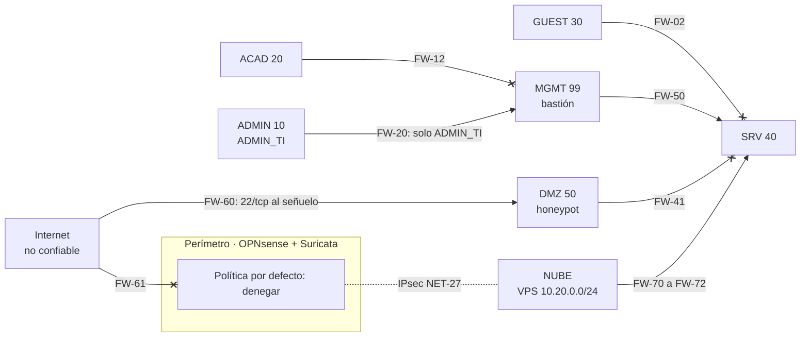
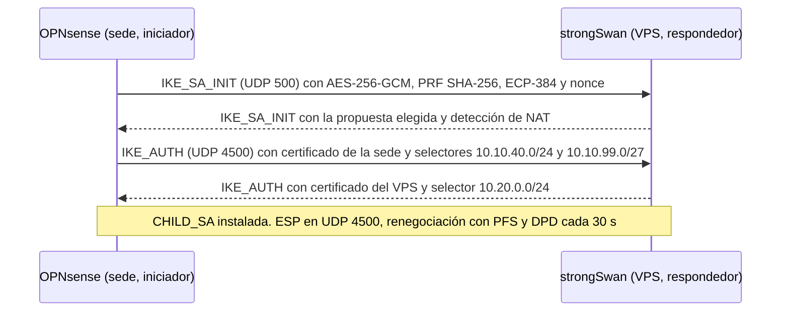
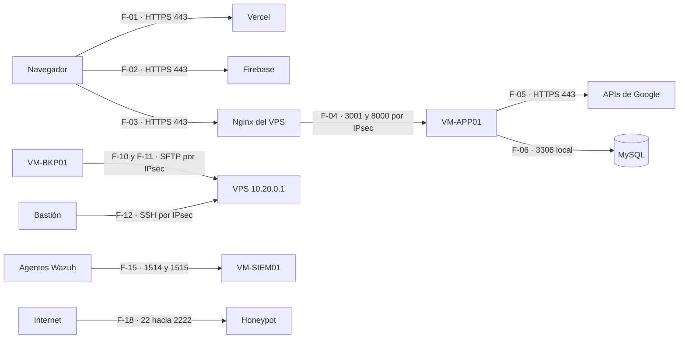

# S1-E1 · Análisis y Diseño de Red (CE0311)

!!! abstract "CE0311 — Diseño de red"
    Levantamiento de requerimientos, topología lógica y física, segmentación VLAN/DMZ, direccionamiento, ruteo, seguridad perimetral, conectividad híbrida y diseño de detección para la infraestructura **on-premise + nube** de CERMAT. Es un documento de **análisis y diseño, sin implementación**: la ejecución y las pruebas se documentan en [S2-E2](s2-e2-implementacion-red-ce0312-ce0313.md).

## Portada

| Campo | Detalle |
|---|---|
| Título | Análisis y diseño de red de la infraestructura híbrida de CERMAT |
| Entregable | Semestre 1 · Entregable 1 · CE0311 |
| Estudiantes | David Robert Yucra Mamani (líder), Gladys Rosaura Yana Pari, Denilson Leeke Mamani Flores, Cárdenas Vilca Rennzo |
| Semestre | 2026-2 (9° ciclo), UPeU campus Juliaca, sección g1 |
| Fecha | 2026-10-24 |
| Versión | 2.0 |
| Organización | CERMAT, Azángaro (Puno, Perú): Academia La Prepa Cermat y CERMAT School |

**Control de versiones**

| Versión | Fecha | Cambio |
|---|---|---|
| 1.0 | 2026-07-06 | Diseño de red de la sede con 4 VLAN, según la estructura anterior de la guía |
| 2.0 | 2026-10-24 | Reescrito según la guía vigente (2026-09-09): arquitectura híbrida, DMZ, VPN IPsec, detección, matrices y diagramas editables |

**Productos obligatorios**

| Producto | Formato entregado | Ubicación | Criterio de aceptación (guía) |
|---|---|---|---|
| Informe de análisis y diseño de red | Página versionada en Git; PDF desde la vista de impresión del sitio | Este documento | Completo, versionado y coherente con la organización descrita |
| Diagramas de red | draw.io editable y Mermaid; PNG/PDF se exportan desde draw.io | [Topología general](../assets/infraestructura/diagramas/topologia-general-hibrida.drawio) · [Topología lógica](../assets/infraestructura/diagramas/topologia-logica-vlan.drawio) · [Zonas de seguridad y VPN](../assets/infraestructura/diagramas/zonas-seguridad-vpn.drawio) | Topología general, lógica, seguridad por zonas y VPN híbrida |
| Matriz de componentes de red | XLSX y sección 12 | [s1-e1-matriz-componentes-red.xlsx](../assets/infraestructura/s1-e1-matriz-componentes-red.xlsx) | Cubre el 100 % de los componentes dibujados (31 componentes) |
| Matriz de pruebas de conectividad planeadas | XLSX y Anexo A | [s1-e1-matriz-pruebas-conectividad.xlsx](../assets/infraestructura/s1-e1-matriz-pruebas-conectividad.xlsx) | Coherente con el diseño de VPN y segmentación (22 pruebas) |

## 1. Resumen ejecutivo del diseño de red

**Proyecto y organización.** CERMAT opera dos sistemas de información: la plataforma web de la academia (React en Vercel, con Firebase para identidad y datos) y el sistema de gestión del colegio (Angular + Laravel + PostgreSQL en un VPS de RackNerd). La academia tiene además una capa local (API Node.js, MySQL y analítica en Python) para reportes, auditoría y continuidad.

**Problema de conectividad y seguridad.**

- La capa local corre en una PC con PM2, **sin firewall perimetral, sin segmentación y sin DMZ**. La aplicación la llama en `http://localhost:3001` (valor por defecto de `config/services`), así que solo sincroniza desde el navegador de esa misma PC y cuando está encendida.
- El VPS del colegio expone SSH a Internet y **no tiene un canal privado** con la sede para respaldos externos, administración ni monitoreo.
- No existen IDS/IPS, honeypot ni registro centralizado de eventos.
- La sede depende de un solo enlace de Internet y no tiene UPS (supuestos SUP-02 y SUP-10).

!!! note "Actualización del 2026-10-24"
    La capa local ya no corre en la PC. Desde el 2026-10-24 la API, MySQL y la analítica corren en el VPS del colegio, con sus puertos solo en 127.0.0.1. Nginx las publica por HTTPS en `api-academia.cermatschool.edu.pe` y `analitica-academia.cermatschool.edu.pe`, así que la sincronización ya no depende de una PC encendida. El diseño de este entregable, con VM-APP01 en la sede publicada por el VPS, se mantiene como destino.

**Solución propuesta.**

- **Topología híbrida en tres dominios:** sede virtualizada (Proxmox VE, equivalente a ESXi), nube IaaS (VPS, equivalente a EC2 en una VPC) y PaaS (Vercel y Firebase).
- **Seguridad perimetral:** OPNsense como firewall de la sede, con política por defecto de denegar y 35 reglas planeadas. El VPS mantiene UFW como Security Group.
- **Zonas de seguridad:** 6 VLAN (ADMIN 10, ACAD 20, GUEST 30, SRV 40, DMZ 50 y MGMT 99) y la red de nube 10.20.0.0/24, con una matriz permitido/denegado y 22 flujos definidos.
- **VPN híbrida:** IPsec IKEv2 sitio a sitio OPNsense ↔ strongSwan con AES-256-GCM, PRF SHA-256, grupo DH 20 (alterno 19) y PFS. Se anuncian 10.10.40.0/24 y 10.10.99.0/27 en la sede, y 10.20.0.0/24 en la nube.
- **Detección:** Suricata como IPS en las WAN e IDS en la troncal, honeypot Cowrie en la DMZ y Wazuh como SIEM.

**Riesgos preliminares.**

| Riesgo | Tratamiento en el diseño |
|---|---|
| La sede podría no tener IP pública (CGNAT) | La sede siempre inicia el túnel con NAT-T; el honeypot solo se expone si hay IP pública |
| 2 GB de RAM del VPS compartidos | Solo componentes ligeros en el VPS; la capa de la academia va on-premise |
| Firewall virtualizado en el host único | NIC dedicadas para WAN; contingencia con el router del ISP; los servicios críticos siguen en la nube |
| SSH del VPS expuesto | Cierre de 22/tcp a Internet una vez validada la administración por VPN |

**Siguientes pasos.** Confirmar con el ISP el tipo de IP y el ancho de banda (SUP-02, SUP-03). Implementar y probar en S2-E2 las pruebas PR-14 a PR-35, que corresponden a PC-01 a PC-22. Cerrar SSH público del VPS tras validar la VPN.

| Cifra del diseño | Valor |
|---|---:|
| Componentes de red | 31 |
| VLAN de la sede / redes de nube | 6 / 1 |
| Reglas OPNsense / reglas UFW del VPS | 35 / 10 |
| Flujos de información | 22 |
| Pruebas de conectividad planeadas | 22 |

## 2. Descripción de la organización y necesidades de red

### 2.1 Organización

CERMAT tiene un colegio (CERMAT School) y una academia preuniversitaria (La Prepa Cermat), con varias sedes. La plataforma de la academia está en **operación piloto con volumen bajo**: los conteos agregados de Firestore al 2026-10-24 (sin datos personales) son los siguientes.

| Indicador | Valor |
|---|---|
| Matrículas | 8 (2 pendientes, 5 pagadas, 1 cancelada), creadas entre 2026-01-27 y 2026-07-07 |
| Pagos | 2 confirmados, 0 anulados |
| Registros de asistencia | 7 (2026-01-27 a 2026-04-02) |
| Usuarios con perfil | 8 (4 alumnos, 3 docentes, 1 auxiliar); los administradores se identifican por claim |
| Oferta | 1 ciclo, 1 grupo y 1 sede; 6 recursos, 1 post, 1 taller y 7 mensajes de contacto |
| Consultas de padres registradas | 0 |

El diseño no presenta estas cifras como adopción masiva: dimensiona para el crecimiento esperado con supuestos explícitos (sección 2.5).

### 2.2 Usuarios y sedes

| Grupo | Dónde se conecta | Zona asignada | Necesidad |
|---|---|---|---|
| Dirección, secretaría/admisión y caja | Sede principal | VLAN 10 ADMIN | Matrícula, pagos y reportes con prioridad y aislamiento |
| Encargado de TI | Sede (estación ADMIN_TI) | VLAN 10 + acceso a VLAN 99 | Administrar red, hipervisor y servidores |
| Docentes y auxiliares | Sede (cableado y Wi-Fi) | VLAN 20 ACAD | Portales docente y auxiliar; lectura de QR de asistencia |
| Alumnos, padres y visitantes | Sede (Wi-Fi) o Internet | VLAN 30 GUEST / Internet | Solo navegación; nunca acceso a redes internas |
| Postulantes y padres | Internet | — | Matrícula pública y consulta de asistencia (servicios en la nube) |
| Equipo técnico | Internet y sede | Bastión por VPN | Despliegue y operación |

La sede principal está en Azángaro. Otras sedes quedan fuera del alcance, con un bloque de direcciones reservado (sección 8).

### 2.3 Servicios TI

| Servicio | Ubicación actual | Ubicación de diseño | Usuarios |
|---|---|---|---|
| Plataforma de la academia (SPA) | Vercel | Vercel | Todos los roles |
| Identidad y datos operativos | Firebase (Auth, 22 colecciones de Firestore, Storage) | Firebase | Todos los roles |
| API de sincronización, MySQL y analítica | VPS del colegio desde el 2026-10-24 (antes, PC local con PM2) | VM-APP01 en VLAN 40, publicada por el VPS | Administración y dirección |
| Sistema de gestión del colegio | VPS (Nginx, PHP-FPM, PostgreSQL) | VPS | Colegio |
| DNS del dominio institucional | Punto.pe (servidores de RCP) | Igual | Todos |
| Correo institucional | Google (registros MX) | Igual | Personal |
| Control de versiones y CI | GitHub | Igual | Equipo técnico |

### 2.4 Uso previsto de la nube y del entorno local

| Criterio | Nube | Local (sede) |
|---|---|---|
| Disponibilidad para usuarios externos | Matrícula, pagos, asistencia y consulta de padres (PaaS) | — |
| Datos relacionales para reportes y auditoría | — | MySQL en VM-APP01 |
| Detección y registro de eventos | Agentes en el VPS | Wazuh, Suricata y honeypot |
| Respaldo externo | Copia cifrada de la sede en el VPS | Copias del VPS en la sede |
| Costo | VPS de US$ 35,99 al año; PaaS en su plan actual | Hardware propio; software libre |

### 2.5 Ancho de banda, disponibilidad y crecimiento

| ID | Supuesto | Valor | Estado | Fuente |
|---|---|---|---|---|
| SUP-01 | Equipos simultáneos en la sede principal | 12–18 | Supuesto a validar | Levantamiento preliminar del equipo (jun-2026), sin medición |
| SUP-02 | Ancho de banda del enlace principal | ≥ 50 Mb/s | Supuesto a validar | Confirmar con el contrato del ISP y una prueba de velocidad |
| SUP-03 | Tipo de IP pública de la sede | Desconocido (fija, dinámica o CGNAT) | Dato a confirmar | Consultar al ISP |
| SUP-04 | Latencia sede ↔ VPS (New York) | 90–150 ms | Supuesto a validar | Medir con `mtr` desde la sede |
| SUP-08 | Crecimiento de usuarios | Piloto con 8 perfiles; cada VLAN /24 admite hasta 253 equipos | Supuesto a validar | Conteos agregados de Firestore |

- **Disponibilidad:** la red de la sede apunta a 99 % mensual. Ante su caída, matrícula, pagos y consulta de padres siguen operando desde cualquier conexión porque residen en la nube.
- **Crecimiento:** cada VLAN /24 deja más de 200 direcciones libres; el bloque 10.10.0.0/16 reserva 10.10.60.0–10.10.98.255 para nuevas zonas y se reservan 10.11.0.0/16 y 10.12.0.0/16 para otras sedes.

### 2.6 Requisitos técnicos y organizacionales

| ID | Tipo | Requisito | Elemento de diseño | Sección | Verificación (S2) |
|---|---|---|---|---|---|
| RQ-01 | Organizacional | Datos de alumnos y pagos accesibles solo por roles autorizados | Zonas SRV y MGMT aisladas; reglas por rol en la capa PaaS | S1-E1 §8, §9 | PC-03, PC-04 |
| RQ-02 | Técnico | Separar el tráfico de invitados del administrativo y de los servidores | VLAN 30, FW-02 y aislamiento de clientes | S1-E1 §8 | PC-06, PC-08 |
| RQ-03 | Técnico | Gestión de la infraestructura solo desde estaciones autorizadas | VLAN 99, alias ADMIN_TI y bastión | S1-E1 §8, §13 | PC-04, PC-05 |
| RQ-04 | Técnico | Ningún servicio interno expuesto a Internet, salvo el señuelo | FW-61; NAT solo al honeypot; API publicada por el VPS | S1-E1 §9, §13 | PC-02, PC-14 |
| RQ-05 | Organizacional | Matrícula y pagos continúan ante una falla de la sede | Servicios críticos en PaaS; enlace WAN2 | S1-E2 §11 | PC-16, REC-10 |
| RQ-06 | Técnico | Canal cifrado sede ↔ nube para respaldos y administración | IPsec IKEv2, AES-256-GCM, PFS | S1-E1 §10 | PC-11, PC-12, PC-13 |
| RQ-07 | Técnico | Respaldos 3-2-1 con restauración verificada | PBS, VPS y disco externo; restore.js | S1-E2 §11 | REC-01 a REC-12 |
| RQ-08 | Técnico | Detección de ataques y trazabilidad de eventos | Suricata, Cowrie y Wazuh | S1-E1 §14 | PC-17, PC-18, PC-19 |
| RQ-09 | Técnico | Alertas de disponibilidad de los servicios | Uptime Kuma con latido externo | S1-E2 §11 | PC-20 |
| RQ-10 | Técnico | Capacidad con margen ≥ 30 % para crecimiento | Host de 64 GB (47 % comprometido); presupuesto de RAM del VPS | S1-E2 §10 | Medición en S2-E3 §9 |
| RQ-11 | Organizacional | Cumplimiento de la Ley N.° 29733 (datos de menores) | Clasificación, cifrado en tránsito, mínimo privilegio | S2-E1 | Auditoría interna |
| RQ-12 | Técnico | Administración del VPS solo por canal cifrado y restringido | UFW-08, UFW-09 y bastión | S1-E1 §13 | PC-15 |
| RQ-13 | Organizacional | Costo de licencias mínimo | Software libre: Proxmox VE, OPNsense, Wazuh, Suricata, Cowrie y strongSwan | S1-E2 §4, §7 | Revisión de licencias |
| RQ-14 | Técnico | Escalable a nuevas sedes | Bloque 10.x.0.0/16 por sede; el VPS como concentrador VPN | S1-E1 §15 | — |
| RQ-15 | Técnico | Réplica relacional disponible 24/7 | VM-APP01 y proxy en el VPS | S1-E2 §8 | PC-14, PC-20 |

## 3. Servicios y procesos críticos dependientes de la red

| Proceso | Servicio TI | Dependencia de red | Criticidad | Efecto si cae la red de la sede |
|---|---|---|---|---|
| Matrícula pública | SPA en Vercel + Firestore | Internet del postulante | Crítica | Ninguno: opera en la nube |
| Registro y anulación de pagos | SPA + Firestore (claim de administrador) | Internet de la sede (ADMIN) | Crítica | Se registra desde otra conexión (4G); WAN2 mitiga |
| Asistencia por QR | SPA + Firestore (auxiliares) | Internet en la sede (ACAD, Wi-Fi) | Alta | Se interrumpe en la sede; WAN2 mitiga |
| Consulta de asistencia de padres | SPA + `parentAttendance` | Internet del padre | Media | Ninguno |
| Sincronización, reportes y analítica | API + MySQL + analítica | SRV y túnel hacia el proxy del VPS | Media | Reportes desactualizados; Firestore sigue siendo la fuente de verdad |
| Sistema del colegio | VPS | Internet | Alta | Ninguno por la sede |
| Respaldo externo del VPS | Túnel IPsec | Sede ↔ VPS | Alta | Las copias se posponen hasta restablecer el túnel |
| Administración de infraestructura | Bastión y VPN | MGMT y túnel | Media | Acceso de emergencia por la consola del proveedor |
| Monitoreo y detección | Wazuh, Uptime Kuma, Suricata | SRV y túnel | Media | Pérdida temporal de visibilidad |

## 4. Partes interesadas relevantes

| Parte interesada | Categoría de la guía | Interés o necesidad de red | Influencia |
|---|---|---|---|
| Alumnos, postulantes y padres | Clientes | Acceso web confiable; protección de sus datos personales y de menores | Media |
| Personal administrativo, docentes y auxiliares | Empleados | Conectividad estable en la sede; separación de su tráfico | Media |
| Dirección de la academia y del colegio | Dirección | Continuidad del servicio, costo y cumplimiento legal | Alta |
| Encargado de TI y equipo técnico | Administradores | Gestión segura, trazabilidad y acceso remoto controlado | Alta |
| RackNerd (VPS), Vercel, Google/Firebase, GitHub, Punto.pe/RCP y Let's Encrypt | Proveedores | Uso conforme a sus términos; responsabilidad compartida | Media |
| ISP de fibra y operador móvil (4G) | ISP | Contrato de ancho de banda, tipo de IP y soporte | Alta |
| Proveedor IaaS (referencia AWS en la guía) | Nube | En este proyecto el rol lo cumple RackNerd; AWS Academy queda como alternativa no usada | Media |
| ANPD (MINJUSDH), MINEDU/UGEL Azángaro y OSIPTEL | Organismos reguladores | Protección de datos personales (Ley N.° 29733), normativa educativa y supervisión de los servicios de telecomunicaciones | Alta |

## 5. Alcance del diseño de red

**Declaración de alcance.** Diseño de la red de la sede principal de Azángaro, de su conexión segura con el VPS de RackNerd y de su relación con los servicios PaaS, incluidos segmentación, direccionamiento, ruteo, perímetro, VPN y detección.

| Límite | Incluye |
|---|---|
| Físico | Sede principal (cuarto de equipos, cableado, Wi-Fi) y VPS en New York |
| Tecnológico | LAN y Wi-Fi por VLAN, firewall OPNsense, Suricata, honeypot, VPN IPsec, firewall de host del VPS, DNS del dominio y flujos hacia PaaS |
| Organizacional | Infraestructura compartida por la academia y el colegio |

| Exclusión | Justificación |
|---|---|
| Otras sedes | Solo se reserva su direccionamiento; se integran con el mismo patrón de VPN |
| Red interna de Vercel, Firebase y GitHub | La gestiona cada proveedor (responsabilidad compartida) |
| Red física del colegio | Su sistema se usa por Internet; no comparte red con la sede |
| VPN de acceso remoto para usuarios | Los portales son web; para administradores se propone OpenVPN con certificado y TOTP en una fase posterior |
| Firewall redundante (CARP) | Costo de un segundo host; se documenta como mejora futura |
| Telefonía IP y videovigilancia IP | Fuera del objeto del proyecto |

## 6. Objetivos medibles del diseño

| ID | Objetivo | Indicador | Meta | Verificación (S2-E2) |
|---|---|---|---|---|
| OBJ-R1 | Segmentar los servidores críticos | VM ubicadas en VLAN 40, 50 o 99 | 7 de 7 (100 %) | Inventario de Proxmox |
| OBJ-R2 | Aislar la gestión | Interfaces de gestión en VLAN 99 alcanzables solo desde ADMIN_TI y el bastión | 100 % | PR-17 y PR-18 |
| OBJ-R3 | No exponer servicios internos | Puertos abiertos en la WAN de la sede | Solo 22/tcp del honeypot | PR-15 |
| OBJ-R4 | Considerar rutas alternas | Tiempo de conmutación a WAN2 | ≤ 60 s | PR-29 |
| OBJ-R5 | Cifrar el enlace híbrido | Túnel con AES-256-GCM, PFS y reconexión automática | ≤ 2 min tras una caída | PR-24 y REC-09 |
| OBJ-R6 | Controlar el tráfico entre zonas | Flujos documentados con política por defecto de denegar | 22 de 22 | Matriz de zonas |
| OBJ-R7 | Centralizar la detección | Dispositivos de seguridad que envían eventos al SIEM | 100 % (OPNsense, Suricata, Cowrie, VPS y VM) | PR-30 a PR-32 |
| OBJ-R8 | Administrar el VPS solo por VPN | SSH del VPS alcanzable desde Internet | No | PR-28 |

## 7. Topología general de infraestructura de red

Diagrama editable: [topologia-general-hibrida.drawio](../assets/infraestructura/diagramas/topologia-general-hibrida.drawio).

| Elemento de la guía | En este diseño |
|---|---|
| Usuarios | Personal en la sede (ADMIN, ACAD), invitados (GUEST) y usuarios externos por Internet |
| Internet | Enlace de fibra (WAN1) y 4G/LTE (WAN2) |
| Firewall perimetral | OPNsense (VM-FW01) con Suricata |
| On-premise | Host Proxmox PVE01 con 7 VM |
| DMZ | VLAN 50 con el honeypot Cowrie |
| LAN | VLAN 10 ADMIN, 20 ACAD y 30 GUEST |
| Gestión | VLAN 99 con switch, AP, UPS, hipervisor, IPMI y bastión |
| Nube (AWS en la guía) | VPS RackNerd (IaaS) y Vercel/Firebase (PaaS) |
| VPN | Túnel IPsec NET-27 entre OPNsense y strongSwan |

**Situación actual (AS-IS).** La sede no tiene firewall perimetral, DMZ, segmentación documentada ni UPS. La capa local corría en una PC con PM2 (NET-31) hasta el 2026-10-24, cuando pasó al VPS. El inventario de equipos de red existentes (router del ISP, switch y puntos de acceso) está pendiente de levantamiento.

## 8. Topología lógica de red

### 8.1 VLAN, subredes y direccionamiento

| VLAN | Zona | Nombre | Subred | Gateway | DHCP | Direcciones fijas | Uso | Confianza |
|---|---|---|---|---|---|---|---|---|
| 10 | ADMIN | Administrativa | 10.10.10.0/24 | 10.10.10.1 | 10.10.10.100–10.10.10.199 | .10 estación ADMIN_TI (reserva DHCP); .20 impresora | Dirección, secretaría/admisión y caja | Media |
| 20 | ACAD | Académica | 10.10.20.0/24 | 10.10.20.1 | 10.10.20.100–10.10.20.250 | — | Docentes y equipos de auxiliares para asistencia QR | Media |
| 30 | GUEST | Invitados | 10.10.30.0/24 | 10.10.30.1 | 10.10.30.50–10.10.30.250 | — | Wi-Fi de visitantes, padres y alumnos, con aislamiento de clientes | Baja |
| 40 | SRV | Servidores | 10.10.40.0/24 | 10.10.40.1 | Sin DHCP | .10 VM-APP01; .20 VM-SIEM01; .30 VM-MON01; .40 VM-BKP01 | Servicios internos | Alta |
| 50 | DMZ | Zona desmilitarizada | 10.10.50.0/24 | 10.10.50.1 | Sin DHCP | .10 VM-HPOT01 | Servicios expuestos y señuelo | Baja (expuesta) |
| 99 | MGMT | Gestión | 10.10.99.0/27 | 10.10.99.1 | Sin DHCP | .2 switch; .3 y .4 AP; .5 UPS; .10 PVE01; .11 IPMI; .20 bastión | Administración de la infraestructura | Máxima |
| — | NUBE | Red interna del VPS | 10.20.0.0/24 | Enrutada por el túnel | Sin DHCP | .1 VPS (interfaz dum0) | Extremo de nube del túnel IPsec | Alta |
| — | WAN1 | Internet por fibra | Asignada por el ISP | Gateway del ISP | DHCP o PPPoE del ISP | IP pública de la sede (por confirmar: fija, dinámica o CGNAT) | Salida principal | No confiable |
| — | WAN2 | Internet 4G/LTE | Red privada del router LTE | Router LTE | DHCP del router | — | Salida alterna con conmutación | No confiable |

Plan de direccionamiento jerárquico (RFC 1918): 10.10.0.0/16 para la sede principal, 10.11.0.0/16 y 10.12.0.0/16 reservadas para otras sedes y 10.20.0.0/16 para la nube. Se pueden resumir rutas por sede y no hay solapamiento con las redes domésticas típicas (192.168.0.0/16). La VLAN 99 usa /27 porque solo aloja equipos de infraestructura con direcciones fijas.

### 8.2 Gateways, DHCP y DNS

- **Gateways:** la dirección .1 de cada VLAN pertenece a OPNsense (subinterfaces VLAN sobre la troncal).
- **DHCP:** rangos por VLAN; reservas para ADMIN_TI e impresora. SRV, DMZ y MGMT solo usan direcciones fijas.
- **DNS:** Unbound en OPNsense resuelve para todas las VLAN, con listas de bloqueo de dominios maliciosos para GUEST y ACAD (control 8.23). La salida DNS directa de invitados se bloquea (prueba PC-21).
- **NTP:** OPNsense sirve hora a todas las zonas para que los registros sean correlacionables (control 8.17).

### 8.3 Ruteo

Diagrama editable: [topologia-logica-vlan.drawio](../assets/infraestructura/diagramas/topologia-logica-vlan.drawio).

- **Router-on-a-stick:** OPNsense es el único equipo que enruta entre VLAN, de modo que todo el tráfico entre zonas pasa por el firewall. No se usa ruteo en el switch porque saltaría la política.
- **Ruta por defecto:** grupo de gateways con WAN1 en nivel 1 y WAN2 en nivel 2; conmuta por pérdida de paquetes o latencia alta.
- **Red de nube:** 10.20.0.0/24 se alcanza por la política IPsec, sin rutas estáticas manuales. En el VPS, strongSwan instala la ruta de vuelta en la tabla 220 usando 10.20.0.1 como origen.
- **Sin protocolo dinámico:** la red es pequeña y estable; OSPF añadiría complejidad sin beneficio. Se reconsidera al integrar más sedes.

### 8.4 Comunicación permitida y denegada entre zonas

| Origen → destino | Internet | ADMIN | ACAD | GUEST | SRV | DMZ | MGMT | NUBE |
|---|---|---|---|---|---|---|---|---|
| Internet | — | D | D | D | D | L (FW-60) | D | D |
| ADMIN (10) | P (FW-24) | P (misma VLAN) | D | D | L (FW-21, solo ADMIN_TI) | D | L (FW-20, solo ADMIN_TI) | D |
| ACAD (20) | P (FW-13) | L (FW-11, impresora) | P (misma VLAN) | D | D | D | D | D |
| GUEST (30) | L (FW-03) | D | D | D (aislamiento en AP) | D | D | D | D |
| SRV (40) | L (FW-30, FW-33) | D | D | D | L (microsegmentación en Proxmox) | D | D | L (FW-32) |
| DMZ (50) | D (FW-41) | D | D | D | L (FW-40, solo agente Wazuh) | — | D | D |
| MGMT (99) | L (FW-56) | D | D | D | L (FW-50 a FW-53) | L (FW-55) | P (misma VLAN) | L (FW-54) |
| NUBE (10.20.0.0/24) | — (salida propia del VPS) | D | D | D | L (FW-70 a FW-72) | D | D | — |

P = permitido; L = limitado a las reglas indicadas (sección 13.5); D = denegado por la política por defecto, con registro. El tráfico dentro de SRV se filtra además con el firewall de Proxmox (solo puertos de agentes y respaldo).

### 8.5 Redes inalámbricas

| SSID | VLAN | Seguridad | Controles |
|---|---|---|---|
| CERMAT-ADMIN | 10 | WPA3-Personal (WPA2/WPA3 en transición si hay equipos antiguos) | Clave rotada cada semestre; WPA3-Enterprise con RADIUS como mejora futura |
| CERMAT-DOCENTES | 20 | WPA3-Personal | Clave distinta a la de ADMIN |
| CERMAT-INVITADOS | 30 | WPA3-Personal con clave publicada en la sede, o portal cautivo de OPNsense | Aislamiento de clientes, limitador de ancho de banda y aceptación de la política de uso |

## 9. Diseño de seguridad perimetral y zonas

Diagrama editable: [zonas-seguridad-vpn.drawio](../assets/infraestructura/diagramas/zonas-seguridad-vpn.drawio).

| Zona | Confianza | Qué protege | Regla clave |
|---|---|---|---|
| Internet | No confiable | — | Ninguna entrada salvo FW-60 |
| DMZ (50) | Baja (expuesta) | Aloja solo el señuelo | Sin salida (FW-41) |
| GUEST (30) | Baja | — | Solo Internet (FW-02, FW-03) |
| ACAD (20) | Media | Equipos de docentes y auxiliares | Internet e impresora (FW-11 a FW-13) |
| ADMIN (10) | Media | Equipos con acceso a pagos y datos personales | Solo ADMIN_TI llega a MGMT y SRV |
| SRV (40) | Alta | API, MySQL, SIEM, monitoreo y respaldos | Accesible solo desde el bastión, ADMIN_TI y el VPS por el túnel |
| MGMT (99) | Máxima | Hipervisor, switch, AP, UPS y bastión | Accesible solo desde ADMIN_TI |
| NUBE | Alta | Extremo VPN y proxy | Solo puertos definidos hacia SRV (FW-70 a FW-72) |

**Defensa en profundidad.**

| Capa | Control |
|---|---|
| Perímetro | OPNsense con filtrado con estado, NAT y Suricata |
| Segmentación | VLAN con política por defecto de denegar y DMZ sin salida |
| Host | UFW en el VPS; firewall de Proxmox en las VM; SSH solo con llaves desde el bastión |
| Aplicación | Reglas de Firestore por rol y titularidad; API que verifica tokens de Firebase; roles MySQL de mínimo privilegio |
| Detección | Suricata, Cowrie y Wazuh; Uptime Kuma para disponibilidad |

**Riesgo del firewall virtualizado.** OPNsense corre como VM en el mismo host que los servidores, lo que es aceptado en la arquitectura de referencia de la guía (firewall virtual sobre ESXi). Se mitiga así:

- Las WAN llegan por NIC físicas dedicadas (`vmbr1`, `vmbr2`) sin IP del host.
- La gestión del hipervisor solo existe en la VLAN 99.
- Si el host falla, el router del ISP se pasa a modo router para dar Internet a una estación administrativa. Como los servicios críticos están en la nube, la academia sigue operando.

## 10. Diseño de conectividad VPN híbrida

| Parámetro | Extremo on-premise | Extremo nube |
|---|---|---|
| Equipo | OPNsense (VM-FW01), interfaz WAN | strongSwan (swanctl) en el VPS |
| Rol | Iniciador (la sede puede tener IP dinámica o CGNAT) | Respondedor (IP pública fija del VPS) |
| Redes anunciadas | 10.10.40.0/24 (SRV) y 10.10.99.0/27 (MGMT) | 10.20.0.0/24 (interfaz `dum0`, 10.20.0.1) |
| Redes no anunciadas | 10.10.10.0/24, 10.10.20.0/24, 10.10.30.0/24 y 10.10.50.0/24 | — |
| Tipo de túnel | IPsec sitio a sitio basado en políticas, IKEv2 (RFC 7296) | Igual |
| Autenticación | Certificados X.509 de una CA propia (ECDSA P-384) | Igual |
| Propuesta IKE | `aes256gcm16-prfsha256-ecp384` (alterna `…-ecp256`) | Igual |
| Propuesta ESP | `aes256gcm16-ecp384` con PFS (alterna `…-ecp256`) | Igual |
| Grupos DH | 20 (ECP-384) y 19 (ECP-256) | Igual |
| Vida de las SA | Renegociación IKE cada 4 h; CHILD cada 1 h | Igual |
| NAT-T y DPD | Encapsulación UDP 4500 forzada; DPD cada 30 s con reinicio | DPD cada 30 s con limpieza |
| MTU | MSS máximo de 1360 en la interfaz IPsec | Igual |

**Justificación de los algoritmos.** AES-GCM es un cifrado autenticado (RFC 4106), así que no requiere un algoritmo de integridad separado. SHA-256 se usa como función pseudoaleatoria de IKE. Los grupos de curva elíptica 19 y 20 están entre los recomendados por NIST SP 800-77r1. PFS asegura que una llave comprometida no descifre tráfico pasado. Con el encapsulado UDP forzado, ESP atraviesa NAT y CGNAT y en el VPS basta abrir UDP 500 y 4500.

**Sin secretos.** Las llaves privadas se generan en cada extremo y nunca salen de él: en OPNsense, en su almacén de certificados; en el VPS, en `/etc/swanctl/private` con permisos 600. Ninguna llave, certificado privado ni clave compartida se versiona.

| Uso del túnel | Flujo | Beneficio |
|---|---|---|
| Respaldo 3-2-1 del VPS en la sede (modelo pull) | F-10 | Copia fuera del VPS sin dar al VPS credenciales de la sede |
| Copia externa cifrada de la sede en el VPS | F-11 | Tercera copia fuera de la sede (restic cifrado) |
| Administración SSH del VPS solo por VPN | F-12 | Permite cerrar 22/tcp a Internet (UFW-08, UFW-09) |
| Monitoreo y SIEM | F-15, F-16 | Agente Wazuh y métricas del VPS sin exponer puertos |
| Publicación de la API de la academia | F-03, F-04 | El VPS publica la API con TLS aunque la sede no tenga IP pública |

**Equivalencia con AWS.** En AWS Site-to-Site VPN, el extremo de nube sería un Virtual Private Gateway con dos túneles, la VPC 10.20.0.0/16 y una ruta propagada hacia 10.10.40.0/24 y 10.10.99.0/27. Los parámetros de cifrado elegidos son compatibles con ese servicio.

## 11. Diagrama de flujo de información planeado

| ID | Origen | Destino | Protocolo y puerto | Propósito | Ruta | Estado |
|---|---|---|---|---|---|---|
| F-01 | Usuarios (Internet o sede) | SPA en Vercel | HTTPS 443/tcp | Uso de la plataforma académica | Internet | Implementado |
| F-02 | Navegador | Firebase Auth, Firestore y Storage | HTTPS 443/tcp | Identidad y datos operativos | Internet | Implementado |
| F-03 | Navegador (admin, docente, auxiliar) | Nginx del VPS (`api-academia.cermatschool.edu.pe`) | HTTPS 443/tcp | Sincronización hacia MySQL, no bloqueante | Internet | Implementado (2026-10-24); prueba de punta a punta con respuesta 200 |
| F-04 | VPS 10.20.0.1 (Nginx) | VM-APP01 10.10.40.10 | HTTP 3001/tcp y 8000/tcp dentro de IPsec | Proxy inverso hacia la API y la analítica | Túnel IPsec | Pendiente (hoy Nginx entrega a la API y la analítica en 127.0.0.1 del mismo VPS) |
| F-05 | VM-APP01 | APIs de Google (Firebase Admin) | HTTPS 443/tcp | Verificar tokens de identidad | Internet (NAT de OPNsense) | Implementado en el VPS (2026-10-24) |
| F-06 | API y analítica | MySQL 8 | 3306/tcp en loopback | Persistencia relacional | Local | Implementado en el VPS (2026-10-24) |
| F-07 | Visitantes | Sitio y API del colegio (VPS) | HTTP 80/tcp → 301; HTTPS 443/tcp | Sistema de gestión del colegio | Internet | Implementado |
| F-08 | Laravel (PHP-FPM) | PostgreSQL 16 | 5432/tcp en loopback | Datos del colegio | Local | Implementado |
| F-09 | OPNsense (WAN) | VPS (IP pública) | UDP 500 y 4500 (IKEv2, NAT-T) | Establecer el túnel | Internet | Pendiente |
| F-10 | VM-BKP01 10.10.40.40 | VPS 10.20.0.1 | SSH/SFTP 22/tcp dentro de IPsec | Extraer el pg_dump diario (modelo pull) | Túnel IPsec | Pendiente |
| F-11 | VM-BKP01 10.10.40.40 | VPS 10.20.0.1 | SFTP 22/tcp dentro de IPsec | Copia externa cifrada (restic) de los respaldos de MySQL | Túnel IPsec | Pendiente |
| F-12 | Bastión 10.10.99.20 | VPS 10.20.0.1 | SSH 22/tcp dentro de IPsec | Administración del VPS | Túnel IPsec | Pendiente |
| F-13 | Bastión 10.10.99.20 | VM de SRV y DMZ | SSH 22/tcp y 22022/tcp | Administración de servidores | LAN (OPNsense) | Pendiente |
| F-14 | ADMIN_TI 10.10.10.10 | PVE01, switch, AP, UPS y OPNsense | HTTPS 443/tcp y 8006/tcp; SSH 22/tcp | Gestión de la infraestructura | LAN (OPNsense) | Pendiente |
| F-15 | Agentes Wazuh (VM, host, VPS, honeypot, OPNsense) | VM-SIEM01 10.10.40.20 | 1514/tcp (eventos), 1515/tcp (registro) | Centralización de eventos | LAN y túnel | Pendiente |
| F-16 | Netdata (host, VM-APP01, VPS) | VM-MON01 10.10.40.30 | 19999/tcp | Métricas de capacidad | LAN y túnel | Pendiente |
| F-17 | Uptime Kuma (VM-MON01) | Vercel, VPS, API y túnel | HTTPS 443/tcp, ICMP | Disponibilidad y vigencia de certificados | Internet y túnel | Pendiente |
| F-18 | Internet | Honeypot 10.10.50.10 | 22/tcp → 2222/tcp (NAT) | Captura de intentos de intrusión | Internet → DMZ | Pendiente (requiere IP pública en la sede) |
| F-19 | PVE01 10.10.99.10 | VM-BKP01 10.10.40.40 | 8007/tcp | Respaldo de VM | LAN (OPNsense) | Pendiente |
| F-20 | GitHub Actions | Firebase (reglas) | HTTPS 443/tcp | Publicación de reglas tras el CI | Internet | Implementado en código (requiere el secreto) |
| F-21 | Equipos ACAD | Impresora 10.10.10.20 | 9100/tcp, 631/tcp | Impresión | LAN (OPNsense) | Pendiente |
| F-22 | Equipos de la sede | OPNsense (Unbound y NTP) | DNS 53, NTP 123 | Resolución de nombres y hora | LAN | Pendiente |

## 12. Matriz de componentes de red

| ID | Componente | IP planeada | Zona | Función | Criticidad | Estado al 2026-10-24 | Diagramas |
|---|---|---|---|---|---|---|---|
| NET-01 | Enlace de Internet por fibra (ISP principal) | IP asignada por el ISP | WAN1 | Salida principal a Internet y terminación del túnel | Alta | Existente (tipo de IP por confirmar) | General, Lógica |
| NET-02 | ONT o módem del ISP en modo puente | Sin gestión expuesta | WAN1 | Entrega el enlace de fibra al firewall | Alta | Existente (modo por confirmar) | General, Física |
| NET-03 | Router 4G/LTE de respaldo | Red privada del router LTE | WAN2 | Salida alterna con conmutación automática | Media | Diseñado | General, Lógica, Física |
| NET-04 | Firewall perimetral OPNsense (VM-FW01) | WAN1 y WAN2 por DHCP/PPPoE; .1 en cada VLAN | Perímetro | Filtrado con estado, ruteo entre VLAN, NAT, DHCP, DNS, NTP e IPsec | Crítica | Diseñado | General, Lógica, Zonas, Hipervisor |
| NET-05 | Suricata (IDS/IPS en OPNsense) | IPS en WAN1/WAN2; IDS en la troncal interna | Perímetro | Detección y bloqueo de tráfico malicioso | Alta | Diseñado | General, Zonas |
| NET-06 | Switch gestionable de 24 puertos PoE+ (802.1Q, LACP) | 10.10.99.2 | MGMT | Conmutación, VLAN y agregación de enlaces con el host | Crítica | Diseñado | General, Lógica, Física |
| NET-07 | Punto de acceso Wi-Fi 6 n.° 1 | 10.10.99.3 | MGMT | SSID por VLAN (10, 20 y 30) | Media | Diseñado | General, Lógica |
| NET-08 | Punto de acceso Wi-Fi 6 n.° 2 | 10.10.99.4 | MGMT | SSID por VLAN (10, 20 y 30) | Media | Diseñado | General, Lógica |
| NET-09 | UPS con interfaz de red (NUT) | 10.10.99.5 | MGMT | Respaldo eléctrico y apagado ordenado | Alta | Diseñado | General, Física |
| NET-10 | Host hipervisor PVE01 (gestión) | 10.10.99.10 | MGMT | Virtualización de las VM de red y de servidores | Crítica | Diseñado | General, Lógica, Física, Hipervisor |
| NET-11 | Gestión fuera de banda del host (IPMI) | 10.10.99.11 | MGMT | Consola remota del servidor físico | Media | Diseñado | Lógica, Física |
| NET-12 | Bastión SSH (VM-BAS01) | 10.10.99.20 | MGMT | Punto único de administración por SSH, incluida la VPN | Alta | Diseñado | General, Lógica, Zonas, Hipervisor |
| NET-13 | Servidor de aplicaciones (VM-APP01) | 10.10.40.10 | SRV | API Node.js (3001), MySQL 8 (3306 local) y analítica FastAPI (8000) | Alta | Diseñado (hoy en el VPS) | General, Lógica, Zonas, Hipervisor |
| NET-14 | SIEM Wazuh (VM-SIEM01) | 10.10.40.20 | SRV | Correlación de eventos, alertas e inventario de agentes | Alta | Diseñado | General, Lógica, Zonas, Hipervisor |
| NET-15 | Monitoreo (VM-MON01) | 10.10.40.30 | SRV | Uptime Kuma (disponibilidad) y Netdata (métricas) | Media | Diseñado | General, Lógica, Zonas, Hipervisor |
| NET-16 | Respaldo (VM-BKP01, Proxmox Backup Server) | 10.10.40.40 | SRV | Respaldo de VM y repositorio de copias del VPS | Alta | Diseñado | General, Lógica, Zonas, Hipervisor |
| NET-17 | Honeypot Cowrie (VM-HPOT01) | 10.10.50.10 | DMZ | Señuelo SSH/Telnet para detectar ataques | Media | Diseñado | General, Lógica, Zonas, Hipervisor |
| NET-18 | Estación de administración TI (ADMIN_TI) | 10.10.10.10 (reserva DHCP) | ADMIN | Única estación de usuario con acceso a gestión | Alta | Diseñado | General, Lógica, Zonas |
| NET-19 | Equipos administrativos | 10.10.10.100–10.10.10.199 | ADMIN | Operación de matrícula, pagos y reportes | Alta | Existentes (por inventariar) | General, Lógica |
| NET-20 | Impresora de red | 10.10.10.20 | ADMIN | Impresión para ADMIN y ACAD | Baja | Por confirmar | General, Lógica |
| NET-21 | Equipos académicos (docentes y auxiliares) | 10.10.20.100–10.10.20.250 | ACAD | Portales docente y auxiliar; lectura de QR | Media | Existentes (por inventariar) | General, Lógica |
| NET-22 | Clientes Wi-Fi de invitados | 10.10.30.50–10.10.30.250 | GUEST | Acceso a Internet aislado | Baja | Diseñado | General, Lógica |
| NET-23 | VPS RackNerd (KVM, Ubuntu 24.04) | IP pública del VPS; 10.20.0.1 en dum0 (planificada) | NUBE | Sistema del colegio, capa relacional de la academia (desde el 2026-10-24), extremo VPN y proxy inverso | Crítica | Implementado (dum0 pendiente) | General, Zonas, Nube |
| NET-24 | Firewall de host UFW del VPS | — | NUBE | Entrada denegada por defecto; 22, 80 y 443/tcp permitidos | Alta | Implementado | General, Zonas, Nube |
| NET-25 | Nginx con TLS (Let's Encrypt) en el VPS | IP pública del VPS: 80 → 301 y 443 | NUBE | Servidor web, API del colegio, sitios `api-academia` y `analitica-academia`, y proxy inverso hacia la sede | Crítica | Implementado (proxy hacia la sede pendiente) | General, Zonas, Nube |
| NET-26 | strongSwan IKEv2 en el VPS | IP pública del VPS (UDP 500/4500); 10.20.0.1 | NUBE | Extremo de nube del túnel IPsec | Alta | Diseñado | General, Zonas, Nube |
| NET-27 | Túnel IPsec sitio a sitio | 10.10.40.0/24 y 10.10.99.0/27 ↔ 10.20.0.0/24 | VPN | Respaldo, administración, monitoreo y proxy entre sede y nube | Alta | Diseñado | General, Lógica, Zonas |
| NET-28 | DNS autoritativo (Punto.pe, servidores RCP) | Servicio del proveedor | Internet | Registros A, CNAME, MX y TXT del dominio | Alta | Implementado | General, Nube |
| NET-29 | Vercel (SPA de la academia) | Dominio *.vercel.app | PaaS | Entrega de la plataforma por HTTPS | Crítica | Implementado | General, Nube |
| NET-30 | Firebase (Auth, Firestore y Storage) | Servicio de Google | PaaS | Identidad y datos operativos | Crítica | Implementado | General, Nube |
| NET-31 | PC local (antes: API, MySQL y analítica con PM2) | Red actual de la sede, sin segmentar | Actual | Entorno anterior de la réplica; desde el 2026-10-24 solo pruebas de restauración | Media | Retirado (2026-10-24): la capa corre en el VPS | General |

La matriz incluye los 31 componentes de los diagramas de topología general, lógica y de zonas; la columna "Diagramas" indica dónde aparece cada uno. Los usuarios externos e Internet son actores, no componentes.

## 13. Diseño de seguridad perimetral

### 13.1 Producto propuesto

**OPNsense** (licencia BSD de 2 cláusulas, sin costo). Integra filtrado con estado, NAT, IPsec, Unbound, DHCP, Suricata con conjuntos de reglas descargables, portal cautivo y exportación de registros por syslog o con el plugin de agente Wazuh. Corre como VM en Proxmox o en ESXi. pfSense CE es una alternativa equivalente; se prefiere OPNsense por su ciclo de actualizaciones y su interfaz IPsec basada en swanctl.

### 13.2 Interfaces y zonas

| Interfaz de OPNsense | Dispositivo virtual | Zona | Dirección |
|---|---|---|---|
| WAN | vtnet0 sobre `vmbr1` (NIC3) | WAN1 | DHCP o PPPoE del ISP |
| WAN2 | vtnet1 sobre `vmbr2` (NIC4) | WAN2 | DHCP del router LTE |
| ADMIN | VLAN 10 sobre vtnet2 (troncal en `vmbr0`) | ADMIN | 10.10.10.1/24 |
| ACAD | VLAN 20 sobre vtnet2 | ACAD | 10.10.20.1/24 |
| GUEST | VLAN 30 sobre vtnet2 | GUEST | 10.10.30.1/24 |
| SRV | VLAN 40 sobre vtnet2 | SRV | 10.10.40.1/24 |
| DMZ | VLAN 50 sobre vtnet2 | DMZ | 10.10.50.1/24 |
| MGMT | VLAN 99 sobre vtnet2 | MGMT | 10.10.99.1/27 |
| IPsec | enc0 | VPN | Políticas hacia 10.20.0.0/24 |

### 13.3 Política por defecto

- Denegar todo lo entrante por las WAN; el único reenvío de puertos es el del honeypot (FW-60), y solo si hay IP pública.
- Denegar el tráfico entre VLAN salvo reglas explícitas; registrar los bloqueos en SRV, DMZ, MGMT e IPsec.
- Interfaz web y SSH del firewall solo en MGMT; regla anti-bloqueo desactivada en las demás interfaces.
- Usuario administrador nominativo con TOTP; respaldo cifrado de `config.xml` después de cada cambio.

### 13.4 Criterio general de reglas

1. **Mínimo privilegio:** origen, destino y puerto concretos; no se usa "any → any" salvo como bloqueo final.
2. **Orden de evaluación:** permisos específicos → bloqueo de `PRIVADAS` → salida a Internet → bloqueo por defecto (primera coincidencia).
3. **Alias** para redes y equipos (`PRIVADAS`, `ADMIN_TI`, `BASTION`, `VPS_INTERNO`), para que una dirección se cambie en un solo lugar.
4. **Trazabilidad:** la descripción de cada regla lleva su ID (FW-xx) y el flujo (F-xx) que habilita.
5. **Gestión de cambios:** toda regla nueva pasa por el procedimiento de cambios (S2-E3) y se revisa cada trimestre.

### 13.5 Reglas planeadas en OPNsense

| ID | Interfaz | Origen | Destino | Servicio | Acción | Registro | Propósito |
|---|---|---|---|---|---|---|---|
| FW-01 | GUEST | Red GUEST | Firewall (10.10.30.1) | DNS 53/tcp-udp | Permitir | No | Resolución DNS con Unbound y listas de bloqueo |
| FW-02 | GUEST | Red GUEST | Alias PRIVADAS (RFC 1918) | Cualquiera | Bloquear | Sí | Aislar a los invitados de las redes internas y de la VPN |
| FW-03 | GUEST | Red GUEST | Internet (no PRIVADAS) | 80/tcp, 443/tcp, 443/udp | Permitir con limitador de ancho de banda | No | Navegación |
| FW-04 | GUEST | Cualquiera | Cualquiera | Cualquiera | Bloquear | Sí | Política por defecto |
| FW-10 | ACAD | Red ACAD | Firewall (10.10.20.1) | DNS 53, NTP 123 | Permitir | No | Servicios de infraestructura |
| FW-11 | ACAD | Red ACAD | Impresora 10.10.10.20 | 9100/tcp, 631/tcp | Permitir | No | Impresión |
| FW-12 | ACAD | Red ACAD | Alias PRIVADAS | Cualquiera | Bloquear | Sí | Sin acceso a ADMIN, SRV, DMZ, MGMT ni VPN |
| FW-13 | ACAD | Red ACAD | Internet | 80/tcp, 443/tcp, 443/udp | Permitir | No | Plataforma (Vercel y Firebase) y navegación |
| FW-20 | ADMIN | ADMIN_TI (10.10.10.10) | Red MGMT | 22/tcp, 443/tcp, 8006/tcp | Permitir | Sí | Administración de switch, AP, UPS, firewall e hipervisor |
| FW-21 | ADMIN | ADMIN_TI (10.10.10.10) | Red SRV | 22/tcp, 443/tcp, 3001/tcp, 8007/tcp, 19999/tcp | Permitir | Sí | Consolas de Wazuh, Uptime Kuma, PBS y Netdata |
| FW-22 | ADMIN | Red ADMIN | Firewall (10.10.10.1) | DNS 53, NTP 123 | Permitir | No | Servicios de infraestructura |
| FW-23 | ADMIN | Red ADMIN | Alias PRIVADAS | Cualquiera | Bloquear | Sí | Usuarios administrativos sin acceso a gestión ni a servidores |
| FW-24 | ADMIN | Red ADMIN | Internet | 80/tcp, 443/tcp, 443/udp | Permitir | No | Plataforma y servicios en la nube |
| FW-30 | SRV | VM-APP01 (10.10.40.10) | Internet | 443/tcp | Permitir | Sí | Verificación de tokens de Firebase (APIs de Google) |
| FW-31 | SRV | Red SRV | Firewall (10.10.40.1) | DNS 53, NTP 123 | Permitir | No | Servicios de infraestructura |
| FW-32 | SRV | VM-BKP01 (10.10.40.40) | VPS 10.20.0.1 | 22/tcp (SFTP) | Permitir | Sí | Extraer respaldos del VPS y guardar la copia externa cifrada |
| FW-33 | SRV | Red SRV | Internet | 80/tcp, 443/tcp | Permitir | No | Actualizaciones de paquetes |
| FW-34 | SRV | Red SRV | Cualquiera | Cualquiera | Bloquear | Sí | Política por defecto (ADMIN, ACAD, GUEST, DMZ y MGMT) |
| FW-40 | DMZ | VM-HPOT01 (10.10.50.10) | VM-SIEM01 (10.10.40.20) | 1514/tcp, 1515/tcp | Permitir | Sí | Enviar los eventos del honeypot al SIEM |
| FW-41 | DMZ | Red DMZ | Cualquiera | Cualquiera | Bloquear | Sí | Contención: el honeypot no inicia conexiones (prueba DMZ → DB) |
| FW-50 | MGMT | Bastión (10.10.99.20) | Red SRV | 22/tcp, 443/tcp | Permitir | Sí | Administración de servidores |
| FW-51 | MGMT | PVE01 (10.10.99.10) | VM-BKP01 (10.10.40.40) | 8007/tcp | Permitir | No | Respaldo de VM hacia Proxmox Backup Server |
| FW-52 | MGMT | Red MGMT | VM-SIEM01 (10.10.40.20) | 1514/tcp, 1515/tcp | Permitir | No | Agentes Wazuh del host y del bastión |
| FW-53 | MGMT | Red MGMT | VM-MON01 (10.10.40.30) | 19999/tcp | Permitir | No | Métricas Netdata del host |
| FW-54 | MGMT | Bastión (10.10.99.20) | VPS 10.20.0.1 | 22/tcp | Permitir | Sí | Administración del VPS solo por la VPN |
| FW-55 | MGMT | Bastión (10.10.99.20) | VM-HPOT01 (10.10.50.10) | 22022/tcp | Permitir | Sí | Administración del honeypot (SSH real en puerto alterno) |
| FW-56 | MGMT | Red MGMT | Internet | 80/tcp, 443/tcp | Permitir | No | Actualizaciones de firmware y del hipervisor |
| FW-57 | MGMT | Red MGMT | Firewall (10.10.99.1) | DNS 53, NTP 123, 443/tcp | Permitir | No | Servicios de infraestructura e interfaz web del firewall |
| FW-58 | MGMT | Cualquiera | Cualquiera | Cualquiera | Bloquear | Sí | Política por defecto |
| FW-60 | WAN1/WAN2 | Internet | IP de WAN, 22/tcp → NAT a 10.10.50.10:2222 | 22/tcp | Permitir (reenvío) | Sí | Exposición del honeypot, solo si la sede tiene IP pública |
| FW-61 | WAN1/WAN2 | Internet | Cualquiera | Cualquiera | Bloquear | Sí (muestreo) | Política por defecto; ningún otro reenvío de puertos |
| FW-70 | IPsec | VPS 10.20.0.1 | VM-APP01 (10.10.40.10) | 3001/tcp, 8000/tcp | Permitir | Sí | Proxy inverso del VPS hacia la API y la analítica |
| FW-71 | IPsec | VPS 10.20.0.1 | VM-SIEM01 (10.10.40.20) | 1514/tcp, 1515/tcp | Permitir | No | Agente Wazuh del VPS |
| FW-72 | IPsec | VPS 10.20.0.1 | VM-MON01 (10.10.40.30) | 19999/tcp | Permitir | No | Métricas Netdata del VPS |
| FW-73 | IPsec | Cualquiera | Cualquiera | Cualquiera | Bloquear | Sí | Política por defecto del túnel |

### 13.6 Firewall de host del VPS (equivalente a Security Group)

| ID | Regla | Estado al 2026-10-24 | Propósito |
|---|---|---|---|
| UFW-01 | default deny incoming | Implementado | Entrada denegada por defecto |
| UFW-02 | default allow outgoing | Implementado | Salida para actualizaciones y renovación de certificados |
| UFW-03 | allow 80/tcp | Implementado | Desafío HTTP-01 de Let's Encrypt y redirección a HTTPS |
| UFW-04 | allow 443/tcp | Implementado | Sitio y API del colegio; proxy hacia la sede (futuro) |
| UFW-05 | allow 22/tcp | Implementado (transitorio) | Administración; se reemplaza por UFW-08 cuando la VPN esté validada |
| UFW-06 | allow 500,4500/udp | Pendiente | IKEv2 y NAT-T del túnel |
| UFW-07 | allow in from 10.10.40.40 to 10.20.0.1 port 22 proto tcp | Pendiente | Extracción de respaldos (usuario SFTP restringido) |
| UFW-08 | allow in from 10.10.99.20 to 10.20.0.1 port 22 proto tcp | Pendiente | SSH solo desde el bastión por la VPN |
| UFW-09 | delete allow 22/tcp | Pendiente | Cierre de SSH a Internet; la consola del proveedor queda como acceso de emergencia |
| UFW-10 | limit 22/tcp + fail2ban | Pendiente | Mitigar fuerza bruta mientras SSH siga expuesto |

## 14. Diseño de detección: IDS/IPS y honeypot

### 14.1 IDS/IPS (Suricata en OPNsense)

| Aspecto | Diseño |
|---|---|
| Ubicación | Modo IPS (en línea, netmap) en WAN1 y WAN2; modo IDS (solo alerta) sobre la troncal interna para ver el tráfico entre zonas |
| Conjuntos de reglas | ET Open (Emerging Threats), abuse.ch SSL Blacklist y Feodo Tracker; reglas locales para la DMZ y la gestión |
| Política | Descartar en categorías de explotación, escaneo y malware conocidas; solo alertar en el resto durante el primer mes para afinar falsos positivos |
| Requisito técnico | Desactivar en OPNsense la descarga de CRC, TSO y LRO por hardware, necesario para netmap sobre NIC virtio |
| Registro | Alertas EVE en syslog hacia Wazuh (o agente Wazuh en OPNsense) con 90 días de retención |

### 14.2 Honeypot (Cowrie)

| Aspecto | Diseño |
|---|---|
| Ubicación | VM-HPOT01 en la DMZ (10.10.50.10), aislada: sin salida (FW-41) |
| Exposición | Si la sede tiene IP pública, NAT de WAN 22/tcp a Cowrie 2222/tcp (FW-60). Si hay CGNAT, opera como señuelo interno: cualquier conexión desde la LAN es sospechosa por definición |
| Interacción | Media: emula SSH y Telnet y registra credenciales y comandos sin dar un shell real |
| Administración | SSH real en el puerto 22022, solo desde el bastión (FW-55) |
| Registro | `cowrie.json` leído por el agente Wazuh con reglas locales |

### 14.3 SIEM (Wazuh)

Wazuh (VM-SIEM01) recibe los eventos del firewall, Suricata, Cowrie, el VPS, el hipervisor y las VM. Su panel concentra la correlación, las alertas y el inventario de agentes.

### 14.4 Eventos esperados

| Evento | Fuente | Regla o firma | Severidad | Respuesta |
|---|---|---|---|---|
| Escaneo de puertos desde la LAN o Internet | Suricata | Categoría ET SCAN | Media | Revisar el origen; bloquear si es externo y persistente |
| Intento de acceso a la gestión desde usuarios | OPNsense | Bloqueo de FW-12 o FW-23 | Media | Verificar el equipo; posible equipo comprometido |
| Conexión al honeypot | Cowrie | `cowrie.session.connect` (regla local 100100) | Baja (Internet) o alta (LAN) | Desde la LAN: tratar como incidente |
| Inicio de sesión o comandos en el honeypot | Cowrie | `cowrie.login.*` y `cowrie.command.input` (reglas 100101 y 100102) | Alta | Registrar credenciales usadas; revisar exposición de cuentas reales |
| Fuerza bruta SSH contra el VPS | Wazuh (sshd) | Reglas 5710, 5712, 5716 y 5720 | Alta | Confirmar el bloqueo de fail2ban; acelerar el cierre de 22/tcp |
| Respuesta sospechosa (`uid=0`) en HTTP | Suricata | SID 2100498 | Alta | Prueba de validación; en producción, investigar |
| Caída del túnel IPsec | Uptime Kuma y registro de IPsec | Sin respuesta de 10.20.0.1 por 3 minutos | Media | Procedimiento REC-09 |

### 14.5 Plan de validación para el Semestre 2

| Prueba | Qué valida | Criterio de aceptación |
|---|---|---|
| PC-17 / PR-30 | Cadena Suricata → Wazuh con una firma inocua | Alerta SID 2100498 en Wazuh en menos de 1 minuto, con IP de origen y fecha |
| PC-18 / PR-31 | Detección de escaneo interno | Al menos una alerta ET SCAN correlacionada con el origen GUEST |
| PC-19 / PR-32 | Honeypot de punta a punta | Evento de Cowrie con usuario y contraseña intentados, visible en Wazuh con nivel ≥ 10 |
| PR-37 | Detección sobre el servicio expuesto real | Alertas de sshd del VPS en Wazuh con conteo diario |

## 15. Escalabilidad, conclusiones, hoja de ruta y referencias

### 15.1 Escalabilidad

- **Nuevas sedes:** cada sede recibe un bloque 10.x.0.0/16 con las mismas VLAN y un túnel IPsec hacia el VPS, que actúa como concentrador.
- **Capacidad:** VLAN /24 con más de 200 direcciones libres; switch de 24 puertos con PoE+ ampliable por apilamiento; Suricata dimensionado con holgura en VM-FW01.
- **Alta disponibilidad futura:** segundo OPNsense con CARP y sincronización de estados cuando se justifique un segundo host.
- **Wi-Fi corporativo:** WPA3-Enterprise con RADIUS cuando crezca el número de usuarios de ADMIN.

### 15.2 Conclusiones

1. El diseño sustituye una red plana y sin perímetro por 6 zonas con política por defecto de denegar, 35 reglas trazables y 22 flujos documentados.
2. La VPN IPsec IKEv2 resuelve tres necesidades con un solo túnel: respaldo externo cruzado, administración del VPS sin exponer SSH y publicación de la API aunque la sede no tenga IP pública.
3. La detección combina prevención en el perímetro (Suricata), un señuelo de alta señal (Cowrie) y correlación central (Wazuh), con un plan de validación medible.
4. Las sustituciones tecnológicas (Proxmox, VPS y PaaS) conservan la equivalencia con ESXi y AWS, y bajan el costo de licencias a cero.

### 15.3 Hoja de ruta hacia la implementación

| Fase | Plazo | Actividades |
|---|---|---|
| 0. Correcciones en la nube | Hasta 2026-10-31 | Reglas de Firestore corregidas publicadas (hecho el 2026-10-24); MFA en cuentas de proveedores |
| 1. Endurecimiento de lo existente | Hasta 2026-11-21 | Cabeceras de seguridad y DNS (CAA, SPF, DMARC); verificación de SSH y fail2ban en el VPS |
| 1b. Laboratorio de validación (opcional) | Hasta 2026-11-21 | Reproducir la sede en un Proxmox de laboratorio para ejecutar PR-14 a PR-35; las evidencias se rotulan como de laboratorio |
| 2. Implementación en la sede | Sujeta a la adquisición del hardware (2027-I) | Switch, AP, host, OPNsense, VLAN, VPN, Suricata, honeypot y Wazuh |
| 3. Operación | Continuo | Revisión trimestral de reglas; pruebas de detección mensuales |

### 15.4 Referencias

[1] C. Kaufman, P. Hoffman, Y. Nir, P. Eronen y T. Kivinen, "Internet Key Exchange Protocol Version 2 (IKEv2)," RFC 7296, IETF, oct. 2014.

[2] J. Viega y D. McGrew, "The Use of Galois/Counter Mode (GCM) in IPsec Encapsulating Security Payload (ESP)," RFC 4106, IETF, jun. 2005.

[3] A. Huttunen, B. Swander, V. Volpe, L. DiBurro y M. Stenberg, "UDP Encapsulation of IPsec ESP Packets," RFC 3948, IETF, ene. 2005.

[4] Y. Rekhter, B. Moskowitz, D. Karrenberg, G. J. de Groot y E. Lear, "Address Allocation for Private Internets," RFC 1918, IETF, feb. 1996.

[5] E. Barker, Q. Dang, S. Frankel, K. Scarfone y P. Wouters, "Guide to IPsec VPNs," NIST SP 800-77 Rev. 1, jun. 2020.

[6] K. Scarfone y P. Hoffman, "Guidelines on Firewalls and Firewall Policy," NIST SP 800-41 Rev. 1, sep. 2009.

[7] K. Scarfone y P. Mell, "Guide to Intrusion Detection and Prevention Systems (IDPS)," NIST SP 800-94, feb. 2007.

[8] *IEEE Standard for Local and Metropolitan Area Networks—Bridges and Bridged Networks*, IEEE Std 802.1Q-2022, 2022.

[9] *IEEE Standard for Local and Metropolitan Area Networks—Link Aggregation*, IEEE Std 802.1AX-2020, 2020.

[10] *Balanced Twisted-Pair Telecommunications Cabling and Components Standard*, ANSI/TIA-568.2-D, 2018.

[11] Deciso B.V., "OPNsense Documentation." [En línea]. Disponible en: https://docs.opnsense.org/

[12] strongSwan Project, "swanctl.conf Reference." [En línea]. Disponible en: https://docs.strongswan.org/

[13] Open Information Security Foundation, "Suricata User Guide." [En línea]. Disponible en: https://docs.suricata.io/

[14] Cowrie Project, "Cowrie SSH/Telnet Honeypot." [En línea]. Disponible en: https://github.com/cowrie/cowrie

[15] Wazuh Inc., "Wazuh Documentation." [En línea]. Disponible en: https://documentation.wazuh.com/

[16] Amazon Web Services, "AWS Site-to-Site VPN User Guide." [En línea]. Disponible en: https://docs.aws.amazon.com/vpn/

## Anexos

### Anexo A. Matriz de pruebas de conectividad planeadas

| ID | Prueba | Origen | Destino o servicio | Herramienta | Resultado esperado | Regla o requisito |
|---|---|---|---|---|---|---|
| PC-01 | Internet → DMZ | Equipo externo (datos móviles) | IP de WAN, 22/tcp (honeypot) | ssh; nmap -Pn -p 22 | Sesión simulada de Cowrie y alerta en Wazuh; ningún otro puerto abierto | FW-60, FW-61 |
| PC-02 | Internet → LAN | Equipo externo | IP de WAN, 1000 puertos más comunes | nmap -Pn -sS --top-ports 1000 | Solo responde 22/tcp (honeypot); el resto filtrado | FW-61 |
| PC-03 | DMZ → DB | VM-HPOT01 (10.10.50.10) | 10.10.40.10:3306 | nc -vz -w 3 | Bloqueado y registrado por el firewall | FW-41 |
| PC-04 | Usuarios → MGMT | Equipo ADMIN (10.10.10.150) y equipo ACAD (10.10.20.120) | 10.10.99.10:8006 y 10.10.99.2:443 | curl -k -m 5; nc -vz | Bloqueado y registrado | FW-12, FW-23 |
| PC-05 | ADMIN → MGMT | ADMIN_TI (10.10.10.10) | 10.10.99.10:8006 | Navegador; curl -k | Permitido (interfaz de Proxmox) | FW-20 |
| PC-06 | Invitados → redes internas | Cliente GUEST | 10.10.10.0/24, 10.10.40.0/24 y 10.10.99.0/27 | ping; nmap -sn | Sin respuesta; bloqueos registrados | FW-02 |
| PC-07 | Invitados → Internet | Cliente GUEST | https://academia-school-platform.vercel.app | Navegador; curl -I | Permitido; DNS resuelto por el firewall | FW-01, FW-03 |
| PC-08 | Aislamiento de clientes Wi-Fi | Cliente GUEST A | Cliente GUEST B | ping | Sin respuesta (aislamiento en el AP) | Configuración del AP |
| PC-09 | ACAD → impresora y ADMIN | Equipo ACAD | 10.10.10.20:9100 y 10.10.10.150 | nc -vz | Impresora permitida; equipo ADMIN bloqueado | FW-11, FW-12 |
| PC-10 | SRV → Internet | VM-APP01 | APIs de Google 443/tcp; servidor SMTP 25/tcp | curl -I; nc -vz | 443 permitido; 25 bloqueado | FW-30, FW-34 |
| PC-11 | Establecimiento del túnel | OPNsense ↔ VPS | IKEv2 | swanctl --list-sas; estado IPsec en OPNsense | IKE_SA ESTABLISHED y CHILD_SA INSTALLED con AES_GCM_16_256 y ECP_384 | Diseño VPN |
| PC-12 | VPN bidireccional | Bastión ↔ VPS | 10.20.0.1:22; desde el VPS, 10.10.40.10:3001/health | ssh; curl | Ambos sentidos responden dentro del túnel | FW-54, FW-70 |
| PC-13 | Selectores de tráfico | VPS 10.20.0.1 | 10.10.10.0/24 y 10.10.20.0/24 | ping; nc -vz | Sin ruta por el túnel (redes no anunciadas) | Diseño VPN |
| PC-14 | Publicación de la API por el VPS | Internet | https://api-academia…/health y otra ruta | curl -I | /health responde 200 a través del túnel; otras rutas 404 | Nginx (proxy) |
| PC-15 | SSH del VPS tras el endurecimiento | Internet y bastión | IP pública del VPS:22 y 10.20.0.1:22 | nc -vz; ssh | Bloqueado desde Internet; permitido desde el bastión | UFW-08, UFW-09 |
| PC-16 | Conmutación de enlaces | Equipo ADMIN | Internet | ping continuo; desconectar WAN1 | Recuperación en ≤ 60 s por WAN2; el túnel se restablece | Grupo de gateways |
| PC-17 | Detección IDS con firma de prueba | Equipo ACAD | http://testmynids.org/uid/index.html | curl | Alerta de Suricata SID 2100498 visible en Wazuh | Suricata |
| PC-18 | Detección de escaneo | Cliente GUEST | 10.10.30.1 (firewall) | nmap -sS -T4 | Alertas ET SCAN en Suricata y en Wazuh | Suricata |
| PC-19 | Inicio de sesión en el honeypot | Equipo externo | Honeypot Cowrie | ssh root@<IP de WAN> | Evento cowrie.login en Wazuh con regla local de nivel ≥ 10 | Cowrie y Wazuh |
| PC-20 | Caída de la API | VM-APP01 | Uptime Kuma | pm2 stop cermat-api | Alerta en ≤ 2 min y recuperación registrada | Uptime Kuma |
| PC-21 | DNS forzado en invitados | Cliente GUEST | 8.8.8.8:53 | nslookup | Bloqueado; solo resuelve el firewall | FW-01, FW-04 |
| PC-22 | MTU por el túnel | VM-BKP01 → VPS | Transferencia SFTP de 100 MB | sftp; ping -M do -s 1332 | Sin fragmentación ni cortes (MSS 1360) | Diseño VPN |

Estas pruebas se ejecutan en S2-E2 como PR-14 a PR-35, con resultado obtenido y evidencia.

### Anexo B. Diagramas editables

| Diagrama | Archivo | Contenido |
|---|---|---|
| Topología general híbrida | [topologia-general-hibrida.drawio](../assets/infraestructura/diagramas/topologia-general-hibrida.drawio) | Usuarios, Internet, sede, nube IaaS, PaaS y túnel |
| Topología lógica | [topologia-logica-vlan.drawio](../assets/infraestructura/diagramas/topologia-logica-vlan.drawio) | VLAN, subredes, gateways, DHCP y ruteo |
| Zonas de seguridad y VPN | [zonas-seguridad-vpn.drawio](../assets/infraestructura/diagramas/zonas-seguridad-vpn.drawio) | Niveles de confianza, reglas clave, pruebas de segmentación y parámetros del túnel |

Los archivos se abren en diagrams.net o en draw.io Desktop; desde ahí se exportan a PNG o PDF.

### Anexo C. Estándares aplicados

| Estándar | Aplicación en el diseño |
|---|---|
| IEEE 802.1Q | VLAN y troncales entre switch, host y AP |
| IEEE 802.1AX (LACP) | Agregación de enlaces entre el host y el switch |
| IEEE 802.3 / 802.3at | Ethernet cableado y PoE+ para los AP |
| IEEE 802.11ax (Wi-Fi 6) | SSID por VLAN con WPA3 |
| ANSI/TIA-568.2-D y TIA-606 | Cableado Cat 6 y etiquetado |
| RFC 1918 | Direccionamiento privado |
| RFC 7296, RFC 4106 y RFC 3948 | IKEv2, ESP con AES-GCM y NAT-T |
| NIST SP 800-41r1, 800-77r1 y 800-94 | Política de firewall, VPN IPsec e IDPS |
| ISO/IEC 27001:2022, controles 8.20 a 8.22 | Seguridad, servicios y segregación de redes (vínculo con el SGSI de S2-E1) |

## Rúbrica de evaluación

| N° | Criterio de evaluación | Peso |
| ---: | --- | ---: |
| 1 | Contexto y alcance del diseño de red | 10% |
| 2 | Arquitectura lógica de red: VLAN, subredes y direccionamiento | 20% |
| 3 | Diseño de conectividad híbrida (VPN) | 15% |
| 4 | Diseño de seguridad perimetral: firewall, DMZ y segmentación | 20% |
| 5 | Diseño de detección: IDS/IPS y honeypot (planificación) | 10% |
| 6 | Diagrama de flujo de información y matriz de componentes | 10% |
| 7 | Calidad documental y trazabilidad del diseño | 8% |
| 8 | Sustentación del diseño | 7% |
|  | **Total** | **100%** |

Escala: Excelente 4, Logrado 3, En proceso 2, Insuficiente 1 y No evidenciado 0. Puntaje = peso × (nivel / 4).

**Dónde se evidencia cada criterio**

| Criterio | Secciones |
|---|---|
| 1 | 2 a 6 |
| 2 | 8 |
| 3 | 10 |
| 4 | 9 y 13 |
| 5 | 14 |
| 6 | 11 y 12 |
| 7 | Portada (versiones), anexos, matrices y diagramas |
| 8 | Exposición ante el jurado (pendiente) |
