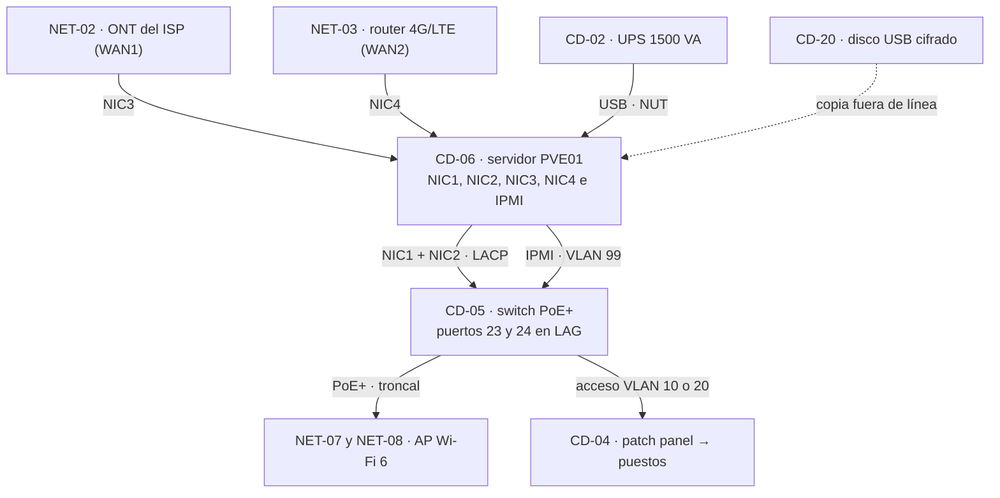
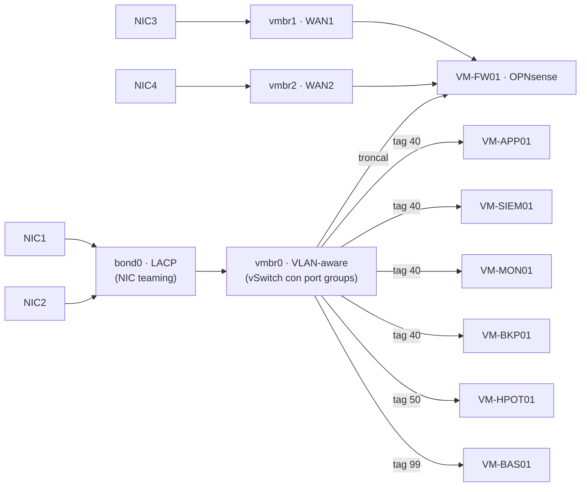
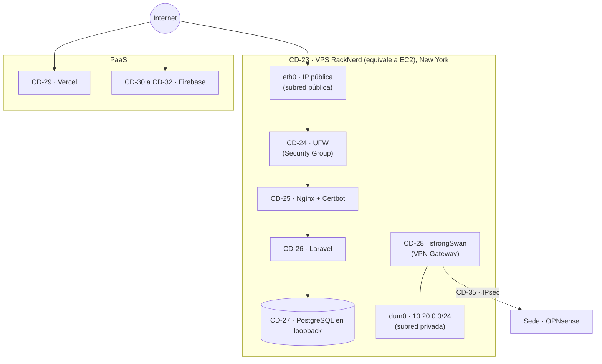
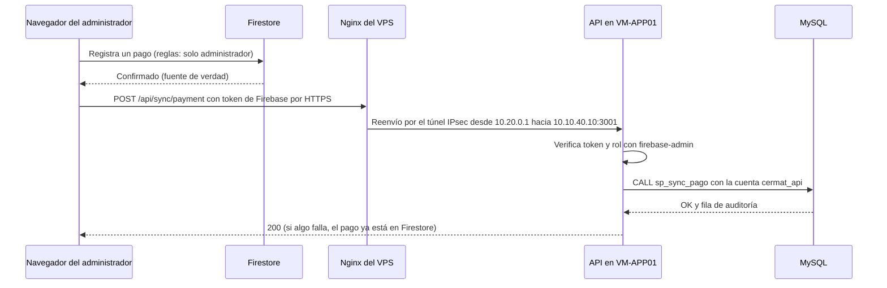

# S1-E2 · Análisis y Diseño de Centro de Datos Híbrido (CE0331)

!!! abstract "CE0331 — Diseño de centro de datos"
    Arquitectura on-premise virtualizada (Proxmox VE, equivalente a VMware ESXi), arquitectura de nube (VPS de RackNerd equivalente a EC2 en una VPC, más PaaS), integración híbrida, dimensionamiento, disponibilidad y continuidad. Documento de **análisis y diseño, sin implementación**: el despliegue y el control se documentan en [S2-E3](s2-e3-implementacion-control-cd-ce0332-ce0333.md). El diseño de red asociado está en [S1-E1](s1-e1-analisis-diseno-red-ce0311.md).

## Portada

| Campo | Detalle |
|---|---|
| Título | Análisis y diseño del centro de datos híbrido de CERMAT |
| Entregable | Semestre 1 · Entregable 2 · CE0331 |
| Estudiantes | David Robert Yucra Mamani (líder), Gladys Rosaura Yana Pari, Denilson Leeke Mamani Flores, Cárdenas Vilca Rennzo |
| Semestre | 2026-2 (9° ciclo), UPeU campus Juliaca, sección g1 |
| Fecha | 2026-10-24 |
| Versión | 2.0 |
| Organización | CERMAT, Azángaro (Puno, Perú) |

**Control de versiones**

| Versión | Fecha | Cambio |
|---|---|---|
| 1.0 | 2026-07-06 | Diseño de rack, Tier y dimensionamiento de un servidor local con contenedores (estructura anterior de la guía) |
| 2.0 | 2026-10-24 | Reescrito según la guía vigente: hipervisor, VM, nube con equivalencias AWS, integración híbrida, RTO/RPO por servicio y matriz de componentes |

**Productos obligatorios**

| Producto | Formato entregado | Ubicación | Criterio de aceptación (guía) |
|---|---|---|---|
| Informe de análisis y diseño de centro de datos híbrido | Página versionada en Git; PDF desde la vista de impresión | Este documento | Completo, versionado y coherente con la organización |
| Diagramas de arquitectura | draw.io editable de 3 páginas y Mermaid | [arquitectura-centro-datos-hibrido.drawio](../assets/infraestructura/diagramas/arquitectura-centro-datos-hibrido.drawio) | Topología física on-premise, hipervisor y nube (VPC/AWS equivalente) |
| Matriz de componentes y dimensionamiento | XLSX y secciones 9 y 10 | [s1-e2-matriz-componentes-dimensionamiento.xlsx](../assets/infraestructura/s1-e2-matriz-componentes-dimensionamiento.xlsx) | 100 % de los elementos dibujados (36) y sustento del dimensionamiento |

## 1. Resumen ejecutivo del diseño del centro de datos híbrido

**Problema.** La capa relacional de la academia (API Node.js, MySQL 8 y analítica FastAPI) corre en una PC con PM2. Ese equipo no está pensado para servicio continuo: sin redundancia de disco, sin UPS y con respaldos en el mismo disco que la base. Además, solo sincroniza cuando está encendido. El sistema del colegio está en un VPS de 2 GB de RAM sin respaldo externo. No hay dónde alojar los servicios de seguridad que pide la línea (firewall, SIEM, honeypot, monitoreo y respaldo).

**Solución.**

- **On-premise:** un rack de 12U en la sede principal con un host **Proxmox VE** (equivalente a ESXi) de 8 núcleos, 64 GB ECC, espejo ZFS de 2×1 TB y un HDD de 4 TB para respaldos. Corre 7 VM: OPNsense con Suricata, servidor de aplicaciones, Wazuh, monitoreo, Proxmox Backup Server, honeypot y bastión. UPS con apagado ordenado y doble enlace de Internet.
- **Nube IaaS:** se reutiliza el **VPS de RackNerd** ya contratado (US$ 35,99 al año), equivalente a una instancia EC2 en una VPC: UFW como Security Group, una red interna 10.20.0.0/24 como subred privada y strongSwan como VPN Gateway.
- **Nube PaaS:** Vercel para la plataforma y Firebase para identidad y datos; siguen siendo la vía crítica de la operación.

**Dimensionamiento.** Las VM suman 14 vCPU, 24 GB de RAM y 344 GB de disco. Con el sistema, el host compromete 30 de 64 GB (47 %) y 38 % del espejo, con margen para una VM de pruebas y para absorber el sistema del colegio si los 2 GB del VPS no alcanzan.

**Disponibilidad.** Tier I con elementos de Tier II. Si la sede falla, la matrícula, los pagos y la asistencia siguen en la nube. RTO de 1 h y RPO de 24 h para la base relacional.

**Siguientes pasos.** Cotizar y adquirir el hardware; mientras tanto, implantar en S2-E3 los respaldos del VPS y de Firestore y validar el diseño en un laboratorio.

| Cifra del diseño | Valor |
|---|---:|
| Componentes del centro de datos | 36 |
| VM planeadas | 7 |
| vCPU / RAM / disco de VM | 14 / 24 GB / 344 GB |
| RAM del host comprometida | 30 de 64 GB (47 %) |
| Costo de licencias de software on-premise | US$ 0 (software libre) |

## 2. Descripción de la organización y necesidades de infraestructura

### 2.1 Servicios a alojar

| Servicio | Hoy | Destino del diseño | Motivo |
|---|---|---|---|
| Plataforma de la academia (SPA) | Vercel | Vercel | HTTPS y reversión de despliegues gestionados; sin servidor que mantener |
| Identidad y datos operativos | Firebase | Firebase | Fuente de verdad con reglas por rol; tiempo real |
| API de sincronización, MySQL y analítica | PC local con PM2 | VM-APP01 (sede), publicada por el VPS | Servicio 24/7, respaldos 3-2-1 y aislamiento en la VLAN 40 |
| Sistema del colegio | VPS | VPS | Ya en producción con TLS y firewall |
| Firewall, IDS/IPS y VPN | No existe | VM-FW01 (sede) | Perímetro y segmentación de la sede |
| SIEM | No existe | VM-SIEM01 (sede) | Registros centralizados y correlación |
| Monitoreo | No existe | VM-MON01 (sede) | Disponibilidad, certificados y capacidad |
| Respaldo | Script en la PC local | VM-BKP01 (sede) + copias cruzadas | Regla 3-2-1 |
| Honeypot | No existe | VM-HPOT01 (sede, DMZ) | Detección de ataques |
| Bastión | No existe | VM-BAS01 (sede, gestión) | Único punto de administración por SSH |

### 2.2 Información gestionada

| Información | Clasificación | Dónde reside |
|---|---|---|
| Datos personales de alumnos (incluidos menores) y apoderados | Restringida | Firestore; réplica en MySQL |
| Pagos y matrículas | Restringida | Firestore; réplica en MySQL con auditoría |
| Asistencia | Confidencial | Firestore; réplica en MySQL |
| Datos del colegio | Restringida | PostgreSQL en el VPS |
| Registros de eventos y alertas | Confidencial | VPS, VM y Wazuh |
| Respaldos | Restringida | VM-BKP01, VPS y disco externo cifrado |

### 2.3 Uso previsto de la nube y del entorno local

Va a la **nube** lo que debe estar disponible para usuarios externos sin depender de la sede (portales, identidad y datos operativos) y lo que ya opera allí (el sistema del colegio). Queda en el **entorno local** lo que maneja copias completas de datos personales para reportes y auditoría (MySQL), lo que necesita ver el tráfico de la sede (firewall, IDS, honeypot) y lo que conviene tener cerca del personal técnico (SIEM, monitoreo y respaldo). La capa de la academia no se lleva al VPS porque compartiría 2 GB de RAM con el sistema del colegio (sección 10.5).

### 2.4 Crecimiento estimado

La plataforma está en piloto (8 matrículas y 8 perfiles al 2026-10-24). El dimensionamiento no extrapola esas cifras: reserva capacidad para crecer en usuarios, en agentes de seguridad y en una sede adicional (sección 10.4), con los supuestos de la sección 10.6.

## 3. Alcance del diseño

| Límite | Incluye |
|---|---|
| Físico | Cuarto de equipos y rack de la sede principal de Azángaro; VPS en el centro de datos del proveedor (New York) |
| Tecnológico | Hipervisor, VM, almacenamiento, respaldo, energía, enlaces, VPS y su integración con los servicios PaaS |
| Organizacional | Servicios de la academia y la infraestructura que comparte con el colegio |

| Exclusión | Justificación |
|---|---|
| Clúster de hipervisores y almacenamiento compartido (SAN) | Costo y escala; el host único se acepta con mitigaciones (riesgo R-18) |
| Segundo centro de datos propio para recuperación | La nube (VPS y PaaS) cumple el papel de sitio externo para copias y servicios críticos |
| Migración del sistema del colegio | Es otro proyecto; el diseño solo deja capacidad para hacerla |
| Cuenta de AWS | No se dispone de ella; se usa la equivalencia técnica con el VPS (AWS Academy como alternativa no usada) |

## 4. Objetivos medibles

| ID | Objetivo | Meta | Verificación |
|---|---|---|---|
| OBJ-C1 | Dimensionar el host con margen | ≤ 50 % de RAM comprometida y ≤ 1 vCPU por hilo en el año 1 (47 % y 0,88) | Capacidad del host (sección 10.3) y Netdata en S2 |
| OBJ-C2 | Arquitectura de nube costo-eficiente | Reutilizar el VPS (US$ 35,99 al año), PaaS en el plan actual y US$ 0 en licencias on-premise | Inventario de proveedores |
| OBJ-C3 | Disponibilidad mínima | 99 % mensual en servicios internos (máximo ≈ 7,3 h de caída al mes); PaaS según el SLA del proveedor | Uptime Kuma (S2-E3) |
| OBJ-C4 | RTO/RPO preliminar | MySQL: RTO 1 h y RPO 24 h; colegio: RTO 8 h y RPO 24 h; Firestore: RTO 4 h y RPO 24 h; SPA: RTO 15 min | Registro de recuperación (S2-E3) |
| OBJ-C5 | No saturar el VPS | MemAvailable ≥ 25 % en hora pico tras agregar los componentes de integración | `free -m` y Netdata |
| OBJ-C6 | Recuperar una VM | Restaurar VM-APP01 desde PBS en ≤ 2 h | REC-07 |

## 5. Arquitectura on-premise

### 5.1 Topología física

Diagrama editable: [arquitectura-centro-datos-hibrido.drawio](../assets/infraestructura/diagramas/arquitectura-centro-datos-hibrido.drawio), página "Rack y topología física".

### 5.2 Rack

| Unidad | Equipo |
|---|---|
| U12 | CD-04 · patch panel Cat 6 de 24 puertos |
| U11 | Organizador horizontal |
| U10 | CD-05 · switch de 24 puertos PoE+ |
| U9 | Organizador horizontal |
| U8 | Bandeja con la ONT del ISP y el router 4G/LTE |
| U6–U7 | Libres para crecimiento |
| U4–U5 | CD-06 · servidor PVE01 (2U) |
| U3 | Bandeja para el disco USB cuando está en la sede |
| U1–U2 | CD-02 · UPS de 1500 VA (2U) |
| Posterior | CD-03 · regleta o PDU |

### 5.3 Firewall

El firewall perimetral es la VM **VM-FW01 (OPNsense con Suricata)**, con NIC físicas dedicadas para WAN1 (NIC3 → `vmbr1`) y WAN2 (NIC4 → `vmbr2`). Esos bridges no tienen IP del host, así que el hipervisor no queda expuesto a Internet. Arranca primero (orden 1). La contingencia ante una falla del host se describe en la sección 11.5.

### 5.4 Switches y puntos de acceso

| Equipo | Requisitos |
|---|---|
| Switch | 24 puertos GbE, al menos 4 con PoE+ (802.3at), 802.1Q, LACP (802.1AX), gestión web/SSH en VLAN 99, SNMPv3, protección de bucles y DHCP snooping |
| Puntos de acceso (2) | Wi-Fi 6 (802.11ax), varios SSID con VLAN, WPA3, aislamiento de clientes y alimentación PoE |

### 5.5 Almacenamiento

| Almacenamiento | Medio | Uso | Protección |
|---|---|---|---|
| `local-zfs` | 2×1 TB SSD en espejo | Discos de las 7 VM | Tolera la falla de un disco; verificación mensual (`zpool scrub`) |
| Datastore de PBS | HDD de 4 TB en paso directo a VM-BKP01 | Respaldos de VM y copias del VPS | Medio distinto del de las VM; verificación de respaldos programada |
| Disco externo | USB cifrado, rotación mensual | Copia fuera de línea y fuera de la sede | Cifrado completo; registro de custodia |

### 5.6 UPS y energía

| Equipo | Consumo típico (W) | Estado | Fuente |
|---|---|---|---|
| Servidor PVE01 (carga media) | 90–150 | Supuesto a validar | Hoja de datos del modelo elegido |
| Switch PoE+ con 2 AP | 30–60 | Supuesto a validar | Hoja de datos |
| ONT y router LTE | 10–20 | Supuesto a validar | Hoja de datos |
| **Total** | **130–230** | Supuesto a validar (SUP-06) | Suma |

Con un UPS de 1500 VA y unos 200 W de carga se estiman 20–30 minutos de autonomía (SUP-05). NUT, por USB, ordena el apagado cuando quedan 10 minutos o el 50 % de batería: primero el honeypot, el monitoreo y la VM de aplicaciones; luego Wazuh, PBS y el bastión; al final el firewall y el host.

### 5.7 Host de virtualización

| Elemento | Especificación | Justificación |
|---|---|---|
| CPU | 8 núcleos / 16 hilos con VT-x/AMD-V y VT-d/AMD-Vi | 14 vCPU planeadas; paso directo del HDD a PBS |
| RAM | 64 GB ECC (2×32 GB) | 30 GB comprometidos; ECC evita corrupción silenciosa con ZFS |
| Disco de VM | 2×1 TB SSD, de preferencia con protección ante pérdida de energía | Espejo ZFS con 38 % de uso inicial |
| Disco de respaldo | 1×4 TB HDD | Segundo medio de la regla 3-2-1 |
| Red | 4×1 GbE + puerto IPMI | 2 para el bond LACP; 1 por cada WAN |
| Formato | Torre o rack de 2U | Cabe en el rack de 12U |

### 5.8 Enlaces

| Enlace | Medio | Función |
|---|---|---|
| WAN1 | Fibra del ISP → ONT en modo puente → NIC3 | Salida principal; ancho de banda por confirmar (SUP-02) |
| WAN2 | Router 4G/LTE → NIC4 | Salida alterna con conmutación automática |
| Host ↔ switch | 2×1 GbE en LACP (NIC1 y NIC2) | Troncal de las 6 VLAN con redundancia |
| IPMI ↔ switch | 1 GbE en acceso VLAN 99 | Gestión fuera de banda |

### 5.9 Nivel de disponibilidad (Uptime Institute)

| Nivel | Disponibilidad de referencia | ¿Aplica a CERMAT? |
|---|---|---|
| Tier I | 99,671 % (≈ 28,8 h al año) | Base del diseño |
| Tier II | 99,741 % (≈ 22,7 h al año) | Se adoptan sus elementos de redundancia de componentes: UPS, doble WAN y espejo de discos |
| Tier III | 99,982 % | No: exige doble ruta de energía y mantenimiento concurrente |
| Tier IV | 99,995 % | No: tolerancia total a fallas, fuera de escala |

No se busca certificación. La sede es un cuarto de equipos (alineado con ANSI/TIA-942 Rated-1 con elementos de Rated-2), porque la disponibilidad de los servicios críticos la aportan los proveedores en la nube.

### 5.10 Ambiente y seguridad física

- Cuarto cerrado con llave, bitácora de ingreso y cámara orientada al rack, con aviso de videovigilancia (controles 7.1, 7.2 y 7.4).
- Temperatura de entrada entre 18 y 27 °C (rango recomendado por ASHRAE), con extracción o aire acondicionado dedicado y un sensor leído por Netdata.
- Extintor de CO2 cercano; el rack lejos de tuberías y ventanas (7.5).
- Cableado Cat 6 en canaletas y etiquetado (TIA-568 y TIA-606).

## 6. Diseño del hipervisor

### 6.1 Elección y equivalencia

| Criterio | VMware ESXi (referencia de la guía) | Proxmox VE (adoptado) |
|---|---|---|
| Licencia | Comercial; edición gratuita incierta tras la adquisición por Broadcom | Libre (AGPLv3); suscripción de soporte opcional |
| Conmutación virtual | vSwitch estándar con port groups | Linux bridge VLAN-aware |
| Agregación de enlaces | NIC teaming | bond 802.3ad |
| Almacenamiento | VMFS, NFS, vSAN | ZFS, LVM-thin, Ceph |
| Respaldo | Herramientas de terceros | vzdump y Proxmox Backup Server integrados |
| Firewall por VM | Requiere NSX (licencia aparte) | Integrado |
| Gestión | vSphere Client o vCenter | Interfaz web (8006) y CLI `qm` |

Proxmox VE cumple las mismas funciones que exige la guía (conmutadores virtuales, VLAN por VM, teaming y VM) sin costo de licencia. Si la institución obtiene una licencia de ESXi, el diseño se traslada uno a uno con la tabla de la sección 6.2.

### 6.2 Conmutadores virtuales, port groups y VLAN

| Red virtual (Proxmox) | Equivalente en ESXi | Uplink | VLAN | Uso |
|---|---|---|---|---|
| `vmbr0` (VLAN-aware) | vSwitch0 con port groups ADMIN, ACAD, GUEST, SRV, DMZ y MGMT | bond0 (NIC1 + NIC2) | 10, 20, 30, 40, 50, 99 | Troncal interna |
| `vmbr0.99` | Puerto VMkernel de gestión | bond0 | 99 | Gestión del host (10.10.99.10/27) |
| `vmbr1` | vSwitch1 "WAN1" | NIC3 | Sin VLAN | Solo VM-FW01 |
| `vmbr2` | vSwitch2 "WAN2" | NIC4 | Sin VLAN | Solo VM-FW01 |
| NIC virtual sin etiqueta con `trunks=10;20;30;40;50;99` | Port group troncal (VLAN 4095) | `vmbr0` | Todas | Interfaz interna de VM-FW01 |

### 6.3 NIC teaming

`bond0` agrupa NIC1 y NIC2 en modo 802.3ad (LACP) con hash `layer2+3` y supervisión de enlace cada 100 ms. En el switch, los puertos 23 y 24 forman un LAG con LACP activo. Si el switch elegido no soporta LACP, se usa `active-backup` (modo 1), que da redundancia sin agregación.

### 6.4 Máquinas virtuales planeadas

| VM | Rol | Red virtual | Orden de arranque |
|---|---|---|---|
| VM-FW01 | Firewall perimetral, IDS/IPS y VPN (OPNsense + Suricata) | `vmbr1`, `vmbr2` y troncal en `vmbr0` | 1 |
| VM-BAS01 | Bastión SSH | `vmbr0`, tag 99 | 2 |
| VM-SIEM01 | SIEM (Wazuh) | `vmbr0`, tag 40 | 3 |
| VM-APP01 | API Node.js, MySQL 8 y analítica FastAPI | `vmbr0`, tag 40 | 4 |
| VM-BKP01 | Proxmox Backup Server | `vmbr0`, tag 40 | 5 |
| VM-MON01 | Uptime Kuma y Netdata | `vmbr0`, tag 40 | 5 |
| VM-HPOT01 | Honeypot Cowrie | `vmbr0`, tag 50 | 6 |

Los recursos de cada VM (vCPU, RAM y disco) y su justificación están en la sección 10.2. Todas se inician solas al encender el host, en el orden indicado.

## 7. Arquitectura en la nube (equivalente a AWS)

### 7.1 Región

El VPS está en **New York (EE. UU.)**. Ya está contratado y en producción, cuesta US$ 35,99 al año y su latencia desde Perú es aceptable para aplicaciones web (supuesto a validar con `mtr`, SUP-04). Una región sudamericana reduciría la latencia a mayor costo y no es necesaria con el volumen actual. Los datos personales se alojan fuera del Perú (VPS, Firebase y Vercel), lo que el SGSI trata como transferencia internacional según la Ley N.° 29733 (riesgo R-24).

### 7.2 Equivalencias de la arquitectura AWS

| Elemento AWS (guía) | Implementación equivalente | Valor | Estado |
|---|---|---|---|
| VPC y CIDR | Espacio de nube 10.20.0.0/16 | 10.20.0.0/16 | Diseñado |
| Subred pública | Interfaz `eth0` del VPS con IP pública | IP pública del VPS | Implementado (provisto) |
| Subred privada | Interfaz `dum0` alcanzable solo por el túnel | 10.20.0.0/24 (10.20.0.1) | Diseñado |
| Route tables | Tabla `main` (salida por el gateway del proveedor) y tabla 220 (rutas IPsec) | — | Diseñado |
| Internet Gateway | Enrutamiento público del proveedor | — | Implementado (provisto) |
| NAT Gateway | No requerido: el VPS tiene IP pública; la sede usa NAT de OPNsense | — | No aplica |
| VPN Gateway | strongSwan IKEv2 | UDP 500/4500 | Diseñado |
| Instancia EC2 | VPS KVM | 2 vCPU, 2 GB, 35 GB SSD, Ubuntu 24.04 | Implementado |
| Security Group | UFW con estado | Entrada denegada; 22, 80 y 443/tcp | Implementado |
| NACL | Reglas nftables sin estado o filtro del proveedor | Ver sección 7.4 | Pendiente |

### 7.3 Instancia

El VPS aloja el sistema del colegio: Nginx sirve Angular y hace de proxy hacia PHP 8.4-FPM (Laravel), y PostgreSQL 16 escucha solo en loopback con un usuario de aplicación sin superusuario. La administración se hace con un usuario Linux no-root con sudo. El diseño le agrega la interfaz `dum0`, strongSwan, el proxy hacia la API de la academia, el agente Wazuh y un Netdata hijo.

### 7.4 Security Group y NACL

- **Security Group (UFW, con estado):** reglas UFW-01 a UFW-10 de [S1-E1 §13.6](s1-e1-analisis-diseno-red-ce0311.md). Se mantienen 80 y 443; se agregan UDP 500 y 4500 para la VPN; SSH pasa a permitirse solo desde el bastión por el túnel.
- **NACL (sin estado):** reglas nftables previas al filtrado con estado que descartan orígenes falsificados (redes de documentación y reservadas) y paquetes TCP con banderas inválidas. Si el panel de RackNerd ofrece un filtro de red, se usa como capa adicional (dato por confirmar). Antes de activarlas se valida que no afecten al tráfico IPsec desencapsulado.

### 7.5 Servicios PaaS

| Servicio | Uso | Controles | Por confirmar |
|---|---|---|---|
| Vercel | SPA de la academia | HTTPS con HSTS (verificado), reversión de despliegues, variables de entorno fuera del repositorio | Plan contratado (SUP-13) |
| Firebase Authentication | Identidad y claims de rol | Invitaciones de un solo uso; MFA para administradores (recomendado) | — |
| Cloud Firestore | 22 colecciones con reglas por rol | Reglas probadas con 19 casos; publicación por CI | Ubicación de la base y plan (SUP-11, SUP-12) |
| Firebase Storage | Imágenes y archivos | Reglas de acceso | — |

### 7.6 Alternativa en AWS Academy (no usada)

| Elemento | Configuración equivalente |
|---|---|
| VPC | 10.20.0.0/16 |
| Subred pública | 10.20.1.0/24 con Internet Gateway, instancia EC2 t3.small para Nginx y proxy |
| Subred privada | 10.20.0.0/24 para servicios internos |
| Site-to-Site VPN | Virtual Private Gateway ↔ OPNsense con los parámetros de S1-E1 §10 |
| Security Groups y NACL | Las reglas UFW y nftables de la sección 7.4 |

Su uso depende de los servicios habilitados en la cuenta educativa. No se ejecutó.

Diagrama editable: página "Nube IaaS y PaaS" de [arquitectura-centro-datos-hibrido.drawio](../assets/infraestructura/diagramas/arquitectura-centro-datos-hibrido.drawio).

## 8. Mecanismo de integración híbrida

| Integración | Mecanismo | Seguridad | Coherencia con S1-E1 |
|---|---|---|---|
| Red sede ↔ nube | Túnel IPsec IKEv2 OPNsense ↔ strongSwan | AES-256-GCM, PFS y certificados | §10, NET-27 |
| Publicación de la API de la academia | Nginx del VPS como proxy inverso hacia VM-APP01 por el túnel | TLS público, límite de peticiones, solo `/health` y `/api/` | Flujos F-03 y F-04, regla FW-70 |
| Identidad común | La API verifica los tokens de Firebase con `firebase-admin` | Sin segundo sistema de usuarios | Flujo F-05 |
| Réplica relacional | Sincronización no bloqueante desde el navegador; Firestore sigue siendo la fuente de verdad | Autorización por rol y titularidad en la API | Flujos F-02 y F-03 |
| Respaldos cruzados | La sede extrae los respaldos del VPS; el VPS guarda la copia cifrada de la sede | Modelo pull y cifrado con restic | Flujos F-10 y F-11 |
| Telemetría | Agente Wazuh y Netdata del VPS hacia la sede | Por el túnel, sin puertos públicos | Flujos F-15 y F-16 |

La aplicación ya permite cambiar la URL de la API y de la analítica desde el panel de administración (`config/services`); al implementar el proxy se apunta a los subdominios propuestos en lugar de `localhost`.

## 9. Matriz de componentes del centro de datos

| ID | Componente | Entorno | Tipo | Función | Criticidad | Estado al 2026-10-24 |
|---|---|---|---|---|---|---|
| CD-01 | Rack de 12U con puerta y cerradura | On-premise | Físico | Alojar equipos de red y cómputo | Alta | Diseñado |
| CD-02 | UPS de 1500 VA con interfaz de red o USB (NUT) | On-premise | Energía | Autonomía y apagado ordenado | Alta | Diseñado |
| CD-03 | Regleta o PDU de rack | On-premise | Energía | Distribución eléctrica | Media | Diseñado |
| CD-04 | Patch panel Cat 6 de 24 puertos y organizador | On-premise | Cableado | Terminación del cableado horizontal | Media | Diseñado |
| CD-05 | Switch gestionable de 24 puertos PoE+ (NET-06) | On-premise | Red | VLAN 802.1Q, LACP y PoE para los AP | Crítica | Diseñado |
| CD-06 | Servidor físico PVE01: 8 núcleos/16 hilos, 64 GB ECC, 2×1 TB SSD, 1×4 TB HDD, 4×1 GbE e IPMI | On-premise | Cómputo | Host de virtualización | Crítica | Diseñado |
| CD-07 | Proxmox VE (equivalente a VMware ESXi) | On-premise | Hipervisor | Ejecutar y aislar las VM | Crítica | Diseñado |
| CD-08 | bond0: LACP 802.3ad sobre NIC1 y NIC2 (equivale a NIC teaming) | On-premise | Red virtual | Agregación y redundancia de enlaces | Alta | Diseñado |
| CD-09 | vmbr0: bridge VLAN-aware sobre bond0 con VLAN 10, 20, 30, 40, 50 y 99 (equivale a vSwitch con port groups) | On-premise | Red virtual | Conmutador virtual troncal | Crítica | Diseñado |
| CD-10 | vmbr1 (NIC3, WAN1) y vmbr2 (NIC4, WAN2), sin IP del host | On-premise | Red virtual | Entregar los enlaces de Internet solo al firewall virtual | Alta | Diseñado |
| CD-11 | VM-FW01: OPNsense con Suricata | On-premise | VM | Firewall perimetral virtual, IDS/IPS y VPN | Crítica | Diseñado |
| CD-12 | VM-APP01: API Node.js, MySQL 8 y analítica FastAPI con PM2 | On-premise | VM | Réplica relacional, reportes y analítica | Alta | Diseñado (hoy en la PC local) |
| CD-13 | VM-SIEM01: Wazuh (indexador, servidor y panel) | On-premise | VM | SIEM | Alta | Diseñado |
| CD-14 | VM-MON01: Uptime Kuma y Netdata (padre) | On-premise | VM | Disponibilidad y métricas | Media | Diseñado |
| CD-15 | VM-BKP01: Proxmox Backup Server | On-premise | VM | Respaldos deduplicados y verificados | Alta | Diseñado |
| CD-16 | VM-HPOT01: Cowrie | On-premise | VM | Honeypot en la DMZ | Media | Diseñado |
| CD-17 | VM-BAS01: bastión SSH | On-premise | VM | Administración centralizada | Alta | Diseñado |
| CD-18 | Almacenamiento local-zfs (espejo de 2×1 TB SSD) | On-premise | Almacenamiento | Discos de las VM; tolera la falla de un disco | Crítica | Diseñado |
| CD-19 | Datastore de respaldos (HDD de 4 TB) | On-premise | Almacenamiento | Segunda copia en un medio distinto | Alta | Diseñado |
| CD-20 | Disco externo USB cifrado (rotación mensual) | On-premise / fuera de la sede | Almacenamiento | Copia fuera de línea (regla 3-2-1) | Media | Diseñado |
| CD-21 | Enlace de fibra (NET-01) | On-premise | Conectividad | Salida principal | Alta | Existente (por confirmar) |
| CD-22 | Enlace 4G/LTE (NET-03) | On-premise | Conectividad | Salida alterna | Media | Diseñado |
| CD-23 | VPS RackNerd KVM: 2 vCPU, 2 GB RAM, 35 GB SSD, New York (equivale a EC2) | Nube IaaS | Cómputo | Servidor del colegio y extremo VPN | Crítica | Implementado |
| CD-24 | Ubuntu 24.04 LTS con UFW (equivale a Security Group) | Nube IaaS | SO y seguridad | Base con firewall de host | Crítica | Implementado |
| CD-25 | Nginx con Certbot (Let's Encrypt) | Nube IaaS | Servicio web | HTTPS, redirección y proxy inverso | Crítica | Implementado |
| CD-26 | Sistema del colegio: Angular y Laravel (PHP 8.4-FPM) | Nube IaaS | Aplicación | Gestión escolar | Alta | Implementado |
| CD-27 | PostgreSQL 16 solo en loopback, usuario de aplicación sin superusuario | Nube IaaS | Base de datos | Datos del colegio | Crítica | Implementado |
| CD-28 | strongSwan e interfaz dum0 10.20.0.1 (equivale a VPN Gateway y subred privada) | Nube IaaS | Red | Extremo del túnel IPsec | Alta | Diseñado |
| CD-29 | Vercel: SPA de la academia | Nube PaaS | Hosting | Entrega web con HTTPS y reversión de despliegues | Crítica | Implementado |
| CD-30 | Firebase Authentication con claims por rol | Nube PaaS | Identidad | Autenticación y roles | Crítica | Implementado |
| CD-31 | Cloud Firestore (22 colecciones con reglas por rol) | Nube PaaS | Base de datos | Fuente de verdad operativa | Crítica | Implementado (reglas corregidas sin publicar) |
| CD-32 | Firebase Storage | Nube PaaS | Archivos | Imágenes y archivos | Media | Implementado |
| CD-33 | GitHub: repositorios y Actions (CI de 6 trabajos) | Nube SaaS | Código y CI | Control de versiones y verificación | Media | Implementado (primera ejecución en GitHub pendiente) |
| CD-34 | DNS autoritativo Punto.pe/RCP (equivale a Route 53) | Proveedor | DNS | Resolución del dominio | Alta | Implementado |
| CD-35 | Túnel IPsec sede ↔ VPS (NET-27) | Híbrido | Integración | Respaldo, administración, monitoreo y proxy | Alta | Diseñado |
| CD-36 | PC local actual con PM2 (API, MySQL y analítica) | On-premise (actual) | Cómputo | Servicio transitorio hasta VM-APP01 | Media | Implementado (transitorio) |

## 10. Dimensionamiento y capacidad

### 10.1 Carga esperada

La carga actual es baja: 8 matrículas, 2 pagos y 7 registros de asistencia en Firestore, y un respaldo de MySQL de 47 KB con datos de prueba. La capacidad la definen los servicios de seguridad, no la aplicación: Wazuh es la VM más exigente según los requisitos publicados por su fabricante.

### 10.2 Dimensionamiento de las VM

| VM | Rol | Sistema | vCPU | RAM (GB) | Disco (GB) | Red | Justificación |
|---|---|---|---|---|---|---|---|
| VM-FW01 | Firewall, IDS/IPS y VPN | OPNsense (serie estable vigente) | 2 | 4 | 40 | vmbr1, vmbr2 y vmbr0 (troncal) | Suricata en modo IPS sobre dos WAN y tabla de estados; holgura para las reglas ET Open |
| VM-APP01 | API, MySQL y analítica | Ubuntu Server 24.04 LTS | 2 | 4 | 60 | VLAN 40 | Carga actual baja (8 matrículas y 7 registros de asistencia); buffer pool de MySQL de 1 GB; Node y Python |
| VM-SIEM01 | SIEM | Wazuh 4.x todo en uno sobre Ubuntu 24.04 | 4 | 8 | 150 | VLAN 40 | Requisito publicado por Wazuh para 1–25 agentes (4 vCPU, 8 GB, 50 GB por 90 días) más margen de retención |
| VM-MON01 | Monitoreo | Ubuntu 24.04 con Docker | 2 | 2 | 30 | VLAN 40 | Uptime Kuma y Netdata padre con retención corta |
| VM-BKP01 | Respaldo | Proxmox Backup Server | 2 | 4 | 32 | VLAN 40 (+ HDD de 4 TB) | Deduplicación, verificación y restauración de VM |
| VM-HPOT01 | Honeypot | Debian 12 mínimo con Cowrie | 1 | 1 | 16 | VLAN 50 | Interacción media, sin servicios reales |
| VM-BAS01 | Bastión | Debian 12 mínimo | 1 | 1 | 16 | VLAN 99 | Solo SSH con llaves y registro de sesiones |
| Total VM |  |  | 14 | 24 | 344 (+ 4 TB de respaldo) |  |  |

### 10.3 Capacidad del host y margen

| Recurso | Capacidad del host | Comprometido (año 1) | Utilización | Margen | Criterio de diseño |
|---|---|---|---|---|---|
| CPU | 16 hilos (8 núcleos) | 14 vCPU | 0,88 vCPU por hilo | Admite sobresuscripción hasta 2:1 en cargas ligeras | ≤ 2 vCPU por hilo |
| RAM | 64 GB ECC | 30 GB (24 de VM + 6 de sistema y ARC de ZFS) | 47 % | 53 % | ≤ 70 % comprometido; sin sobresuscripción de RAM |
| Disco de VM | ~900 GB útiles (espejo 2×1 TB) | 344 GB (aprovisionamiento delgado) | 38 % | 62 % | ≤ 70 % (ZFS pierde rendimiento sobre el 80 %) |
| Respaldo | 4 TB (HDD dedicado) | ~0,5 TB (supuesto: 7 diarios, 4 semanales y 6 mensuales deduplicados) | ~13 % (supuesto) | ~87 % | Verificar con el informe de deduplicación de PBS |
| Red | 2 Gb/s (bond LACP) + 2 WAN | < 100 Mb/s (supuesto) | < 5 % | > 95 % | Medir con Netdata en S2 |

### 10.4 Margen de crecimiento

| Escenario | Recursos adicionales | RAM comprometida resultante | ¿Cabe en el host? |
|---|---|---|---|
| VM de pruebas (staging) de la plataforma | 2 vCPU, 4 GB, 60 GB | 34 GB (53 %) | Sí |
| Migrar el sistema del colegio desde el VPS si 2 GB no alcanzan | 2 vCPU, 4 GB, 60 GB | 38 GB (59 %), sumado al anterior | Sí |
| Wazuh con 26–50 agentes (otras sedes) | +4 vCPU, +100 GB de disco | Sin cambio de RAM | Sí (CPU sobresuscrita 1,5:1) |
| Segunda sede conectada por VPN al VPS | Sin VM nuevas (bloque 10.11.0.0/16) | Sin cambio | Sí |

Con todos los escenarios, el host llega al 59 % de RAM comprometida, por debajo del límite de diseño del 70 %. Comprar 32 GB dejaría el año 1 en 94 % sin margen; por eso se eligen 64 GB.

### 10.5 Límite real del VPS

| Componente | RAM estimada (MB) | Estado | Fuente o forma de validar |
|---|---|---|---|
| Ubuntu 24.04 base (systemd, sshd, journald, cron) | 250 | Supuesto a validar | Estimación del equipo; medir con free -m y ps -eo rss,comm --sort=-rss |
| Nginx (maestro y 2 workers) | 20 | Supuesto a validar | ps -C nginx -o rss= |
| PHP 8.4-FPM (pm dinámico, ~5 procesos) | 200 | Supuesto a validar | ps -C php-fpm8.4 -o rss= |
| PostgreSQL 16 (shared_buffers de 128 MB por defecto y conexiones) | 250 | Supuesto a validar | ps -u postgres -o rss=; SHOW shared_buffers; |
| Subtotal actual estimado | 720 | Supuesto a validar | Línea base que se mide antes de agregar componentes |
| strongSwan (charon) | 15 | Supuesto a validar | Medir tras instalar |
| Agente Wazuh | 50 | Supuesto a validar | Medir tras instalar |
| Netdata hijo sin base local (streaming) | 60 | Supuesto a validar | Alternativa más ligera: node_exporter (~15 MB) |
| Total proyectado | 845 de 2048 (≈ 41 %) | Supuesto a validar | Aceptación: MemAvailable ≥ 25 % en hora pico |
| Capa de la academia (API Node, MySQL 8 y FastAPI) | ≈ 600 (supuesto) | Excluida del VPS | Se aloja on-premise en VM-APP01 (riesgo R-08) |

**Decisión:** el VPS solo recibe componentes ligeros (strongSwan, agente Wazuh y Netdata en modo streaming). La capa de la academia, que con MySQL 8, Node y FastAPI necesitaría unos 600 MB adicionales (supuesto), va a VM-APP01. Si la línea base medida deja menos del 25 % de memoria disponible en hora pico, se retira Netdata del VPS y se evalúa ampliar el plan o mover el sistema del colegio al host (escenario de crecimiento).

### 10.6 Supuestos

| ID | Supuesto | Valor | Estado | Fuente |
|---|---|---|---|---|
| SUP-01 | Equipos simultáneos en la sede principal | 12–18 | Supuesto a validar | Levantamiento preliminar del equipo (jun-2026), sin medición |
| SUP-02 | Ancho de banda del enlace principal | ≥ 50 Mb/s | Supuesto a validar | Diseño de junio; confirmar con el contrato del ISP y una prueba de velocidad |
| SUP-03 | Tipo de IP pública de la sede | Desconocido (fija, dinámica o CGNAT) | Dato a confirmar | Consultar al ISP; condiciona la exposición del honeypot. El túnel siempre lo inicia la sede |
| SUP-04 | Latencia sede ↔ VPS (New York) | 90–150 ms | Supuesto a validar | Estimación; medir con mtr desde la sede |
| SUP-05 | Autonomía del UPS con la carga del rack (~200 W) | 20–30 min | Supuesto a validar | Hoja de datos del modelo elegido |
| SUP-06 | Consumo eléctrico del rack | 150–250 W | Supuesto a validar | Suma de consumos típicos de host, switch PoE, ONT y router LTE |
| SUP-07 | Volumen de datos de MySQL | < 100 MB en 3 años | Supuesto a validar | Respaldo actual de 47 KB con datos de prueba; 8 matrículas reales |
| SUP-08 | Crecimiento de usuarios | Piloto con 8 perfiles; cada VLAN /24 admite hasta 253 equipos | Supuesto a validar | Conteos agregados de Firestore al 2026-10-24 |
| SUP-09 | Retención de eventos en Wazuh | 90 días | Supuesto a validar | Requisito de Wazuh (50 GB por 90 días para 1–25 agentes) |
| SUP-10 | Frecuencia de cortes eléctricos en la sede | Frecuentes (no medido) | Supuesto a validar | Percepción del personal; registrar los eventos del UPS durante 3 meses |
| SUP-11 | Ubicación de los datos de Firestore | Desconocida | Dato a confirmar | Consola de Firebase (ubicación de la base) |
| SUP-12 | Plan de facturación de Firebase | Desconocido (Spark o Blaze) | Dato a confirmar | Condiciona la exportación programada gestionada |
| SUP-13 | Plan de Vercel | Desconocido | Dato a confirmar | El plan Hobby está limitado a uso personal no comercial según los términos del proveedor |
| SUP-14 | Uso real de RAM y disco del VPS | Ver presupuesto de RAM | Supuesto a validar | free -m y df -h en el VPS |

## 11. Disponibilidad y continuidad

### 11.1 Redundancia

| Componente | Redundancia | Falla tolerada |
|---|---|---|
| Discos de las VM | Espejo ZFS | Un disco |
| Enlace host ↔ switch | bond LACP | Un cable o un puerto |
| Internet de la sede | WAN1 y WAN2 con conmutación | Caída de un proveedor |
| Energía | UPS con NUT | Cortes de hasta 20–30 min (supuesto) con apagado ordenado |
| Host | Sin redundancia (aceptado, R-18) | Los servicios críticos siguen en la nube; se restaura desde PBS en hardware de reemplazo |
| VPS | Sin redundancia; respaldo diario en la sede | Reconstrucción en ≤ 8 h |
| PaaS | Redundancia del proveedor | Según el SLA del plan contratado |

### 11.2 Respaldo previsto (regla 3-2-1)

| Datos | Copia 1 | Copia 2 (otro medio) | Copia 3 (fuera del sitio) | Frecuencia | Retención |
|---|---|---|---|---|---|
| MySQL (VM-APP01) | `backup.js` en la VM (7 copias con SHA-256) | PBS en el HDD de 4 TB | VPS por el túnel, cifrada con restic | Diaria, 02:00 | 7 diarias, 4 semanales y 6 mensuales |
| PostgreSQL del colegio | `pg_dump -Fc` en el VPS (7 copias) | VM-BKP01 en la sede (extracción por el túnel) | Disco externo cifrado, rotación mensual | Diaria, 01:30 | 7 diarias, 4 semanales y 6 mensuales |
| Firestore y usuarios de Auth | Exportación diaria | VM-BKP01 | Disco externo cifrado | Diaria | 30 días |
| VM completas | vzdump hacia PBS | Datastore en el HDD dedicado | Disco externo cifrado (semanal) | Diaria | 7 diarias, 4 semanales y 3 mensuales |
| Configuraciones (OPNsense, swanctl, Nginx, Proxmox) | Repositorio Git sanitizado | PBS | Disco externo | En cada cambio | Historial completo |

### 11.3 RTO y RPO objetivo por servicio

| Servicio | Ubicación | Criticidad | RTO objetivo | RPO objetivo | Mecanismo de recuperación | Validación (S2) |
|---|---|---|---|---|---|---|
| Plataforma web (SPA) | Vercel | Crítica | 15 min | 0 (código en Git) | Promover el despliegue anterior en Vercel o revertir el commit | REC-10 |
| Identidad (Firebase Auth) | Firebase | Crítica | Según el proveedor | Según el proveedor | Exportación semanal de usuarios (firebase auth:export), cifrada | REC-11 |
| Datos operativos (Firestore) | Firebase | Crítica | 4 h | 24 h | Exportación diaria programada y restauración en un proyecto de prueba | REC-11 |
| API de sincronización y MySQL | VM-APP01 (hoy PC local) | Alta | 1 h | 24 h | backup.js diario y restore.js; resincronización desde Firestore | REC-01 a REC-05 |
| Analítica | VM-APP01 | Baja | 24 h | 24 h | Redespliegue desde Git | REC-07 |
| Sistema del colegio (web, API y PostgreSQL) | VPS | Alta | 8 h (reconstrucción completa); 2 h (solo base) | 24 h | pg_dump -Fc diario con SHA256SUMS y copia en la sede | REC-06, REC-08 |
| VPN sitio a sitio | OPNsense ↔ VPS | Media | 1 h (reconexión automática ≤ 2 min) | No aplica | DPD y reintento; configuración versionada | REC-09 |
| Firewall perimetral | VM-FW01 | Crítica para la sede | 2 h | Último config.xml | Restaurar config.xml en una VM nueva; contingencia con el router del ISP | REC-12 |
| SIEM (Wazuh) | VM-SIEM01 | Media | 24 h | 24 h | Restaurar la VM desde PBS | REC-07 |
| Monitoreo (Uptime Kuma y Netdata) | VM-MON01 | Media | 8 h | 24 h | Restaurar la VM desde PBS | REC-07 |

El RTO de 1 h de la base relacional coincide con el objetivo del Project Charter del [E4 de Ingeniería de Software](../e4-calidad-operacion-ce024.md).

### 11.4 Validación esperada en el Semestre 2

| Prueba | Qué demuestra | Criterio de aceptación |
|---|---|---|
| REC-01 a REC-05 | Restauración de MySQL con verificación de integridad | RTO < 1 h; filas, rutinas, triggers y vistas completos |
| REC-06 | Restauración de PostgreSQL del colegio | Base de verificación con las 116 migraciones registradas |
| REC-07 | Recuperación de una VM desde PBS | VM-APP01 responde `/health` en ≤ 2 h |
| REC-08 | Reconstrucción del VPS | Web y API del colegio en ≤ 8 h en un entorno de prueba |
| REC-09 | Recuperación del túnel | Reconexión automática en ≤ 2 min |
| REC-10 a REC-12 | Reversión del frontend, Firestore y firewall | Dentro de los RTO de la tabla 11.3 |

### 11.5 Contingencia de la sede

Si el host PVE01 falla:

1. El personal sigue operando matrícula, pagos y asistencia desde la nube con cualquier conexión; puede usar el router 4G/LTE como punto de acceso.
2. El encargado de TI pasa el router del ISP a modo router para dar Internet a las estaciones administrativas, sin acceso a servidores.
3. Las VM se restauran desde PBS o desde el disco externo en hardware de reemplazo, en este orden: VM-FW01, VM-APP01 y las demás.
4. La réplica MySQL se reconcilia con Firestore usando `v_conciliacion_pagos` y una resincronización.

## 12. Conclusiones, hoja de ruta y referencias

### 12.1 Conclusiones

1. El reparto on-premise/nube sigue un criterio explícito: lo que debe estar siempre disponible para usuarios externos queda en la nube; lo que maneja copias completas de datos personales o necesita ver la red de la sede queda on-premise.
2. Un solo host de 64 GB aloja las 7 VM con 47 % de RAM comprometida y deja margen para pruebas, más agentes y la eventual migración del sistema del colegio.
3. La nube reutiliza un VPS existente con equivalencia directa a EC2, Security Group y VPN Gateway, y mantiene el costo de licencias on-premise en cero.
4. Cada servicio tiene RTO y RPO con un mecanismo y una prueba de validación asignados para el Semestre 2.

### 12.2 Hoja de ruta

| Fase | Plazo | Actividades |
|---|---|---|
| Continuidad inmediata | Hasta 2026-11-21 | Respaldos del VPS y de Firestore, línea base de RAM del VPS, monitoreo transitorio |
| Laboratorio (opcional) | Hasta 2026-11-21 | Proxmox de laboratorio con las 7 VM para ensayar el despliegue y las pruebas REC |
| Adquisición | 2027-I | Cotizar y comprar host, switch, AP, UPS y discos |
| Despliegue | Tras la adquisición | Instalar Proxmox, crear las VM, migrar la API a VM-APP01 y activar el túnel |
| Operación | Continuo | Restauraciones de prueba mensuales y revisión de capacidad trimestral |

### 12.3 Referencias

[1] Uptime Institute, "Tier Standard: Topology," Uptime Institute, 2018.

[2] *Telecommunications Infrastructure Standard for Data Centers*, ANSI/TIA-942-B, 2017.

[3] ASHRAE TC 9.9, *Thermal Guidelines for Data Processing Environments*, 5.ª ed. Atlanta, GA, EE. UU.: ASHRAE, 2021.

[4] Proxmox Server Solutions GmbH, "Proxmox VE Administration Guide." [En línea]. Disponible en: https://pve.proxmox.com/pve-docs/

[5] Proxmox Server Solutions GmbH, "Proxmox Backup Server Documentation." [En línea]. Disponible en: https://pbs.proxmox.com/docs/

[6] VMware by Broadcom, "vSphere Networking." [En línea]. Disponible en: https://techdocs.broadcom.com/

[7] Amazon Web Services, "Amazon VPC User Guide." [En línea]. Disponible en: https://docs.aws.amazon.com/vpc/

[8] Wazuh Inc., "Wazuh Quickstart: requirements." [En línea]. Disponible en: https://documentation.wazuh.com/

[9] M. Swanson, P. Bowen, A. W. Phillips, D. Gallup y D. Lynes, "Contingency Planning Guide for Federal Information Systems," NIST SP 800-34 Rev. 1, may. 2010.

[10] E. Barker, Q. Dang, S. Frankel, K. Scarfone y P. Wouters, "Guide to IPsec VPNs," NIST SP 800-77 Rev. 1, jun. 2020.

[11] restic authors, "restic Documentation." [En línea]. Disponible en: https://restic.readthedocs.io/

[12] Google, "Export and import data — Cloud Firestore." [En línea]. Disponible en: https://firebase.google.com/docs/firestore/manage-data/export-import

## Anexos

| Anexo | Contenido | Ubicación |
|---|---|---|
| A | Diagrama editable de 3 páginas: rack y topología física, hipervisor y nube | [arquitectura-centro-datos-hibrido.drawio](../assets/infraestructura/diagramas/arquitectura-centro-datos-hibrido.drawio) |
| B | Matriz de componentes, dimensionamiento, capacidad, crecimiento, RAM del VPS, supuestos y RTO/RPO | [s1-e2-matriz-componentes-dimensionamiento.xlsx](../assets/infraestructura/s1-e2-matriz-componentes-dimensionamiento.xlsx) |
| C | Equivalencias tecnológicas de la línea | [Resumen del área](index.md) |
| D | Costos: el único costo real conocido es el VPS (US$ 35,99 al año); las licencias de software on-premise cuestan US$ 0; el hardware está por cotizar y no hay presupuesto aprobado | — |

## Rúbrica de evaluación

| N° | Criterio de evaluación | Peso |
| ---: | --- | ---: |
| 1 | Contexto y alcance del diseño de infraestructura | 8% |
| 2 | Diseño de arquitectura on-premise (VMware ESXi) | 22% |
| 3 | Diseño de arquitectura AWS | 22% |
| 4 | Mecanismo de integración híbrida | 10% |
| 5 | Dimensionamiento, capacidad y justificación técnica | 12% |
| 6 | Matriz de componentes y trazabilidad | 10% |
| 7 | Disponibilidad y continuidad en el diseño | 8% |
| 8 | Calidad documental y sustentación | 8% |
|  | **Total** | **100%** |

Escala: Excelente 4, Logrado 3, En proceso 2, Insuficiente 1 y No evidenciado 0. Puntaje = peso × (nivel / 4).

**Dónde se evidencia cada criterio**

| Criterio | Secciones |
|---|---|
| 1 | 2 a 4 |
| 2 | 5 y 6 (Proxmox VE como equivalente de ESXi) |
| 3 | 7 (VPS y PaaS como equivalentes de AWS) |
| 4 | 8 |
| 5 | 10 |
| 6 | 9 y matriz XLSX |
| 7 | 11 |
| 8 | Portada, anexos y exposición ante el jurado (pendiente) |
