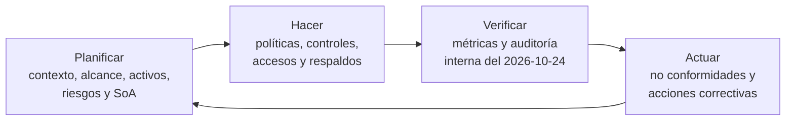
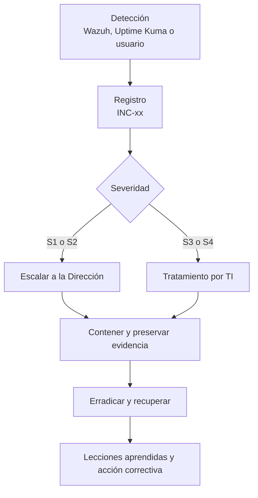

# S2-E1 · Planificación e Implementación del SGSI (CE0321–CE0324)

!!! abstract "CE032 — Gestión de la Seguridad de la Información"
    Sistema de Gestión de Seguridad de la Información (ISO/IEC 27001:2022) aplicado a la arquitectura híbrida diseñada en el Semestre 1: planificación (CE0321), implementación de controles (CE0322), monitoreo y mejora (CE0323) y ética ACM (CE0324). Se apoya en el [diseño de red](s1-e1-analisis-diseno-red-ce0311.md) y en el [diseño del centro de datos](s1-e2-diseno-centro-datos-hibrido-ce0331.md).

## Portada

| Campo | Detalle |
|---|---|
| Título | Sistema de Gestión de Seguridad de la Información de la infraestructura híbrida de CERMAT |
| Entregable | Semestre 2 · Entregable 1 · CE0321, CE0322, CE0323 y CE0324 |
| Estudiantes | David Robert Yucra Mamani (líder), Gladys Rosaura Yana Pari, Denilson Leeke Mamani Flores, Cárdenas Vilca Rennzo |
| Semestre | 2026-2 (9° ciclo), UPeU campus Juliaca, sección g1 |
| Fecha | 2026-10-24 |
| Versión | 2.0 |
| Marco | ISO/IEC 27001:2022, ISO/IEC 27002:2022, ISO/IEC 27005:2022 y NIST CSF 2.0 |

**Control de versiones**

| Versión | Fecha | Cambio |
|---|---|---|
| 1.0 | 2026-07-06 | Planificación de seguridad (activos, riesgos, políticas y roles) y entregable de controles, monitoreo y ética, según la estructura anterior de la guía |
| 2.0 | 2026-10-24 | SGSI integral según la guía vigente: alcance híbrido, inventario C-I-D, ISO/IEC 27005, SoA de 93 controles, 6 políticas, auditoría interna real y matriz maestra de trazabilidad |

**Productos obligatorios**

| Producto | Formato entregado | Ubicación | Criterio de aceptación (guía) | Estado |
|---|---|---|---|---|
| Informe del SGSI | Página versionada; PDF desde la vista de impresión | Este documento | Completo, versionado y trazable con los diseños del Semestre 1 | Entregado |
| Inventario de activos | XLSX y sección 5 | [s2-e1-inventario-activos.xlsx](../assets/infraestructura/s2-e1-inventario-activos.xlsx) | Cubre todo el alcance del SGSI | Entregado (33 activos) |
| Matriz de evaluación y tratamiento de riesgos | XLSX y secciones 6 y 7 | [s2-e1-matriz-riesgos.xlsx](../assets/infraestructura/s2-e1-matriz-riesgos.xlsx) | Criterios definidos y resultados consistentes | Entregado (29 riesgos) |
| Declaración de Aplicabilidad (SoA) | XLSX y sección 8 | [s2-e1-declaracion-aplicabilidad.xlsx](../assets/infraestructura/s2-e1-declaracion-aplicabilidad.xlsx) | Trazabilidad riesgo → control → evidencia | Entregado (93 controles) |
| Políticas y procedimientos del SGSI | Sección 9 (6 documentos) | Este documento | Adaptados al proyecto; no plantillas genéricas | Redactados; aprobación de la Dirección pendiente |
| Declaración de ética de seguridad | Sección 12.7 | Este documento | Firmada por el equipo y coherente con el comportamiento observado | **Pendiente de firma** |

## 1. Resumen ejecutivo del SGSI

**Alcance.** La seguridad de la información de los procesos de matrícula, pagos, asistencia, comunicación con padres y gestión escolar de CERMAT, soportados por la sede on-premise (diseñada), el VPS y los servicios PaaS en producción, la VPN entre ambos y los procesos de administración, respaldo, monitoreo e incidentes.

**Riesgos principales.** Se evaluaron 29 riesgos con ISO/IEC 27005: 7 críticos, 10 altos y 12 medios. **16 provienen de hallazgos reales**, no de supuestos:

- Reglas de Firestore publicadas que permiten listar matrículas pagadas sin sesión, auto-asignarse roles y que bloquean la matrícula pública (R-01 a R-03).
- Correcciones de seguridad que no llegan a producción porque el despliegue fallaba en silencio (R-04).
- Una clave de cuenta de servicio en copias ZIP versionadas: retiro iniciado, rotación pendiente (R-05).
- Respaldos del VPS sin implantar (R-07) y 2 GB de RAM compartidos en el VPS, que desde el 2026-10-24 también aloja la capa relacional de la academia (R-08).
- Dominio sin SPF ni DMARC y MFA no verificado (R-11).
- Un falso positivo del antivirus que interrumpió pruebas (R-22).

Con el tratamiento, el riesgo residual queda en 18 bajos y 11 medios, que requieren aceptación de la Dirección.

**Controles y SoA.** De los 93 controles del Anexo A de ISO/IEC 27001:2022, 92 son aplicables y 1 se excluye (8.30, sin desarrollo externalizado). Hoy hay 9 implementados con evidencia, 47 parciales y 36 planificados.

**Ciclo PHVA.**

| Etapa | Estado |
|---|---|
| Planificar | Completo (secciones 2 a 8) |
| Hacer | Parcial: controles en la nube y en la capa de datos; la sede está pendiente de hardware |
| Verificar | Auditoría interna real del 2026-10-24 con 11 hallazgos; 12 indicadores definidos |
| Actuar | 8 no conformidades con acción correctiva, responsable y plazo (NC-01 a NC-03 cerradas el 2026-10-24); revisión por la dirección pendiente |

**Conclusión.** El SGSI está establecido y opera parcialmente. El 2026-10-24 se cerraron dos acciones críticas: se publicaron las reglas corregidas, verificadas en producción, y se rotó la clave expuesta. Antes de la sustentación deben cerrarse las restantes: activar MFA e implantar los respaldos del VPS.

## 2. Contexto de la organización

### 2.1 Qué protege el SGSI

- Datos personales de alumnos (incluidos menores de edad) y apoderados.
- Registros de pagos y matrículas.
- Registros de asistencia y la consulta de los padres.
- Datos del sistema de gestión del colegio.
- La continuidad de la matrícula, los pagos y la asistencia.
- Credenciales, llaves y configuraciones de seguridad (reglas, firewall y VPN).

### 2.2 Cuestiones externas e internas

| Tipo | Cuestión | Efecto en el SGSI |
|---|---|---|
| Externa | Ley N.° 29733 y su reglamento (D.S. N.° 016-2024-JUS) | Requisitos de tratamiento, seguridad, transferencia internacional y notificación de incidentes |
| Externa | Proveedores en el extranjero (Google, Vercel, RackNerd y GitHub) | Responsabilidad compartida; datos fuera del Perú |
| Externa | Amenazas comunes: phishing, fuerza bruta SSH, ransomware y escaneo automatizado | Controles de identidad, perímetro y respaldo |
| Externa | Conectividad y energía en Azángaro (supuestos a validar) | Doble enlace, UPS y servicios críticos en la nube |
| Interna | Equipo pequeño con conocimiento concentrado en una persona | Segregación limitada; necesidad de documentar y delegar |
| Interna | Presupuesto limitado | Software libre; hardware on-premise sujeto a adquisición |
| Interna | Operación piloto con volumen bajo | Riesgo real aunque el número de registros sea pequeño: son datos de menores |
| Interna | Secretos en el historial del repositorio | No conformidad abierta (NC-03) |

### 2.3 Partes interesadas

| Parte interesada | Necesidades y expectativas | Requisito que adopta el SGSI |
|---|---|---|
| Alumnos y apoderados | Confidencialidad de sus datos; consulta de asistencia disponible | Reglas por rol, cifrado en tránsito y aviso de privacidad |
| Dirección de la academia y del colegio | Continuidad, cumplimiento legal y costo controlado | RTO/RPO, SoA y uso de software libre |
| Personal administrativo, docentes y auxiliares | Acceso simple y seguro | Identidad única en Firebase y MFA para cuentas privilegiadas |
| Equipo técnico | Procedimientos claros | Políticas y procedimientos de la sección 9 |
| Proveedores en la nube | Uso conforme a sus términos | Política de proveedores (POL-03) |
| ANPD | Cumplimiento de la Ley N.° 29733 | Inscripción del banco de datos y notificación de incidentes |
| MINEDU y UGEL Azángaro | Custodia de registros académicos | Protección de los registros (control 5.33) |
| UPeU (jurado) | Evidencia verificable | Este SGSI con trazabilidad completa |

## 3. Alcance del SGSI

**Declaración.** El SGSI comprende la seguridad de la información de los procesos de matrícula, pagos, asistencia, comunicación con padres y gestión escolar de CERMAT, soportados por los elementos de la tabla siguiente.

| Elemento del alcance (guía) | En este proyecto | Estado al 2026-10-24 |
|---|---|---|
| Infraestructura virtualizada (VMware ESXi) | Host Proxmox VE con 7 VM en la sede principal; mientras tanto, la capa relacional corre en el VPS (desde el 2026-10-24) | Diseñado; la capa relacional, operativa en el VPS |
| Recursos de nube (AWS) | VPS RackNerd (IaaS); Vercel y Firebase (PaaS); GitHub (SaaS) | Operativos |
| Redes | VLAN 10, 20, 30, 40, 50 y 99; red de nube 10.20.0.0/24 | Diseñadas |
| Servidores | VM-APP01, VM-SIEM01, VM-MON01, VM-BKP01, VM-BAS01 y VPS | VPS operativo; VM diseñadas |
| Dispositivos de seguridad | OPNsense, Suricata, Cowrie, UFW y firewall de Proxmox | UFW operativo; el resto diseñado |
| VPN | Túnel IPsec IKEv2 OPNsense ↔ strongSwan | Diseñado |
| Monitoreo | Wazuh, Uptime Kuma y Netdata; `/health` y panel de infraestructura | `/health` operativo; el resto diseñado |
| Procesos asociados | Administración de accesos, respaldo, gestión de cambios, gestión de incidentes y monitoreo | Definidos en las secciones 9 a 11 |

**Interfaces y dependencias.** Proveedores en la nube (responsabilidad compartida), ISP de la sede, correo de Google Workspace (cuentas usadas para recuperar accesos) y personal de la institución.

| Exclusión | Justificación |
|---|---|
| Red física del colegio | Su sistema se usa por Internet; la infraestructura del VPS sí está en el alcance |
| Dispositivos personales de alumnos y visitantes | Solo se conectan a la VLAN de invitados, aislada |
| Desarrollo externalizado | No existe (control 8.30 excluido) |
| Contabilidad fuera del ámbito académico | No es tratada por estos sistemas |

## 4. Liderazgo y objetivos de seguridad

### 4.1 Política

La política de seguridad de la información (POL-01, sección 9.1) compromete a CERMAT a cumplir la Ley N.° 29733, proteger los datos según su clasificación, conceder acceso por rol con MFA en cuentas privilegiadas, cifrar en tránsito, publicar cambios de seguridad solo con pruebas en verde, mantener respaldos 3-2-1 probados, gestionar incidentes y mejorar de forma continua. **Estado: redactada; aprobación y firma de la Dirección pendientes.**

### 4.2 Roles y responsabilidades

| Actividad | Dirección | Responsable de seguridad | Líder técnico | Encargado de TI | Responsable de respaldos | Usuarios |
|---|---|---|---|---|---|---|
| Aprobar políticas y aceptar riesgos residuales | A | R | C | I | I | I |
| Evaluar riesgos y mantener la SoA | I | A/R | C | C | C | — |
| Gestionar identidades y accesos | I | A | R | R | — | I |
| Operar respaldos y pruebas de restauración | I | A | C | C | R | — |
| Responder incidentes | I (S1/S2: A) | A/R | R | R | C | I |
| Gestionar cambios de seguridad | I | A | R | C | — | — |
| Auditoría interna | I | A | C | C | C | — |
| Revisión por la dirección | A/R | R | C | C | C | — |

R = responsable de ejecutar, A = rinde cuentas, C = consultado, I = informado. La Dirección debe designar formalmente a las personas en cada rol. Mientras tanto, el líder técnico concentra funciones, lo que se trata como riesgo R-23.

### 4.3 Objetivos de seguridad medibles

| ID | Objetivo | Indicador | Meta | Plazo |
|---|---|---|---|---|
| OBJ-S1 | Ninguna falla crítica de autorización en producción | KPI-01 | 0 | 2026-10-31 |
| OBJ-S2 | Cuentas privilegiadas protegidas | KPI-03 | 100 % con MFA | 2026-10-31 |
| OBJ-S3 | Repositorios sin secretos | KPI-04 | 0 hallazgos | 2026-11-07 |
| OBJ-S4 | Recuperabilidad demostrada | KPI-05 | ≥ 1 restauración verificada por sistema y mes | Desde 2026-11 |
| OBJ-S5 | Disponibilidad medida | KPI-07 | ≥ 99 % mensual | Desde 2026-12 |
| OBJ-S6 | Respuesta oportuna a incidentes | KPI-09 | 100 % de S1/S2 contenidos en plazo | Continuo |
| OBJ-S7 | Avance de controles | KPI-10 | ≥ 60 % de los aplicables implementados | Cierre de la fase 2 |
| OBJ-S8 | Riesgos críticos tratados | KPI-11 | 0 abiertos | 2026-11-30 |

## 5. Inventario de activos y clasificación de la información

### 5.1 Esquema de clasificación

| Nivel | Definición | Manejo |
|---|---|---|
| Pública | Puede divulgarse sin daño | Sin restricciones; se controla su integridad |
| Interna | Uso del personal y del equipo técnico | No se publica; acceso con cuenta institucional |
| Confidencial | Su divulgación causa daño limitado | Acceso por rol; cifrado en tránsito; registros de acceso |
| Restringida | Datos personales, de menores, financieros o credenciales | Acceso mínimo y nominativo; cifrado en tránsito y en las copias externas; nunca en repositorios ni chats |

### 5.2 Criterios de valoración C-I-D

| Dimensión | Nivel 1 | Nivel 2 | Nivel 3 |
|---|---|---|---|
| Confidencialidad (C) | Pública: su divulgación no causa daño | Interna o confidencial: uso interno; su divulgación causa daño limitado | Restringida: datos personales, de menores, financieros o credenciales |
| Integridad (I) | Un error no tiene consecuencias | Un error afecta la operación y se corrige | Un error tiene consecuencias económicas, legales o de seguridad |
| Disponibilidad (D) | Tolera más de 1 semana sin servicio | Tolera hasta 1 día sin servicio | Se requiere de forma continua (máximo 4 h sin servicio) |
| Criticidad (C+I+D) | 3–4: Baja | 5–6: Media; 7–8: Alta | 9: Crítica |

### 5.3 Inventario

| ID | Activo | Tipo | Propietario | Custodio | Ubicación | Clasificación | C | I | D | Valor (C+I+D) | Criticidad | Estado |
|---|---|---|---|---|---|---|---|---|---|---|---|---|
| ACT-01 | Datos personales de alumnos y apoderados (users, enrollments, students; réplica alumnos) | Información | Dirección de la academia | Equipo técnico | Firestore (Google) y réplica MySQL | Restringida | 3 | 3 | 2 | 8 | Alta | Operativo |
| ACT-02 | Datos de pagos (payments; tabla pagos) | Información | Dirección de la academia | Administrador del sistema | Firestore y MySQL | Restringida | 3 | 3 | 2 | 8 | Alta | Operativo |
| ACT-03 | Registros de asistencia (attendanceLogs, attendanceDayState, parentAttendance; tabla asistencia) | Información | Dirección de la academia | Auxiliares y equipo técnico | Firestore y MySQL | Confidencial | 2 | 3 | 2 | 7 | Alta | Operativo |
| ACT-04 | Contenido público (ciclos, sedes, posts, recursos y talleres) | Información | Dirección de la academia | Administrador del sistema | Firestore y Storage | Pública | 1 | 2 | 2 | 5 | Media | Operativo |
| ACT-05 | Configuración de servicios (config/services) | Información | Líder técnico | Administrador del sistema | Firestore | Interna | 2 | 3 | 2 | 7 | Alta | Operativo |
| ACT-06 | Reglas de seguridad de Firestore | Software y configuración | Líder técnico | Equipo técnico | Repositorio Git y Firebase | Interna | 1 | 3 | 3 | 7 | Alta | Operativo (publicada 2026-10-24) |
| ACT-07 | Código fuente, pruebas y pipeline CI | Software | Líder técnico | Equipo técnico | GitHub (repositorio privado) | Interna | 2 | 3 | 2 | 7 | Alta | Operativo |
| ACT-08 | Secretos y credenciales (cuenta de servicio, contraseñas de BD, llaves SSH, credenciales de VPN) | Información | Líder técnico | Responsable de seguridad | Gestor de contraseñas y servidores | Restringida | 3 | 3 | 2 | 8 | Alta | Operativo (clave rotada 2026-10-24) |
| ACT-09 | Respaldos (MySQL, PostgreSQL, Firestore y VM) | Información | Responsable de respaldos | Encargado de TI | VPS (respaldo diario de MySQL), PC (copia semanal), PBS y disco externo | Restringida | 3 | 3 | 3 | 9 | Crítica | Parcial (solo MySQL) |
| ACT-10 | Datos del sistema del colegio (PostgreSQL cermat_produccion) | Información | Dirección del colegio | Líder técnico | VPS (New York) | Restringida | 3 | 3 | 3 | 9 | Crítica | Operativo |
| ACT-11 | Registros de eventos (API, Nginx, autenticación, firewall, IDS y SIEM) | Información | Responsable de seguridad | Encargado de TI | VPS y VM-SIEM01 | Confidencial | 2 | 3 | 2 | 7 | Alta | Parcial (sin centralizar) |
| ACT-12 | Documentación técnica y del SGSI | Información | Líder técnico | Equipo técnico | Repositorio público de documentación | Pública e interna | 1 | 2 | 1 | 4 | Baja | Operativo |
| ACT-13 | Plataforma web de la academia (SPA en Vercel) | Servicio | Dirección de la academia | Líder técnico | Vercel | Pública | 1 | 3 | 3 | 7 | Alta | Operativo |
| ACT-14 | Firebase Authentication (cuentas y claims) | Servicio | Dirección de la academia | Líder técnico | Google Cloud | Restringida | 3 | 3 | 3 | 9 | Crítica | Operativo |
| ACT-15 | Cloud Firestore y Storage | Servicio | Dirección de la academia | Líder técnico | Google Cloud | Restringida | 3 | 3 | 3 | 9 | Crítica | Operativo |
| ACT-16 | API de sincronización y servicio de analítica | Software | Líder técnico | Equipo técnico | VPS del colegio, usuario `academia` (destino de diseño: VM-APP01) | Interna | 2 | 3 | 2 | 7 | Alta | Operativo (VPS desde 2026-10-24) |
| ACT-17 | Base MySQL 8 (réplica relacional) | Software e información | Líder técnico | Equipo técnico | VPS del colegio (destino de diseño: VM-APP01) | Restringida | 3 | 3 | 2 | 8 | Alta | Operativo (VPS desde 2026-10-24) |
| ACT-18 | Sistema de gestión del colegio (Angular y Laravel) | Software | Dirección del colegio | Líder técnico | VPS | Interna | 2 | 3 | 3 | 8 | Alta | Operativo |
| ACT-19 | VPS RackNerd (Ubuntu 24.04, UFW, Nginx y Certbot) | Infraestructura | Dirección del colegio | Líder técnico | New York (proveedor) | Restringida | 3 | 3 | 3 | 9 | Crítica | Operativo |
| ACT-20 | PC local con PM2 (servicios anteriores de la capa) | Infraestructura | Dirección de la academia | Líder técnico | PC local (ubicación por confirmar) | Restringida | 3 | 2 | 2 | 7 | Alta | Retirado (2026-10-24) |
| ACT-21 | Host hipervisor PVE01 y sus VM | Infraestructura | Dirección de la academia | Encargado de TI | Rack de la sede | Restringida | 3 | 3 | 3 | 9 | Crítica | Planificado |
| ACT-22 | Firewall OPNsense con Suricata | Infraestructura | Dirección de la academia | Encargado de TI | VM-FW01 | Confidencial | 2 | 3 | 3 | 8 | Alta | Planificado |
| ACT-23 | Red local: switch, AP y cableado | Infraestructura | Dirección de la academia | Encargado de TI | Sede principal | Interna | 2 | 2 | 3 | 7 | Alta | Planificado |
| ACT-24 | Túnel IPsec sede ↔ VPS | Infraestructura | Líder técnico | Encargado de TI | OPNsense y VPS | Confidencial | 3 | 3 | 2 | 8 | Alta | Planificado |
| ACT-25 | SIEM Wazuh | Infraestructura | Responsable de seguridad | Encargado de TI | VM-SIEM01 | Confidencial | 2 | 3 | 2 | 7 | Alta | Planificado |
| ACT-26 | Monitoreo (Uptime Kuma y Netdata) | Infraestructura | Encargado de TI | Encargado de TI | VM-MON01 | Interna | 1 | 2 | 2 | 5 | Media | Planificado |
| ACT-27 | Repositorio de respaldos (PBS) y disco externo | Infraestructura | Responsable de respaldos | Encargado de TI | Sede y custodia externa | Restringida | 3 | 3 | 3 | 9 | Crítica | Planificado |
| ACT-28 | Honeypot Cowrie | Infraestructura | Responsable de seguridad | Encargado de TI | VM-HPOT01 en la DMZ | Interna | 1 | 2 | 1 | 4 | Baja | Planificado |
| ACT-29 | Dominio y DNS (cermatschool.edu.pe en Punto.pe) | Servicio | Dirección del colegio | Líder técnico | Punto.pe / RCP | Interna | 1 | 3 | 3 | 7 | Alta | Operativo |
| ACT-30 | Cuentas administrativas de proveedores (Google/Firebase, GitHub, Vercel, RackNerd y Punto.pe) | Información y acceso | Dirección | Líder técnico | Proveedores en la nube | Restringida | 3 | 3 | 2 | 8 | Alta | Operativo (MFA no verificado) |
| ACT-31 | Equipos de usuario (PC administrativas, laptops y dispositivos de auxiliares) | Infraestructura | Dirección de la academia | Usuarios | Sede principal | Interna | 2 | 2 | 2 | 6 | Media | Operativo (por inventariar) |
| ACT-32 | Personal clave (administrador del sistema, encargado de TI y equipo técnico) | Personas | Dirección | — | Sede y trabajo remoto | No aplica | 2 | 2 | 3 | 7 | Alta | Operativo |
| ACT-33 | Cuarto de equipos, rack y UPS | Físico | Dirección de la academia | Encargado de TI | Sede principal, Azángaro | Interna | 1 | 2 | 3 | 6 | Media | Planificado |

El inventario cubre información, software y servicios, infraestructura en la nube y on-premise, personas y el espacio físico. Resultado: 7 activos críticos, 20 altos, 4 medios y 2 bajos.

## 6. Evaluación de riesgos (ISO/IEC 27005)

### 6.1 Método

Se aplicó el enfoque basado en activos de ISO/IEC 27005:2022:

1. Para cada activo del inventario se identificaron amenazas y vulnerabilidades.
2. Se estimaron probabilidad e impacto con escalas de 1 a 5.
3. El nivel se calculó como P × I y se comparó con los criterios de aceptación.

Las fuentes fueron los hallazgos de la auditoría interna del 2026-10-24, el manual de despliegue del VPS, las verificaciones externas y el análisis del diseño.

### 6.2 Criterios

| Escala | Valor | Nombre | Descripción |
|---|---|---|---|
| Probabilidad | 1 | Rara | No se espera en 5 años |
| Probabilidad | 2 | Improbable | Podría ocurrir una vez en 2 a 5 años |
| Probabilidad | 3 | Posible | Una vez al año |
| Probabilidad | 4 | Probable | Varias veces al año |
| Probabilidad | 5 | Casi segura | Mensual, o la vulnerabilidad está activa y se explota sin conocimientos especiales |
| Impacto | 1 | Insignificante | Sin efecto en datos ni servicios |
| Impacto | 2 | Menor | Molestia operativa menor a 4 h; sin datos personales |
| Impacto | 3 | Moderado | Interrupción de un servicio crítico hasta 1 día o pérdida recuperable de hasta 24 h de datos |
| Impacto | 4 | Mayor | Exposición de datos personales de un grupo, interrupción mayor a 1 día o posible sanción |
| Impacto | 5 | Catastrófico | Exposición masiva de datos de menores, compromiso total de la plataforma o pérdida irrecuperable |
| Nivel (P×I) | 1–4 | Bajo | Aceptable; se revisa una vez al año |
| Nivel (P×I) | 5–9 | Medio | Aceptable con monitoreo y aprobación de la Dirección |
| Nivel (P×I) | 10–14 | Alto | Tratamiento en 30 días como máximo |
| Nivel (P×I) | 15–25 | Crítico | Tratamiento inmediato (7 días como máximo) |

### 6.3 Matriz de evaluación

| ID | Activos | Amenaza | Vulnerabilidad | Impacto | P | I | Nivel (P×I) | Clasificación | Origen |
|---|---|---|---|---|---|---|---|---|---|
| R-01 | ACT-01, ACT-15 | Recolección no autorizada de datos personales | Las reglas publicadas el 22-jun-2026 permitían, hasta el 2026-10-24, listar sin sesión las matrículas pagadas (nombres y teléfonos) | Exposición de datos de menores y apoderados; incumplimiento de la Ley N.° 29733 | 5 | 4 | 20 | Crítico | Hallazgo H-01 (auditoría 2026-10-24) |
| R-02 | ACT-14, ACT-15 | Escalamiento de privilegios por un usuario registrado | Las reglas publicadas hasta el 2026-10-24 permitían crear un perfil de auxiliar o docente sin invitación | Acceso a funciones de asistencia y a datos de alumnos | 4 | 4 | 16 | Crítico | Hallazgo H-01 |
| R-03 | ACT-13, ACT-15 | Interrupción de la matrícula pública | Las reglas publicadas hasta el 2026-10-24 bloqueaban la lectura y el cupo que necesita la matrícula sin sesión | Pérdida de pre-matrículas e ingresos | 5 | 3 | 15 | Crítico | Hallazgo H-01 |
| R-04 | ACT-06 | Cambios de seguridad que no llegan a producción | El despliegue de reglas fallaba en silencio por una línea inválida y nadie verificaba lo publicado | Controles corregidos sin efecto durante meses | 4 | 4 | 16 | Crítico | Hallazgo H-02 |
| R-05 | ACT-08, ACT-14, ACT-15 | Uso indebido de una credencial de administrador del proyecto Firebase | La clave de la cuenta de servicio estuvo en copias ZIP versionadas en el repositorio privado (revocada el 2026-10-24) | Lectura y escritura total de datos y cuentas | 2 | 5 | 10 | Alto | Hallazgo H-03 |
| R-06 | ACT-08, ACT-17 | Acceso no autorizado a MySQL | Archivos de entorno versionados (hoy sin contraseñas; el equipo decidió mantenerlos en Git) | Lectura o alteración de la réplica | 2 | 3 | 6 | Medio | Hallazgo H-03 |
| R-07 | ACT-09, ACT-10, ACT-19 | Pérdida de datos del colegio (falla del VPS, error humano o ransomware) | Respaldos externos diseñados pero no implantados; sin prueba de restauración | Pérdida irrecuperable de información escolar | 3 | 5 | 15 | Crítico | Hallazgo H-04 (manual del VPS) |
| R-08 | ACT-16, ACT-17, ACT-19 | Agotamiento de memoria del VPS | 2 GB compartidos por Nginx, PHP-FPM, PostgreSQL y, desde el 2026-10-24, la capa de la academia; sin alertas | Caída del sitio y de la API del colegio y de la capa de la academia | 3 | 3 | 9 | Medio | Hallazgo H-05 |
| R-09 | ACT-13, ACT-16, ACT-18, ACT-19 | Indisponibilidad no detectada | Sin monitor externo ni alertas | Las fallas las descubren los usuarios | 4 | 3 | 12 | Alto | Hallazgo H-06 |
| R-10 | ACT-01, ACT-02, ACT-03, ACT-15 | Pérdida de datos operativos | Firestore sin respaldo programado ni prueba de restauración | Pérdida de matrículas, pagos y asistencia | 2 | 5 | 10 | Alto | Hallazgo H-07 |
| R-11 | ACT-30 | Toma de cuentas administrativas por phishing | MFA no verificado; el dominio sin SPF ni DMARC facilita la suplantación | Control total de los servicios en la nube | 3 | 5 | 15 | Crítico | Hallazgo H-08 (verificación DNS 2026-10-24) |
| R-12 | ACT-19 | Acceso no autorizado por SSH | 22/tcp abierto a Internet; configuración de autenticación SSH no verificada | Compromiso del servidor y de PostgreSQL | 3 | 5 | 15 | Crítico | Análisis (manual del VPS) |
| R-13 | ACT-13, ACT-18, ACT-19 | Reconocimiento y ataques del lado del cliente | Nginx revela su versión; el sitio del colegio no envía HSTS ni cabeceras de seguridad y la SPA solo envía HSTS | Facilita ataques dirigidos, clickjacking y degradación a HTTP | 3 | 2 | 6 | Medio | Hallazgo H-09 (verificación 2026-10-24) |
| R-14 | ACT-29 | Emisión indebida de certificados o suplantación DNS | Sin registros CAA ni DNSSEC | Suplantación del sitio institucional | 2 | 3 | 6 | Medio | Hallazgo H-09 |
| R-15 | ACT-16, ACT-17, ACT-21 | Movimiento lateral desde la red local | La sede no tiene firewall perimetral ni segmentación implantada | Acceso a servidores desde equipos infectados o de invitados | 3 | 4 | 12 | Alto | Análisis |
| R-16 | ACT-11, ACT-22, ACT-25 | Intrusión no detectada | Sin IDS/IPS, SIEM ni honeypot | Ataques sin detección ni evidencia | 3 | 4 | 12 | Alto | Análisis |
| R-17 | ACT-33, ACT-21 | Cortes eléctricos | Sin UPS en la sede | Apagado abrupto y corrupción de datos locales | 4 | 3 | 12 | Alto | Análisis (SUP-10) |
| R-18 | ACT-21 | Falla del host único | Un solo servidor físico, sin clúster | Interrupción de los servicios locales | 2 | 4 | 8 | Medio | Análisis |
| R-19 | ACT-23 | Caída del enlace de Internet de la sede | Un solo enlace | La sede pierde acceso a la plataforma | 3 | 3 | 9 | Medio | Análisis |
| R-20 | ACT-24 | Interrupción del túnel | Dependencia del enlace de la sede | Sin respaldos externos, administración ni sincronización mientras dure | 3 | 2 | 6 | Medio | Análisis |
| R-21 | ACT-31, ACT-01 | Ransomware o malware | Equipos de usuario sin control centralizado | Cifrado o robo de información | 3 | 4 | 12 | Alto | Análisis |
| R-22 | ACT-07, ACT-31 | Interrupción de tareas por un falso positivo del antivirus | Ejecutar scripts SQL desde PowerShell con cmd se detectó como amenaza | Scripts en cuarentena y demora de pruebas | 3 | 2 | 6 | Medio | Incidente INC-03 |
| R-23 | ACT-32 | Pérdida de capacidad operativa por concentración de conocimiento y accesos | Un solo integrante administra los servicios y figura como único autor del historial | Dependencia crítica de una persona | 3 | 4 | 12 | Alto | Hallazgo H-10 |
| R-24 | ACT-01 | Sanción o reclamo por incumplimiento normativo | Formalidades de la Ley N.° 29733 no verificadas (banco de datos, aviso de privacidad, consentimiento de apoderados, transferencia internacional) | Multas y daño reputacional | 3 | 4 | 12 | Alto | Análisis (dato a confirmar) |
| R-25 | ACT-28 | Uso del honeypot como plataforma de ataque | Servicio expuesto a Internet | Responsabilidad por ataques a terceros | 2 | 3 | 6 | Medio | Análisis |
| R-26 | ACT-33 | Acceso físico no autorizado | Sin cuarto de equipos cerrado | Robo o manipulación de equipos | 2 | 4 | 8 | Medio | Análisis |
| R-27 | ACT-09, ACT-17 | Pérdida de los respaldos de MySQL junto con la base | Respaldos en el mismo servidor que la base; la copia fuera del VPS es manual y semanal | Sin recuperación ante una falla del equipo | 3 | 4 | 12 | Alto | Análisis |
| R-28 | ACT-17 | Réplica relacional incompleta | Sin reintentos: un envío que falla no se repite (INC-06); los datos anteriores a la sincronización se cargaron el 2026-10-24 | Reportes con datos faltantes | 4 | 2 | 8 | Medio | Hecho verificado |
| R-29 | ACT-13, ACT-15, ACT-16, ACT-17, ACT-19 | Dependencia de proveedores | Cambio de condiciones, falta de pago o suspensión de la cuenta | Interrupción prolongada | 2 | 4 | 8 | Medio | Análisis |

### 6.4 Mapa de calor del riesgo inicial

| Probabilidad / Impacto | 1 Insignificante | 2 Menor | 3 Moderado | 4 Mayor | 5 Catastrófico |
|---|---|---|---|---|---|
| **5 Casi segura** | — | — | R-03 | R-01 | — |
| **4 Probable** | — | R-28 | R-09, R-17 | R-02, R-04 | — |
| **3 Posible** | — | R-13, R-20, R-22 | R-08, R-19 | R-15, R-16, R-21, R-23, R-24, R-27 | R-07, R-11, R-12 |
| **2 Improbable** | — | — | R-06, R-14, R-25 | R-18, R-26, R-29 | R-05, R-10 |
| **1 Rara** | — | — | — | — | — |

## 7. Tratamiento de riesgos

| ID | Opción | Controles (Anexo A) | Acciones | Responsable | Plazo | Residual (P×I) | Nivel residual | Estado |
|---|---|---|---|---|---|---|---|---|
| R-01 | Mitigar | 5.15, 8.3, 5.34, 8.29, 8.32 | Publicar las reglas corregidas mediante el CI (19/19); verificar en producción que el listado sin sesión falla | Líder técnico | 2026-10-31 | 1×4 = 4 | Bajo | Tratado (2026-10-24): publicadas desde la consola; listar matrículas pagadas sin sesión → 403 |
| R-02 | Mitigar | 5.15, 5.18, 8.2, 8.29 | Publicar las reglas; revisar los 4 perfiles con rol docente o auxiliar contra sus invitaciones | Líder técnico | 2026-10-31 | 1×4 = 4 | Bajo | Tratado (2026-10-24): reglas publicadas; falta revisar los 4 perfiles existentes |
| R-03 | Mitigar | 8.32, 8.29, 5.30 | Publicar las reglas y registrar una matrícula de prueba sin sesión en producción, anulándola después | Líder técnico | 2026-10-31 | 1×3 = 3 | Bajo | Tratado (2026-10-24): pre-matrícula de prueba sin sesión exitosa en producción |
| R-04 | Mitigar | 8.32, 8.9, 8.25 | Publicar solo por CI tras las 19 pruebas; configurar el secreto; comparar cada mes el ruleset publicado con el repositorio | Líder técnico | 2026-11-07 | 1×4 = 4 | Bajo | En curso: reglas publicadas desde la consola el 2026-10-24; falta el secreto del CI y la comparación mensual |
| R-05 | Mitigar | 5.17, 8.12, 8.4, 5.26 | Revocar y rotar la clave en IAM; retirar todas las copias y depurar el historial; revisar los registros de auditoría de IAM; escaneo de secretos en el CI | Líder técnico | 2026-10-26 | 1×5 = 5 | Medio | Tratado (2026-10-24): clave `283b43c3…` eliminada y reemplazada por `ddf50bfe…`; falta el escaneo de secretos en el CI |
| R-06 | Mitigar | 5.17, 8.12 | Retirar los archivos del índice de Git, rotar las contraseñas y usar las cuentas de mínimo privilegio | Líder técnico | 2026-11-07 | 1×3 = 3 | Bajo | Tratado con riesgo aceptado (2026-10-24): los `.env` no tienen contraseñas y siguen versionados por decisión del equipo; las contraseñas MySQL irán fuera de ellos |
| R-07 | Mitigar | 8.13, 5.30, 8.14 | pg_dump -Fc diario con SHA256SUMS; copia semanal cifrada fuera del VPS por SCP (transitoria) y luego extracción diaria por el túnel; restauración mensual de prueba | Líder técnico | 2026-11-07 | 3×2 = 6 | Medio | Pendiente |
| R-08 | Mitigar | 8.6, 8.16 | Línea base medida el 2026-10-24: 1,5 GiB disponibles antes de la capa de la academia y 1,3 GiB con ella en marcha, con MySQL de bajo consumo; swap de 1 GiB; alerta al 80 %; ampliar el plan si MemAvailable < 25 % | Encargado de TI | 2026-11-14 | 2×3 = 6 | Medio | Tratado en parte (2026-10-24): línea base medida; faltan la alerta y el monitoreo |
| R-09 | Mitigar | 8.16, 5.24 | Uptime Kuma con alertas y latido externo | Encargado de TI | 2026-11-14 | 4×2 = 8 | Medio | Pendiente |
| R-10 | Mitigar | 8.13, 5.23 | Exportación diaria (gestionada si el plan lo permite, o script con firebase-admin) y restauración en un proyecto de prueba | Líder técnico | 2026-11-21 | 2×2 = 4 | Bajo | Pendiente |
| R-11 | Mitigar | 5.17, 8.5, 6.3, 5.14 | MFA en las 5 cuentas (de preferencia llave FIDO2); SPF, DKIM y DMARC; capacitación | Dirección y líder técnico | 2026-10-31 | 1×5 = 5 | Medio | Pendiente |
| R-12 | Mitigar | 8.5, 8.20, 8.2 | Verificar autenticación solo con llaves y sin root; fail2ban; SSH solo por la VPN desde el bastión | Líder técnico | 2026-11-07 | 1×5 = 5 | Medio | Pendiente |
| R-13 | Mitigar | 8.21, 8.9 | server_tokens off; HSTS, nosniff, frame-ancestors y Referrer-Policy en Nginx y en vercel.json | Líder técnico | 2026-11-07 | 1×2 = 2 | Bajo | Tratado (2026-10-24): 5 de 5 cabeceras y versión oculta en el Nginx del colegio; cabeceras de `vercel.json` en la SPA |
| R-14 | Mitigar | 8.21, 8.24 | Registro CAA para Let's Encrypt; DNSSEC si el registro .pe y el proveedor lo permiten | Líder técnico | 2026-11-14 | 1×3 = 3 | Bajo | Pendiente |
| R-15 | Mitigar | 8.22, 8.20 | VLAN y reglas de OPNsense según S1-E1 | Encargado de TI | Fase 2 (sujeta al hardware) | 1×4 = 4 | Bajo | Planificado |
| R-16 | Mitigar | 8.16, 8.15, 5.7 | Suricata, Wazuh y Cowrie | Responsable de seguridad | Fase 2 | 2×3 = 6 | Medio | Planificado |
| R-17 | Mitigar | 7.11, 8.14 | UPS con NUT y apagado ordenado | Encargado de TI | Fase 2 | 4×1 = 4 | Bajo | Planificado |
| R-18 | Aceptar con mitigación parcial | 8.14, 8.13 | Espejo ZFS, respaldos en PBS y disco externo; los servicios críticos siguen en la nube | Dirección | Fase 2 | 2×3 = 6 | Medio | Planificado (aceptación pendiente) |
| R-19 | Mitigar | 8.14, 5.30 | WAN2 4G/LTE con conmutación automática | Encargado de TI | Fase 2 | 3×1 = 3 | Bajo | Planificado |
| R-20 | Mitigar | 8.14, 8.16 | DPD y reintento, alerta y consola del proveedor como acceso de emergencia | Encargado de TI | Fase 2 | 3×1 = 3 | Bajo | Planificado |
| R-21 | Mitigar | 8.7, 8.1, 6.3, 8.13 | Antivirus, actualizaciones, cuentas sin privilegios de administrador y respaldos fuera de línea | Encargado de TI | 2026-12-15 | 2×3 = 6 | Medio | Planificado |
| R-22 | Mitigar | 8.7, 5.37 | Ejecutar desde Git Bash; exclusión acotada a la carpeta; verificar el hash al restaurar desde cuarentena; reportar al fabricante | Líder técnico | Cumplido (procedimiento) | 1×2 = 2 | Bajo | Implementado |
| R-23 | Mitigar | 5.2, 5.3, 5.37 | Manuales, cuentas nominativas para otro integrante, credenciales de emergencia custodiadas y revisión por un segundo integrante | Dirección y líder técnico | 2026-11-30 | 2×3 = 6 | Medio | Pendiente |
| R-24 | Mitigar | 5.31, 5.34, 5.20 | Verificar la inscripción del banco de datos ante la ANPD, el aviso de privacidad y el consentimiento en la matrícula; revisar las condiciones de tratamiento de los proveedores | Dirección | 2026-12-15 | 1×4 = 4 | Bajo | Pendiente |
| R-25 | Mitigar | 8.22, 8.20 | DMZ sin salida (FW-41), Cowrie de interacción media, snapshots y revisión semanal | Responsable de seguridad | Fase 2 | 1×3 = 3 | Bajo | Planificado |
| R-26 | Mitigar | 7.1, 7.2, 7.4 | Cuarto cerrado con llave, bitácora y cámara | Dirección | Fase 2 | 1×4 = 4 | Bajo | Planificado |
| R-27 | Mitigar | 8.13 | Respaldo diario con un temporizador de systemd en el VPS y copia semanal verificada en la PC (2026-10-24); falta la copia en PBS (3-2-1) | Líder técnico | 2026-11-14 | 1×3 = 3 | Bajo | Tratado en parte (2026-10-24): respaldo diario y copia semanal verificada; falta PBS |
| R-28 | Mitigar | 8.14, 8.16 | Servicio 24/7 en el VPS desde el 2026-10-24 (destino de diseño: VM-APP01); conciliación con v_conciliacion_pagos; carga inicial y resincronización desde Firestore | Líder técnico | Fase 2 | 2×2 = 4 | Bajo | Tratado en parte (2026-10-24): servicio 24/7 en el VPS y carga inicial hecha; faltan los reintentos |
| R-29 | Aceptar con controles | 5.19, 5.22, 5.23 | Recordatorios de renovación, exportaciones periódicas y documentación para migrar | Dirección | Continuo | 2×3 = 6 | Medio | Aceptación pendiente |

**Resultado.** El tratamiento deja 18 riesgos residuales bajos y 11 medios: R-05, R-07, R-08, R-09, R-11, R-12, R-16, R-18, R-21, R-23 y R-29. Según el criterio de aceptación, los residuales medios necesitan aprobación de la Dirección, que se solicitará en la revisión por la dirección (sección 13.4). R-18 y R-29 se aceptan con controles porque eliminarlos exigiría un segundo host o un segundo proveedor, desproporcionados para la escala de la institución.

## 8. Declaración de Aplicabilidad (SoA)

La SoA cubre los 93 controles del Anexo A de ISO/IEC 27001:2022. La columna "Riesgos tratados" se calcula automáticamente desde la matriz de tratamiento: cada control seleccionado en un tratamiento aparece vinculado a su riesgo. La hoja "Trazabilidad" del XLSX y la sección 14 completan la cadena riesgo → control → evidencia.

**Estados:** Implementado = existe y hay evidencia verificable; Parcial = existe en una parte del alcance (por ejemplo, en la nube) y falta en otra; Planificado = diseñado, con procedimiento, sin ejecutar; No aplicable = excluido con justificación.

| Tema | Controles | Implementado | Parcial | Planificado | No aplicable |
|---|---|---|---|---|---|
| 5. Organizacionales | 37 | 4 | 22 | 11 | 0 |
| 6. De personas | 8 | 0 | 2 | 6 | 0 |
| 7. Físicos | 14 | 0 | 0 | 14 | 0 |
| 8. Tecnológicos | 34 | 5 | 23 | 5 | 1 |
| Total | 93 | 9 | 47 | 36 | 1 |

**Exclusión justificada:** 8.30 Desarrollo externalizado. El software lo desarrolla el propio equipo; si en el futuro se contrata desarrollo a terceros, se aplicarán los requisitos de 5.20 y se reincorporará el control.

### 8.1 Controles organizacionales (5.1 a 5.37)

| Control | Nombre | Aplicable | Justificación | Riesgos tratados | Estado | Evidencia o plan |
|---|---|---|---|---|---|---|
| 5.1 | Políticas de seguridad de la información | Sí | Requisito de la cláusula 5.2; marco de todo el SGSI | — | Parcial | Política POL-01 redactada (§9.1); aprobación de la Dirección pendiente |
| 5.2 | Roles y responsabilidades de seguridad de la información | Sí | Equipo pequeño con funciones concentradas | R-23 | Parcial | Matriz RACI (§4.2); designación formal pendiente |
| 5.3 | Segregación de funciones | Sí | Un mismo integrante desarrolla y publica | R-23 | Planificado | Revisión por un segundo integrante con .github/pull_request_template.md |
| 5.4 | Responsabilidades de la dirección | Sí | La Dirección aprueba la política y acepta riesgos residuales | — | Planificado | Revisión por la dirección (§13.4) pendiente |
| 5.5 | Contacto con las autoridades | Sí | Incidentes con datos personales y delitos informáticos | — | Planificado | Directorio de contactos en PRO-01 (ANPD, PNP-DIVINDAT, CSIRT nacional) |
| 5.6 | Contacto con grupos de interés especial | Sí | Avisos de seguridad de los productos usados | — | Planificado | Suscripción a avisos de Ubuntu, OPNsense, Proxmox, Wazuh, Firebase y GitHub |
| 5.7 | Inteligencia de amenazas | Sí | Detección basada en firmas y reputación | R-16 | Planificado | Reglas ET Open y listas abuse.ch en Suricata; CTI de Wazuh |
| 5.8 | Seguridad de la información en la gestión de proyectos | Sí | Los riesgos de seguridad deben entrar al backlog | — | Parcial | Ítems PB-04, PB-06, PB-08 y PB-11 del backlog (E4 §3.3) |
| 5.9 | Inventario de información y otros activos asociados | Sí | Base de la evaluación de riesgos | — | Implementado | s2-e1-inventario-activos.xlsx (33 activos); revisión trimestral |
| 5.10 | Uso aceptable de la información y otros activos asociados | Sí | Personal, docentes e invitados usan la red y los datos | — | Parcial | POL-05 redactada (§9.6); difusión y aceptación pendientes |
| 5.11 | Devolución de activos | Sí | Rotación de personal con accesos | — | Planificado | Lista de baja: retirar claims, llaves SSH y equipos el mismo día |
| 5.12 | Clasificación de la información | Sí | Datos de menores y financieros | — | Implementado | Esquema de 4 niveles aplicado al inventario (§5) |
| 5.13 | Etiquetado de la información | Sí | Respaldos y exportaciones con datos restringidos | — | Planificado | Prefijo de clasificación en nombres de respaldos y documentos |
| 5.14 | Transferencia de información | Sí | Datos entre navegador, nube y sede | R-11 | Parcial | TLS 1.2/1.3 verificado (PR-06, PR-13); túnel IPsec pendiente; correo sin SPF ni DMARC |
| 5.15 | Control de acceso | Sí | Portales por rol y datos de menores | R-01, R-02 | Parcial | Reglas por rol probadas 19/19 y publicadas el 2026-10-24; roles MySQL; UFW |
| 5.16 | Gestión de identidades | Sí | Identidad única en Firebase y cuentas en servidores | — | Parcial | Invitaciones de un solo uso; usuario nominativo en el VPS; revisión de cuentas pendiente |
| 5.17 | Información de autenticación | Sí | Contraseñas, llaves y cuentas de servicio | R-05, R-06, R-11 | Parcial | Contraseñas de BD por variables de entorno; no conformidad NC-03 abierta |
| 5.18 | Derechos de acceso | Sí | Altas, cambios y bajas de roles | R-02 | Parcial | Claims de administrador y matriz de accesos (§10.2); revisión trimestral pendiente |
| 5.19 | Seguridad de la información en las relaciones con los proveedores | Sí | Dependencia de 6 proveedores | R-29 | Parcial | Proveedores identificados (§9.4); evaluación formal pendiente |
| 5.20 | Tratamiento de la seguridad de la información en los acuerdos con proveedores | Sí | Tratamiento de datos personales por terceros | R-24 | Planificado | Revisar términos y anexos de tratamiento de datos de Google, Vercel, RackNerd y Punto.pe |
| 5.21 | Gestión de la seguridad de la información en la cadena de suministro de las TIC | Sí | Dependencias npm y pip | — | Parcial | package-lock.json y npm ci en el CI; auditoría de dependencias pendiente |
| 5.22 | Seguimiento, revisión y gestión del cambio de los servicios de proveedores | Sí | Cambios de planes y condiciones | R-29 | Planificado | Suscripción a páginas de estado y avisos de cambios de plan |
| 5.23 | Seguridad de la información para el uso de servicios en la nube | Sí | Arquitectura con IaaS, PaaS y SaaS | R-10, R-29 | Parcial | POL-03 (§9.4); respaldo de Firestore pendiente |
| 5.24 | Planificación y preparación de la gestión de incidentes de seguridad de la información | Sí | Incidentes reales registrados | R-09 | Parcial | PRO-01 (§9.3) y registro de incidentes; simulacro pendiente |
| 5.25 | Evaluación y decisión sobre los eventos de seguridad de la información | Sí | Diferenciar eventos e incidentes | — | Parcial | Criterios de severidad (§11.2) aplicados a INC-01 a INC-06 |
| 5.26 | Respuesta a incidentes de seguridad de la información | Sí | Incidentes reales registrados (INC-01 a INC-06) | R-05 | Parcial | INC-01, INC-02 e INC-06 contenidos y cerrados el 2026-10-24; falta el simulacro |
| 5.27 | Aprendizaje de los incidentes de seguridad de la información | Sí | Evitar recurrencia | — | Implementado | Lecciones aprendidas aplicadas: publicación por CI y ejecución desde Git Bash (E4 §2.6 y §3.5) |
| 5.28 | Recopilación de evidencias | Sí | Evidencia de hallazgos y de incidentes | — | Parcial | Ruleset de producción descargado en modo solo lectura; cadena de custodia por formalizar |
| 5.29 | Seguridad de la información durante una interrupción | Sí | Operación en contingencia sin la sede | — | Planificado | Modo de contingencia: la operación sigue en la nube con los mismos controles |
| 5.30 | Preparación de las TIC para la continuidad de negocio | Sí | RTO y RPO por servicio | R-03, R-07, R-19 | Parcial | RTO/RPO definidos; restauración de MySQL probada; VPS, VM y Firestore pendientes |
| 5.31 | Requisitos legales, estatutarios, reglamentarios y contractuales | Sí | Ley N.° 29733 y su reglamento | R-24 | Parcial | Requisitos identificados; formalidades ante la ANPD por verificar |
| 5.32 | Derechos de propiedad intelectual | Sí | Uso de software libre y dependencias | — | Parcial | Licencias libres (AGPL, BSD, GPL) identificadas; inventario de licencias pendiente |
| 5.33 | Protección de los registros | Sí | Trazabilidad de pagos y cambios | — | Parcial | Tabla auditoria con triggers; historial de Git; retención centralizada pendiente |
| 5.34 | Privacidad y protección de datos personales | Sí | Datos de menores y apoderados | R-01, R-24 | Parcial | Reglas corregidas restringen lecturas; indicadores con conteos agregados; datos ficticios en pruebas |
| 5.35 | Revisión independiente de la seguridad de la información | Sí | La auditoría interna la hizo el propio equipo | — | Planificado | Revisión por el jurado y por un integrante no autor; auditoría externa no prevista por costo |
| 5.36 | Cumplimiento de las políticas, reglas y normas de seguridad de la información | Sí | Verificar que los controles se aplican | — | Parcial | Auditoría interna del 2026-10-24 con lista de verificación |
| 5.37 | Procedimientos de operación documentados | Sí | Operación por pocas personas | R-22, R-23 | Implementado | Manual del VPS (diario, semanal, mensual, diagnóstico y comandos prohibidos); server/src/db/README.md |

### 8.2 Controles de personas (6.1 a 6.8)

| Control | Nombre | Aplicable | Justificación | Riesgos tratados | Estado | Evidencia o plan |
|---|---|---|---|---|---|---|
| 6.1 | Investigación de antecedentes | Sí | Personal con acceso privilegiado | — | Planificado | Verificación de referencias proporcional al cargo |
| 6.2 | Términos y condiciones del empleo | Sí | Responsabilidades de seguridad del personal | — | Planificado | Cláusula de confidencialidad y uso aceptable en los contratos |
| 6.3 | Concienciación, educación y formación en seguridad de la información | Sí | Phishing y manejo de datos personales | R-11, R-21 | Planificado | Sesión anual sobre phishing, contraseñas, MFA y uso aceptable |
| 6.4 | Proceso disciplinario | Sí | Consecuencias de incumplir las políticas | — | Planificado | Referencia al reglamento interno de la institución |
| 6.5 | Responsabilidades ante la finalización o cambio de empleo | Sí | Retiro oportuno de accesos | — | Planificado | Retiro de claims, roles y llaves el mismo día |
| 6.6 | Acuerdos de confidencialidad o no divulgación | Sí | Acceso a datos personales | — | Parcial | Declaración de ética del equipo (§12.7) pendiente de firma; acuerdo para el personal pendiente |
| 6.7 | Trabajo remoto | Sí | La plataforma se administra por Internet | — | Parcial | Administración web por HTTPS; administración de infraestructura solo por VPN y bastión (planificado) |
| 6.8 | Notificación de eventos de seguridad de la información | Sí | Detección temprana por usuarios | — | Planificado | Canal de reporte (grupo del equipo y correo del administrador) y formulario de incidente |

### 8.3 Controles físicos (7.1 a 7.14)

| Control | Nombre | Aplicable | Justificación | Riesgos tratados | Estado | Evidencia o plan |
|---|---|---|---|---|---|---|
| 7.1 | Perímetros de seguridad física | Sí | Rack on-premise; en la nube lo asume el proveedor | R-26 | Planificado | Cuarto de equipos cerrado (S1-E2 §5) |
| 7.2 | Controles físicos de entrada | Sí | Acceso al cuarto de equipos | R-26 | Planificado | Llave y bitácora de ingreso |
| 7.3 | Seguridad de oficinas, despachos e instalaciones | Sí | Secretaría y caja atienden público | — | Planificado | Acceso restringido a oficinas con equipos administrativos |
| 7.4 | Monitoreo de la seguridad física | Sí | Rack sin vigilancia | R-26 | Planificado | Cámara orientada al rack, con aviso de videovigilancia |
| 7.5 | Protección contra amenazas físicas y ambientales | Sí | Incendio, agua y temperatura | — | Planificado | Extintor de CO2, ubicación lejos de tuberías, sensor de temperatura |
| 7.6 | Trabajo en áreas seguras | Sí | Visitas técnicas al cuarto de equipos | — | Planificado | Acompañamiento de terceros; prohibido comer o beber junto al rack |
| 7.7 | Puesto de trabajo despejado y pantalla limpia | Sí | Datos personales en pantallas de atención | — | Planificado | Bloqueo automático de sesión a los 5 minutos |
| 7.8 | Ubicación y protección de equipos | Sí | Equipos de red y cómputo | — | Planificado | Rack cerrado, UPS y ventilación |
| 7.9 | Seguridad de los activos fuera de las instalaciones | Sí | Disco de respaldo externo y laptops | — | Planificado | Disco cifrado con custodia registrada fuera de la sede |
| 7.10 | Soportes de almacenamiento | Sí | Respaldos con datos restringidos | — | Planificado | Cifrado del disco externo y registro de custodia |
| 7.11 | Servicios de suministro | Sí | Cortes eléctricos | R-17 | Planificado | UPS con NUT (Tier I con elementos de Tier II) |
| 7.12 | Seguridad del cableado | Sí | Cableado estructurado de la sede | — | Planificado | Cat 6 en canaletas; patch panel etiquetado (TIA-568 y TIA-606) |
| 7.13 | Mantenimiento de los equipos | Sí | Baterías del UPS y ventilación | — | Planificado | Mantenimiento semestral del UPS y limpieza del rack |
| 7.14 | Eliminación o reutilización segura de los equipos | Sí | Discos con datos restringidos | — | Planificado | Borrado seguro según NIST SP 800-88 antes de reutilizar o desechar |

En la nube, la seguridad física la asume cada proveedor (modelo de responsabilidad compartida). Los controles físicos aplican al cuarto de equipos de la sede, que aún no existe.

### 8.4 Controles tecnológicos (8.1 a 8.34)

| Control | Nombre | Aplicable | Justificación | Riesgos tratados | Estado | Evidencia o plan |
|---|---|---|---|---|---|---|
| 8.1 | Dispositivos de punto final de usuario | Sí | Equipos administrativos y de auxiliares | R-21 | Parcial | Antivirus activo en la PC local (INC-03); estándar de equipos pendiente |
| 8.2 | Derechos de acceso privilegiado | Sí | Administradores de nube y servidores | R-02, R-12 | Parcial | Usuario no-root con sudo en el VPS; claim admin acotado; MFA no verificado |
| 8.3 | Restricción del acceso a la información | Sí | Datos de menores | R-01 | Parcial | Reglas corregidas publicadas el 2026-10-24; vistas MySQL para reportes |
| 8.4 | Acceso al código fuente | Sí | Repositorio con configuración de seguridad | R-05 | Parcial | Repositorio privado en GitHub; secretos en el historial (NC-03) |
| 8.5 | Autenticación segura | Sí | Cuentas privilegiadas y servidores | R-11, R-12 | Parcial | Firebase Auth y SSH; MFA no verificado; IKEv2 con certificados planificado |
| 8.6 | Gestión de la capacidad | Sí | VPS de 2 GB compartido | R-08 | Parcial | Línea base medida el 2026-10-24, antes y después de alojar la capa de la academia; faltan las alertas al 80 % |
| 8.7 | Protección contra el malware | Sí | Ransomware en equipos de usuario | R-21, R-22 | Parcial | Antivirus en la PC local; FIM y rootcheck de Wazuh planificados |
| 8.8 | Gestión de las vulnerabilidades técnicas | Sí | Servidores expuestos y dependencias | — | Planificado | Auditoría de dependencias en el CI, actualizaciones automáticas de seguridad y detección de vulnerabilidades de Wazuh |
| 8.9 | Gestión de la configuración | Sí | Reglas, migraciones y configuraciones de red | R-04, R-13 | Parcial | Git, migraciones numeradas y reglas versionadas; configuraciones de red y CD por versionar en infra/ |
| 8.10 | Eliminación de la información | Sí | Retención de datos personales | — | Parcial | backup.js conserva 7 copias; política de retención de datos de exalumnos pendiente |
| 8.11 | Enmascaramiento de datos | Sí | Pruebas e indicadores | — | Implementado | Datos ficticios en 90_datos_prueba.sql; indicadores solo con conteos agregados |
| 8.12 | Prevención de la fuga de datos | Sí | Secretos en el repositorio | R-05, R-06 | Planificado | gitleaks en el CI y escaneo de secretos de GitHub |
| 8.13 | Copias de seguridad de la información | Sí | Pérdida de datos | R-07, R-10, R-18, R-21, R-27 | Parcial | MySQL: respaldo diario en el VPS (temporizador de systemd desde el 2026-10-24), copia semanal verificada en la PC y restauraciones REC-05, REC-13 y REC-14. PostgreSQL del colegio, Firestore y VM pendientes |
| 8.14 | Redundancia de las instalaciones de procesamiento de la información | Sí | Falla de disco, enlace o host | R-07, R-17, R-18, R-19, R-20, R-28 | Planificado | Espejo ZFS, bond LACP y WAN2 LTE; PaaS con redundancia del proveedor |
| 8.15 | Registro de eventos | Sí | Trazabilidad e investigación | R-16 | Parcial | morgan en la API, registros de Nginx y autenticación en el VPS, auditoría MySQL; centralización en Wazuh pendiente |
| 8.16 | Actividades de monitoreo | Sí | Detección de fallas y ataques | R-08, R-09, R-16, R-20, R-28 | Parcial | /health y panel admin Infraestructura; Uptime Kuma y Wazuh pendientes |
| 8.17 | Sincronización del reloj | Sí | Correlación de eventos | — | Parcial | Fechas locales corregidas en la app; NTP del VPS por verificar (timedatectl); NTP de OPNsense planificado |
| 8.18 | Uso de programas utilitarios privilegiados | Sí | Comandos destructivos en producción | — | Parcial | Lista de comandos prohibidos en el manual del VPS; sudo con registro |
| 8.19 | Instalación del software en sistemas en producción | Sí | Cambios en servidores productivos | — | Parcial | Despliegue por CI y Vercel; procedimiento de actualización sin pérdida del manual |
| 8.20 | Seguridad de las redes | Sí | Perímetro de la sede y del VPS | R-12, R-15, R-25 | Parcial | UFW en el VPS implementado; OPNsense planificado |
| 8.21 | Seguridad de los servicios de red | Sí | HTTPS, DNS y correo | R-13, R-14 | Parcial | TLS 1.2/1.3 en todos los sitios; cabeceras de seguridad en la SPA y en el colegio (2026-10-24); CAA, SPF y DMARC pendientes |
| 8.22 | Segregación de las redes | Sí | Red plana en la sede | R-15, R-25 | Planificado | VLAN 10, 20, 30, 40, 50 y 99 (S1-E1 §8) |
| 8.23 | Filtrado web | Sí | Malware en la navegación de invitados | — | Planificado | Listas de bloqueo DNS en Unbound para GUEST y ACAD |
| 8.24 | Uso de la criptografía | Sí | Datos en tránsito y respaldos | R-14 | Parcial | TLS verificado; SHA-256 en respaldos; IPsec AES-256-GCM y restic cifrado planificados |
| 8.25 | Ciclo de vida de desarrollo seguro | Sí | Reglas y API con controles de acceso | R-04 | Parcial | CI con pruebas; revisión entre pares pendiente |
| 8.26 | Requisitos de seguridad de las aplicaciones | Sí | Autorización por rol y titularidad | — | Implementado | Requisitos de autorización probados (19 reglas, 18 API); validación con Zod |
| 8.27 | Principios de ingeniería y arquitectura de sistemas seguros | Sí | Defensa en profundidad | — | Parcial | Mínimo privilegio en BD, sincronización no bloqueante y zonas del diseño |
| 8.28 | Codificación segura | Sí | Inyección y fuga de errores | — | Parcial | execFileSync sin shell, errores sin detalles internos y helmet; 240 usos de any pendientes |
| 8.29 | Pruebas de seguridad en el desarrollo y la aceptación | Sí | Fallas de autorización | R-01, R-02, R-03 | Implementado | 19 pruebas de reglas, 27 de API y 19 de BD; suite ejecutada contra producción en solo lectura |
| 8.30 | Desarrollo externalizado | No | No aplica: el desarrollo lo realiza el equipo; si se contrata a terceros se aplicará 5.20 | — | No aplicable | — |
| 8.31 | Separación de los entornos de desarrollo, prueba y producción | Sí | Pruebas sin tocar datos reales | — | Parcial | Emulador de Firestore y bases cermat_prueba y cermat_db_verificacion; sin proyecto Firebase de staging |
| 8.32 | Gestión de cambios | Sí | Reglas que nunca llegaron a producción | R-01, R-03, R-04 | Parcial | Publicación condicionada en el CI; procedimiento de actualización del VPS; NC-02 abierta |
| 8.33 | Información de prueba | Sí | Datos personales en pruebas | — | Implementado | Datos ficticios; el script de datos se niega a correr con datos reales |
| 8.34 | Protección de los sistemas de información durante las pruebas de auditoría | Sí | Auditar sin afectar producción | — | Implementado | Ruleset descargado en solo lectura; restauraciones en base de verificación; restore.js se niega a escribir en producción |

## 9. Políticas y procedimientos

Los seis documentos que exige la guía están adaptados a esta infraestructura. Cada uno tiene versión 1.0 del 2026-10-24, revisión anual o ante cambios significativos y **aprobación de la Dirección pendiente**. El procedimiento de gestión de cambios (PRO-02) está en [S2-E3 §10](s2-e3-implementacion-control-cd-ce0332-ce0333.md).

### 9.1 POL-01 · Política de seguridad de la información

**Propósito.** Proteger la confidencialidad, integridad y disponibilidad de la información de alumnos, apoderados y personal, y de las operaciones académicas y administrativas de CERMAT.

**Alcance.** El del SGSI (sección 3).

**Compromisos.**

1. Cumplir la Ley N.° 29733, su reglamento y las condiciones contractuales de los proveedores.
2. Clasificar la información (sección 5.1) y protegerla según su nivel; los datos de menores son siempre Restringidos.
3. Conceder acceso por rol y con mínimo privilegio (POL-02), con MFA obligatorio en las cuentas privilegiadas.
4. Cifrar la información en tránsito (TLS 1.2 o superior; IPsec entre la sede y la nube) y las copias que salgan del sitio.
5. Publicar cambios de seguridad (reglas de Firestore, firewall, VPN) solo después de pasar sus pruebas automáticas, y verificar lo publicado.
6. Mantener respaldos 3-2-1 con al menos una restauración probada al mes por sistema (POL-04).
7. Registrar, clasificar y responder los incidentes (PRO-01), y notificar a los afectados y a la ANPD cuando corresponda.
8. No guardar secretos en repositorios ni documentos.
9. Medir el desempeño del SGSI (sección 13) y mejorar de forma continua.

**Responsabilidades.** La Dirección aprueba y asigna recursos. El responsable de seguridad mantiene el SGSI. El líder técnico y el encargado de TI implementan los controles. Todo el personal cumple y reporta. El incumplimiento se trata según el reglamento interno.

**Controles relacionados:** 5.1, 5.2, 5.4, 5.31 y 5.34.

### 9.2 POL-02 · Política de control de accesos

1. **Identidad única.** Cada persona usa su propia cuenta de Firebase y, si administra servidores, su propio usuario Linux. No se comparten cuentas. Las cuentas de servicio están inventariadas, con propietario (sección 10.4).
2. **Altas por invitación.** Docentes, auxiliares y alumnos se activan con una invitación de un solo uso y con vencimiento. Las reglas de Firestore solo asignan los roles de docente y auxiliar con una invitación vigente (lo cubren 8 pruebas automáticas) y solo vinculan al alumno con su matrícula mediante su propia invitación.
3. **Claim de administrador.** Lo otorga el líder técnico con aprobación de la Dirección. La lista de administradores se revisa cada trimestre.
4. **Bajas.** El mismo día del cese se retiran el claim y el rol, se revocan las sesiones activas y las llaves SSH, y se deja registro.
5. **MFA obligatorio** en Google (consola de Firebase y Google Cloud), GitHub, Vercel, el panel de RackNerd y el de Punto.pe; TOTP en Proxmox, OPNsense y Wazuh.
6. **SSH** solo con llaves ed25519, sin root ni contraseñas. Una vez validada la VPN, solo desde el bastión (reglas UFW-08 y UFW-09).
7. **Bases de datos** con cuentas de mínimo privilegio: `cermat_api` sin `INSERT`, `UPDATE` ni `DELETE` directos; `cermat_respaldo` de solo lectura; usuario de PostgreSQL sin superusuario. Las cuentas root y postgres se usan solo en mantenimientos planificados.
8. **Red.** La gestión (VLAN 99) solo se alcanza desde ADMIN_TI y el bastión; los invitados están aislados.
9. **Contraseñas** de al menos 12 caracteres (el mínimo que exige `db-crear-usuarios.js`), únicas y guardadas en un gestor de contraseñas; nunca en código, chats ni documentos.
10. **Revisión trimestral** de accesos, con registro (sección 10.5).

**Controles relacionados:** 5.15 a 5.18, 8.2, 8.3 y 8.5.

### 9.3 PRO-01 · Procedimiento de gestión de incidentes

**Definiciones.** *Evento:* ocurrencia observable relevante para la seguridad. *Incidente:* evento que compromete o puede comprometer la confidencialidad, integridad o disponibilidad. *Brecha de datos personales:* incidente que afecta datos personales.

**Roles.** Coordinador de incidentes (responsable de seguridad; suplente, el líder técnico), encargado de TI, Dirección (decide la comunicación externa) y proveedores (soporte).

| Severidad | Ejemplos | Escalamiento | Contención |
|---|---|---|---|
| S1 · Crítica | Exposición de datos personales; credencial privilegiada comprometida; caída total mayor a 4 h | Dirección en 2 h | 4 h |
| S2 · Alta | Servicio crítico caído por 1 h o más; malware en un servidor | Dirección en 8 h | 8 h |
| S3 · Media | Intento relevante bloqueado; falla parcial | Líder técnico | 3 días |
| S4 · Baja | Falso positivo u observación | Registro | 7 días |

**Etapas.**

1. **Detectar y registrar:** fecha, quién detecta, sistema, descripción y evidencia inicial; se asigna un ID (INC-xx).
2. **Evaluar y clasificar** la severidad con la tabla anterior (control 5.25).
3. **Contener:** aislar la VM o la red, deshabilitar la cuenta, revocar la clave, bloquear la IP de origen o publicar la corrección.
4. **Preservar la evidencia:** copiar los registros en solo lectura, calcular su SHA-256 y anotar la cadena de custodia (control 5.28).
5. **Erradicar y recuperar:** restaurar desde un respaldo verificado y rotar los secretos afectados.
6. **Notificar:** a la Dirección; a los titulares afectados y a la ANPD si hay datos personales, conforme al reglamento de la Ley N.° 29733; a los proveedores implicados; a la PNP (DIVINDAT) si hay delito.
7. **Lecciones aprendidas** en 10 días como máximo, con acción correctiva registrada en la sección 13.3.

**Contactos** (el directorio con datos de contacto se guarda fuera de este documento): Dirección, líder técnico, encargado de TI, soporte de RackNerd, Vercel y Google Cloud, ANPD, PNP-DIVINDAT y Centro Nacional de Seguridad Digital (PCM).

**Registro:** sección 11.3 y hoja "Incidencias" de [s2-e2-plan-resultados-pruebas-red.xlsx](../assets/infraestructura/s2-e2-plan-resultados-pruebas-red.xlsx).

**Controles relacionados:** 5.24 a 5.28 y 6.8.

### 9.4 POL-03 · Política de proveedores y servicios en la nube

| Proveedor | Servicio | Datos que trata | Controles exigidos | Plan de salida |
|---|---|---|---|---|
| Google (Firebase y Google Cloud) | Auth, Firestore y Storage | Personales (Restringida) | MFA del propietario, roles IAM mínimos, reglas probadas y exportación periódica | Exportación de Firestore y de usuarios |
| Vercel | Hosting de la SPA | Registros de acceso | MFA, variables de entorno fuera del repositorio, plan acorde al uso institucional (SUP-13) | Publicar el build estático en otro hosting |
| RackNerd | VPS | Datos del colegio (Restringida) | MFA del panel, renovación a tiempo y respaldos fuera del VPS | Reconstrucción con el manual y los respaldos |
| GitHub | Código y CI | Código y secretos de CI | MFA, repositorio privado, secretos con rol mínimo y escaneo de secretos | Clon local completo |
| Punto.pe / RCP | Dominio y DNS | Ninguno | Credenciales robustas o MFA; registros CAA, SPF y DMARC | Cambio de servidores DNS |
| ISP y operador móvil | Internet | Tráfico cifrado | Condiciones del contrato | Segundo enlace |

1. La responsabilidad compartida se documenta por servicio: el proveedor protege la infraestructura; CERMAT protege cuentas, configuración y datos.
2. Los datos personales solo se confían a proveedores con condiciones de tratamiento publicadas y con ubicación conocida (dato por confirmar en Firestore, SUP-11).
3. Las copias de los datos pertenecen a CERMAT y se guardan fuera del proveedor (POL-04).
4. Las cuentas en los proveedores son nominativas, con MFA y sin compartir.
5. Los secretos se guardan solo en los almacenes del proveedor (GitHub Secrets, variables de Vercel), nunca en Git.
6. Las cuentas de servicio tienen el rol mínimo (por ejemplo, *Firebase Rules Admin* para el CI) y se rotan cada 90 días o de inmediato si se exponen.
7. Cada año se revisan términos, incidentes y costos de cada proveedor, y se sigue su página de estado.

**Controles relacionados:** 5.19 a 5.23.

### 9.5 POL-04 · Política de respaldo y recuperación ante desastres

1. **Regla 3-2-1** para cada conjunto de datos (MySQL, PostgreSQL del colegio, Firestore y usuarios, VM y configuraciones), según el esquema de [S1-E2 §11.2](s1-e2-diseno-centro-datos-hibrido-ce0331.md).
2. **Integridad:** cada respaldo lleva su SHA-256, como ya hace `backup.js` para MySQL; para PostgreSQL, un archivo `SHA256SUMS`.
3. **Cifrado** de toda copia fuera del sitio: restic, cifrado del cliente en PBS o disco externo cifrado.
4. **Cuentas de solo lectura** para respaldar (`cermat_respaldo`). El VPS no guarda credenciales de la sede: la sede extrae las copias (modelo pull).
5. **Retención:** 7 copias diarias, 4 semanales y 6 mensuales; los datos personales no se conservan más de lo necesario.
6. **Pruebas de restauración** mensuales por sistema, en una base o VM de verificación y nunca sobre producción sin confirmación explícita (`--confirmar-produccion`). El RTO medido se anota en el [registro de recuperación](../assets/infraestructura/s2-e3-registro-prueba-recuperacion.xlsx).
7. **RTO y RPO** por servicio según la sección 11.4.
8. **Desastres:** la respuesta a pérdida de la sede, del VPS o de los datos de Firestore está en la sección 11.5.
9. **Verificación diaria** del éxito de los trabajos de respaldo, como prevé la rutina diaria del manual del VPS.

**Controles relacionados:** 8.13, 8.14, 5.29 y 5.30.

### 9.6 POL-05 · Política de uso aceptable

**Alcance:** personal, docentes, auxiliares, alumnos y visitantes que usan la red, los equipos o la plataforma de CERMAT.

1. Las cuentas institucionales son personales e intransferibles; no se comparten contraseñas ni códigos de acceso.
2. Los datos de alumnos y apoderados se usan solo con fines académicos y administrativos; no se copian a dispositivos personales ni se envían por canales no institucionales.
3. Se bloquea la sesión al dejar el puesto; los equipos administrativos se bloquean solos a los 5 minutos.
4. No se instala software no autorizado en los equipos administrativos; el antivirus y las actualizaciones se mantienen activos.
5. En la red de invitados se exige uso lícito; se prohíbe escanear, atacar o intentar acceder a otras redes, y se limita el ancho de banda.
6. Correos sospechosos, pérdida de equipos o accesos indebidos se reportan de inmediato al canal de incidentes.
7. **Aviso de monitoreo:** se registran eventos de red y de acceso con fines de seguridad durante 90 días.
8. El incumplimiento se trata según el reglamento interno.

**Aceptación:** registro de aceptación del personal (firma o aceptación digital), **pendiente**.

**Controles relacionados:** 5.10, 6.3, 7.7, 8.1 y 8.23.

## 10. Gestión de identidades y accesos

### 10.1 Principios

Identidad única por persona, acceso por rol con mínimo privilegio, separación entre quien desarrolla y quien aprueba cambios de seguridad, MFA en toda cuenta privilegiada y ningún secreto fuera de un almacén seguro.

### 10.2 Matriz de accesos por rol

| Rol | Plataforma (Firebase) | API y MySQL | VPS y PostgreSQL | Proxmox, OPNsense y Wazuh | Consolas de proveedores | MFA |
|---|---|---|---|---|---|---|
| Visitante o postulante | Contenido público; crear pre-matrícula si hay cupo | — | — | — | — | No aplica |
| Padre o apoderado | Consulta de asistencia por código | — | — | — | — | No aplica (código de acceso) |
| Alumno | Su perfil, cursos, recursos y asistencia | — | — | — | — | Recomendado |
| Docente | Sus grupos, alumnos y asistencia por QR | Sincroniza su propia asistencia | — | — | — | Recomendado |
| Auxiliar | Escaneo QR y supervisión de asistencia | Sincroniza asistencia como registrador del token | — | — | — | Recomendado |
| Administrador del sistema (claim admin) | Gestión completa de matrículas, pagos, usuarios y contenido | Sincroniza pagos y matrículas | — | — | — | Obligatorio (se evalúa MFA en Firebase Authentication) |
| Encargado de TI | — | Mantenimiento con cuenta nominativa | Usuario sudo nominativo | Administrador con TOTP | Panel de RackNerd, si se delega | Obligatorio |
| Líder técnico | Administrador, si se requiere | Administrador de BD | Usuario sudo nominativo | Administrador con TOTP | Propietario de Firebase, GitHub, Vercel y Punto.pe | Obligatorio |
| Responsable de respaldos | — | `cermat_respaldo` (solo lectura) | Usuario SFTP de solo lectura | Operador de PBS | — | Obligatorio en PBS |
| Cuentas de servicio | — | `cermat_api` (SELECT y EXECUTE), `cermat_analitica` y `cermat_reportes` | Usuario de aplicación de PostgreSQL sin superusuario | Agentes Wazuh | CI de GitHub con rol *Firebase Rules Admin* | No aplica (llaves rotadas) |

### 10.3 MFA

| Cuenta | Factor recomendado | Estado al 2026-10-24 | Acción |
|---|---|---|---|
| Cuenta de Google propietaria del proyecto Firebase | Llave FIDO2 o app de autenticación | No verificado | Activar y registrar (2026-10-31) |
| GitHub (propietario y colaboradores) | Llave FIDO2 o TOTP | No verificado | Activar y exigirlo en el repositorio |
| Vercel | TOTP o llave | No verificado | Activar |
| Panel de RackNerd | TOTP | No verificado | Activar si el panel lo ofrece |
| Panel de Punto.pe | TOTP o contraseña robusta | No verificado | Activar si el panel lo ofrece |
| Proxmox, OPNsense y Wazuh | TOTP | Planificado | Al implementar la sede |
| Administradores de la plataforma (claim admin) | MFA de Firebase Authentication | No implementado | Evaluar la activación de MFA en Firebase Authentication (requiere cambios en la aplicación) |

### 10.4 Manejo seguro de credenciales

| Credencial | Dónde se guarda | Rotación | Estado |
|---|---|---|---|
| Contraseñas de las cuentas MySQL | Variables de entorno del servidor; gestor de contraseñas | Cada 6 meses o al cambiar de personal | Implementado en los scripts; los archivos de entorno versionados deben retirarse (NC-03) |
| Clave de la cuenta de servicio de Firebase | Solo en el servidor que la necesita; en el CI, como secreto de GitHub con rol mínimo | Cada 90 días e **inmediatamente**, por la exposición en copias ZIP | **Rotación pendiente** |
| Llaves SSH | Una llave ed25519 por persona y por equipo | Anual; revocación inmediata ante pérdida | Por verificar en el VPS |
| Certificados de la VPN | CA guardada fuera de línea; llaves privadas en cada extremo | Certificados cada 2 años; CA cada 10 | Planificado |
| Tokens de GitHub y Vercel | Almacén del proveedor, con alcance mínimo y vencimiento | Al vencer o ante exposición | Por revisar |
| Claves Wi-Fi | Gestor de contraseñas | Cada semestre | Planificado |

### 10.5 Revisión de accesos

Cada trimestre, el responsable de seguridad y el líder técnico revisan: administradores con claim, perfiles de docente y auxiliar con su invitación, colaboradores de GitHub, miembros de Vercel, usuarios Linux con sudo, cuentas de MySQL y PostgreSQL, y cuentas de Proxmox, OPNsense y Wazuh. Retiran lo innecesario y dejan registro con fecha. La primera revisión debe incluir los 4 perfiles de docente y auxiliar creados mientras estaba publicada la regla defectuosa (R-02).

### 10.6 Protección de datos (gobernanza)

- **Minimización:** los indicadores del proyecto usan conteos agregados; la réplica MySQL guarda solo lo necesario para reportes y auditoría.
- **Datos de prueba ficticios:** `90_datos_prueba.sql` se niega a correr si hay matrículas reales (control 8.33).
- **Retención:** definir con la Dirección el plazo de conservación de los datos de exalumnos (control 8.10).
- **Transferencia internacional:** los datos están en proveedores de EE. UU. (VPS, Vercel y, según su ubicación, Firestore). Se debe cumplir el régimen de flujo transfronterizo de la Ley N.° 29733 (R-24).
- **Derechos de los titulares:** canal para solicitudes de acceso, rectificación, cancelación y oposición, a cargo de la Dirección.

## 11. Gestión de incidentes, continuidad y recuperación

### 11.1 Roles y escalamiento

Los roles, la clasificación por severidad y el escalamiento se definen en PRO-01 (sección 9.3).

### 11.2 Clasificación

Ver la tabla de severidades de PRO-01. Los incidentes con datos personales son S1 por defecto hasta que se demuestre lo contrario.

### 11.3 Registro de incidentes

| ID | Detección | Descripción | Clasificación | Severidad | Contención | Causa raíz | Lección aprendida | Estado | Vínculo SGSI |
|---|---|---|---|---|---|---|---|---|---|
| INC-01 | 2026-10-24 | Reglas de Firestore publicadas el 22-jun-2026 con 3 fallas: listado público de matrículas pagadas, auto-asignación de rol y matrícula pública bloqueada | Incidente de seguridad: exposición potencial de datos personales y escalamiento de privilegios | S1 (alta) | Corrección con 19 pruebas; frontend y reglas publicados el 2026-10-24 y verificados como visitante sin sesión (listar matrículas pagadas → 403) | Una línea inválida impedía compilar y nadie verificaba el despliegue | Publicar solo por CI y verificar el ruleset publicado | Cerrado (2026-10-24) | R-01 a R-04; NC-01 y NC-02 |
| INC-02 | 2026-10-24 | Clave de cuenta de servicio y archivos de entorno en el repositorio privado (copias ZIP y archivos versionados) | Incidente de seguridad: credencial expuesta | S1 (alta) | Clave de enero (`283b43c3…`) eliminada y reemplazada por `ddf50bfe…`; contraseñas de las cuentas de `teachers.json` restablecidas; los `.env` (sin contraseñas) siguen versionados por decisión del equipo | Copias del proyecto subidas con secretos; control preventivo ausente | Escaneo de secretos en el CI y lista de revisión de cambios | Cerrado con riesgo residual aceptado (2026-10-24) | R-05 y R-06; NC-03 |
| INC-03 | 2026-10-24 | El antivirus puso en cuarentena scripts SQL al ejecutarlos desde PowerShell con cmd (IDP.Generic) | Evento de seguridad: falso positivo | S4 (baja) | Restaurar desde cuarentena, ejecutar desde Git Bash y exclusión acotada | Heurística del antivirus ante la cadena PowerShell → cmd | Procedimiento documentado en server/src/db/README.md | Cerrado | R-22 |
| INC-04 | 2026-10-24 | Sitio del colegio sin cabeceras de seguridad y con la versión de Nginx expuesta; SPA de la academia solo con HSTS | Observación de seguridad (no es incidente) | S4 (baja) | No requiere | Configuración por defecto | Academia: cabeceras publicadas con `vercel.json`. Colegio: fragmento de Nginx con 5 cabeceras y `server_tokens off`, aplicado y verificado el 2026-10-24 ([S2-E2 §4.3](s2-e2-implementacion-red-ce0312-ce0313.md)) | Cerrado (2026-10-24) | R-13 |
| INC-05 | 2026-10-24 | Dominio sin SPF, DMARC, CAA ni DNSSEC | Observación de seguridad (no es incidente) | S3 (media) | No requiere | Configuración DNS inicial sin controles de correo | Lista de verificación de dominio | Abierto | R-11 y R-14 |
| INC-06 | 2026-10-24 | La sincronización con la API del VPS respondió 500 a las 20:40 y 20:42, y la migración que lo corregía quedó bloqueada más de 20 minutos | Incidente de disponibilidad e integridad de la réplica relacional; sin exposición de datos | S3 (media) | Detección: consola del panel (`[sync] … respondió 500`) y registros de PM2 (`Data truncated for column 'turno'`). Contención: API y analítica detenidas desde otra ventana, lo que liberó la transacción abierta | Tres defectos de la base: etiqueta `mañana` dañada desde junio, rutinas del VPS con otra collation y transacción abierta tras errores de clase 01 ([E4 §2.8](../e4-calidad-operacion-ce024.md#28-analisis-del-incidente-sincronizacion-con-el-vps-inc-06)) | Reproducir cada falla en una réplica antes de corregir; migrar con los servicios detenidos y una espera máxima de 60 s; la API cierra la conexión ante un error | Cerrado (2026-10-24 22:11) | R-27 y R-28; ACT-16 y ACT-17 |

### 11.4 Servicios críticos, RTO y RPO

| Servicio | Ubicación | Criticidad | RTO objetivo | RPO objetivo | Mecanismo de recuperación | Validación (S2) |
|---|---|---|---|---|---|---|
| Plataforma web (SPA) | Vercel | Crítica | 15 min | 0 (código en Git) | Promover el despliegue anterior en Vercel o revertir el commit | REC-10 |
| Identidad (Firebase Auth) | Firebase | Crítica | Según el proveedor | Según el proveedor | Exportación semanal de usuarios (firebase auth:export), cifrada | REC-11 |
| Datos operativos (Firestore) | Firebase | Crítica | 4 h | 24 h | Exportación diaria programada y restauración en un proyecto de prueba | REC-11 |
| API de sincronización y MySQL | VM-APP01 (hoy VPS del colegio) | Alta | 1 h | 24 h | backup.js diario (temporizador de systemd en el VPS) y restore.js; resincronización desde Firestore | REC-01 a REC-05, REC-13 y REC-14 |
| Analítica | VM-APP01 (hoy VPS del colegio) | Baja | 24 h | 24 h | Redespliegue desde Git | REC-07 |
| Sistema del colegio (web, API y PostgreSQL) | VPS | Alta | 8 h (reconstrucción completa); 2 h (solo base) | 24 h | pg_dump -Fc diario con SHA256SUMS y copia en la sede | REC-06, REC-08 |
| VPN sitio a sitio | OPNsense ↔ VPS | Media | 1 h (reconexión automática ≤ 2 min) | No aplica | DPD y reintento; configuración versionada | REC-09 |
| Firewall perimetral | VM-FW01 | Crítica para la sede | 2 h | Último config.xml | Restaurar config.xml en una VM nueva; contingencia con el router del ISP | REC-12 |
| SIEM (Wazuh) | VM-SIEM01 | Media | 24 h | 24 h | Restaurar la VM desde PBS | REC-07 |
| Monitoreo (Uptime Kuma y Netdata) | VM-MON01 | Media | 8 h | 24 h | Restaurar la VM desde PBS | REC-07 |

### 11.5 Continuidad ante escenarios de desastre

| Escenario | Respuesta | Objetivo |
|---|---|---|
| Pérdida de la sede (falla del host, incendio o corte prolongado) | La operación sigue en la nube; Internet de contingencia por el router del ISP o 4G; restauración de las VM desde PBS o el disco externo en hardware de reemplazo | Matrícula y pagos sin interrupción; servicios locales en ≤ 24 h |
| Pérdida del VPS | Reconstrucción con el manual y el último `pg_dump` guardado en la sede. La capa de la academia se restaura desde la copia semanal en la PC (REC-14) y se resincroniza desde Firestore | ≤ 8 h (REC-08) |
| Pérdida o corrupción de datos de Firestore | Importación de la última exportación en un proyecto de verificación y luego en producción | RTO 4 h; RPO 24 h (REC-11) |
| Credencial privilegiada comprometida | PRO-01 (S1): revocar, rotar, revisar registros de auditoría y notificar | Contención en ≤ 4 h |
| Ransomware en equipos de la sede | Aislar la VLAN, reinstalar y restaurar desde una copia fuera de línea | Según el sistema afectado |

## 12. Ética de la seguridad de la información

### 12.1 Código de conducta

| Principio ACM | Compromiso del equipo |
|---|---|
| 1.2 Evitar daño | Las pruebas que pueden afectar la operación se hacen en el emulador, en bases de prueba o en laboratorio |
| 1.3 Ser honesto y confiable | Lo no ejecutado se reporta como pendiente; las cifras estimadas se rotulan como supuestos |
| 1.6 Respetar la privacidad | Los indicadores usan conteos agregados; no se consultan registros personales innecesarios |
| 1.7 Honrar la confidencialidad | Sin secretos, IP públicas ni datos personales en la documentación |
| 2.5 Evaluar riesgos de forma exhaustiva | Riesgos evaluados con ISO/IEC 27005 y tratados con responsable y plazo |
| 2.8 Acceder solo con autorización | Pruebas solo sobre sistemas de CERMAT, con autorización escrita |
| 2.9 Diseñar sistemas robustos y seguros | Defensa en profundidad y mínimo privilegio en todo el diseño |

### 12.2 Alcance ético de las pruebas

| Permitido | No permitido |
|---|---|
| Pruebas de reglas en el emulador de Firestore y pruebas SQL en bases de prueba con datos ficticios | Probar reglas o escrituras contra datos reales de producción |
| Descargar en solo lectura el ruleset publicado para auditarlo | Modificar producción durante una auditoría |
| Consultas HTTP, TLS y DNS no intrusivas sobre los dominios propios, como las del 2026-10-24 | Escanear puertos o ejecutar ataques contra sistemas de terceros |
| Pruebas de segmentación, IDS y honeypot en la red de la sede con autorización y ventana acordada | Usar las credenciales capturadas por el honeypot fuera del análisis de seguridad |
| Restaurar respaldos en bases o VM de verificación | Restaurar sobre producción sin confirmación explícita |

### 12.3 Consentimiento y autorización

Antes de las pruebas de segmentación, detección y recuperación de S2-E2 y S2-E3, la Dirección de la academia (para la sede y la plataforma) y la del colegio (para el VPS) deben firmar una **autorización de pruebas de seguridad**. Esa autorización debe indicar:

- Sistemas y redes incluidos y excluidos.
- Ventanas horarias.
- Pruebas permitidas (PR-14 a PR-37 y REC-05 a REC-12).
- Responsables.
- Criterio para detener una prueba si afecta la operación.
- Tratamiento de los datos capturados.

**Estado: pendiente de firma.** Las verificaciones del 2026-10-24 se limitaron a consultas públicas no intrusivas sobre dominios propios.

### 12.4 Confidencialidad y protección de datos

Los integrantes tratan como Restringidos los datos personales, las credenciales y los hallazgos aún no corregidos. Los registros del honeypot contienen IP de origen, que pueden ser datos personales, y se usan solo con fines de seguridad durante 90 días.

### 12.5 Divulgación responsable

1. Los hallazgos de secretos se documentan **sin rutas exactas** hasta que la credencial se rote.
2. El repositorio de esta documentación es **público**. Por eso las reglas corregidas se publicaron el 2026-10-24 **antes** de difundir el sitio actualizado que describe las fallas; desde entonces están cerradas en producción (NC-01 y NC-02).
3. Las vulnerabilidades que se encuentren en productos de terceros se reportan primero al fabricante.
4. Las observaciones sobre el sistema del colegio (cabeceras y DNS) se comunican a su Dirección junto con el plan de corrección.

### 12.6 Conflictos de interés

El líder técnico es autor de ambos sistemas y administrador del VPS. Para que no audite ni apruebe solo su propio trabajo: los cambios de seguridad requieren la revisión de un segundo integrante; la Dirección aprueba la aceptación de riesgos; y la auditoría interna siguiente la conduce otro integrante, con revisión independiente del jurado (control 5.35).

### 12.7 Declaración de ética de seguridad

> **Declaración de ética de seguridad de la información — Equipo CERMAT, EPE 2026-2**
>
> Los integrantes del equipo declaramos que:
>
> 1. Realizamos y realizaremos pruebas de seguridad solo sobre sistemas de CERMAT, dentro del alcance autorizado por escrito por la Dirección, y en entornos de prueba cuando el ensayo pueda afectar la operación.
> 2. No accedemos a datos personales reales más allá de lo necesario; para los indicadores usamos conteos agregados.
> 3. Mantenemos la confidencialidad de credenciales, configuraciones y hallazgos; no publicamos secretos, IP públicas ni datos personales.
> 4. Reportamos de inmediato toda vulnerabilidad o incidente al responsable de seguridad y a la Dirección, y lo divulgamos de forma responsable después de corregirlo o mitigarlo.
> 5. No usamos el acceso privilegiado para fines distintos de los asignados y declaramos cualquier conflicto de interés.
> 6. Presentamos resultados veraces: lo no ejecutado se reporta como pendiente.

| Integrante | Firma | Fecha |
|---|---|---|
| David Robert Yucra Mamani | Pendiente de firma | — |
| Gladys Rosaura Yana Pari | Pendiente de firma | — |
| Denilson Leeke Mamani Flores | Pendiente de firma | — |
| Cárdenas Vilca Rennzo | Pendiente de firma | — |

**Coherencia con el comportamiento observado**

| Compromiso | Evidencia observable |
|---|---|
| Pruebas en entornos controlados | 19 pruebas de reglas en el emulador; base `cermat_prueba` con datos ficticios |
| Auditar sin afectar producción | Ruleset descargado en solo lectura; `restore.js` se niega a escribir en producción |
| Datos mínimos | Indicadores de uso con conteos agregados |
| Sin secretos | Documentación sin IP públicas, correos ni contraseñas; secretos reportados sin rutas exactas |
| Veracidad | Pendientes rotulados en todos los entregables |
| Verificación no intrusiva | Solo consultas HTTP, TLS y DNS a dominios propios el 2026-10-24; sin escaneo de puertos |

## 13. Evaluación del desempeño del SGSI

### 13.1 Métricas e indicadores

| ID | Indicador | Fórmula | Meta | Valor al 2026-10-24 | Fuente | Frecuencia |
|---|---|---|---|---|---|---|
| KPI-01 | Fallas de reglas en producción | Pruebas de la suite que fallan contra el ruleset publicado | 0 | 0 fallas observadas en producción tras publicar la versión corregida (verificación como visitante sin sesión del 2026-10-24); con las reglas de junio: 10 de 19 | Suite de reglas y consultas sin sesión | Cada cambio y mensual |
| KPI-02 | Publicaciones con pruebas en verde | Despliegues con CI en verde / despliegues | 100 % | 99 de 99 pruebas en local; CI en GitHub sin primera ejecución | GitHub Actions | Cada cambio |
| KPI-03 | Cuentas privilegiadas con MFA | Con MFA / privilegiadas | 100 % | No verificado | Revisión de cuentas | Trimestral |
| KPI-04 | Secretos en repositorios | Hallazgos de escaneo de secretos | 0 | 0 secretos vigentes: la clave de los ZIP fue revocada y las contraseñas de `teachers.json` restablecidas (2026-10-24); escaneo con gitleaks pendiente | gitleaks | Cada cambio |
| KPI-05 | Restauraciones verificadas | Pruebas exitosas por sistema y mes | ≥ 1 | MySQL: 5 (2 en la base de prueba, 1 en la base real y 2 en otro servidor: REC-13 en el VPS y REC-14 en la PC, todas del 2026-10-24); PostgreSQL, Firestore y VM: 0 | Registro de recuperación | Mensual |
| KPI-06 | RTO medido de MySQL | Tiempo de `restore.js` | < 1 h | 0,23 s en la base real (REC-05); 0,33 s en el VPS (REC-13) y 0,41 s con el respaldo del VPS en la PC (REC-14); 0,27–0,38 s en la base de prueba | `restore.js` | Mensual |
| KPI-07 | Disponibilidad de servicios públicos | Tiempo en línea / total | ≥ 99 % | No medida | Uptime Kuma | Mensual |
| KPI-08 | Tiempo de detección de caídas | Minutos hasta la alerta | ≤ 5 | No medido | Uptime Kuma | Por evento |
| KPI-09 | Incidentes S1 y S2 contenidos en plazo | Contenidos a tiempo / total | 100 % | INC-01 e INC-02 cerrados el día de la detección (2026-10-24); la contención superó el objetivo de 4 h porque la publicación de las reglas esperó el despliegue del frontend | Registro de incidentes | Mensual |
| KPI-10 | Controles aplicables implementados | Implementados / aplicables | ≥ 60 % al cierre de la fase 2 | 9 de 92, más 47 parciales | SoA | Trimestral |
| KPI-11 | Riesgos críticos abiertos | Riesgos con nivel ≥ 15 sin tratar | 0 | 4 (R-04, R-07, R-11 y R-12); R-01 a R-03 tratados el 2026-10-24 | Matriz de riesgos | Mensual |
| KPI-12 | Sitios con TLS ≥ 1.2 y HSTS | Sitios conformes / sitios | 6 de 6 | TLS: 4 de 4 medidos con `openssl` (los 2 subdominios de la academia, sin medir); HSTS: 6 de 6 (2026-10-24) | `curl` y `openssl` (PR-06, PR-10, PR-13, PR-38) | Trimestral |

### 13.2 Auditoría interna del 2026-10-24

| Aspecto | Detalle |
|---|---|
| Objetivo | Verificar el estado de los controles en la parte implementada (nube, capa de datos y repositorio) y su conformidad con ISO/IEC 27001:2022 en lo aplicable |
| Alcance | VPS del colegio, Vercel, reglas de Firestore, repositorio y capa local de la academia. La sede on-premise no se auditó porque no está implementada |
| Criterios | Controles del Anexo A seleccionados (5.15, 5.17, 8.3, 8.5, 8.9, 8.12, 8.13, 8.16, 8.21, 8.29 y 8.32); lista de verificación del [E4 §4.4](../e4-calidad-operacion-ce024.md); manual del propietario del VPS |
| Método | Revisión documental; suite de reglas contra el ruleset publicado, descargado en solo lectura; revisión del índice de Git sin abrir el contenido de los secretos; consultas externas no intrusivas (HTTP, TLS y DNS) sobre los dominios propios |
| Equipo auditor | Equipo del proyecto. **Limitación:** no es independiente; se compensa con la revisión del jurado (control 5.35) |

**Hallazgos**

| ID | Hallazgo | Evidencia | Control | Tipo | NC |
|---|---|---|---|---|---|
| H-01 | Tres fallas activas en las reglas publicadas el 22-jun-2026: listado sin sesión de matrículas pagadas, auto-asignación de rol y matrícula pública bloqueada (corregido en producción el 2026-10-24) | 10 de 19 pruebas fallan contra el ruleset publicado | 5.15, 8.3, 8.29 | No conformidad mayor | NC-01 |
| H-02 | Las correcciones de reglas no se publican desde junio: la línea 1 (`#`) impedía compilar y nadie verificaba el despliegue (corregido el 2026-10-24) | Error del emulador `token recognition error at: '#'` | 8.32, 8.9 | No conformidad mayor | NC-02 |
| H-03 | Secretos en el repositorio privado: clave de cuenta de servicio en copias ZIP versionadas y archivos de entorno versionados (corregido el 2026-10-24: clave revocada y contraseñas restablecidas) | Revisión del índice de Git, sin abrir los secretos | 5.17, 8.12, 8.4 | No conformidad mayor | NC-03 |
| H-04 | Respaldos del VPS diseñados y no implantados; sin prueba de restauración | Manual del propietario | 8.13, 5.30 | No conformidad mayor | NC-04 |
| H-05 | Capacidad del VPS (2 GB) no validada para carga real; sin línea base (medida el 2026-10-24: 1,3 GiB disponibles con la capa de la academia en marcha) | Manual del propietario | 8.6 | Observación | — |
| H-06 | Sin monitor externo ni alertas de disponibilidad | E4 §2.4 | 8.16 | No conformidad menor | NC-05 |
| H-07 | Firestore sin respaldo programado | E4 §2.5 | 8.13 | No conformidad mayor | NC-06 |
| H-08 | MFA de cuentas privilegiadas no verificado; dominio sin SPF ni DMARC | Verificación DNS del 2026-10-24 (PR-12) | 5.17, 8.5, 5.14 | No conformidad menor | NC-07 |
| H-09 | Sin cabeceras de seguridad, con la versión de Nginx expuesta y sin CAA ni DNSSEC (cabeceras y versión corregidas el 2026-10-24; CAA y DNSSEC pendientes) | Verificación externa del 2026-10-24 (PR-10, PR-12) | 8.21, 8.9 | Observación | — |
| H-10 | Cambios sin revisión de un segundo integrante; un solo autor y mensajes de commit genéricos | Historial de Git; plantilla de PR sin uso registrado | 5.3, 8.32, 8.25 | No conformidad menor | NC-08 |
| H-11 | Falso positivo del antivirus al ejecutar scripts SQL desde PowerShell | Cuarentena registrada; procedimiento en `server/src/db/README.md` | 8.7, 5.37 | Observación cerrada con procedimiento | — |

**Fortalezas**

| ID | Fortaleza | Evidencia |
|---|---|---|
| F-01 | Cuentas MySQL de mínimo privilegio | `cermat_api` recibe el error 1142 ante DML directo, verificado también en la base real (2026-10-24) |
| F-02 | Pruebas automáticas que detectan fallas reales | 99 pruebas; la suite de reglas reveló las 3 fallas de producción |
| F-03 | Cifrado en tránsito correcto en todos los sitios | TLS 1.0 y 1.1 rechazados; TLS 1.2 y 1.3 con AEAD; redirección a HTTPS (PR-03 a PR-07, PR-13) |
| F-04 | Base del colegio no expuesta | PostgreSQL solo en loopback y usuario sin superusuario |
| F-05 | Recuperación verificable | Restauración con SHA-256 y RTO medido (REC-01 a REC-05, REC-13 y REC-14; en la base real, 0,23 s; en otro servidor, 0,33 s y 0,41 s) |
| F-06 | Operación documentada | Procedimientos diarios, semanales y mensuales del manual del VPS |

### 13.3 No conformidades y acciones correctivas

| NC | Hallazgo | Corrección inmediata | Causa raíz | Acción correctiva | Responsable | Plazo | Verificación de eficacia | Estado |
|---|---|---|---|---|---|---|---|---|
| NC-01 | H-01 | Publicar las reglas corregidas | Reglas publicadas sin pruebas y despliegue fallido sin detección | Suite de 19 pruebas obligatoria en el CI | Líder técnico | 2026-10-31 | Suite contra el ruleset publicado: 19/19 | Cerrada (2026-10-24): reglas publicadas desde la consola y verificadas como visitante sin sesión (matrículas pagadas → 403; pre-matrícula de prueba exitosa) |
| NC-02 | H-02 | Línea 1 corregida en código | Despliegue manual sin verificación posterior | Publicación automática solo por CI; alerta si falla; comparación mensual del ruleset | Líder técnico | 2026-11-07 | Ruleset publicado igual al del repositorio | Cerrada (2026-10-24): versión corregida publicada; la publicación automática por CI sigue en R-04 (falta el secreto) |
| NC-03 | H-03 | Retirar las copias y rotar la clave | Sin control preventivo de secretos | Escaneo de secretos (gitleaks) en el CI, plantilla de PR y `.gitignore` | Líder técnico | Rotación 2026-10-26; CI 2026-11-07 | Clave anterior revocada; escaneo sin hallazgos | Cerrada con riesgo residual aceptado (2026-10-24): clave `283b43c3…` revocada, contraseñas de `teachers.json` restablecidas; los `.env`, sin contraseñas, siguen versionados por decisión del equipo; escaneo en el CI pendiente |
| NC-04 | H-04 | Copia manual inmediata con `pg_dump` | Se priorizó el despliegue sobre la operación | Respaldos automáticos y restauración mensual | Líder técnico | 2026-11-07 | REC-06 conforme | Abierta |
| NC-05 | H-06 | — | No había herramienta de monitoreo | Uptime Kuma con latido externo | Encargado de TI | 2026-11-14 | PR-33 conforme | Abierta |
| NC-06 | H-07 | Exportación manual inicial | Confianza exclusiva en la durabilidad del proveedor | Exportación programada y prueba de restauración | Líder técnico | 2026-11-21 | REC-11 conforme | Abierta |
| NC-07 | H-08 | Activar MFA en las cuentas | Configuración por defecto de las cuentas | Revisión trimestral de MFA; SPF, DKIM y DMARC | Dirección y líder técnico | 2026-10-31 | KPI-03 = 100 %; PR-12 conforme | Abierta |
| NC-08 | H-10 | — | Equipo pequeño sin flujo de revisión | Revisión obligatoria por un segundo integrante | Líder técnico | Desde el Sprint 2 | 100 % de los cambios revisados | Abierta |

### 13.4 Revisión por la dirección

| Entrada (ISO/IEC 27001:2022, 9.3) | Contenido preparado |
|---|---|
| a) Estado de las acciones de revisiones anteriores | Primera revisión: no hay acciones previas |
| b) Cambios en cuestiones externas e internas | Reglamento de la Ley N.° 29733; VPS del colegio en producción desde el 2026-10-17 |
| c) Cambios en necesidades de las partes interesadas | Enlace del sitio del colegio hacia la plataforma de la academia |
| d) Desempeño: no conformidades, seguimiento, auditoría y objetivos | Secciones 13.1 a 13.3 |
| e) Retroalimentación de partes interesadas | Pendiente de recoger de la Dirección y del personal |
| f) Resultados de la evaluación de riesgos y del plan de tratamiento | Secciones 6 y 7 |
| g) Oportunidades de mejora | Sección 13.5 |
| Salidas esperadas | Aprobar POL-01 a POL-05; designar roles; aceptar los riesgos residuales medios; decidir el presupuesto del hardware |

**Fecha propuesta:** semana del 2026-11-23. **Resultado obtenido: pendiente de ejecución.** **Evidencia a adjuntar:** acta firmada por la Dirección con las decisiones tomadas.

### 13.5 Mejora continua

- Revisión mensual de los indicadores KPI-01 a KPI-12.
- Seguimiento quincenal de NC-04 a NC-08 hasta su cierre (NC-01 a NC-03 se cerraron el 2026-10-24).
- Auditoría interna semestral; la próxima, en 2027-I, incluirá la sede si ya está implementada y la conducirá un integrante distinto del líder técnico.
- Actualización de la matriz de riesgos ante cada incidente o cambio significativo.

## 14. Conclusiones y matriz maestra de trazabilidad

### 14.1 Conclusiones

1. El SGSI está establecido con contexto, alcance, 33 activos valorados, 29 riesgos evaluados, una SoA de 93 controles y seis políticas y procedimientos propios.
2. La auditoría interna encontró fallas reales y activas (reglas, secretos y respaldos). El SGSI las convierte en no conformidades con causa raíz, responsable, plazo y verificación de eficacia.
3. 9 de los 92 controles aplicables están implementados y 47 parcialmente. El avance depende de cerrar NC-04 a NC-08 (NC-01 a NC-03 se cerraron el 2026-10-24) y de implementar la sede (fase 2).
4. El alcance ético de las pruebas ya se practica; falta firmar la declaración y obtener la autorización escrita de la Dirección.

### 14.2 Matriz maestra de trazabilidad (riesgo → control → evidencia)

| Riesgo | Descripción | Nivel inicial | Controles (SoA) | Política o procedimiento | Evidencia | Verificación | Nivel residual | Estado |
|---|---|---|---|---|---|---|---|---|
| R-01 | Recolección no autorizada de datos personales | 20 (Crítico) | 5.15, 8.3, 5.34, 8.29, 8.32 | POL-02, PRO-02 | tests/firestore-rules/reglas.test.ts: 19/19 con las reglas corregidas; 10 fallaban con las de junio. Producción: listar matrículas pagadas sin sesión → 403 (2026-10-24) | Suite de reglas contra el ruleset publicado (KPI-01 = 0) | 4 (Bajo) | Tratado (2026-10-24) |
| R-02 | Escalamiento de privilegios por un usuario registrado | 16 (Crítico) | 5.15, 5.18, 8.2, 8.29 | POL-02 | Grupo de 8 pruebas de roles en la suite de reglas; reglas publicadas el 2026-10-24 | Revisión de perfiles y KPI-01 | 4 (Bajo) | Tratado (2026-10-24); falta revisar los 4 perfiles existentes |
| R-03 | Interrupción de la matrícula pública | 15 (Crítico) | 8.32, 8.29, 5.30 | PRO-02 | Grupo de 6 pruebas de matrícula pública con el código real de la app; pre-matrícula de prueba exitosa en producción (2026-10-24) | Matrícula de prueba sin sesión en producción | 3 (Bajo) | Tratado (2026-10-24) |
| R-04 | Cambios de seguridad que no llegan a producción | 16 (Crítico) | 8.32, 8.9, 8.25 | PRO-02 | .github/workflows/ci.yml (trabajo desplegar-reglas condicionado) | Primera ejecución del CI en GitHub; comparación mensual | 4 (Bajo) | En curso (reglas publicadas desde la consola; falta el secreto del CI) |
| R-05 | Uso indebido de una credencial de administrador del proyecto Firebase | 10 (Alto) | 5.17, 8.12, 8.4, 5.26 | POL-02, PRO-01 | Clave `283b43c3…` eliminada y reemplazada por `ddf50bfe…` (INC-02); fuera de la lista pública de claves de Google | Clave anterior revocada en IAM; gitleaks sin hallazgos (KPI-04) | 5 (Medio) | Tratado (2026-10-24); falta el escaneo de secretos en el CI |
| R-06 | Acceso no autorizado a MySQL | 6 (Medio) | 5.17, 8.12 | POL-02 | server/scripts/db-crear-usuarios.js (contraseñas por variables de entorno); `.env` versionados sin contraseñas | Ninguna contraseña en `.env` versionados (KPI-04) | 3 (Bajo) | Tratado con riesgo aceptado (2026-10-24) |
| R-07 | Pérdida de datos del colegio (falla del VPS, error humano o ransomware) | 15 (Crítico) | 8.13, 5.30, 8.14 | POL-04 | Procedimiento diseñado en el manual del VPS | REC-06 conforme | 6 (Medio) | Pendiente |
| R-08 | Agotamiento de memoria del VPS | 9 (Medio) | 8.6, 8.16 | POL-03 | Presupuesto de RAM (S1-E2 §10); manual de despliegue §9.0 y §9.4 | Línea base con free -h; alerta de MemAvailable | 6 (Medio) | Tratado en parte (2026-10-24): línea base medida; faltan la alerta y el monitoreo |
| R-09 | Indisponibilidad no detectada | 12 (Alto) | 8.16, 5.24 | PRO-01 | /health de la API y panel admin Infraestructura | PR-33 (alerta ≤ 2 min); KPI-07 y KPI-08 | 8 (Medio) | Pendiente |
| R-10 | Pérdida de datos operativos | 10 (Alto) | 8.13, 5.23 | POL-04 | Brecha registrada en E4 §2.5 | REC-11 | 4 (Bajo) | Pendiente |
| R-11 | Toma de cuentas administrativas por phishing | 15 (Crítico) | 5.17, 8.5, 6.3, 5.14 | POL-02, POL-05 | PR-12 (sin SPF ni DMARC) | KPI-03 = 100 %; PR-12 conforme | 5 (Medio) | Pendiente |
| R-12 | Acceso no autorizado por SSH | 15 (Crítico) | 8.5, 8.20, 8.2 | POL-02 | UFW activo (PR-01) | PR-28; sshd -T | 5 (Medio) | Pendiente |
| R-13 | Reconocimiento y ataques del lado del cliente | 6 (Medio) | 8.21, 8.9 | POL-01 | PR-10 | PR-10 conforme | 2 (Bajo) | Tratado (2026-10-24): 5 de 5 cabeceras y versión oculta en el Nginx del colegio; cabeceras de `vercel.json` en la SPA |
| R-14 | Emisión indebida de certificados o suplantación DNS | 6 (Medio) | 8.21, 8.24 | POL-03 | PR-12 | PR-12 conforme | 3 (Bajo) | Pendiente |
| R-15 | Movimiento lateral desde la red local | 12 (Alto) | 8.22, 8.20 | POL-01 | Diseño S1-E1 §8 a §13 | PR-14 a PR-23 | 4 (Bajo) | Planificado |
| R-16 | Intrusión no detectada | 12 (Alto) | 8.16, 8.15, 5.7 | PRO-01 | Diseño S1-E1 §14 | PR-30 a PR-32 y PR-37 | 6 (Medio) | Planificado |
| R-17 | Cortes eléctricos | 12 (Alto) | 7.11, 8.14 | POL-04 | Diseño S1-E2 §5 | Prueba de apagado ordenado con NUT | 4 (Bajo) | Planificado |
| R-18 | Falla del host único | 8 (Medio) | 8.14, 8.13 | POL-04 | Diseño S1-E2 §6 y §11 | REC-07 | 6 (Medio) | Planificado (aceptación pendiente) |
| R-19 | Caída del enlace de Internet de la sede | 9 (Medio) | 8.14, 5.30 | POL-04 | Diseño S1-E1 §7 | PR-29 | 3 (Bajo) | Planificado |
| R-20 | Interrupción del túnel | 6 (Medio) | 8.14, 8.16 | POL-04 | Diseño S1-E1 §10 | REC-09 | 3 (Bajo) | Planificado |
| R-21 | Ransomware o malware | 12 (Alto) | 8.7, 8.1, 6.3, 8.13 | POL-05 | Antivirus activo en la PC local | Revisión trimestral de equipos | 6 (Medio) | Planificado |
| R-22 | Interrupción de tareas por un falso positivo del antivirus | 6 (Medio) | 8.7, 5.37 | PRO-01 | server/src/db/README.md | Sin nuevas cuarentenas al ejecutar desde Git Bash | 2 (Bajo) | Implementado |
| R-23 | Pérdida de capacidad operativa por concentración de conocimiento y accesos | 12 (Alto) | 5.2, 5.3, 5.37 | POL-01 | Matriz RACI (§4.2) | Segundo integrante con accesos nominativos; 100 % de cambios revisados | 6 (Medio) | Pendiente |
| R-24 | Sanción o reclamo por incumplimiento normativo | 12 (Alto) | 5.31, 5.34, 5.20 | POL-01 | Clasificación de activos (§5) | Constancia de inscripción y aviso de privacidad publicado | 4 (Bajo) | Pendiente |
| R-25 | Uso del honeypot como plataforma de ataque | 6 (Medio) | 8.22, 8.20 | POL-01 | Regla FW-41 (diseño) | PR-16 (DMZ → DB bloqueado) | 3 (Bajo) | Planificado |
| R-26 | Acceso físico no autorizado | 8 (Medio) | 7.1, 7.2, 7.4 | POL-01 | Diseño de rack (S1-E2 §5) | Bitácora de acceso | 4 (Bajo) | Planificado |
| R-27 | Pérdida de los respaldos de MySQL junto con la base | 12 (Alto) | 8.13 | POL-04 | server/scripts/backup.js; temporizador academia-respaldo | REC-05, REC-13 y REC-14; copias en el VPS y en la PC | 3 (Bajo) | Tratado en parte (2026-10-24): respaldo diario y copia semanal verificada; falta PBS |
| R-28 | Réplica relacional incompleta | 8 (Medio) | 8.14, 8.16 | POL-04 | Vista v_conciliacion_pagos | Conciliación con 0 filas | 4 (Bajo) | Tratado en parte (2026-10-24): servicio 24/7 en el VPS y carga inicial hecha; faltan los reintentos |
| R-29 | Dependencia de proveedores | 8 (Medio) | 5.19, 5.22, 5.23 | POL-03 | Inventario de proveedores (§9.4) | Revisión anual de proveedores | 6 (Medio) | Aceptación pendiente |

## Anexos

| Anexo | Contenido | Ubicación |
|---|---|---|
| A | Inventario de activos con criterios C-I-D | [s2-e1-inventario-activos.xlsx](../assets/infraestructura/s2-e1-inventario-activos.xlsx) |
| B | Criterios, evaluación y tratamiento de riesgos | [s2-e1-matriz-riesgos.xlsx](../assets/infraestructura/s2-e1-matriz-riesgos.xlsx) |
| C | Declaración de Aplicabilidad, resumen y trazabilidad | [s2-e1-declaracion-aplicabilidad.xlsx](../assets/infraestructura/s2-e1-declaracion-aplicabilidad.xlsx) |
| D | Registro de incidentes | Sección 11.3 y [s2-e2-plan-resultados-pruebas-red.xlsx](../assets/infraestructura/s2-e2-plan-resultados-pruebas-red.xlsx) |
| E | Evidencia de las verificaciones externas del 2026-10-24 | [S2-E2, Anexo B](s2-e2-implementacion-red-ce0312-ce0313.md) |
| F | Registro de pruebas de recuperación | [s2-e3-registro-prueba-recuperacion.xlsx](../assets/infraestructura/s2-e3-registro-prueba-recuperacion.xlsx) |
| G | Autorización de pruebas y acta de revisión por la dirección | Pendientes de firma |

### Referencias

[1] ISO/IEC 27001:2022, *Information security, cybersecurity and privacy protection — Information security management systems — Requirements*. Ginebra, Suiza: ISO, 2022.

[2] ISO/IEC 27002:2022, *Information security, cybersecurity and privacy protection — Information security controls*. Ginebra, Suiza: ISO, 2022.

[3] ISO/IEC 27005:2022, *Information security, cybersecurity and privacy protection — Guidance on managing information security risks*. Ginebra, Suiza: ISO, 2022.

[4] National Institute of Standards and Technology, "The NIST Cybersecurity Framework (CSF) 2.0," NIST CSWP 29, feb. 2024.

[5] A. Nelson, S. Rekhi, M. Souppaya y K. Scarfone, "Incident Response Recommendations and Considerations for Cybersecurity Risk Management: A CSF 2.0 Community Profile," NIST SP 800-61 Rev. 3, abr. 2025.

[6] M. Swanson, P. Bowen, A. W. Phillips, D. Gallup y D. Lynes, "Contingency Planning Guide for Federal Information Systems," NIST SP 800-34 Rev. 1, may. 2010.

[7] R. Kissel, A. Regenscheid, M. Scholl y K. Stine, "Guidelines for Media Sanitization," NIST SP 800-88 Rev. 1, dic. 2014.

[8] Congreso de la República del Perú, "Ley N.° 29733, Ley de Protección de Datos Personales," *Diario Oficial El Peruano*, jul. 2011.

[9] Ministerio de Justicia y Derechos Humanos, "Decreto Supremo N.° 016-2024-JUS que aprueba el Reglamento de la Ley N.° 29733," *Diario Oficial El Peruano*, nov. 2024.

[10] Association for Computing Machinery, "ACM Code of Ethics and Professional Conduct," 2018. [En línea]. Disponible en: https://www.acm.org/code-of-ethics

[11] M. Kucherawy y E. Zwicky, "Domain-based Message Authentication, Reporting, and Conformance (DMARC)," RFC 7489, IETF, mar. 2015.

[12] S. Kitterman, "Sender Policy Framework (SPF) for Authorizing Use of Domains in Email, Version 1," RFC 7208, IETF, abr. 2014.

## Rúbrica de evaluación

| N° | Criterio de evaluación | Peso |
| ---: | --- | ---: |
| 1 | Contexto, alcance y liderazgo del SGSI | 10% |
| 2 | Inventario de activos y clasificación de información | 10% |
| 3 | Evaluación y tratamiento de riesgos (ISO/IEC 27005) | 18% |
| 4 | Declaración de Aplicabilidad (SoA) y selección de controles | 12% |
| 5 | Políticas y procedimientos del SGSI | 10% |
| 6 | Gestión de identidades, accesos y protección de datos (gobernanza) | 8% |
| 7 | Gestión de incidentes, continuidad y recuperación (planificación) | 8% |
| 8 | Ética de la seguridad de la información | 8% |
| 9 | Monitoreo, medición y auditoría interna del SGSI | 9% |
| 10 | Calidad documental y sustentación | 7% |
|  | **Total** | **100%** |

Escala: Excelente 4, Logrado 3, En proceso 2, Insuficiente 1 y No evidenciado 0. Puntaje = peso × (nivel / 4).

**Dónde se evidencia cada criterio**

| Criterio | Secciones |
|---|---|
| 1 | 2, 3 y 4 |
| 2 | 5 |
| 3 | 6 y 7 |
| 4 | 8 |
| 5 | 9 |
| 6 | 10 |
| 7 | 11 |
| 8 | 12 |
| 9 | 13 |
| 10 | Portada, anexos, matriz de trazabilidad (14.2) y exposición ante el jurado (pendiente) |
